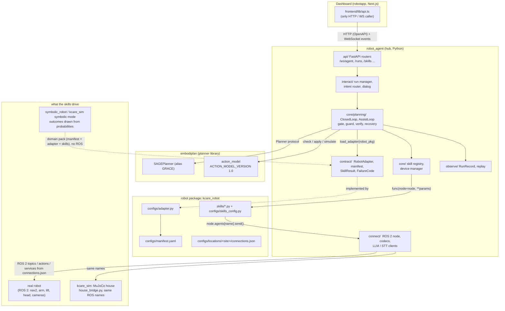
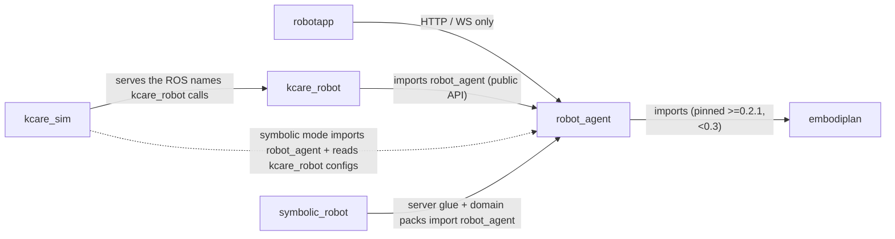

# PLAN-framework: phase 1 of the robot_agent framework site

Part: **framework layer** (orientation, concepts, contracts between repos, guides, satellite overviews) plus a
**high-level list** of the hub's module and reference pages, split into parts A, B, C for later plans
(`website/PLAN-A-loops.md`, `PLAN-B-contract-api-connect.md`, `PLAN-C-observe-interact.md`).

Planned on 2026-11-18, read-only and offline. Nothing in any repo was edited. Code links on the site use
`https://github.com/<owner>/<repo>/blob/<sha>/<path>#L<a>-L<b>`; `<owner>` is the account in each repo's
`git remote get-url origin` (not written here, see the privacy list).

## Planned at (per repo) and the moving parts

| repo | branch | Planned at | dirty working tree seen (writers: these files may differ from the commit) |
|---|---|---|---|
| robot_agent (hub) | main | `ad501cf15ece` | `robot_agent/api/models.py` (adds `RecordingEditIn.prompt`), `robot_agent/core/episodes.py`, `tests/test_episodes.py` |
| embodiplan | docs/website | code at `a69064255c69`; HEAD `8293351291c7` | untracked `website/PLAN.md`. `git diff a690642 HEAD -- embodiplan pyproject.toml` is empty: the code is identical at both commits |
| kcare_robot | main | `d4f5577b342e` | 21 modified files: `configs/skills_config.py` (adds `vla_stack`, `rotatet`; **removes `vla_drawer_open`**), `configs/tasks.py`, `configs/common/{skills,buttons,button_groups}.json`, `skills/{align_shoes,arm,head,recognition,vla}.py`, site configs and map images under `configs/locations/`, egg-info, `tests/test_recorder_prompts.py`; untracked `skills/vla_stack.py`, `skills/_vla_io.py`, `tests/test_vla_stack.py`, `configs/common/poses.json`, map history images |
| robotapp | main | `f30f0b52d969` | 22 modified: `frontend/lib/generated/openapi.json`, `frontend/app/page.tsx`, `frontend/components/{ButtonPanel,DataPanel,DevicePanel,GuidePanel,PlanPanel,RecorderBar}.tsx`, `frontend/lib/{recorder,recordings}.ts`, `frontend/lib/skill_configs.json`, `scripts/test_lib.mjs`, docs (`docs/features/*.md`, `docs/CHANGELOG.md`, `docs/src/content/docs/index.mdx`); untracked `docs/features/vla-stack.md` |
| kcare_sim | main | `4a8d0afd7176` | `sim/config/house_layout.yaml` (88+/226-); untracked `*.bak*` files, `sim/kcare_code.bak-round4/` (ignored, out of scope) |
| symbolic_robot | main (in sync with origin/main, public) | `f55ace24c3b4` | `docs/home/bench/lora.md` |

Scope inside kcare_sim: `git ls-files` only (527 files); `sim/.kcare_venv`, `sim/kcare_code*`, `.venv` ignored.
Not one of the six but referenced: `scenarios` (whole-system tests, robot_agent `docs/testing.md`), `visionserve`
(a kcare_robot dependency, `kcare_robot/pyproject.toml:24`), `robot_template` (robot_agent `Makefile:38` expects
`../robot_template`; not on disk; a different, older `robot_project_template` checkout exists), `base_robot`
(named in robot_agent `docs/guard.md`; not on disk), vla-serve (kcare_sim README).

Size (Python lines, working tree): hub package 28,967 + tests 9,384; kcare_robot package 11,650; embodiplan
6,577; kcare_sim 20,747; symbolic_robot 49,069; robotapp `frontend/` TS/TSX 14,233 (excluding generated).

---

## 1. Audience and promise

Readers:

1. **Robot integrators**: bring a new robot (or a simulator) under robot_agent. They need the contract, the
   manifest, the adapter, the skill signature, and a check that runs before hardware.
2. **Planner researchers**: use or benchmark planners (embodiplan's SAGE, the direct planner, their own) through
   robot_agent, on the symbolic simulator. They need the planner protocol, what the core adds around a planner,
   and where benchmark numbers come from.
3. **The owner's team**: find the current `docs/` hard to follow (dense, codenames, no diagrams, no glossary).

Promise (Home page, one line): **robot_agent is the robot-agnostic brain and API of a robot: you describe a robot
as data, plug in its skills, pick a planner, and the core plans, acts, checks and recovers, the same way on a
real robot, a physics simulation or a symbolic one.**

What goes in and out (two sentences for Home): a person's command (text or speech, any language the robot
declares) goes in through a WebSocket; a plan of abstract actions comes out of a planner, each step is bound to
one of the robot's skills, run, verified against the robot's sensors and the world model, and every step is
streamed back as typed events and kept in a run record that can be replayed offline.

Rules for every page (from `framework-docs.md`, applied here):

- One name per thing. Codenames never title a page: "AssistLoop (codename `sage`)" is defined on first use and
  in the glossary; page titles say "Planning with understanding and checks", not "SAGE-v2".
- Docs in `robot_agent/docs/` are **source material for the reason**, never text to copy. Leave out ticket ids,
  round numbers (`T2`, `R14`, `D7`, `P0.8`, `GR01` ...), and bug history.
- Every cross-repo claim cites both sides (offer and use) with `file:line`.
- Examples come from the offline fake-robot run (section 8), tests, `check_manifest`, or pure calls; anything
  else is labelled "not run" / "not run on a real robot".

---

## 2. System diagram (mermaid draft)

Layer diagram for **Architecture** (and a smaller copy on Home):



Dependency direction for **Repo map** (arrows = "imports or calls"):



---

## 3. Key ideas (for `start/key-ideas.md`; 7 ideas, in reading order)

| # | one-line statement | why it matters | evidence | background (Concepts page) | implementing module (hub page) |
|---|---|---|---|---|---|
| 1 | **The core never names a robot: a robot is data (a manifest) plus one adapter object.** | A new robot is a new package, not a fork of the core; the same loops drive a real robot, a MuJoCo one and a symbolic one. | `contract/adapter.py:47-75` (Protocol); `contract/legacy_adapter.py:215` `load_adapter`; `make lint-core` = 0 hits (run, section 8); kcare manifest loads with 10 skills, 0 errors | C2 | B: contract types, manifest, adapter |
| 2 | **Every skill result becomes one `SkillResult` with a failure code from a fixed list of 13; recovery is a table keyed by that code.** | Retry / ask / replan decisions do not depend on how each robot phrases an error. | `contract/types.py:15-31` (13 codes), `types.py:92-137` `from_legacy`; `core/planning/robot.py:306-325` `run_skill` (the one place); `contract/recovery.py:345-370` | C3 | B: contract types and recovery |
| 3 | **A plan is a list of abstract actions; binding to the robot's skills is a separate step.** | Planners stay robot-agnostic (`MoveTo`, `Find`, `Pick` ...); the adapter decides which skill and which params. | `KaairAdapter.bind({'action':'Pick','object':'cup'})` -> `('pick', {'inputs': 'cup', 'type': 'fine_move'})` (run); `Unbindable` on `Fly` (run) | C1, C2 | A: ClosedLoop / mapper, RobotView |
| 4 | **One action model decides what a step needs and does; the plan gate, the step guard and symbolic verify all ask it.** | The checker and the executor cannot disagree about the rules. | `core/planning/action_model.py:1-8, 30-42` (only importer of `embodiplan.action_model`); `simulate` rejects `[MoveTo kitchen, Pick cup]` with `no_find_before_pick` (run) | C5 | A: action model facade |
| 5 | **The robot's world state is a belief, re-checked against sensors, with a source label per field.** | A plan made on a stale belief fails safely: the guard fixes it before motion. | `core/planning/base.py:49` `WorldState`; `reconcile` event from the fake run: `arrived: null -> entrance`, `source: sensor` (run); `docs/guard.md` for the reason | C4 | A/C: reconcile, sensor health |
| 6 | **Three checks stand between a plan and motion: the whole-plan gate, the per-step guard, the skill's own check; success is declared only after the goals are observed.** | No uncertified plan moves the robot; a reported success is not trusted without verification. | fake run: `gate problems: []` then per-step `step_verify` layers `isdone`, `symbolic`, `localization` / `sensor`, then `goal_check ok: true` (run); `core/planning/verify.py:137-160` | C5 | A: AssistLoop gate and guard; C: verification |
| 7 | **The planner is a plug-in with two methods; the core adds understanding, gating, recovery, recording and replay around any planner.** | Researchers swap planners by name (`package.module:Class`) without editing robot_agent, and benchmark them under the same checks. | `core/planning/base.py:247` `Planner`; `registry.py:72` `resolve_planner('tests.fakes:ScriptedPlanner')` resolves (run); `docs/planners.md` "What the core gives every planner" | C6, C7 | A: planner interface, backends; C: replay |

(Optional 8th if the page stays short: "One active run per robot; whatever someone says during a run is an event
into that run" — `interact/run_manager.py:1`, `api/agent.py:461-465`, intent router examples in C8.)

---

## 4. Background chapters (Concepts, `concepts/*.md`)

Order: from "what is it" to "how it runs for real". Each page: 1-2 screens, an "In this chapter" box, one real
value, one figure, links down to module pages and to the glossary.

### C1. The closed loop of a robot agent: plan, act, verify, recover (`concepts/closed-loop.md`)
- **Teach**: why a robot agent is a loop and not a one-shot plan; the four phases; what "replan" replaces (the
  failed step and everything after it, `docs/planners.md`); the three execution paths a run can take and when:
  open-loop (legacy default when no `planner` is sent, `core/unified_agent.py:363-366`), ClosedLoop (`grace`,
  `direct`, plug-ins), AssistLoop (`sage`, `unified_agent.py:371-372`), plus `run_direct` (structured
  `skill::input` plan, no LLM, `unified_agent.py:466`).
- **Real example**: the fake-robot run (section 8): plan `MoveTo desk@study room, Find apple, Pick apple, MoveTo
  dining table@kitchen, Place dining table@kitchen`; `Find apple` fails (`apple not found`), a `search` event
  ranks places, the planner's `replan` returns a suffix starting `MoveTo counter@kitchen`, run ends `done
  status=success` after `goal_check ok=true`. Skill trace: move, find (fail), move, find, pick, move, place, find
  (the goal check looks again).
- **Figure**: a timeline (swimlanes: planner / core / robot) drawn from the 33 recorded events of that run.
- **Sources**: `robot_agent/core/unified_agent.py`, `robot_agent/core/planning/loop.py`, `robot_agent/core/planning/assist_loop.py`, `tests/fakes.py`, `tests/test_assist_loop_fake_robot.py`.

### C2. One core, many robots: the manifest and the adapter (`concepts/robot-as-data.md`)
- **Teach**: what a manifest declares (skills with `action`, `params` JSON schema, `pre`, `effects`, `verify`,
  `interruptible`, `errors`; `capabilities`; `geometry` in metres; `language(s)`); what the adapter does
  (`bind`, `observe`, `reconcile`, `health`, optional `pose`, `container_states`); how `load_adapter` finds it
  (`configs/adapter.py` first, else the namemap shim, `contract/legacy_adapter.py:215`); `check_manifest`.
- **Real values**: kcare manifest `robot: kaair` (see privacy), `language: ko`, `languages: [ko, en]`, actions
  `Ask Close Find MoveTo Observe Open Pick Place PutIn Query Verify`, geometry `arrive_tol_m 0.3, reach_m 0.78,
  reach_far_m 1.0` plus extras `max_reach_y_m 0.8, frame_max_age_s 2.0, pose_max_age_s 2.0, vlm_min_conf 0.5`
  (`Manifest.from_yaml`, run). The `pick` skill spec (`kcare_robot/configs/manifest.yaml:114-131`): `pre:
  ["found(?inputs)", "hand_empty()"]`, `effects: ["holding(?inputs)", "not found(?inputs)", "not hand_empty()"]`,
  `verify: [{kind: symbolic}, {kind: sensor, skill: grasp_succeed}]`, `interruptible: false`.
  A bad manifest: `ManifestError invalid manifest: skills[0] (p).errors[0]: 'oops' is not a FailureCode (valid: ...)` (run).
  Three robot packs in the system, by `check_manifest` (run): kcare_robot 10 skills 0 errors 0 warnings;
  symbolic_robot home pack 17 skills 0 errors 22 warnings; factory pack 12 skills 0 errors 17 warnings
  (warnings: skill modules outside the pack dir are not inspected).
- **Figure**: manifest -> adapter -> RobotView -> loops, with the `pick` entry annotated.
- **Sources**: `robot_agent/contract/`, `robot_agent/core/planning/robot.py`, `kcare_robot:kcare_robot/configs/manifest.yaml`, `kcare_robot:kcare_robot/configs/adapter.py`, `symbolic_robot:symbolic_robot/domains/home/configs/manifest.yaml`.

### C3. Skills, results and failure codes (`concepts/skills-and-failures.md`)
- **Teach**: a skill is `def skill(node, **params) -> dict` (kcare CLAUDE.md rule 7; called as
  `func(node=node, **params)`, `core/skill_registry.py:227`); internal (imported), external (HTTP), plan skills
  (`skill_registry.py:197-203, 246-275`); the legacy `{'isdone', 'msg'}` dict -> `SkillResult`; text heuristics
  live in one place (`contract/failures.py:101-132`); the recovery table.
- **Real values** (run): `SkillResult.from_legacy({'isdone': False, 'msg': 'gripper is empty'})` -> `ok=False,
  code=grasp_failed`, `to_legacy()` -> `{'isdone': False, 'msg': 'gripper is empty', 'code': 'grasp_failed'}`;
  `from_legacy(None, strict=True)` -> `unknown, 'skill returned nothing'`; `classify_legacy_failure('object out of
  reach')` -> `unreachable`; recovery for `absent`: attempts 1 and 3 -> `continue_search`, attempt 4 -> `ask_help`.
  The 13 codes: absent, perception_unavailable, unreachable, blocked, grasp_failed, dropped, hw_fault, estop,
  timeout, cancelled, software, unknown, budget_exceeded.
- **Figure**: table/flow "code -> first action -> after retries" from `DEFAULT_RECOVERY` (`recovery.py:345-370`).
- **Sources**: `robot_agent/contract/types.py`, `robot_agent/contract/failures.py`, `robot_agent/contract/recovery.py`, `robot_agent/core/planning/robot.py`, `robot_agent/core/skill_registry.py`.

### C4. The belief: what the robot thinks is true, and reconcile (`concepts/belief-and-reconcile.md`)
- **Teach**: `WorldState` fields (`arrived, found, holding, opened, on`, plus `holding_since, found_pose,
  holding_pose, provenance`); only `arrived` is sensor-read on kcare (no gripper/drawer state sensor; reason in
  `docs/guard.md`); persistence (`state.py:162-190`, `world_state.json`); reconcile at start / resume; provenance
  `sensor | operator | belief | unknown`; `GET/PUT /agent/world`.
- **Real values**: `WorldState().as_text()` -> `arrived=- found=- holding=- opened=[-] on=[-]` (run); the fake run's
  `reconcile` event: `changed: {arrived: [null, "entrance"]}`, `sensors.arrived.detail: "0.00 m from entrance"`,
  `provenance.arrived.source: "sensor"` (run).
- **Figure**: belief vs sensor, a diagram of reconcile updating `arrived` and leaving `opened` "unconfirmed".
- **Sources**: `robot_agent/core/planning/base.py`, `robot_agent/core/planning/reconcile.py`, `robot_agent/core/planning/robot.py`, `robot_agent/state.py`, `kcare_robot:kcare_robot/configs/adapter.py`.

### C5. Three checks before a robot moves: gate, per-step guard, skill (`concepts/checks-before-motion.md`)
- **Teach**: plan tidy (drop no-op steps), the certified gate (simulate the whole plan with the action model +
  goal checks; critical findings -> sub-goal repair or one fresh plan; an uncertified plan never runs); the guard
  right before each step; the skill's own precondition failure; after success: layered verify (`isdone` ->
  `symbolic` -> `vlm` -> `sensor` / `localization`, `core/planning/verify.py:137-160`); `goal_check`.
- **Real values** (run): `action_model.simulate([MoveTo kitchen, Pick cup])` -> `ok=False`, `StepViolation(index=1,
  code='no_find_before_pick', reason='Pick requires a preceding Find of the target object')`; adding `Find cup`
  -> `ok=True`, final `holding='cup'`. Fake run `step_verify` of the Pick: layers `isdone ok "grasped"`, `symbolic
  ok`, `sensor ok "grasp_succeed: ok"`; of the failed Find: only `isdone false "apple not found"` (short-circuit).
- **Figure**: the three gates on a horizontal timeline, with where each failure goes (repair, replan, recovery).
- **Sources**: `robot_agent/core/planning/action_model.py`, `robot_agent/core/planning/assist_loop.py` (`_check` :654, `_guard` :1801), `robot_agent/core/planning/plan_tidy.py`, `robot_agent/core/planning/subgoal_repair.py`, `robot_agent/core/planning/verify.py`, `embodiplan:embodiplan/action_model.py`.

### C6. Planners and the loop: ClosedLoop, AssistLoop and embodiplan (`concepts/planners.md`)
- **Teach**: the planner protocol (`generate_plan(task, obs, visible_objects)`, `replan(...)`, both `-> (steps,
  meta)`, `core/planning/base.py:247`); names: `grace` = the ClosedLoop around the built-in `GraceBackend`
  (`registry.py` `_BUILTIN`); `sage` is **not** a planner name (`resolve_planner('sage')` raises, run) but the
  choice of the AssistLoop in `unified_agent.py:359-372`, whose generator defaults to `grace`; embodiplan's
  `GRACEPlanner` is an alias of `SAGEPlanner` (`embodiplan/__init__.py:79-80`) and SAGE expands to "Symbolic
  Action-Gating and Editing planner" (embodiplan site, `planners/sage.md`). So both codenames end up in the same
  embodiplan class; they differ in the loop around it. `llm_direct` = one LLM call producing `skill::inputs`.
  Optional capabilities (`SubgoalRepair`, `ProgressReporting`, `EpisodeMemory`).
- **Real values** (run): `resolve_planner('grace')` -> `GraceBackend`; `'llm_direct'` -> `LlmDirectBackend`;
  `'sage'` -> `ValueError unknown planner 'sage'; available planners: grace, llm_direct (or 'package.module:Class',
  or an entry point in group 'robot_agent.planners')`; `ACTION_MODEL_VERSION` `1.0`; `ROBOT_ACTIONS` (14):
  `Close Find LieOn MoveTo Open Pick Place PutIn Serve Sit TurnOff TurnOn Wait Wash`.
- **Figure**: matrix "loop x planner" (ClosedLoop|AssistLoop x grace|llm_direct|plug-in) with what the core adds.
- **Sources**: `robot_agent/core/planning/base.py`, `robot_agent/core/planning/registry.py`, `robot_agent/core/planning/backends/`, `robot_agent/core/unified_agent.py`, `embodiplan:embodiplan/__init__.py`, `embodiplan:embodiplan/sage.py`.

### C7. Runs and records: observe and replay (`concepts/runs-and-records.md`)
- **Teach**: `run_id` and one active run per robot (`interact/run_manager.py`); RunRecord rows (`header, context,
  event, user, llm, planner, skill, step, health, end, snapshot`, `observe/record.py:1-30`); where they go
  (`ROBOT_AGENT_DATA_DIR`, `observe/paths.py`); replay `plan` and `exec --fake`, exit 0/1/2
  (`observe/replay.py:1-27`); golden tests.
- **Real values**: the fake run wrote `runs/<run_id>.jsonl` with run id `20261118-163831-081` (run; this is the
  planning layer's JSONL logger `core/planning/records.py`, not the RunRecord, which needs the RunManager path:
  "not run"). Replay itself: **not run** (its inputs are recorded runs, see privacy).
- **Figure**: one run's record as a stacked list of row kinds (from the docstring, not from real data).
- **Sources**: `robot_agent/observe/`, `robot_agent/core/planning/records.py`, `robot_agent/interact/run_manager.py`, `tests/test_observe_record_replay.py`, `tests/test_golden_task_runs.py`.

### C8. Talking to the robot: dialog and intent (`concepts/dialog-and-intent.md`)
- **Teach**: the understand call (person's words -> typed goals `on, in, open, close, go, say, deliver`,
  `core/planning/goals.py:33-47`), clarification questions, the robot's questions (`interact/dialog.py`), what
  happens when someone speaks during a run (intent router: STOP, PAUSE, RESUME, MODIFY, ADD, DROP, NEW, STATUS,
  ANSWER, `interact/intent_router.py:28-38`); `POST /agent/listen/{req_id}` for answers; languages from the
  manifest (`core/languages.py`).
- **Real values** (run, no LLM): `IntentRouter().classify('stop')` -> `stop, source keyword, confidence 1.0`;
  `'pause'` -> `pause`; `'also bring a cup'` -> `add, source fallback, 0.5, keyword 'also'`; `'yes'` while a
  question is open -> `answer, source awaiting, 0.9`; `'what are you doing?'` -> `status`. Note: plain
  `keyword_fallback('stop')` gives `new` (control words are matched earlier, in `_control`,
  `intent_router.py:166-178`).
- **Figure**: state diagram of a run (`running, paused, cancelling, done, failed`, `run_manager.py:50-58`) with
  intents on the edges.
- **Sources**: `robot_agent/interact/`, `robot_agent/core/planning/understand.py`, `robot_agent/core/planning/goals.py`, `robot_agent/core/languages.py`.

---

## 5. Modules: the phase-1 pages, entry by entry

Front matter for every page: `sources:` (repo-prefixed; no prefix = hub) and `verified_at:` with the SHAs above
(`robot_agent: ad501cf, embodiplan: a690642, kcare_robot: d4f5577, robotapp: f30f0b5, kcare_sim: 4a8d0af,
symbolic_robot: f55ace2`; list only the repos the page cites).

### 5.1 Orientation

#### O1. Home (`index.md`)
- sources: `README.md`, `robot_agent/app_factory.py`, `robot_agent/core/unified_agent.py`
- Content: promise (section 1); the layer diagram (small); "In one minute" = the **offline** commands that work
  today without ROS (section 8: `make lint-core`, `check_manifest`, the fake-robot run); a "What it takes off
  your hands" table (robot as data; failure codes; certified gate; replay); "Verified so far" (what section 8 ran;
  `make test` **not run** in this planning pass); "Status / not yet" (ROS needed to boot the server,
  `runtime.py:141-148`; the ROS-off switch the simulators expect is missing, finding F1).
- Do not reuse the README's numbers ("~4.2 K LOC, 26 files", "30+ endpoints", "23 production skills"): they are
  outdated (finding F9).

#### O2. Key ideas (`start/key-ideas.md`)
- sources: as in section 3. Content = section 3.

#### O3. Architecture (`start/architecture.md`)
- sources: `robot_agent/api/agent.py`, `robot_agent/core/unified_agent.py`, `robot_agent/core/planning/assist_loop.py`, `robot_agent/core/planning/loop.py`, `robot_agent/core/planning/robot.py`, `robot_agent/core/skill_registry.py`, `robot_agent/connect/ros/node.py`, `robot_agent/core/planning/backends/pyplanner_grace.py`, `robotapp:frontend/app/page.tsx`, `robotapp:frontend/lib/api.ts`, `robotapp:frontend/lib/planView.ts`, `kcare_robot:kcare_robot/configs/adapter.py`, `kcare_robot:kcare_robot/configs/skills_config.py`, `kcare_robot:kcare_robot/skills/mobile.py`, `kcare_sim:sim/scripts/house_bridge.py`, `embodiplan:embodiplan/__init__.py`, `embodiplan:embodiplan/sage.py`
- Content: the layer diagram (section 2); the hub's internal layering rule (`contract <- model <- plan/execute <-
  interact <- api`, `CLAUDE.md` rule 2, link to `docs/rules.md`); **one request end to end** (below); a
  "Decisions, and why" table, reasons taken from `docs/contract.md`, `docs/guard.md`, `docs/planners.md`,
  `docs/action_model_divergence.md` (one action model; adapter not inheritance; failure codes; belief with
  provenance; plug-in planners by name), each row with the rejected alternative those docs name.

**One request end to end** ("Bring the apple from the desk to the dining table", typed in the dashboard,
planner `sage`, kcare_robot driving the MuJoCo house). Lines verified at the commits above; the run itself was
**not run** end to end (no ROS / simulator); steps 4-9 were exercised offline on the fake robot (section 8).

1. Dashboard opens the socket: `robotapp:frontend/app/page.tsx:328` `api.agentWs()` -> `frontend/lib/api.ts:840-842`
   `new WebSocket(${getWsBase()}/ws/agent)`; sends `{prompt, lang, direct, planner, plan_only, log_data, log_mode,
   log_all}` (`page.tsx:331-335`; line numbers from HEAD, the file is dirty).
2. Hub accepts: `robot_agent/api/agent.py:431-455` reads the fields (also `options`, `generator`, `user_id`,
   `role`); `:461` `_runs().start(...)`: one active run per robot (a second client observes, `:462-464`).
3. `agent.py:483-488` -> `core/unified_agent.py:322` `UnifiedAgent.run`: translation to English if `lang != 'en'`
   (`:346-352`); planner choice `:359`; `sage` -> `AssistLoop` (`:371-372`), else `ClosedLoop` (`:366-370`); no
   planner and no `ROBOT_AGENT_CLOSED_LOOP=1` -> open-loop path (`:383-...`).
4. The loop loads the robot: `core/planning/robot.py:60` `RobotView.load` -> `contract/legacy_adapter.py:215`
   `load_adapter('kcare_robot')` -> `kcare_robot:kcare_robot/configs/adapter.py:224` `make_adapter()` (the adapter
   class at `:87` reads `configs/manifest.yaml`).
5. `AssistLoop.run_blocking` (`core/planning/assist_loop.py:951`): reconcile (`:1766`), understand -> goals,
   plan from the generator: `core/planning/backends/pyplanner_grace.py:222-229` -> embodiplan `get("GRACE")`
   (`pyplanner_grace.py:219-220`) = `SAGEPlanner` (`embodiplan:embodiplan/__init__.py:79-80`, class at
   `embodiplan/sage.py:334`, `generate_plan` `:560`).
6. Gate: `assist_loop.py:654` `_check` -> `core/planning/action_model.py:40-42` `simulate` ->
   `embodiplan:embodiplan/action_model.py:422`. Event `gate`.
7. Per step: guard (`assist_loop.py:1801`), bind (`robot.py:99` -> `legacy_adapter.py:87`; real value: `MoveTo
   kitchen` -> `('move', {'inputs': 'kitchen'})`), run: `robot.py:306-325` `run_skill` ->
   `core/skill_registry.py:180` `execute` (recorded) -> `:218-227` `importlib.import_module(...)`,
   `func(node=node, **params)`.
8. The skill: `kcare_robot:kcare_robot/configs/skills_config.py:35` `'move': (kcare_robot.skills.mobile, 'move')`
   -> `skills/mobile.py:86` `move` -> `:182` `moveb` -> `:41` `node.agents['mobile_move'].send({...x, y, qx..qw,
   wait})` -> hub `connect/ros/node.py:301, 316` `ActionClientAgent.send`.
9. The wire: kcare site `connections.json` entry `mobile_move`: `conn_type ros_action`, `conn_name
   /navigate_to_pose`, `data_interface nav2_msgs/action/NavigateToPose` (read, values only; no hosts) ->
   simulator side `kcare_sim:sim/scripts/house_bridge.py:722` action server `'/navigate_to_pose'`; the pose comes
   back on `/robot_pose/mobile_pose` (`house_bridge.py:704-705`, `PoseStamped`), read by kcare's `mobile_pose`
   skill (`skills/mobile.py:24-31`) and by the adapter's `pose()` (`configs/adapter.py:111-137`).
10. Back up: return dict -> `SkillResult.from_legacy(strict=True)` (`contract/types.py:92`) -> `StepVerifier.verify`
    (`core/planning/verify.py:137`) -> events `step_verify`, `step_done` -> `agent.py:489-500` `run.publish` +
    `_serialize_result` -> dashboard `robotapp:frontend/lib/planView.ts:118, 136, 163, 178` (`plan`,
    `step_start`, `step_done`, `goal_check`).
11. End: `done` event; `agent.py:516-518` `_runs().finish(...)`; record kept (`observe/record.py`).

#### O4. Glossary (`start/glossary.md`)
- sources: `robot_agent/contract/`, `robot_agent/core/planning/`, `robot_agent/interact/`, `robot_agent/observe/`, `docs/`
- One table, alphabetical, columns `Term | Plain meaning | Also called | Where explained`. Writers verify each
  meaning against the cited code before publishing; the list below is the minimum (collected from code and
  `docs/`; GRACE appears 61 times in `robot_agent/docs/*.md`):

| term | plain meaning (draft) | also called / code name | evidence |
|---|---|---|---|
| action (abstract action) | a robot-independent step verb a planner uses: MoveTo, Find, Pick, Place, PutIn, Open, Close, Say, Ask ... | plan action | `contract/types.py:192`, `action_model.ROBOT_ACTIONS` |
| action model | the one set of rules saying what each action needs and changes; used by gate, guard, verify | `embodiplan.action_model`, ACTION_MODEL_VERSION | `core/planning/action_model.py:1-8` |
| ACTION_MODEL_VERSION | version string of those rules, `"1.0"`; must match between hub and embodiplan | | `embodiplan/action_model.py:29`, `tests/test_action_model_agreement.py:285-287` |
| adapter (RobotAdapter) | the one object a robot package gives the core: binds steps to skills, observes, reconciles, reports health | `configs/adapter.py` | `contract/adapter.py:47` |
| announcer | the part that turns plan progress into spoken phrases | | `core/planning/announcer.py` |
| AssistLoop | the loop that adds understanding, clarification, the certified gate and a per-step guard around a planner | codename `sage`, "SAGE-v2" in docs | `core/planning/assist_loop.py:298` |
| belief | what the robot assumes is true but has not just measured | world state, `WorldState` | `core/planning/base.py:49` |
| bind / binding | turning an abstract step into `(skill, params)` for this robot | `Unbindable` when impossible | `contract/adapter.py:53-57` |
| budget (LLM-call budget) | max LLM calls a run may make; running out is failure `budget_exceeded` | `llm_budget` | `core/planning/budget.py`, `types.py:31` |
| certified gate | check of the whole plan before motion; a plan with critical findings never runs | gate | `docs/guard.md`, `assist_loop.py:654` |
| clarify | the robot asks the person a question before planning | | `api/events.py` (`clarify`) |
| ClosedLoop | the plain plan -> act -> check -> replan loop around any planner | codename `grace` (as a run's planner choice) | `core/planning/loop.py:242` |
| codec | a named function that encodes/decodes a device message (`codec:<name>`); inline code strings are deprecated | `encode_func`, `decode_func` | `connect/codecs.py:1-25` |
| connections.json | per-site list of device connections (ROS topics/actions/services, TCP, LLM servers) | devices | `kcare_robot/configs/locations/<site>/` |
| device agent | one named connection inside the ROS node (`node.agents['mobile_move']`) with `get` / `send` | NodeAgent | `connect/ros/node.py:93` |
| direct planner | one LLM call producing a `skill::inputs` program | `llm_direct`, planner `direct` | `backends/llm_direct.py`, `core/planning/direct_prompt.py` |
| domain / domain pack | (symbolic_robot) a simulated world type plus its robot_agent package | `home`, `factory` | `symbolic_robot/docs/architecture.md` |
| embodiplan | the planner library robot_agent uses | | `embodiplan/` |
| ENV | the site's table of places (keys like `table@living room`) with coordinates and aliases | places | `skill_configs.py:94`, `env_names.py` |
| episode (VLA) | one recorded teleoperation sequence for policy training | raw episode | `core/episodes.py`, `api/recordings.py` |
| FailureCode | why a skill failed, one of 13 shared codes | code | `contract/types.py:15-31` |
| goal (typed goal) | what the person wants, as `on / in / open / close / go / say / deliver` | | `core/planning/goals.py:33-47` |
| goal check | success is declared only when goals are observed to hold | `goal_check` event | `assist_loop.py:1708` |
| GRACE | in robot_agent: the built-in planner name of the ClosedLoop (`GraceBackend`); in embodiplan: an alias of SAGEPlanner | `grace` | `registry.py` `_BUILTIN`, `embodiplan/__init__.py:79-80` |
| grace_namemap | older per-robot module of name maps and param builders, wrapped by `NamemapAdapter` | namemap | `contract/legacy_adapter.py:34` |
| guard (per-step guard) | check of one step's preconditions on the current belief right before it runs | | `assist_loop.py:1801` |
| health / sensor health | adapter's report of frame age, pose age etc.; stale sensors block trust | | `core/planning/sensor_health.py`, `contract/adapter.py:72` |
| intent | what someone's words during a run mean: stop, pause, resume, modify, add, drop, new, status, answer | intent router | `interact/intent_router.py:28-38` |
| interruptible | a skill that may be stopped mid-way; `false` = finish or release safely first | | `contract/types.py:198` |
| manifest | the robot's `configs/manifest.yaml`: skills, capabilities, geometry, languages | | `contract/manifest.py` |
| memory (seed / live) | example plans a planner retrieves; seed = shipped by the robot, live = learned from successful runs | `seed_memory.jsonl`, episode memory | `docs/memory.md`, `core/planning/episode_memory.py` |
| open-loop path | legacy path: one LLM plan, steps run without re-planning | | `core/unified_agent.py:383-...` |
| plan skill | a skill defined as a plan of other skills (data, not code) | `type: plan` | `core/plan_skill.py` |
| plan tidy | removing steps the action model proves do nothing | | `core/planning/plan_tidy.py` |
| presence | heartbeat file saying which machine runs the robot package on which site | | `presence.py` |
| provenance | per-field source of the belief: sensor, operator, belief, unknown | | `core/planning/base.py`, `docs/guard.md` |
| reconcile | bringing the belief in line with sensors at run start / resume | | `core/planning/reconcile.py` |
| recovery policy | table: failure code -> what to do first, then after retries | RecoveryRule | `contract/recovery.py:345` |
| replan | asking the planner for a new suffix after a failure | | `base.py:247` (`replan`) |
| replay | re-running a recorded run offline with recorded LLM / skill answers | | `observe/replay.py` |
| run / run_id | one execution of one command, with its own id; one active run per robot | RunManager | `interact/run_manager.py` |
| RunRecord | one JSONL file of everything a run did | record | `observe/record.py` |
| RobotView | the robot as the loops see it (wraps the adapter) | | `core/planning/robot.py:48` |
| SAGE | embodiplan's planner "Symbolic Action-Gating and Editing"; in robot_agent `sage` selects the AssistLoop | SAGE-v2 (docs) | embodiplan site `planners/sage.md`, `unified_agent.py:371` |
| site (location) | one deployment place with its own connections, overrides and map | location | `api/locations.py`, `state.py` |
| skill | a robot function `skill(node, **params) -> dict` | internal / external / plan | `core/skill_registry.py` |
| SkillResult | normalised skill outcome: `ok, code, msg, device, data` | | `contract/types.py:61` |
| SkillSpec | one skill as the manifest declares it | | `contract/types.py:189` |
| spoken names | `said->real` names in plans so the robot can say the user's word | | `spoken.py` |
| SubgoalRepair | optional planner capability: repair only the failing sub-goal block | | `docs/planners.md`, `subgoal_repair.py` |
| symbolic simulator | a robot whose skills draw outcomes from declared probabilities over a symbolic world | symbolic mode, `truth` | `symbolic_robot/README.md`, `kcare_sim/README.md` |
| truth | (symbolic sims) what really happened in a call; hidden from the robot | | `symbolic_robot/docs/architecture.md` |
| verify layers | post-success checks: `isdone`, `symbolic`, `vlm`, `sensor`, `localization` | VerifySpec | `core/planning/verify.py:137-160` |
| VLA | vision-language-action policy (here: drawer opening, stacking) | SmolVLA, vla-serve | `kcare_sim/README.md`, `kcare_robot/skills/vla*.py` |

#### O5. Run the whole system (`start/run-the-system.md`)
- sources: `robot_agent:pyproject.toml`, `robot_agent:Makefile`, `robot_agent/runtime.py`, `robot_agent/app_factory.py`, `kcare_robot:Makefile`, `kcare_robot:kcare_robot/main.py`, `kcare_robot:pyproject.toml`, `robotapp:Makefile`, `kcare_sim:README.md`, `kcare_sim:Makefile`, `kcare_sim:sim/README.md`, `symbolic_robot:README.md`, `symbolic_robot:Makefile`
- Content: a table per mode (real robot | MuJoCo house | symbolic), each row = what starts, in order, with the
  command and what success looks like. **Every command on this page is "not run" in this pass**; the writer runs
  what can run offline and labels the rest.

| order | piece | needs | start command (from the repo) | evidence |
|---|---|---|---|---|
| 1 | embodiplan | Python; local path package, not on PyPI | `pip install -e ../embodiplan` | `robot_agent/pyproject.toml:19-24` |
| 2 | robot_agent | Python, `numpy==1.26.4` (ROS ABI), ROS 2 sourced (`rclpy` imported by `bootstrap`) | `pip install -e .` (or `make install`); no entry point of its own | `pyproject.toml:13-25`, `runtime.py:141-148`, `app_factory.py:12-13` |
| 3 | an LLM server | Ollama / OpenAI-compatible, configured as `llm` entries in the site's `connections.json` | (site config) | `connect/llm/__init__.py`; kcare site lists 3 `llm` entries (names only read) |
| 4a | kcare_robot (real robot) | ROS 2 + colcon workspace (`rosinterfaces`), `visionserve`, site `.env` | `make install`, `make run` -> `uvicorn kcare_robot.main:app --port 8001`; checks `make doctor`, `make smoke-live` | `kcare_robot/Makefile:609-610`, `main.py:29`, `CLAUDE.md` |
| 4b | kcare_sim MuJoCo house | docker container with ROS 2 Humble, GPU EGL; kcare_robot site profile `sim_house` made by `make_kcare_sim_location.py` | `sim/README.md` "Running it"; bridge `python3 scripts/house_bridge.py` inside the container | `house_bridge.py:1-30`, `make_kcare_sim_location.py:1-20` |
| 4c | symbolic (kcare_sim) | robot_agent with `ROBOT_AGENT_ROS=off` (missing, F1), kcare_robot configs | `make run SIM=symbolic PORT=8001` | `kcare_sim/README.md`, `kcare_sim/Makefile:96` |
| 4d | symbolic_robot | same switch; `pip install -e .[server]` | `make run ROBOT=home PORT=8121` | `symbolic_robot/README.md`, `Makefile:33` |
| 5 | robotapp | Node, `frontend/node_modules` | `make install-frontend`, `make run-frontend` (port 3007); add the backend URL as a robot in the UI | `robotapp/Makefile:14-18`, `frontend/lib/api.ts:11-61` |

- Include: the safety notes the repos give (robotapp rules 7-8: two clients on one robot is unsafe; ask before
  motion; kcare `CLAUDE.md`: runs on a real robot). Link, do not restate.

#### O6. Repo map and versions (`start/repo-map.md`)
- sources: `robot_agent:pyproject.toml`, `kcare_robot:pyproject.toml`, `embodiplan:pyproject.toml`, `embodiplan:embodiplan/action_model.py`, `robot_agent/api/events.py`, `robotapp:scripts/gen_types.sh`, `robotapp:frontend/lib/generated/openapi.json`, `symbolic_robot:pyproject.toml`
- Table (from the template `assets/framework/repo-map.md`):

| repo | role | depends on | language | docs | checked against |
|---|---|---|---|---|---|
| robot_agent | the brain and API: contract, loops, run manager, observe, connect | embodiplan | Python | this site; `docs/` (contributor notes) | `ad501cf` |
| embodiplan | task planner library (SAGE and baselines; the action model) | none of these | Python | own site (`website/`, 20 pages; `site_url` in `embodiplan/website/mkdocs.yml:3`; PR pending) | `a690642` (HEAD `8293351` docs only) |
| kcare_robot | skills and config of one mobile manipulator; runs on the real robot | robot_agent, visionserve, embodiplan (extra) | Python | `docs/` in repo (no site) | `d4f5577` |
| robotapp | dashboard for any robot_agent backend | robot_agent's HTTP/WS API only | TypeScript (Next.js 14) | own site (Astro/Starlight, `docs/astro.config.mjs:29-30`) | `f30f0b5` |
| kcare_sim | MuJoCo house with the robot's ROS 2 names; VLA drawer-opening training and evaluation | kcare_robot (ROS names), robot_agent (symbolic mode only) | Python | own site (`website/mkdocs.yml:3`) | `4a8d0af` |
| symbolic_robot | symbolic simulator engine (home, factory) + planner benchmark suites | robot_agent (server glue, packs, in-process bench), embodiplan (bench planners) | Python | `docs/` in repo (no site) | `f55ace2` |

Version compatibility table:

| consumer | needs | declared in | checked by |
|---|---|---|---|
| robot_agent | `embodiplan>=0.2.1,<0.3` (core dependency **and** `[grace]` extra) | `robot_agent/pyproject.toml:24, 59` | `tests/test_action_model_agreement.py:285-287` (pin regex + same ACTION_MODEL_VERSION) |
| robot_agent | `numpy==1.26.4` | `pyproject.toml:17` | none found |
| kcare_robot | `robot_agent` (no version), `visionserve`, `numpy==1.26.4`, `opencv-python<5`; extra `planner`: `embodiplan>=0.2.1,<0.3` | `kcare_robot/pyproject.toml:22-35` | `make install` checks the pin (comment `:34`) - not run |
| embodiplan | provides 0.2.5, `ACTION_MODEL_VERSION = "1.0"` | `embodiplan/pyproject.toml:7`, `embodiplan/__init__.py:57`, `action_model.py:29` | its own rule 2 (bump on rule change) |
| robotapp | the OpenAPI snapshot `frontend/lib/generated/openapi.json` (66 paths, `info.version 0.1.0`) | `scripts/gen_types.sh`, `scripts/dump_openapi.py:16-17` | `scripts/lint.mjs:1-12` (endpoints in `api.ts` exist in the snapshot) |
| robotapp | `/ws/agent` events: no pin; `EVENT_SCHEMA_VERSION '1.0.0'` exists but is not consumed | `robot_agent/api/events.py:26` | none (finding F3) |
| kcare_sim, symbolic_robot | a robot_agent "with the `ROBOT_AGENT_ROS=off` switch"; no version | `kcare_sim/symbolic/serve.py:9,56`, `symbolic_robot/symbolic_robot/server.py:4,74`, `symbolic_robot/Makefile:33` | `symbolic_robot/tests/test_server.py:10-33` (skips when robot_agent is absent) |
| kcare_sim | ROS names and types of the real robot (`kaair_msgs`, `/kaair_worker/*`, `/navigate_to_pose`, `/robot_pose/*`) | `kcare_sim/sim/scripts/robot_interfaces.py`, `docs/external_contract.md` | `symbolic/tests/test_robot_interfaces.py` |
| robot_agent itself | SemVer for the contract, manifest format, event schema (CHANGELOG header) | `CHANGELOG.md:1-4` | `version = "0.1.0"`, CHANGELOG has only "Unreleased": no released contract version yet |

### 5.2 Contracts between repos (`contracts/*.md`) - the most valuable part

Each page: "Both sides" table (offer | use, file:line), "What crosses" (fields, types, real example), "Version
and pin", "What breaks when it changes" (real cases only), "How to check" (command), diagram.

#### K0. Contracts overview (`contracts/index.md`)
- sources: the union of K1-K4. One diagram with the four contracts as labelled edges; one table linking them.

#### K1. Dashboard <-> core: HTTP (OpenAPI) and WebSocket events (`contracts/dashboard-api.md`)
- sources: `robot_agent/app_factory.py`, `robot_agent/api/agent.py`, `robot_agent/api/events.py`, `robot_agent/api/models.py`, `robot_agent/core/unified_agent.py`, `robotapp:frontend/lib/api.ts`, `robotapp:frontend/app/page.tsx`, `robotapp:frontend/lib/planView.ts`, `robotapp:frontend/lib/chatRun.ts`, `robotapp:scripts/gen_types.sh`, `robotapp:scripts/dump_openapi.py`, `robotapp:scripts/lint.mjs`, `robotapp:frontend/lib/generated/openapi.json`, `robotapp:docs/features/backend-contract.md`
- Both sides:

| | offer (robot_agent) | use (robotapp) |
|---|---|---|
| HTTP routes | 17 routers mounted in `app_factory.py:73-89, 130-132`; response models `api/models.py` | only `frontend/lib/api.ts` calls HTTP (robotapp `CLAUDE.md` rule 1; `scripts/lint.mjs:9-10`) |
| route list for types | the app itself | `scripts/dump_openapi.py:16-17` mounts its **own copy** of 16 router names (no `events`) |
| start a run | `api/agent.py:431-455` reads `prompt, lang, direct, planner, plan_only, log_data, log_mode, log_all, options, generator, user_id, role` | `frontend/app/page.tsx:331-335` sends `prompt, lang, direct, planner, plan_only, log_data, log_mode, log_all` |
| events | 27 event models (`api/events.py`, `GET /schema/events`, version `1.0.0`); emitters: loops via `r.ev(...)`, open-loop via `emit({...})` (`unified_agent.py:342-460`) | handlers in `frontend/lib/planView.ts` (`plan` :118, `step_start` :136, `step_done` :163, `goal_check` :178) and `chatRun.ts` |
| stop / answers | `POST /agent/cancel` (`agent.py:201`), `POST /runs/{id}/cancel|pause|resume|inject` (`:296-315`), `POST /agent/listen/{req_id}` (`:155`) | `docs/features/cancel-stop.md`, `hri-voice.md` (link) |

- Real example of the event stream (from the fake run, section 8): `task_start, reconcile, status, understand,
  status, gate, plan, step_start, step_verify, step_done, ..., search, replan, ..., goal_check, done`.
- Breaks when it changes (evidence-based): a new router is invisible to the lint check until
  `dump_openapi.py:16-17` is edited by hand (already the case for `events`, F2); an event the loops emit but the
  schema does not list (`goal_change, understand_check, reconcile, task_resumed, search, health, goal_check`,
  found by grep of `r.ev("...")` in `core/planning/*.py`, F3) has no generated type; field names differ between
  paths (`step`/`task` in open-loop vs `index`/`action` in loops, `api/events.py:11-12`).
- How to check: `make gen-types ROBOT_AGENT_DIR=../robot_agent` then `make ci` in robotapp (not run: needs
  fastapi and node_modules).
- Link (do not rewrite): robotapp site and `docs/features/backend-contract.md`.

#### K2. Robot package <-> core: RobotAdapter, manifest, skills (`contracts/robot-package.md`)
- sources: `robot_agent/contract/`, `robot_agent/runtime.py`, `robot_agent/app_factory.py`, `robot_agent/core/skill_registry.py`, `robot_agent/core/planning/robot.py`, `robot_agent/api/skills.py`, `robot_agent/skill_configs.py`, `kcare_robot:kcare_robot/main.py`, `kcare_robot:kcare_robot/configs/adapter.py`, `kcare_robot:kcare_robot/configs/manifest.yaml`, `kcare_robot:kcare_robot/configs/skills_config.py`, `kcare_robot:kcare_robot/configs/grace_namemap.py`, `kcare_robot:kcare_robot/skills/_recognition_helpers.py`, `kcare_robot:CLAUDE.md`, `symbolic_robot:symbolic_robot/domains/home/configs/`, `symbolic_robot:symbolic_robot/domains/factory/configs/`
- What a robot package must provide (table): `<pkg>/main.py` calling `create_app(robot_pkg=..., config_dir=...)`
  (`kcare_robot/main.py:29` <- `app_factory.py:50`); `configs/skills_config.py: SKILL_CONFIGS = {name: (module,
  func)}` (`kcare_robot/configs/skills_config.py:3` <- `runtime.py:192-201`, `skill_registry.py:334-345`);
  `configs/manifest.yaml` (<- `contract/manifest.py:109`); `configs/adapter.py` with `make_adapter()` / `ADAPTER` /
  `Adapter` (<- `legacy_adapter.py:215`; kcare `adapter.py:224`); `configs/locations/<site>/connections.json`,
  `skill_configs_override.json`, `.env` (secrets, gitignored); skills `def skill(node, **params) -> dict`.
- What crosses: `bind(step, world) -> (skill, params) | None | raise Unbindable` (real values above); skill return
  dict -> `SkillResult`; `pose(node) -> {x, y, yaw?, ts?}` (kcare `adapter.py:111-137`); `health()`.
- Version and pin: none machine-checked (kcare depends on unversioned `robot_agent`); the check is
  `python -m robot_agent.contract.check_manifest <pkg>` (kcare: `0 error(s), 0 warning(s)`, run) and kcare's
  tests `tests/test_manifest.py`, `test_adapter*.py`.
- Breaks (real): skills present in `skills_config.py` but the registry ignores them at boot when
  `configs/common/skills.json` exists (`runtime.py:194-195`) until `POST /skills/reload` (`api/skills.py:44-70`)
  (F6); kcare imports one robot's object lists from the hub (`robot_agent/skill_configs.py:104-110` <-
  `kcare_robot/skills/_recognition_helpers.py:22`) (F5); private imports from robot_agent are forbidden by kcare
  rule 1 (link to `kcare_robot/docs/rules.md`, allow-list there).
- Second example: symbolic_robot's packs are robot packages too (home 17 skills, factory 12; `check_manifest`
  numbers above), with no ROS: show the table "kcare vs home pack" (manifest `robot`, skills, `capabilities`).

#### K3. Robot package <-> hardware or simulator (`contracts/robot-and-simulators.md`)
- sources: `robot_agent/connect/ros/node.py`, `robot_agent/connect/ros/configs.py`, `robot_agent/connect/codecs.py`, `robot_agent/core/device_manager.py`, `kcare_robot:kcare_robot/skills/mobile.py`, `kcare_robot:kcare_robot/configs/locations/`, `kcare_sim:sim/scripts/house_bridge.py`, `kcare_sim:sim/scripts/robot_interfaces.py`, `kcare_sim:docs/external_contract.md`, `kcare_sim:sim/scripts/make_kcare_sim_location.py`, `kcare_sim:symbolic/serve.py`, `symbolic_robot:symbolic_robot/server.py`, `symbolic_robot:docs/architecture.md`
- Three ways the same skills reach a body:
  1. **Real robot**: skill -> `node.agents[name]` -> ROS 2 (`connections.json` names and types).
  2. **MuJoCo house (kcare_sim)**: the same names served by `house_bridge.py` (topics, actions, services listed
     in its docstring `:9-28`); names fixed in `robot_interfaces.py`, reason in `docs/external_contract.md`
     ("renaming them in the sim alone would break both the sim-to-real switch and kcare_robot"); a kcare site
     profile made for the sim by `make_kcare_sim_location.py` (copies the real site's ROS connections,
     re-points AI servers, replaces ENV with the house's spots).
  3. **Symbolic** (kcare_sim symbolic mode, symbolic_robot): no ROS; the server replaces the ROS node by a stub
     with agents `mobile_pose`, `sim_world`, `sim_command` (`symbolic_robot/server.py:55-69, 144-149`) and
     registers simulated skills; outcomes from YAML profiles with `source` labels.
- What crosses (table, one real row each): `mobile_move` | `ros_action` | `/navigate_to_pose` |
  `nav2_msgs/action/NavigateToPose` | sim `house_bridge.py:722`; `mobile_pose` | `ros_topic` |
  `/robot_pose/mobile_pose` | `geometry_msgs/msg/PoseStamped` | sim `:704-705`; arm/lift/head actions under the
  maker's namespace (`docs/external_contract.md` table).
- Codecs: inline `encode_func`/`decode_func` source strings are deprecated (`connect/codecs.py:11-16`); the kcare
  site checked has **39** inline entries (`python -m robot_agent.connect.codecs --scan`, run) (F8).
- Breaks (real): the ROS-off switch the symbolic servers need is not in robot_agent (F1); kcare's
  `vla_drawer_open` skill (the one kcare_sim's README says calls the trained drawer policy) is removed in the
  kcare working tree (F10).

#### K4. Planner library <-> core: planner protocol, action model, pins (`contracts/planner-library.md`)
- sources: `robot_agent/core/planning/base.py`, `robot_agent/core/planning/registry.py`, `robot_agent/core/planning/backends/pyplanner_grace.py`, `robot_agent/core/planning/backends/examples.py`, `robot_agent/core/planning/action_model.py`, `robot_agent:pyproject.toml`, `tests/test_action_model_agreement.py`, `tests/test_v2_planner_plugin.py`, `embodiplan:embodiplan/__init__.py`, `embodiplan:embodiplan/action_model.py`, `embodiplan:embodiplan/sage.py`, `embodiplan:embodiplan/memory_retriever.py`, `embodiplan:pyproject.toml`, `embodiplan:CLAUDE.md`, `symbolic_robot:bench/suites/home/planners/robot_agent_adapter.py`
- Both sides: rule 3 of the hub (`CLAUDE.md`): embodiplan is imported only in `core/planning/backends/` and
  `core/planning/action_model.py` (grep confirms: `backends/pyplanner_grace.py:141,157,192,262`,
  `backends/examples.py:67`, `action_model.py:21`; `observe/replay.py:418` only calls `planner_available`).
  embodiplan rule 1: keep `__all__` backwards compatible within 0.x.
- What crosses: `embodiplan.get("GRACE", **selected)` (`pyplanner_grace.py:219-220`) with kwargs filtered to
  `_GRACE_KWARGS`; `generate_plan/replan` returning `(steps, metrics)`; SAGE extras `last_blocks`, `flatten`,
  `edit_block`, `retrieve_examples`, `progress`, `record_episode`; action model `check / apply / simulate`,
  `Capabilities`, `Violation`, `ROBOT_ACTIONS`, `ACTION_MODEL_VERSION`.
- Pins: `>=0.2.1,<0.3` (`pyproject.toml:24, 59`, kcare `pyproject.toml:35`); provided 0.2.5; the agreement test
  asserts the pin and the same ACTION_MODEL_VERSION (`tests/test_action_model_agreement.py:285-287`).
- Breaks: a rule change in embodiplan without a version bump changes gate/guard/verify at once (by design, one
  source); the in-process benchmark of symbolic_robot drives robot_agent by replacing module globals
  (`state.current`, `assist_loop.current`, `loop.current`, `host_id`, `skill_configs.ENV`,
  `connect.llm.init_llm_client`; `robot_agent_adapter.py:1-17`): a rename inside robot_agent breaks it (F7).
- Link the embodiplan site for planner internals (planners/sage.md, reference/action-model.md,
  reference/interface.md); do not rewrite them.

### 5.3 Guides (`guides/*.md`)

#### G1. Add a new robot (`guides/add-a-robot.md`) - template `assets/framework/guide-add-robot.md`
- sources: `robot_agent/new_robot.py`, `robot_agent/new_skill.py`, `robot_agent/contract/`, `robot_agent/runtime.py`, `robot_agent/app_factory.py`, `tests/fakes.py`, `tests/fakebot/`, `kcare_robot:kcare_robot/configs/`, `symbolic_robot:symbolic_robot/domains/factory/configs/`, `symbolic_robot:docs/domains.md`
- Steps:
  1. What the hub expects (link K2's table).
  2. Smallest package: two routes exist and the guide must say which it uses: `python -m robot_agent.new_robot
     <pkg> --from kcare_robot --reset-sites --blank-configs` (fork; `new_robot.py:1-40`, default `--from
     kcare_robot` at `:203`), or the `robot_template` cookiecutter (`Makefile:38, 155`; **not on disk**: open
     question Q4). The smallest *complete* example on disk is symbolic_robot's factory pack
     (`domains/factory/configs/`: `adapter.py, backend.py, manifest.yaml, ra_skills.py, skills_config.py,
     tasks.py`).
  3. Describe the robot: write `manifest.yaml`; run `check_manifest` until `0 error(s)` (show the real
     `ManifestError` text from C2).
  4. Write one skill (link G2).
  5. Run against a fake robot **without ROS**: the in-process route used by robot_agent's tests (`tests/fakes.py`
     FakeRobot + `tests/conftest.py` `make_assist`) and by the script in section 8; success = `done
     status=success` and the skill trace. The HTTP server cannot start without ROS today (`runtime.py:141-148`);
     say so.
  6. Before hardware: `make lint-core` (hub stays clean), the package's tests, then on the robot the package's
     `doctor` / `smoke-live` equivalents (kcare Makefile targets; not run).
  7. Common errors (real): `Unbindable no skill for action 'Fly' on object 'x' on robot 'kaair'` (run);
     `ManifestError ... is not a FailureCode`; skills.json shadowing SKILL_CONFIGS (F6); `ERROR: ROS2 not found.
     Source /opt/ros/*/setup.bash before running.` (`runtime.py:146`).
- Success criteria: `check_manifest` 0 errors; a scripted AssistLoop run on the new package's adapter ends
  `success`; `make lint-core` total 0.
- Open: the guide needs one tiny reference package that passes `check_manifest` and runs in the fake loop.
  `tests/fakebot` does not (it has no `skills_config.py`; `check_manifest tests/fakebot` gives errors "not in the
  skill registry", run). Q4.

#### G2. Add a skill (`guides/add-a-skill.md`)
- sources: `robot_agent/new_skill.py`, `robot_agent/core/skill_registry.py`, `robot_agent/api/skills.py`, `robot_agent/runtime.py`, `robot_agent/skills/__init__.py`, `robot_agent/contract/types.py`, `robot_agent/contract/check_manifest.py`, `kcare_robot:CLAUDE.md`, `kcare_robot:kcare_robot/skills/template.py`, `kcare_robot:kcare_robot/configs/manifest.yaml`
- Steps: scaffold `python -m robot_agent.new_skill <pkg> <name> [--template detect]` (`new_skill.py:1-24`, inserts
  into `SKILL_CONFIGS`, refuses duplicates `:18, 287-292`); write the function (signature, `node=` passed on,
  return `isdone`/`msg`, or `SkillResult`; prefer a `code`); add a `SkillSpec` if the planner should use it
  (kcare rule 2); `check_manifest`; load it: restart **and** `POST /skills/reload` when `skills.json` exists
  (F6); test from CLI (`<pkg> name::input`, `cli.py:1-20`) or `POST /skill/{name}`.
- Note from code (not run): reload rebuilds from SKILL_CONFIGS and keeps plan skills and aliases
  (`api/skills.py:56-69`); skills registered only via `POST /skills` (external) are not in that list: writer must
  verify before stating what happens to them.

#### G3. Add a planner (`guides/add-a-planner.md`)
- sources: `robot_agent/core/planning/base.py`, `robot_agent/core/planning/registry.py`, `robot_agent/core/unified_agent.py`, `docs/planners.md`, `tests/test_v2_planner_plugin.py`, `tests/fakes.py`, `symbolic_robot:bench/suites/home/planners/`
- Steps: class with `generate_plan` / `replan`; select by `package.module:Class` (`ROBOT_AGENT_SAGE_GENERATOR`, or
  `/ws/agent` `planner` for ClosedLoop, `generator` with `planner: "sage"`) or entry point group
  `robot_agent.planners`; constructor kwargs the core passes (`registry.accepted_kwargs`, `:105`); optional
  capabilities; run it on the fake robot (section 8 script with `ScriptedPlanner` replaced); benchmark on
  symbolic_robot (G5).
- Real value: `resolve_planner('tests.fakes:ScriptedPlanner')` -> `(ScriptedPlanner, False)` (run).

#### G4. Debug a failed run (`guides/debug-a-failed-run.md`)
- sources: `robot_agent/observe/`, `robot_agent/api/agent.py`, `robot_agent/api/diagnostics.py`, `robot_agent/diagnose.py`, `robot_agent/contract/failures.py`, `robot_agent/contract/recovery.py`, `robot_agent/core/planning/verify.py`
- Steps: read the event stream (which event failed: `gate` problems, `step_verify` layer, `recover`, `error`);
  `GET /runs/{id}`, `/runs/{id}/record`, `/runs/{id}/metrics` (`agent.py:251-285`); `GET /diagnostics`,
  `/diagnostics/boot`; map the failure code to the recovery rule (C3 table); replay offline `python -m
  robot_agent.observe.replay plan|exec --fake <run>` (exit codes 0/1/2); `ROBOT_AGENT_DEBUG_RESPONSE=1` for
  tracebacks in skill errors (`skill_registry.py:238-245`).
- Examples must come from the fake run (failed Find, `apple not found` -> `absent` -> search -> replan) or a
  fresh scripted failure; **never** from recorded robot runs (privacy).

#### G5 (proposed). Benchmark a planner (`guides/benchmark-a-planner.md`)
- sources: `symbolic_robot:README.md`, `symbolic_robot:docs/bench.md`, `symbolic_robot:docs/home/bench/planners.md`, `symbolic_robot:docs/home/bench/robot_agent.md`, `symbolic_robot:bench/suites/home/planners/robot_agent_adapter.py`
- Short page for researchers: which planners exist (`oracle, naive, keyword, saycan_like, knowno_like,
  progprompt_like, inner_monologue_like`, and `robot_agent:sage|grace|llm_direct`, from file names and
  `robot_agent_adapter.py:1-3`), the command shape (`make bench ROBOT=home SUITE=run ARGS="--planner oracle --split
  dev --limit 20 --llm fake"`, README), the test-split rule (symbolic_robot rule 4), licences of the task data
  (README table). No numbers unless quoted with file, date and count. Bench **not run** (it writes results).

### 5.4 Satellite overviews (`repos/*.md`)

Each: role (1 line), how it plugs into the hub (which contract page), its modules in one table (from
`git ls-files`), what it needs to run, its own docs. Detail stays in the satellite.

| page | role | plugs in via | module table rows (from the repo) | needs to run | own docs to link |
|---|---|---|---|---|---|
| `repos/kcare-robot.md` | skills + config of one mobile manipulator (real robot) | K2, K3 | `configs/` (manifest, adapter, grace_namemap, skills_config, tasks, locations/), `skills/` by family: recognition (1139 lines + helpers 1030), hri (2994), pick (697), place/pnp, stack, vla/vla_stack, mobile, arm, lift, head, grip, emergency, switchbot, align_shoes, real2sim_capture; `template_skills/`; `planner/seed_memory.jsonl`; `tests/` (10 files) | ROS 2, colcon ws, visionserve, embodiplan extra; `make run` | `kcare_robot/docs/` (README, notes/architecture.md, SKILLS.md, testing.md): no site |
| `repos/robotapp.md` | dashboard for any robot_agent backend | K1 | `frontend/app/page.tsx`, `frontend/components/*Panel.tsx` (Agent, Plan, Map, Skill, Device, Env, Data, Button, Chat ...), `frontend/lib/api.ts` (+ planView, chatRun, recorder ...), `scripts/` (gen_types, dump_openapi, lint, test_lib) | Node; a backend URL | its live Starlight site (`docs/astro.config.mjs:29-30`) and `docs/features/*.md`: **link only** |
| `repos/embodiplan.md` | planner library; SAGE + baselines; the action model | K4 | `embodiplan/`: sage.py, action_model.py, memory_retriever.py, memory_tools.py, direct.py, cot.py, react.py, saycan.py, llmp.py, hierarchical.py, few_shot*.py, self_refine.py, verifier.py, llm_router.py, robot_prompt.py | Python, an LLM for real planning | its site (20 pages, `website/mkdocs.yml:3`; PR pending, so link may 404 until merged: Q6) |
| `repos/kcare-sim.md` | MuJoCo copy of the home with the robot's ROS names; VLA drawer policy data, training, evaluation; a symbolic mode | K3 | `sim/scripts/` (house_bridge, house_scene, robot_interfaces, make_kcare_sim_location, gen_dataset, eval_policy, expert_*), `sim/config/`, `sim/mjcf|urdf|assets`, `symbolic/` (engine, profiles, serve, tests), `website/` | docker + ROS 2 Humble + GPU (bridge); conda env per mode (`make install SIM=...`) | its live site (`website/mkdocs.yml:3`): **link only**; quote its README's policy table only with source (`kcare_sim/README.md` at `4a8d0af`: 44/50 office, 4/50 house, 26/50 house after more data; not re-measured) |
| `repos/symbolic-robot.md` | symbolic simulator engine (domains `home`, `factory`) + benchmark package `bench/` | K2 (packs), K3 (stub node), K4 (in-process bench) | `symbolic_robot/` core (result, rng, profile, registry, server, server_skills, simcommand), `domains/home/` (frozen since tag `home-sim-freeze-r19`), `domains/factory/`, `bench/` (runner, campaign, stats, suites/home, suites/factory), `tests/` | Python >= 3.10, pyyaml; `[server]` + robot_agent with ROS-off (F1) | `docs/architecture.md`, `docs/domains.md`, `docs/bench.md`, `docs/home/`: no site. **Never link `docs/migration_kcare_sim.md`** |

Real value for the symbolic page: `python -m symbolic_robot list` (run) -> domains `factory` (floors
`assembly_hall, small_workshop`; profiles `ideal, real, stress`) and `home` (houses `care_home_suite,
couple_flat, family_house, korean_apt_59, korean_apt_84, senior_flat, shared_flat, studio_flat`, default
`senior_flat`; profiles `ideal, real, stress`). Parity numbers in its `docs/architecture.md` ("774 episodes,
15,690 calls, 0 mismatches") may be quoted only with that file and commit.

---

## 6. Hub module and reference pages: high-level list for later parts

Each later part writes its own plan with the full module recipe (`deep-dive.md`). Sources listed are the minimum.

### Part A: planning and execution loops (`core/`, `core/planning`) -> `PLAN-A-loops.md`

| page | scope (one line) | sources |
|---|---|---|
| `modules/execution-paths.md` | how one command picks open-loop, ClosedLoop, AssistLoop or direct; event emission and dataset logging | `core/unified_agent.py`, `core/plan_skill.py` |
| `modules/closed-loop.md` | plan -> bind -> run -> verify -> replan loop; RunContext; step records | `core/planning/loop.py`, `core/planning/mapper.py`, `core/planning/records.py` |
| `modules/assist-loop.md` | AssistLoop overview and `run_blocking` (2150 lines: split below) | `core/planning/assist_loop.py` |
| `modules/understanding-and-goals.md` | understand call, typed goals, goal filter, goal changes during a run | `core/planning/understand.py`, `goals.py`, `goal_filter.py`, `goal_change.py` |
| `modules/plan-gate.md` | plan tidy, certified gate, sub-goal repair, LLM-call budget | `core/planning/plan_tidy.py`, `subgoal_repair.py`, `budget.py`, `assist_loop.py` (`_check`) |
| `modules/guard-and-reconcile.md` | per-step guard, reconcile with sensors, provenance | `core/planning/reconcile.py`, `assist_loop.py` (`_guard`, `_reconcile`), `base.py` |
| `modules/robot-view.md` | the robot as the loops see it; `run_skill` | `core/planning/robot.py` |
| `modules/planner-interface.md` | Planner protocol, optional capabilities, registry, plug-ins | `core/planning/base.py`, `registry.py` |
| `modules/planner-backends.md` | GraceBackend (embodiplan), LlmDirectBackend, concrete steps, example retrieval | `core/planning/backends/`, `core/planning/concrete.py` |
| `modules/action-model.md` | the facade over embodiplan's rules | `core/planning/action_model.py`, `embodiplan:embodiplan/action_model.py` |
| `modules/skill-registry.md` | internal / external / plan skills, aliases, spoken names, shared skills.json | `core/skill_registry.py`, `core/plan_skill.py`, `spoken.py`, `core/shared_json.py` |

### Part B: contract, api and connect -> `PLAN-B-contract-api-connect.md`

| page | scope | sources |
|---|---|---|
| `modules/contract-types.md` | FailureCode, SkillResult, SkillSpec, VerifySpec, Geometry, Messages, Observation; failure text heuristics; recovery policy | `contract/types.py`, `failures.py`, `recovery.py` |
| `modules/manifest.md` | manifest loading, validation, lookups, `check_manifest` | `contract/manifest.py`, `contract/check_manifest.py` |
| `modules/adapter.md` | RobotAdapter protocol, `load_adapter`, NamemapAdapter | `contract/adapter.py`, `contract/legacy_adapter.py` |
| `modules/runtime-and-app.md` | bootstrap, create_app, AgentState, presence, logging, sites | `runtime.py`, `app_factory.py`, `state.py`, `presence.py`, `logging_config.py` |
| `modules/api-runs.md` | `/ws/agent`, `/runs*`, cancel, listen, world, LLM config, event schema, response models | `api/agent.py`, `api/events.py`, `api/models.py` |
| `modules/api-skills-devices.md` | skills CRUD and reload, devices, configs, diagnostics, robot info, planner prompt view | `api/skills.py`, `api/devices.py`, `api/configs.py`, `api/diagnostics.py`, `api/robot.py`, `api/planner.py` |
| `modules/api-sites-map-poses.md` | sites (locations), map files, Go-to poses, shortcut buttons, ENV names | `api/locations.py`, `api/map.py`, `api/poses.py`, `api/buttons.py`, `core/poses.py`, `core/button_manager.py`, `env_names.py` |
| `modules/api-camera-teleop-recording.md` | camera WebSocket, teleop, raw-episode recorder, recordings, TTS | `api/camera.py`, `api/teleop.py`, `api/recorder.py`, `api/recordings.py`, `api/tts.py`, `core/teleop.py`, `core/recorder.py`, `core/episodes.py`, `core/prompts.py`, `core/tts.py` |
| `modules/device-manager-and-ros.md` | device registry, the one ROS node and its agents | `core/device_manager.py`, `connect/ros/` |
| `modules/codecs-and-serde.md` | named codecs, deprecated inline code, msgpack serde, legacy shim | `connect/codecs.py`, `connect/serde.py`, `connect/ros/codecs.py`, `connect/legacy.py` |
| `modules/transports.md` | tcp_ip, zmq, websocket, http, webrtc; base classes; helpers | `connect/transport.py`, `connect/{tcp_ip,zmq,websocket,http,webrtc}/`, `connect/parallel.py`, `connect/helpers.py`, `connect/paths.py` |
| `modules/ai-servers.md` | server pools per role, LLM clients, speech-to-text | `connect/pool.py`, `connect/llm/`, `connect/stt/` |
| `modules/config-layering.md` | skill config groups, defaults, per-site overrides, live proxies | `core/config_manager.py`, `skill_configs.py`, `skill_config_defaults.py` |
| `modules/skill-side-api.md` | what skills import: emitters, spoken(), utils, safe parsing | `skills/__init__.py`, `utils.py`, `safe_parse.py` |
| `modules/developer-cli.md` | robot CLI and the package tools | `cli.py`, `new_robot.py`, `new_skill.py`, `copy_skill.py`, `delete_skill.py`, `rename_skill.py`, `diagnose.py` |

### Part C: observe, interact, verify, search, dialog, run manager, memory, direct prompt -> `PLAN-C-observe-interact.md`

| page | scope | sources |
|---|---|---|
| `modules/run-records.md` | RunRecord rows, metrics line, data dir, the recorded LLM call path | `observe/record.py`, `observe/paths.py`, `observe/llm.py` |
| `modules/replay.md` | offline replay `plan` / `exec --fake`, mismatch reports | `observe/replay.py` |
| `modules/run-manager.md` | one active run per robot, roles, cancel / pause / inject, task stack, run control | `interact/run_manager.py`, `core/run_control.py` |
| `modules/intent-router.md` | classifying what is said during a run | `interact/intent_router.py` |
| `modules/dialog.md` | the robot's questions, yes/no answers, refusals | `interact/dialog.py` |
| `modules/step-verification.md` | verify layers, VLM verify, sensor health | `core/planning/verify.py`, `verify_vlm.py`, `sensor_health.py` |
| `modules/object-search.md` | search with a belief: priors, ranking, experience | `core/planning/search.py`, `search_hooks.py`, `search_experience.py` |
| `modules/planner-memory.md` | seed pool, which runs are recorded, example retrieval | `core/planning/episode_memory.py`, `core/planning/backends/examples.py` |
| `modules/direct-prompt.md` | the direct planner's prompt built from manifest, places, memory; `GET /planner/prompt` | `core/planning/direct_prompt.py`, `robot_prompt.py`, `api/planner.py` |
| `modules/narration-and-languages.md` | announcer phrases, manifest languages, translation | `core/planning/announcer.py`, `core/languages.py` |

### Reference pages (written after parts A-C; sources in brackets)

| page | scope |
|---|---|
| `reference/http-endpoints.md` | every route with request/response model and errors [`api/*.py`, `api/models.py`]; generated from the app's OpenAPI where possible |
| `reference/ws-events.md` | every `/ws/agent` event and its fields [`api/events.py`, emitters in `core/planning/*.py`, `core/unified_agent.py`]; mark events missing from the schema (F3) |
| `reference/run-options.md` | `/ws/agent` start fields and `options` keys (`ASSIST_OPTIONS`, `assist_loop.py:74-...`) |
| `reference/manifest-schema.md` | every manifest key, default, validation error [`contract/manifest.py`, `docs/contract.md`] |
| `reference/failure-codes.md` | the 13 codes, text patterns, default recovery [`contract/`] |
| `reference/environment.md` | the 55 `ROBOT_AGENT_*` variables found by `git grep` in `robot_agent/` (one row each: default, meaning, file:line) plus `ROBOT_SKILLS_PKG`, `ROBOT_SKILLS_PATH` |
| `reference/cli.md` | Makefile targets and `python -m robot_agent.*` tools |
| `reference/known-pitfalls.md` | the findings F1-F11 that remain true when written, each with the check that shows it |

---

## 7. Findings (record on `reference/known-pitfalls.md` or the relevant contract page; re-check before writing)

- **F0. "No robot names in the core" vs the 31 files that mention `kcare_robot`.** `git grep -il kcare_robot` in
  robot_agent at `ad501cf` = 31 files. `make lint-core` (patterns `grasp_succeed mobile_pose kcare kaair
  MOBILE_HEIGHT` in `core/ interact/ contract/`, `Makefile:212-226`) reports **0** (run). Classification:
  - **docs (12)**: `README.md`, `CHANGELOG.md`, `docs/{CLOSED_LOOP_ARCHITECTURE, ACTION_MAPPER_SPEC,
    TRACKING_VERIFY_VOICE, verify, rules, README, memory, guard, direct_prompt, action_model_divergence}.md`.
  - **tests (7)**: `tests/test_contract_adapter.py:15-16, 171` (reads the sibling checkout, skips when absent; also
    a hard-coded absolute home-directory path, privacy), `test_contract_manifest.py:12, 139`,
    `test_contract_check_manifest.py:10, 114` (sibling checkout), `test_episodes.py:321-338` (a tmp dir name),
    `tests/fakebot/configs/{adapter.py:2, grace_namemap.py:3, manifest.yaml:2}` ("copied from" comments).
  - **comments, docstrings, help text, usage examples (11)**: `app_factory.py:4`, `cli.py:5-20`,
    `copy_skill.py:8-15`, `delete_skill.py:18-19, 59, 146`, `diagnose.py:8-9, 49`, `new_skill.py:7-15, 464`,
    `rename_skill.py:25-26, 97`, `runtime.py:72`, `skill_config_defaults.py:18`, `skills/__init__.py:11`,
    `utils.py:6`.
  - **real coupling, by name (1)**: `new_robot.py:203-204` defaults `--from` to `kcare_robot` (a developer CLI,
    outside the lint scope; `:113` is a comment).
  - **real coupling, by data (not by name, missed by both counts)**: `robot_agent/skill_configs.py:104-110` holds
    one robot's values (`MOBILE_HEIGHT = 435`, `ME = 'living room'`, `STANDING_OBJ_NAMES`, `LYING_OBJ_NAMES`), the
    same values kcare's manifest declares (`capabilities.standing_objects`, `defaults.mobile_height`), and kcare
    imports them from the hub (`kcare_robot/skills/_recognition_helpers.py:22`). Also comments naming kcare skills
    in `skill_configs.py:56, 95, 98`, `api/locations.py:3`, `api/map.py:6`, `api/agent.py:191`, `spoken.py:17`,
    and "kaair" in `connect/ros/configs.py:24`, `connect/ros/node.py:396` (all outside the lint scope).
  - Related (languages, not robots): `interact/intent_router.py:60-75` hard-codes English and Korean control
    words in the interaction core, which the dev-principles rule 1 (no language facts in the core) would put in a
    language pack.
- **F1. The ROS-off switch the simulators need does not exist in robot_agent.** kcare_sim symbolic mode
  (`symbolic/serve.py:9, 56`, `Makefile:96`) and symbolic_robot (`server.py:4, 74`, `Makefile:33`,
  `tests/test_server.py:33`) set `ROBOT_AGENT_ROS=off`; `git grep ROBOT_AGENT_ROS` finds nothing in robot_agent
  `main` nor in the remote branches `domain-profile`, `sage-v2/{homeloop,r12,r14}`; `runtime.py:141-148` imports
  `rclpy` and re-raises on ImportError. So `create_app` from those servers cannot boot without ROS at this commit
  (reasoned from code, not run). Q2.
- **F2. robotapp's OpenAPI dump keeps its own router list.** `robotapp/scripts/dump_openapi.py:16-17` lists 16
  routers; the hub mounts 17 (`app_factory.py:73-89`), the missing one is `events` (`/schema/events` absent from
  `frontend/lib/generated/openapi.json`, 66 paths). A new hub router is not covered by robotapp's lint until that
  list is edited.
- **F3. The event schema is not complete and not consumed.** `api/events.py` has 27 events (version `1.0.0`);
  the loops also emit `goal_change, understand_check, reconcile, task_resumed, search, health, goal_check` (grep
  of `r.ev("...")`); robotapp does not fetch `/schema/events` (grep: 0 hits) and handles `goal_check`
  (`planView.ts:178`).
- **F4. `docs/contract.md` lists 12 failure codes; the code has 13** (`budget_exceeded`, `contract/types.py:31`;
  printed by the run in section 8).
- **F5.** see F0, "by data".
- **F6. `skills.json` shadows `SKILL_CONFIGS` at boot.** `runtime.py:194-195`: when `configs/common/skills.json`
  loads, `skills_config.py` is not read; a new entry appears only after `POST /skills/reload`
  (`api/skills.py:44-70`). kcare tracks `configs/common/skills.json`, so kcare rule 9 ("register in
  skills_config.py") alone does not load a skill until reload (reasoned from code, not run).
- **F7. The household benchmark drives robot_agent through module globals**, not the public API
  (`symbolic_robot/bench/suites/home/planners/robot_agent_adapter.py:1-17`); its home pack's planner keys
  `translate_budget, input_pivot, translate_model, search_legs`
  (`symbolic_robot/domains/home/configs/manifest.yaml:16-25`) exist on robot_agent `origin/sage-v2/r14` and not on
  `main` (`git grep`); main and r14 have diverged (66 commits only on r14, 18 only on main). The benchmark
  therefore targets a robot_agent revision other than the one this site documents. Q3.
- **F8. Inline device code is deprecated but in use**: 39 inline `*_func` entries in one kcare site's
  `connections.json` (`codecs --scan`, run); `connect/codecs.py:11-16` (the only `exec`, warns once). The hub
  README still presents inline `exec()` as a design choice.
- **F9. The hub README is out of date**: it lists `api/connects.py`, `api/ros.py`, `api/skill_configs.py`,
  `api/llm_config.py` (not in `git ls-files`), "~4.2 K LOC, 26 files" (now ~29k lines in the package), and
  encode/decode via `exec()` (now deprecated, F8). Treat it as history, not source.
- **F10. kcare's drawer-policy skill is moving**: kcare_sim's README says the trained policy is called from
  kcare's `vla_drawer_open` skill; the kcare working tree removes `'vla_drawer_open'` from `skills_config.py`
  (present at `d4f5577`) and adds `vla_stack`.
- **F11. `embodiplan` is both a core dependency and an "optional" extra**: `pyproject.toml:24` (dependencies)
  and `:55-59` (`[grace]`, comment "kept out of the core deps so the generic runtime never hard-depends on a
  planner"); `action_model.py:20-26` raises ImportError without it, so the loops need it.

---

## 8. Structure and nav

Site: MkDocs Material from the skill template, in `robot_agent/website/` (docs in `website/docs/`). This plan
file stays outside `docs/`.

```yaml
nav:
  - Home: index.md
  - Start here:
      - Key ideas: start/key-ideas.md
      - Architecture: start/architecture.md
      - Run the whole system: start/run-the-system.md
      - Repo map and versions: start/repo-map.md
      - Glossary: start/glossary.md
  - Concepts:
      - concepts/index.md
      - The closed loop: concepts/closed-loop.md
      - A robot as data: concepts/robot-as-data.md
      - Skills, results, failure codes: concepts/skills-and-failures.md
      - The belief and reconcile: concepts/belief-and-reconcile.md
      - Checks before motion: concepts/checks-before-motion.md
      - Planners and loops: concepts/planners.md
      - Runs and records: concepts/runs-and-records.md
      - Dialog and intent: concepts/dialog-and-intent.md
  - Contracts between repos:
      - contracts/index.md
      - Dashboard and core: contracts/dashboard-api.md
      - Robot package and core: contracts/robot-package.md
      - Robot, hardware and simulators: contracts/robot-and-simulators.md
      - Planner library and core: contracts/planner-library.md
  - Guides:
      - Add a new robot: guides/add-a-robot.md
      - Add a skill: guides/add-a-skill.md
      - Add a planner: guides/add-a-planner.md
      - Debug a failed run: guides/debug-a-failed-run.md
      - Benchmark a planner: guides/benchmark-a-planner.md
  - Core modules:
      - Code map: modules/index.md
      - Planning and execution: [Part A pages]
      - Contract, API, connect: [Part B pages]
      - Observe and interact: [Part C pages]
  - Other repos:
      - repos/index.md
      - Robot package (kcare_robot): repos/kcare-robot.md
      - Dashboard (robotapp): repos/robotapp.md
      - Planner library (embodiplan): repos/embodiplan.md
      - Physics simulation (kcare_sim): repos/kcare-sim.md
      - Symbolic simulator and benchmark (symbolic_robot): repos/symbolic-robot.md
  - Reference:
      - HTTP endpoints: reference/http-endpoints.md
      - WebSocket events: reference/ws-events.md
      - Run options: reference/run-options.md
      - Manifest schema: reference/manifest-schema.md
      - Failure codes and recovery: reference/failure-codes.md
      - Environment variables: reference/environment.md
      - CLI and make targets: reference/cli.md
      - Known pitfalls: reference/known-pitfalls.md
```

Merge / split decisions:
- `assist_loop.py` (2150 lines) is split into four module pages (A); a single page would not be readable.
- api routers grouped by what the operator does (runs; skills/devices; sites/map/poses; camera/teleop/recording)
  instead of one page per file.
- Transports merged into one page (each is ~100 lines, same pattern).
- Leave out: `docs/*` bug history and round ids; `test.py` (13 lines, scratch); `connect/legacy.py` gets one
  paragraph in codecs; robot-specific notes of `docs/guard.md` "Robots" section go to the kcare overview as data.
- robotapp's own site has "stack/robot-agent" and "stack/kcare-robot" pages that overlap this site: link both
  ways, do not copy (Q7).

Writing order (phase 1):
1. Glossary (O4) - every later page links into it.
2. Repo map and versions (O6) + stamp `verified_at`.
3. Contracts K2 (robot package), K4 (planner library), K1 (dashboard), K3 (simulators), then K0.
4. Concepts C2, C3, C1, C4, C5, C6, C7, C8 (C2/C3 first: everything else uses them).
5. Architecture (O3), then Key ideas (O2), then Home (O1) last (it summarises).
6. Guides G1, G2, G3, G4, G5.
7. Satellite overviews (5 pages).
8. Run the whole system (O5) - after the owner answers Q1-Q2.

---

## 9. What was run and what was not

All runs: offline, read-only. Interpreters: `/usr/bin/python3` (3.12, has pyyaml, no numpy/pytest/fastapi) and the
conda env `sim` python (3.11, has pyyaml + numpy, no requests/pytest/fastapi). **No env with pytest exists on this
machine**, so `make test` was **not run** in any repo.

Run (results quoted above):
- `python -c` calls of `robot_agent.contract` (FailureCode list, `classify_legacy_failure`, `SkillResult.from_legacy`,
  `RecoveryPolicy.decide`), `Manifest.from_yaml` on kcare's manifest, a `ManifestError`.
- `python -m robot_agent.contract.check_manifest` on `kcare_robot`, symbolic_robot `domains/home`, `domains/factory`,
  and `tests/fakebot` (errors, expected for that fixture).
- `load_adapter('kcare_robot')` and four `bind` calls (with `PYTHONPATH` = robot_agent, embodiplan, kcare_robot).
- `robot_agent.core.planning.action_model`: `ACTION_MODEL_VERSION`, `ROBOT_ACTIONS`, `check`, `simulate` on two plans.
- `registry.resolve_planner` for 5 names (with a stub `requests` module).
- `IntentRouter().classify` and `keyword_fallback` on 5 utterances.
- `make lint-core` (0), `python -m robot_agent.connect.codecs --scan` on one kcare site file (39 entries; values not printed).
- `python -m symbolic_robot list`.
- **The fake-robot AssistLoop run** (the end-to-end example of Concepts C1/C4/C5), script below. It mirrors
  `tests/conftest.py` `make_assist`; it stubs `requests` (embodiplan imports it; the scripted planner never calls
  it). Run it with `python -B` (no bytecode in the repos) and an output dir outside the repos:

```python
"""AssistLoop (planner 'sage') on robot_agent's symbolic FakeRobot: scripted LLM + scripted planner, no ROS/LLM/network.
Usage: REPOS=<dir holding robot_agent and embodiplan> python -B fake_run.py <out_dir>   (mirrors tests/conftest.py make_assist)"""
import json, os, sys, types
from pathlib import Path
REPOS, OUT = Path(os.environ["REPOS"]), sys.argv[1]
sys.path[:0] = [str(REPOS / "robot_agent"), str(REPOS / "robot_agent" / "tests"), str(REPOS / "embodiplan")]
sys.modules.setdefault("requests", types.ModuleType("requests"))   # embodiplan imports it; nothing here calls it
from fakes import FakeLLM, FakeRobot, ScriptedPlanner, FakeState, FakeSkillRegistry, load_env, run_task, done, steps
import robot_agent.state as state_mod, robot_agent.core.planning.assist_loop as AL, robot_agent.core.planning.loop as LP
import robot_agent.skill_configs as sc
from robot_agent.core.run_control import begin_run
st = FakeState(Path(OUT))
for m in (AL, LP, state_mod): m.current = lambda: st
for m in (AL, LP): m.host_id = lambda: "test"
env = load_env(); sc.ENV = env
AL.reconcile_world = lambda node, world, threshold=0.8: world
begin_run()
DT, DS, CT = "dining table@kitchen", "desk@study room", "counter@kitchen"
robot = FakeRobot(env, {"apple": CT, "mug": DS, "banana": DT})          # the apple is NOT on the desk
llm = FakeLLM({"status": "clear", "reason": "", "question": "",
               "goals": [{"type": "on", "object": "apple", "from": "desk", "to": "dining table"}]})
planner = ScriptedPlanner(steps(f"MoveTo {DS}", "Find apple", "Pick apple", f"MoveTo {DT}", f"Place {DT}"),
                          replans=[steps(f"MoveTo {CT}", "Find apple", "Pick apple", f"MoveTo {DT}", f"Place {DT}")])
agent = types.SimpleNamespace(skill_registry=FakeSkillRegistry(robot), device_manager=types.SimpleNamespace(_ros_node=None),
                              _llm_cfg={"name": "fake", "url": None, "model": "scripted"})
loop = AL.AssistLoop(agent, emit=None, log_dir=OUT + "/runs", live_path=OUT + "/live.jsonl", memory_path=OUT + "/om.json",
                     mute_skill_tts=False, speak_backend=False, vlm_enabled=False)
loop._llm_client, loop._make_planner = llm, (lambda: planner)
evs = run_task(loop, "Bring the apple from the desk to the dining table.")
for e in evs:
    print(json.dumps({k: e[k] for k in ("event", "index", "action", "object", "skill", "status", "ok", "reason", "problems") if k in e})[:200])
print("TRACE", robot.trace)
print("DONE", done(evs).get("status"))
```

  Output (trimmed): 33 events; `task_start, reconcile, status, understand(clear), status, gate(problems: []),
  plan, step_start/verify/done x2 (Find fails: "apple not found"), search, replan, step_start/verify/done x5,
  status, goal_check(ok: true), done(status: success)`; TRACE `move desk, find apple (False), move counter, find
  apple, pick apple, move dining table, place dining table, find apple`. It also prints one warning line
  `teleop stop_all: 'FakeState' object has no attribute 'cm'` (harmless for this run; the writer should mention it
  if the output is shown).

Not run (and why):
- `make test` in all repos (no pytest); `make ci` in robotapp (no node_modules checked); `make gen-types` (no fastapi).
- Any server, ROS, MuJoCo, docker, LLM, dashboard: forbidden / unavailable. The end-to-end request across repos is
  traced in code only.
- `observe.replay` (inputs are recorded runs); the household benchmark (writes results); symbolic skill calls
  (no `Result` example captured: a writer can add one with a pure call, the engine needs only pyyaml).
- I did not read `.env` files, recorded runs (`kcare_robot/kcare_robot/configs/common/task_runs/*.jsonl`,
  `world_state.json`, `robot_agent/tests/data/{task_runs,golden}/`), maps or photos beyond their names.
- Not verified: that the embodiplan, robotapp and kcare_sim sites are live (offline); whether robot_agent's GitHub
  repo is public.

Repo state: a first attempt ran Python with `-I`, which ignores `PYTHONDONTWRITEBYTECODE`; the 84 bytecode
files it created under robot_agent and embodiplan (gitignored) were deleted again; `git status` of every repo is
as listed at the top.

---

## 10. Privacy list (check before every publish)

Must not appear on the public site (say where, not what):

- **Hostnames, IPs, ports of private machines**: private IPs in kcare site `connections.json` files (2-4 per site,
  not printed here), default/example IPs in robot_agent `connect/{__init__,pool,llm/llama,stt/__init__,tcp_ip/client,
  websocket/client,zmq/client}.py`, `core/device_manager.py`, `tests/test_contract_failures.py`; robotapp
  `README.md`, `WHISPER_SERVER.md`, `docs/features/visual-qa.md`, `frontend/components/{DevicePanel,GuidePanel,
  ServerListEditor,SkillPanel}.tsx`, and its already public `docs/src/content/docs/deep-dive/perception.mdx`;
  embodiplan `apps/evaluate/evaluate.py`. Use `<host>` in examples.
- **Machine names and personal paths**: GPU-server labels and NAS paths in kcare_sim (`/mnt/nas/...`, the host
  checkout path in `docs/legacy_names.md`, `make_kcare_sim_location.py` mount paths); the owner's personal user name
  and home-directory paths (robot_agent `tests/test_contract_adapter.py:16`, 25 files in symbolic_robot, 16 in
  kcare_sim, 3 in robotapp, 2 in embodiplan); `/home/...` paths in all repos.
- **Domains and accounts**: the dashboard's production domain in robotapp `README.md` and hub `README.md`; the
  GitHub account in remotes and site URLs (already public through the live sites: owner decides, Q1); the
  organisation account of `robot_project_template`.
- **Site, organisation and customer names**: the site folder names under
  `kcare_robot/kcare_robot/configs/locations/` (all except `default`) name organisations and cities; never use them
  in examples (use `default` or `sim_house`). Institution names in kcare_sim's README: link, do not repeat.
- **Robot / product names the repos are removing**: the maker's product name `kaair` / `KAAIR` (kcare_sim renamed
  it on 2026-11-18 and tests for it, `symbolic/tests/test_no_kaair_names.py`; it remains in kcare_robot's
  manifest `robot:` value and adapter class, robot_agent `docs/` and `tests/fixtures/contract/manifest_kaair.yaml`,
  and the ROS names `kaair_msgs`, `/kaair_worker/*`). Quote it only inside unavoidable code identifiers, Q5.
  Also the robot names `homeloop` / `shopfloor` in symbolic_robot manifests and the retired sibling repo names in
  its docs: check with the owner.
- **Recorded run data**: `kcare_robot/kcare_robot/configs/common/task_runs/*.jsonl` (69 tracked files),
  `configs/common/world_state.json`, `kcare_robot/data/switchbot_state.json`, robot_agent
  `tests/data/task_runs/*.jsonl` and `tests/data/golden/*.json` (same run ids as kcare's), symbolic_robot
  `results/{live_smoke,r4a}` (simulated, but quote only with source), `run_records/` dirs. Examples come from the
  fake run instead.
- **Real-site maps, photos, layouts**: `kcare_robot/kcare_robot/configs/locations/*/map/*.png` (+ `history/`), product
  photos `configs/products/*.jpg`; kcare_sim's house is built from the owner's floor plan and photos: link its site,
  add no new house images or coordinates; `tests/data/env_sim_house.json` place names are generic (OK to quote).
- **Secrets**: site `.env` files (gitignored; `POST /agent/api-key` writes keys there, `api/agent.py:102-130`) and
  robotapp's Cloudflare token (env only, `Makefile:62-66`). Never read, never show.
- **Files to keep off the site by rule**: symbolic_robot `docs/migration_kcare_sim.md` (its own rule 5 says delete
  before publishing; it is on origin/main now): do not link or quote; owner decides whether to delete it.
- **Licences**: symbolic_robot household task data contains model-generated Korean text that is research-use only
  (`bench/suites/home/LICENSE-DATA`); do not copy task texts onto the site.

Repos that must not be published by this site: none any more. symbolic_robot is public on GitHub (coordinator,
2026-11-18) and may be linked; robot_agent's own visibility is unknown (kcare_sim's README calls it "not
public"): Q1 decides whether this site can be public at all.

---

## 11. Open questions for the user

1. **Is robot_agent public?** kcare_sim's README calls it private; the site lives in robot_agent and its code links
   point there. If private: publish the site elsewhere, or keep it internal? And may the site name the GitHub
   account (used in all code links)?
2. **Which robot_agent revision do the simulators run against?** The `ROBOT_AGENT_ROS=off` switch (F1) is not in
   `main` nor in any remote branch. Is there unpushed work, and should "Run the whole system" document it?
3. **Which robot_agent does the household benchmark target?** Its pack uses keys that exist only on
   `origin/sage-v2/r14` (F7). Will r14 merge into main, or should the planner pages document both?
4. **The "Add a new robot" path**: `robot_template` (expected at `../robot_template`) is not on disk. Should the
   guide use `new_robot --from kcare_robot --reset-sites --blank-configs`, symbolic_robot's factory pack, or a new
   minimal example package (which would be a repo change, for you to approve)?
5. **The name `kaair`/KAAIR**: keep it out of public pages entirely (as kcare_sim does), or allow it in code
   identifiers? Same for `homeloop` / `shopfloor`.
6. **embodiplan's site** is on a pending PR: link to its future URL now, or to the repo docs until it is merged?
7. **robotapp's "stack" pages** (robot-agent, kcare-robot) overlap this site: replace them with links here later?
8. **Findings F0-F11**: document them as "Known pitfalls" on the public site, or fix some first (e.g. F2, F4,
   F6, F9 are small)? Fixes are repo changes outside this docs task.
9. **kcare_sim's own symbolic mode vs symbolic_robot**: two symbolic engines exist; which one should the framework
   site present as the symbolic simulator for kcare_robot?
10. **Benchmark numbers**: may the site quote measured results from symbolic_robot `docs/home/bench/*_result*.md`
    and kcare_sim's README (with file, date and count), or only describe how to measure?

## Left out of this plan (for later parts)

Module-level detail of every hub file (parts A, B, C above); a byte-level check of each excerpt; the reference
pages' exhaustive tables (endpoints, 55 env vars, options); per-satellite module detail (stays in their repos).
