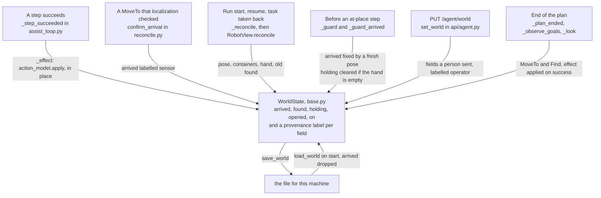
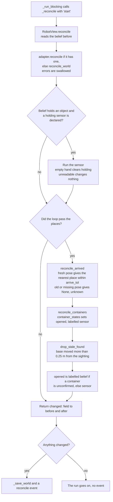

# The belief and reconcile

The robot cannot see its whole world at every moment, so it keeps a short note of what it thinks is true: where it is, what it holds, what is open. This page explains that note, why it can be wrong, and how the robot corrects it against its sensors.

!!! abstract "In this page"
    - The [belief](../start/glossary.md#belief) is one small object, `WorldState`, with five main fields: `arrived`, `found`, `holding`, `opened`, `on`. Skills update it when they succeed. It is saved to disk and survives a restart.
    - It can be wrong: a person moves the robot, an object slips, the process restarts. Nothing in the belief itself notices.
    - [Reconcile](../start/glossary.md#reconcile) compares the belief with what the sensors report and fixes the fields it can read. Fields it cannot read stay as they are and are marked as unconfirmed. One more rule at run start: an object kept as `found` from an earlier run is dropped when the base has moved more than 0.25 m from where it was seen.
    - Every field carries a [provenance](../start/glossary.md#provenance) label: `sensor`, `operator`, `belief` or `unknown`. The label says who vouches for the value.

!!! code "Where in the code"
    - [`WorldState`](https://github.com/mtbui2010/robot_agent/blob/e65e9aa/robot_agent/core/planning/base.py#L49-L243) (fields, `mark`, `provenance_view`, `as_text`)
    - [`reconcile.py`](https://github.com/mtbui2010/robot_agent/blob/e65e9aa/robot_agent/core/planning/reconcile.py#L120-L196): `reconcile_arrived`, `reconcile_containers`, `drop_stale_found`, `reconcile_sensors`, `guard_arrived`
    - [`RobotView.reconcile`](https://github.com/mtbui2010/robot_agent/blob/e65e9aa/robot_agent/core/planning/robot.py#L210-L252) (the whole procedure) and the loop's [`_reconcile`](https://github.com/mtbui2010/robot_agent/blob/e65e9aa/robot_agent/core/planning/assist_loop.py#L3480-L3493)
    - Persistence: [`save_world` / `load_world`](https://github.com/mtbui2010/robot_agent/blob/e65e9aa/robot_agent/state.py#L162-L188). Endpoints: [`GET` and `PUT /agent/world`](https://github.com/mtbui2010/robot_agent/blob/e65e9aa/robot_agent/api/agent.py#L72-L87)
    - A robot's own part: [`KaairAdapter.reconcile` and `pose`](https://github.com/mtbui2010/kcare_robot/blob/d4f5577b342e/kcare_robot/configs/adapter.py#L98-L137) (the robot maker's package; the class name is a code identifier)

## The idea in plain words

You leave your keys on the kitchen table and go to bed. You believe the keys are on the table. You have not looked since. In the morning someone may have moved them. A sensible person looks first, then acts. Looking is cheap. Walking to the wrong room is not.

The robot's belief is the "keys are on the table" note. It is what the robot thinks is true, built from what it did and what the skills reported. Reconcile is the "look first" step: before the robot acts, and again after a pause, it reads the sensors it has and corrects the note where a sensor disagrees.

## What the belief holds

`WorldState` is a plain dataclass in [`base.py`](https://github.com/mtbui2010/robot_agent/blob/e65e9aa/robot_agent/core/planning/base.py#L49-L243). It has five main fields, the same five that the planner's action model uses (see [Symbolic state](https://mtbui2010.github.io/embodiplan/concepts/symbolic-state/) in the embodiplan docs).

| field | meaning | type |
|---|---|---|
| `arrived` | the place the robot is at (`None`: unknown) | text, a place key such as `desk@study room` |
| `found` | the object most recently located and not yet picked | text or `None` |
| `holding` | the object in the hand (`None`: hand empty) | text or `None` |
| `opened` | containers that are open | set of place keys |
| `on` | appliances that are on | set of names |

It also keeps `holding_since` (when `holding` was set), `found_pose` and `holding_pose` (where the object was seen or grasped, with the base pose at that time; `found_pose` is treated as stale once the base has moved more than 0.25 m, and reconcile uses this to drop an old `found`, see below), and `provenance` (below).

`as_text()` gives the one-line form that is put into the planner's prompt. An empty belief prints:

```text
arrived=- found=- holding=- opened=[-] on=[-]
```

There is one belief per robot process. A run does not make its own copy: the loop uses `current().world`, so the next run starts from what the last one left. Skills update it when they succeed ("updated only from skills that actually succeeded", says the class docstring), and the dashboard can edit it through `PUT /agent/world`.

### Saved and reloaded

The belief is written to a file for this machine after a step's effect, after a reconcile that changed it, and when the dashboard edits it ([`save_world`](https://github.com/mtbui2010/robot_agent/blob/e65e9aa/robot_agent/state.py#L162-L188)). On start, `load_world` reads it back, **but drops `arrived`**: the saved place is not trusted, and reconcile re-reads it from the sensors.

## Where each field changes

The belief is written in six places. Each arrow ends in the same `WorldState`. The text in the box says which function writes it.



Read it as a map, not a timeline. A skill's success applies the action model's effect ([`_effect`](https://github.com/mtbui2010/robot_agent/blob/e65e9aa/robot_agent/core/planning/assist_loop.py#L1604-L1612)). The run-start reconcile is the next section. The guard before a step that acts at a place (`Find`, `Pick`, `Place`, `PutIn`, `Open`, `Close`) is [`guard_arrived`](https://github.com/mtbui2010/robot_agent/blob/e65e9aa/robot_agent/core/planning/reconcile.py#L178-L196). At the end of the plan the loop looks at each `on` or `in` goal ([`_observe_goals`](https://github.com/mtbui2010/robot_agent/blob/e65e9aa/robot_agent/core/planning/assist_loop.py#L3345-L3374)). A goal it cannot look at stays a belief.

*Drawn from the code at e65e9aa, not from a recorded run. Not drawn: the places where a step handler sets `found` to `None` after a failed `Find`.*

## Why the belief can be wrong

| cause | example | field |
|---|---|---|
| the world changed while the robot did not act | a person pushed the robot, or moved the object | `arrived`, `found` |
| the belief outlived the sighting | `found` was saved by an earlier run, and the robot has driven elsewhere since | `found` |
| a skill said "ok" but the world differs | the gripper closed on nothing | `holding` |
| the robot has no sensor for the field | no way to read whether a drawer is open | `opened`, `on` |
| the process restarted, or a run was paused | the saved belief is old | any |
| a person typed a value in the dashboard | the value is the person's claim | any |

Which of these a robot can check depends on what it declares. The core does not know; it asks the robot's adapter and manifest (see [One core, many robots](robot-as-data.md)).

## What reconcile does

[`RobotView.reconcile`](https://github.com/mtbui2010/robot_agent/blob/e65e9aa/robot_agent/core/planning/robot.py#L210-L252) takes the belief and, in this order:

1. **Calls the robot's own `reconcile`** if its adapter has one (otherwise the core's generic pose-and-place match). The robot knows its own sensors. Errors here are swallowed: a failing reconcile changes nothing.
2. **Checks the hand.** If the belief says `holding` something and the manifest declares a holding sensor (the skill that verifies a Pick), the core runs it. If the sensor says the hand is empty, `holding` is cleared (with `holding_since` and `holding_pose`) and its label becomes `sensor`. If the sensor cannot be read, nothing changes.
3. **Reads the pose and the containers** ([`reconcile_sensors`](https://github.com/mtbui2010/robot_agent/blob/e65e9aa/robot_agent/core/planning/reconcile.py#L165-L175)), when the loop passes the list of places:
    - `arrived` comes from a fresh base pose. The nearest known place within the manifest's `arrive_tol_m` is where the robot is. Farther from every place, `arrived` is `None` (between places, label `sensor`). A pose that is missing or older than `pose_max_age_s` makes `arrived` `None` with label `unknown`. A place is never invented and an old one is never kept.
    - `opened` comes from the adapter's optional `container_states`. A container it reports is set to open or closed, label `sensor`. A container it cannot read stays as the belief says and is listed under `unconfirmed`.
    - `found` is checked against the base pose just read ([`drop_stale_found`](https://github.com/mtbui2010/robot_agent/blob/e65e9aa/robot_agent/core/planning/reconcile.py#L151-L162)). If the belief keeps an object as `found` and the base is now more than 0.25 m from where that object was seen (`WorldState.found_pose_is_stale`), `found` and `found_pose` are cleared and the report gets `found_dropped` with the object's name. A sighting that has no base pose, or a pose that cannot be read now, is left as it is, because it cannot be proved old. See below.

It returns what changed as `{field: [before, after]}`. Only `arrived`, `holding`, `found` and `opened` are compared, so a dropped `found` shows up in the returned dict. When the dict is not empty, the loop saves the belief and emits a `reconcile` event.

**When it runs.** At the start of a run, after a pause that ended (`resume`), and when a suspended task is taken back. In the `AssistLoop` there is a second, smaller fix before each step that acts at a place (`Find`, `Pick`, `Place`, `PutIn`, `Open`, `Close`): if `arrived` is not backed by a sensor, it is compared with a fresh pose and corrected if wrong ([`guard_arrived`](https://github.com/mtbui2010/robot_agent/blob/e65e9aa/robot_agent/core/planning/reconcile.py#L178-L196)). This is part of [Checks before motion](checks-before-motion.md), which also explains how the belief feeds the other checks. The switch `ROBOT_AGENT_RECONCILE=0` turns the pose-and-container stage off; the loop then uses the plain reconcile (the adapter's, then the holding check).

The run-start reconcile in order, as `RobotView.reconcile` does it ([`robot.py`](https://github.com/mtbui2010/robot_agent/blob/e65e9aa/robot_agent/core/planning/robot.py#L210-L252)). The loop calls it from [`_reconcile`](https://github.com/mtbui2010/robot_agent/blob/e65e9aa/robot_agent/core/planning/assist_loop.py#L3480-L3493) when its option `reconcile` is on.



*Drawn from the code at e65e9aa, not from a recorded run. The case with the option `reconcile` off is not drawn.*

### Dropping an old `found`

`found` is saved to disk with the rest of the belief and used to survive a restart or the end of a run. That was a problem on the real kcare robot: a run started with `found=plastic spoon` from a find made 10 minutes and more than 3 m earlier. The planner trusted it, skipped the Find, drove to the destination and never asked where the object was. So the run-start reconcile now checks the sighting, in [`drop_stale_found`](https://github.com/mtbui2010/robot_agent/blob/e65e9aa/robot_agent/core/planning/reconcile.py#L151-L162):

```python
fp = getattr(world, "found_pose", None)
if not getattr(world, "found", None) or not fp or not fp.get("robot_pose") or not pose:
    return None
if not world.found_pose_is_stale(pose):
    return None
dropped, world.found, world.found_pose = world.found, None, None
return dropped
```

`pose` is the base `[x, y]` that `reconcile_arrived` has just read; `robot_pose` is the base pose stored with the sighting. The rule is a plain distance: stale means more than 0.25 m ([`found_pose_is_stale`](https://github.com/mtbui2010/robot_agent/blob/e65e9aa/robot_agent/core/planning/base.py#L167-L176)). It does not look at the age of the sighting. A `found` with no stored base pose, or a run where no pose can be read, is not touched. After a drop the plan has no `found` to lean on, so it has to look again or ask. This runs inside `reconcile_sensors`, so it is part of the pose-and-container stage: with `ROBOT_AGENT_RECONCILE=0` it does not run. It is covered by a unit test, [`test_reconcile_stale_found.py`](https://github.com/mtbui2010/robot_agent/blob/e65e9aa/tests/test_reconcile_stale_found.py); it was not run on a robot after the change, and not measured on any benchmark.

A run on the hub's `fakebot` package, continuing the snippet in "A real example" below (same imports, `Stub`, `env`, `DS`): the base is 0.1 m from the desk, the sighting was made 3 m away. The pose and the sighting are scripted by me.

```python
rv = RobotView.load("fakebot")
x, y = env[DS]["loc"]["x"], env[DS]["loc"]["y"]
rv = RobotView(Stub(rv.adapter, {"x": x+0.1, "y": y, "ts": time.time()}))
seen_from = [x + 3.0, y, 0.0]
w = WorldState(arrived=DS, found="spoon", found_pose={"robot_pose": seen_from, "ts": time.time() - 600})
rep = {}
changed = rv.reconcile(w, None, places=env, report=rep)
print("AFTER", w.as_text())
print("changed", json.dumps(changed))
print("found_dropped", rep.get("found_dropped"))
```

Printed output (2026-11-20, HEAD e65e9aa):

```text
AFTER arrived=desk@study room found=- holding=- opened=[-] on=[-]
changed {"found": ["spoon", null]}
found_dropped spoon
```

### Who reads the belief

The goal check and the guard read the belief, and so does the `bt_goal` option. A behaviour tree of that option has leaf conditions `holding`, `hand_free`, `at`, `placed`, `opened` and `closed` that read the belief, and each tree starts with "already achieved?". So a wrong `opened` or `holding` changes whether a tree does anything. The belief itself and reconcile are unchanged by `bt_goal`. It only reads them. It is on by default, and does nothing for a robot that declares no `trees` ([`docs/bt_goal.md`](https://github.com/mtbui2010/robot_agent/blob/e65e9aa/docs/bt_goal.md)). It was not run on the offline examples of this page.

The robot's "look first" before it asks where an object is (`look_then_ask`) first checks the object memory for a trusted sighting, and only then makes one `Find`. See [Dialog and intent](dialog-and-intent.md#two-questions-the-robot-adds-before-it-plans). It was checked with English phrases only.

## Provenance: who vouches for each value

Each field has a source label.

| label | meaning | set by |
|---|---|---|
| `sensor` | read off the robot at a time `ts` | reconcile; also a `MoveTo` whose localization layer measured the base at its target |
| `operator` | a person set it from the dashboard | `PUT /agent/world` |
| `belief` | the robot's own bookkeeping: a skill's effect, or a value loaded from disk | the default |
| `unknown` | a sensor was needed and could not tell | reconcile, with the reason in `why` |

One rule matters: a label counts **only while the field still has the value it was recorded for**. If a skill changes `arrived` after reconcile marked it `sensor`, the label falls back to `belief`. A `sensor` label is therefore never a stale claim about a value that has since changed ([`provenance_of`](https://github.com/mtbui2010/robot_agent/blob/e65e9aa/robot_agent/core/planning/base.py#L128-L133) compares the value). The tests in [`test_v2_reconcile_sensors.py`](https://github.com/mtbui2010/robot_agent/blob/e65e9aa/tests/test_v2_reconcile_sensors.py) check this behaviour.

For `opened`, the label is kept per container, and the view lists the open containers that no sensor confirmed (`unconfirmed`).

## A real example: before and after

First, the fake robot run from [The closed loop](closed-loop.md). Its `reconcile` event at the start (event 1), with times left out:

```text
changed:    {"arrived": [null, "entrance"]}
sensors:    {"arrived": {"pose": [0.25, 2.1], "detail": "0.00 m from entrance", ...}, "containers": {}, "unconfirmed": []}
provenance: arrived  -> source "sensor", detail "0.00 m from entrance"
            found    -> source "belief"
            holding  -> source "belief"
            opened   -> source "sensor", containers {}, unconfirmed []
            on       -> source "belief"
```

The belief started empty, so only `arrived` changed: from none to `entrance`, read from the pose. The other fields stay `belief`. This is a fake robot, **not run on a real robot**.

That run starts from an empty belief, so it does not show a wrong one being fixed. The next snippet does. It builds a belief that is wrong on purpose and calls `RobotView.reconcile` on the hub's `fakebot` test package. The pose is a stub placed 0.1 m from the desk. The holding sensor is stubbed to answer "no" (`gripper is empty`). Both are scripted by me, not read from hardware. It needs `pyyaml` and runs offline:

```python
import json, os, sys, time, types
from pathlib import Path
R_ = Path(os.environ["REPOS"])          # folder holding robot_agent and embodiplan
sys.path[:0] = [str(R_/"robot_agent"), str(R_/"robot_agent"/"tests"), str(R_/"embodiplan")]
sys.modules.setdefault("requests", types.ModuleType("requests"))
from robot_agent.core.planning.base import WorldState
from robot_agent.core.planning.robot import RobotView
from robot_agent.contract import SkillResult
from fakes import load_env
env = load_env()
DS, DT, DR = "desk@study room", "dining table@kitchen", "drawer@kitchen"
class Stub:                              # the fakebot adapter with a controllable pose()
    def __init__(self, inner, pose): self._inner, self._pose = inner, pose
    def __getattr__(self, k): return getattr(self._inner, k)
    def pose(self, node=None): return dict(self._pose)
rv = RobotView.load("fakebot")
x, y = env[DS]["loc"]["x"], env[DS]["loc"]["y"]
rv = RobotView(Stub(rv.adapter, {"x": x+0.1, "y": y, "ts": time.time()}))
w = WorldState(arrived=DT, holding="apple", opened={DR}, found="mug")   # a wrong belief
print("BEFORE", w.as_text())
rep = {}
sense = lambda skill: SkillResult(ok=False, msg="gripper is empty")     # the holding sensor says: empty
changed = rv.reconcile(w, None, sense=sense, places=env, report=rep)
print("AFTER", w.as_text())
print("changed", json.dumps(changed))
```

Printed output (2026-11-18):

```text
BEFORE arrived=dining table@kitchen found=mug holding=apple opened=[drawer@kitchen] on=[-]
AFTER arrived=desk@study room found=mug holding=- opened=[drawer@kitchen] on=[-]
changed {"arrived": ["dining table@kitchen", "desk@study room"], "holding": ["apple", null]}
```

The labels after the call, with times left out:

| field | value after | source | note |
|---|---|---|---|
| `arrived` | `desk@study room` | `sensor` | detail `0.10 m from desk@study room` |
| `holding` | none | `sensor` | the holding sensor said the hand is empty |
| `found` | `mug` | `belief` | no sensor reads `found`; this belief has no stored sighting pose, so the stale-sighting rule does not apply |
| `opened` | `drawer@kitchen` | `belief` | listed under `unconfirmed`: no container reader exists here |
| `on` | none | `belief` | no sensor checks `on` |

Read it as the code's rules at work, not as a result from a robot. Reconcile fixed the two fields it could read (`arrived`, `holding`). It did not clear `opened` or `found`. It only reported that it could not confirm the open drawer. Later checks treat an unconfirmed belief with more care than a sensed value.

!!! warning "Pitfalls"
    - **`holding`, `found`, `opened` and `on` are often only beliefs.** A robot with no sensor for a field keeps the belief for it, and reconcile cannot fix it. For `found` there is one check: an old sighting is dropped when the base has moved (above); a `found` that is still near where it was seen stays a belief, and the object may have been moved. On the kcare package at the pinned commit, reconcile checks the base pose and the gripper (through a wrist depth check, in its adapter's `reconcile`); it has no `container_states`, so `opened` and `on` stay beliefs. If your robot lacks a sensor, a wrong `opened` or `on` stays wrong until a skill or a person changes it.
    - **A dashboard edit is a belief the robot re-checks, not a fact.** `PUT /agent/world` marks the edited fields `operator`. Fields a sensor can read are still checked and may be overwritten at the next reconcile.
    - **A saved `arrived` is thrown away on restart** by design. Do not rely on it surviving.
