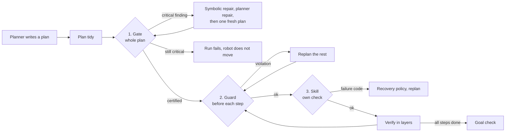
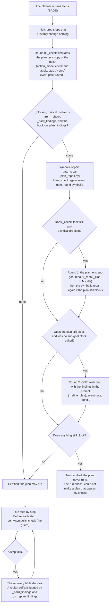

# Checks before motion

!!! abstract "In this page"
    - A plan can be wrong in ways a robot should never find out by moving. The framework checks a plan three times before the robot acts on it: once for the whole plan, once for each step, and once inside the skill.
    - The first two checks run on the [belief](../start/glossary.md#belief) (the robot's written picture of the world), not on hardware. They use one set of rules, the [action model](../start/glossary.md#action-model).
    - A step that ran is not "done" because the skill said so. The result is checked in layers, and the whole task is done only when the goals are seen to hold.
    - These checks are in the [AssistLoop](../start/glossary.md#assistloop) (planner key `sage`). The plain [ClosedLoop](../start/glossary.md#closedloop) (planner key `sage_plain`) has a much smaller version. See [Planners and loops](planners.md).

## The idea in plain words

A language model writes the plan. It can write "pick up the cup" without first looking for the cup. If the robot ran that plan, the Pick would fail, and the robot would have wasted time or moved the wrong way.

So the plan is first **played on paper**. Each step is applied, one after another, to a copy of the belief. A step is only allowed when the rules say it can happen in that state. "Pick needs a Find of the same object before it" is one such rule. If a rule is broken, the plan is not run. It is sent back to be repaired.

The same rules are used again right before each real step. This time they run on the belief as it is *now*, because the world may have changed since the plan was made.

## One example from this repo

The rules come from `embodiplan.action_model`. The hub calls them through `robot_agent/core/planning/action_model.py`. This snippet ran offline, with no robot, using the hub's own `simulate`:

```python
from robot_agent.core.planning import action_model as am
from robot_agent.core.planning.base import WorldState
S = lambda a, o: {"action": a, "object": o}
for plan in ([S("MoveTo", "kitchen"), S("Pick", "cup")],
             [S("MoveTo", "kitchen"), S("Find", "cup"), S("Pick", "cup")]):
    r = am.simulate(plan, WorldState())
    print(r.ok, [(v.index, v.code, v.reason) for v in r.violations])
```

Real output (the first plan, then the second):

```text
False [(1, 'no_find_before_pick', 'Pick requires a preceding Find of the target object')]
True []
```

The first plan breaks the rule at step index 1 (the second step, counting from 0). The second plan passes, and its final belief has `holding='cup'`. The check changes nothing and costs no LLM call.

## The three checks



| Check | Question | Where | When | On a violation |
|---|---|---|---|---|
| 1. [Gate](../start/glossary.md#gate) | Is the whole plan allowed, and does it reach the goals? | `AssistLoop._check`, used by `_generate_and_certify` | Once, before the first step | Symbolic repair, then the planner's own repair, then one fresh plan, else the run ends as failed |
| 2. [Guard](../start/glossary.md#guard) | Can this step run in the world as it is now? | `AssistLoop._guard`, `_precondition` | Right before every step | One replan of the rest of the plan, else the run ends |
| 3. Skill | Can the robot do this physically? | In the robot package's skill | During the step | The skill returns a [failure code](../start/glossary.md#failure-code); the recovery policy decides |

### 1. The gate: the whole plan

`_check` simulates the plan as written and returns a list of findings `(step index, text, critical)`. It does three things:

- It asks the action model about each step in the simulated belief (wrong place, Pick without Find, opening with a full hand, and so on). The robot's own limits (its hand count, its action list, what can be opened) are passed in, so the rules fit the robot.
- It adds findings that need the task: the plan does not achieve the goals, or the goals are already reached after step *k* and later steps repeat the task.
- It words each finding in plain text for the planner to read.

`_generate_and_certify` then runs up to four rounds. Each round is one `gate` event:

1. **Round 0.** The planner's plan is tidied and checked. The planner is given one sub-goal per goal the loop understood (see [Planners and loops](planners.md)), so its blocks follow the goals.
2. **Round `symbolic`.** If a finding blocks the plan, the core first edits the plan itself with `plan_repair.py`: fixes whose result the action model proves, such as moving an Open before the Pick that fills the hand, removing a second delivery of an object already at its goal, or adding a missing `MoveTo` or `Find`. An edit is kept only when the number of critical findings goes down. It makes no LLM call. The edits are listed on the event.
3. **Round 1.** If a critical finding remains, the findings go to the planner's own repair of the part of the plan that owns them. This needs the optional `SubgoalRepair` capability (`subgoal_repair.py`); each repair call uses the run's LLM-call budget. With the option `person_goals` (default off) some blocks are written by the loop itself, as fixed blocks: they are never sent to the planner and never emptied. Not used for plans built from templates (go, say, deliver), which have no planner to ask.
4. **Round 2.** If a critical finding remains, or the planner has no repair, the planner is asked for **one fresh plan** with the findings in the prompt. The gate refines at most once. A planner whose blocks were already edited by an LLM call in round 1 gets no fresh plan.

Then the plan is **certified** only if no blocking finding is left. Blocking means a critical checker finding, or a step the robot cannot run at all (an action it does not have, a place that is not a known place, a step its adapter cannot bind), or a finding that an option adds through the hook `on_plan_findings` (see the next section). An uncertified plan never runs. In `_plan_phase` the run ends as `failed` with a message that starts "I could not make a plan that passes my checks:" and lists up to three findings.

!!! note "Goals run by the option `bt_goal` skip the gate"
    The option `bt_goal` is on by default, but it does nothing for a robot that declares no behaviour trees. When the robot does declare them, a goal whose kind has a tree is run by the tree, and the planner is not asked for it, so no plan of it goes through this gate. Neighbouring goals without a tree are planned by SAGE once, when the run reaches them, and their steps run one by one through the engine's own step path (guard, bind, verify and recovery as for any step). That plan is **not** put through the gate: only SAGE's own verifier checks it. The effect of this on the benchmark was not measured. The rules are in the hub's [`docs/bt_goal.md`](https://github.com/mtbui2010/robot_agent/blob/e65e9aa/docs/bt_goal.md).

### 2. The guard: each step

Right before a step, `_guard` checks it on the belief now (`_precondition`). It rejects, for example, a Place when the robot is not at the target, an Open or Close while holding something, and anything the action model forbids in the current state.

Before it judges, the guard also repairs a belief it can prove is stale:

- If the belief on `arrived` did not come from a sensor and a fresh pose says the robot is somewhere else, the belief is fixed and a `recover` event with `kind=reconcile` is sent.
- If the belief says the robot holds something and the holding sensor says the hand is empty, the belief is fixed and the step is judged again.
- Before a Place or PutIn, if the held object is no longer in the gripper, the run ends as failed with the code `dropped`.

An old `found` is not repaired here. It is dropped earlier, at run start, by the reconcile (see [Belief and reconcile](belief-and-reconcile.md#dropping-an-old-found)).

A violation that remains is **not** run. It goes to the planner's replan as `precondition: <reason>`. The same violation at the same step is replanned once; the second time the run ends. A replan is also limited by `max_replans` (6 for the AssistLoop). The new suffix is first repaired symbolically (no LLM call), then it must pass a smaller check (`_hard_findings`: actions the robot has, places it can reach, steps it can bind, plus what options add through the hook `on_replan_findings`; it is not run through `_check`). A suffix that fails is dropped and the run ends with "the new plan did not pass my checks".

### 3. The skill's own check

The hub does not own this check. A skill is code in the robot package. It can refuse to run when it cannot do its job, and it reports a failure code such as `unreachable` or `grasp_failed` (see [Skills and failures](skills-and-failures.md)). The hub sees only a failed result with a code. The [recovery policy](skills-and-failures.md), keyed on that code, decides: retry in place, wait for the robot's health, ask the person, replan, or stop.

One code is changed by the engine before the policy sees it. With the option `fetch_guard` (on by default, part `absent_find`), a failed `Find` that came back with the code `UNKNOWN` (the skill said "not done" and gave no reason text) becomes `ABSENT`. The look found nothing, so the search ladder runs, and then the question "I couldn't find the X. Where is it?", instead of a replan that returns the same plan. The line is in the step-failure path of the AssistLoop (`self.options.query("failure_code", ...)`, [`assist_loop.py` line 3676](https://github.com/mtbui2010/robot_agent/blob/e65e9aa/robot_agent/core/planning/assist_loop.py#L3676)). A camera that cannot look is caught before the Find and keeps its own code (`PERCEPTION_UNAVAILABLE`).

## Where the plan is simulated before the robot moves

"Simulated" here means: the steps are applied one after another to a copy of the belief with the shared [action model](../start/glossary.md#action-model), and nothing touches the robot or the real belief. All of it is in the AssistLoop. The table lists every place, so a reader can find the one that matters.

**The gate in one picture.** The rounds of `AssistLoop._generate_and_certify`, read from the code at the pinned commit (`assist_loop.py`, lines 2682 to 2738). It is a drawing of the logic, not of a recorded run, and the number of rounds a real plan needs was not measured. The names in the boxes are the functions and the `gate` events (round `0`, `symbolic`, `1`, `2`).



A finding added by the hook `on_plan_findings` (for example by `fetch_guard`) is counted in `_blocking`. It therefore starts the symbolic repair, and it can send the plan to round 2, but it does not start round 1 by itself, because round 1 starts only when `_check` reports a critical problem.

| What | Where in the code | Runs on | What it is for |
|---|---|---|---|
| The plan checker | [`AssistLoop._check`](https://github.com/mtbui2010/robot_agent/blob/e65e9aa/robot_agent/core/planning/assist_loop.py#L1300-L1329) | the plan as written, from a copy of the belief it is given (`world.copy()`), with `action_model.check` and `action_model.apply` for each step | Returns `[(step index, problem, critical)]`. Critical findings block the plan; the others are only mentioned. |
| Its callers in the gate | [`_generate_and_certify`](https://github.com/mtbui2010/robot_agent/blob/e65e9aa/robot_agent/core/planning/assist_loop.py#L2682-L2742): one `_check` after round 0, after the symbolic repair and after round 1 | the plan of that round | The text of the `gate` event (`problems`), and whether round 1 runs (only when a `_check` finding is critical). |
| Its blocking form | [`_blocking`](https://github.com/mtbui2010/robot_agent/blob/e65e9aa/robot_agent/core/planning/assist_loop.py#L2902-L2912): the critical findings of `_check` plus `_hard_findings` plus the hook | the plan as written | Decides `certified`, round 2, and the message of a failed run. |
| The symbolic repair | [`_gate_repair`](https://github.com/mtbui2010/robot_agent/blob/e65e9aa/robot_agent/core/planning/assist_loop.py#L2808-L2834) and [`_gate_repair_run`](https://github.com/mtbui2010/robot_agent/blob/e65e9aa/robot_agent/core/planning/assist_loop.py#L2842-L2868) | each candidate edit of `plan_repair.repair` | The score of a candidate is `len(self._blocking(...))`, so every candidate is simulated; an edit is kept only when the count goes down. |
| The planner's own repair | [`_repair_plan`](https://github.com/mtbui2010/robot_agent/blob/e65e9aa/robot_agent/core/planning/assist_loop.py#L1424-L1430), which calls [`subgoal_repair`](https://github.com/mtbui2010/robot_agent/blob/e65e9aa/robot_agent/core/planning/subgoal_repair.py#L56-L74) (`_findings_per_block`) | the joined sub-goal blocks (`loop._check`) and, for the state before each block, `action_model.simulate` ([line 94](https://github.com/mtbui2010/robot_agent/blob/e65e9aa/robot_agent/core/planning/subgoal_repair.py#L94)) | Gives each block the findings it must fix. |
| The hard findings | [`_hard_findings`](https://github.com/mtbui2010/robot_agent/blob/e65e9aa/robot_agent/core/planning/assist_loop.py#L2922-L2941) | the plan from a copy of the belief, `action_model.apply` on every step | Steps no belief can make runnable: an action the robot does not have, a place that is not in the ENV, a step the adapter cannot bind. |
| The hook | `on_plan_findings` in `_blocking` ([line 2909](https://github.com/mtbui2010/robot_agent/blob/e65e9aa/robot_agent/core/planning/assist_loop.py#L2909); declared in [`core/options/spec.py`](https://github.com/mtbui2010/robot_agent/blob/e65e9aa/robot_agent/core/options/spec.py#L49)) | the list of hard findings, the run and the steps | Lets an option add findings. Built in use: `fetch_guard`, below. |
| The replan check | [`_sage_replan`](https://github.com/mtbui2010/robot_agent/blob/e65e9aa/robot_agent/core/planning/assist_loop.py#L2960) and `_replan_suffix` | the new suffix: `_hard_findings` and the hook `on_replan_findings`; then `_check` on the whole plan, whose findings are only listed on the `replan` event ([line 2989](https://github.com/mtbui2010/robot_agent/blob/e65e9aa/robot_agent/core/planning/assist_loop.py#L2989)) | A suffix that fails the hard findings is dropped. |
| The action model | [`action_model.simulate` and `action_model.apply`](https://github.com/mtbui2010/robot_agent/blob/e65e9aa/robot_agent/core/planning/action_model.py#L35-L42), which call `embodiplan.action_model` | a plan or a step, and a belief | `simulate(plan, world)` runs a whole plan and returns the violations and the final state; `apply(step, world)` is one step's effect. `_check` uses `check` and `apply` per step, not `simulate`. |
| The run-time check | [`verify.symbolic_check`](https://github.com/mtbui2010/robot_agent/blob/e65e9aa/robot_agent/core/planning/verify.py#L31-L44) | one step, in the belief as it is now | See below. It is not a plan simulation. |

`verify.symbolic_check(step, world, capabilities=..., openable=...)` returns `(ok, reason)` and never changes `world`. It is called by `AssistLoop._precondition` ([line 3474](https://github.com/mtbui2010/robot_agent/blob/e65e9aa/robot_agent/core/planning/assist_loop.py#L3474)) from the guard, right before the step moves, so the same rules that judged the plan in `_check` judge the step again on the belief of that moment:

```python
for v in action_model.check(step, world, openable=openable,
                            capabilities=capabilities or action_model.ROBOT_CAPABILITIES):
    if v.is_error and v.code != "unknown_action":
        return False, v.reason
return True, ''
```

It skips `unknown_action` (the robot's own vocabulary is checked elsewhere). `CONTEXT_CODES` in `action_model.py` (`unknown_action`, `not_openable`, `find_wrong_place`) are the rules that need the robot's vocabulary, the ENV or the goals; `symbolic_check` applies `not_openable` only because the guard passes `openable`, and does not report the other two. The option `replan_guard` also calls it, to find a step the engine would refuse.

### A finding from an option: `fetch_guard`

The option `fetch_guard` (default on; `fetch_guard=0` turns all of it off, or one part with `fetch_guard.plan_finding=0`) uses the hook. Its target: an `on` or `in` goal whose object has no source (no `from`, no `from_any`, no trusted sighting in the object memory). Without a source the planner may look for the object at its destination, which is where it must end up, not where it is. The part `plan_finding` simulates the plan on the action model ([`fetch_guard.visits`](https://github.com/mtbui2010/robot_agent/blob/e65e9aa/robot_agent/options/fetch_guard.py#L58-L66) tracks the place the plan has driven to). If the first `Find` or `Pick` of such an object is made at its destination, the hook adds a finding, from [`fetch_findings`](https://github.com/mtbui2010/robot_agent/blob/e65e9aa/robot_agent/options/fetch_guard.py#L44-L55):

```text
step N 'Find banana': <destination> is where the banana must end up, not where it is (its place is unknown): look for the banana at another place first
```

A look where the robot already stands is not flagged. The finding is blocking, so the symbolic repair counts it in its score and the one fresh plan (round 2) gets it in its prompt. Round 1, the planner's own repair, is driven by `_check` findings only, so a plan whose only finding is this one skips it. A plan that still looks there ends uncertified and the run fails before it moves. The other two parts act outside the gate: `rank_unknown` gives such an object a first place from the ranked search before planning, and `absent_find` is the failure code above.

Evidence and limits. The option was written after two real-robot run records of 2026-11-20. In a good run the answer "on the dining table" was grounded and the run succeeded. In a bad run the answer "on the dinning table" was not grounded, the plan looked for the banana at its destination, there were 5 failed Finds and 4 identical replans. The option is **not measured** on any benchmark and **unverified** with a real LLM; offline tests of the parts are in `tests/test_option_fetch_guard.py`.

## Success needs an observation

When a skill reports success, the preconditions are not checked again. The step must pass the layers in `StepVerifier.verify` (`verify.py`). Each layer adds a result:

| Layer | What it checks | Cost |
|---|---|---|
| `isdone` | The skill's own report. If this fails, the later layers are skipped and the step fails. | none |
| `symbolic` | The step's effects hold in the belief. | no LLM call |
| `vlm` | A vision-language model, only if the robot's manifest or the legacy switch asks for it. | one model call |
| `sensor` / `localization` | The skill's declared sensor (for example the pose after a MoveTo). If none is declared, or the sensor itself failed (a device fault, a timeout, no perception), the result is marked unknown: it neither confirms nor contradicts the skill. | one sensor read |

In the offline fake-robot run (below), the Pick step printed three layers: `isdone` ok ("grasped"), `symbolic` ok, `sensor` ok ("grasp_succeed: ok"). The failed Find printed only `isdone`, not ok ("apple not found"), because a failed `isdone` stops the check.

At the end of the plan the AssistLoop does not trust the belief. For each `on` or `in` goal it goes back to the destination if needed and looks (a Find), then sends a `goal_check` event with `ok`. The run is `success` only if every goal holds in the belief **and** was seen to hold. A goal that cannot be looked at (inside a closed drawer, or no Find skill) stays on the belief and is marked unknown. The `goal_check` option can be set to `belief` to trust the belief instead; the default is `observe`.

## Plan tidy: removing steps that do nothing

Small planner models repeat themselves ("Find plate, Pick plate" twice). `plan_tidy.tidy` removes steps the action model proves do nothing, before the gate sees the plan. It needs no LLM call. It removes:

- `Find X` or `Pick X` while X is already in the hand;
- `MoveTo P` where the robot already is, `Open C` of an open container, `Close C` of a closed one;
- a `MoveTo` to a room (not a place) right before another `MoveTo`;
- every step after the first point where the goals are reached, unless those steps only close what the plan itself opened (closing a door after the goals is the expected default, not a repeat).

A step with any other finding is kept, so the gate and the planner can see it. Tidy runs on the first plan, after each repair, on the fresh plan, and on every replan suffix. Removed steps are listed as `tidied` on the `gate` event. The option `plan_tidy` (environment variable `ROBOT_AGENT_PLAN_TIDY=0`) turns it off.

Offline example (same snippet style; the robot is already at the kitchen, and the plan repeats itself):

```text
input:  MoveTo kitchen, Find cup, Pick cup, Find cup, Pick cup
output: ['Find cup', 'Pick cup']
notes:  ["step 1 'MoveTo kitchen' does nothing here: removed",
         "step 4 'Find cup' does nothing here: removed",
         "step 5 'Pick cup' does nothing here: removed"]
```

This output is real: it came from `plan_tidy.tidy(plan, world, [], lambda *a: False, {})` with `world.arrived = 'kitchen'`. There were no goals, so the "goals reached" rule did not apply.

## The same run, end to end

The same offline fake robot (the scripted planner and LLM from the hub's tests, no ROS, no LLM) ran the task "Bring the apple from the desk to the dining table". The apple is not on the desk. The events printed, in order, were: `gate` with `problems: []` (the plan passed), `plan`, five steps, a failed Find ("apple not found") that produced `search` and `replan`, five more steps, `goal_check` with `ok: true`, and `done` with `success`. The fake run printed one harmless warning line (`teleop stop_all: 'FakeState' object has no attribute 'cm'`). This is a scripted fake result, not a real robot result.

!!! warning "What the ClosedLoop does instead"
    The plain ClosedLoop (planner key `sage_plain`) has no whole-plan simulation and no per-step guard. Its only gate (`_cl_certify`) refuses steps the robot cannot bind to a skill: it asks the planner for one new plan, and ends the run as failed if that does not help. It checks step results with the same layers, but it never looks at the goals at the end: a plan that ran every step is a success. If you need the checks above, select the AssistLoop (planner key `sage`).

!!! code "Where in the code"
    - Action rules, one source: [`action_model.py`](https://github.com/mtbui2010/robot_agent/blob/e65e9aa/robot_agent/core/planning/action_model.py#L18-L53) (calls `embodiplan.action_model`)
    - Gate: [`_check`](https://github.com/mtbui2010/robot_agent/blob/e65e9aa/robot_agent/core/planning/assist_loop.py#L1300-L1329), [`_generate_and_certify`](https://github.com/mtbui2010/robot_agent/blob/e65e9aa/robot_agent/core/planning/assist_loop.py#L2682-L2742), [`_blocking` and `_hard_findings`](https://github.com/mtbui2010/robot_agent/blob/e65e9aa/robot_agent/core/planning/assist_loop.py#L2902-L2941), [`_plan_phase`](https://github.com/mtbui2010/robot_agent/blob/e65e9aa/robot_agent/core/planning/assist_loop.py#L2651-L2680)
    - Every place the plan is simulated: the table in "Where the plan is simulated before the robot moves" above. Option: [`fetch_guard.py`](https://github.com/mtbui2010/robot_agent/blob/e65e9aa/robot_agent/options/fetch_guard.py) and the hook `on_plan_findings` in `_blocking`
    - Symbolic repair: [`plan_repair.py`](https://github.com/mtbui2010/robot_agent/blob/e65e9aa/robot_agent/core/planning/plan_repair.py), called by [`_gate_repair_run`](https://github.com/mtbui2010/robot_agent/blob/e65e9aa/robot_agent/core/planning/assist_loop.py#L2842-L2868)
    - Sub-goal repair: [`subgoal_repair.py`](https://github.com/mtbui2010/robot_agent/blob/e65e9aa/robot_agent/core/planning/subgoal_repair.py)
    - Guard: [`_precondition`](https://github.com/mtbui2010/robot_agent/blob/e65e9aa/robot_agent/core/planning/assist_loop.py#L3467-L3475), [`_guard`](https://github.com/mtbui2010/robot_agent/blob/e65e9aa/robot_agent/core/planning/assist_loop.py#L3515-L3549)
    - Tidy: [`plan_tidy.py`](https://github.com/mtbui2010/robot_agent/blob/e65e9aa/robot_agent/core/planning/plan_tidy.py#L45-L84)
    - Verify layers: [`StepVerifier.verify`](https://github.com/mtbui2010/robot_agent/blob/e65e9aa/robot_agent/core/planning/verify.py#L144-L196); goal check: [`_observe_goals`](https://github.com/mtbui2010/robot_agent/blob/e65e9aa/robot_agent/core/planning/assist_loop.py#L3345-L3374), [`_final_check`](https://github.com/mtbui2010/robot_agent/blob/e65e9aa/robot_agent/core/planning/assist_loop.py#L4066-L4081)
    - Reasons and history (dense): [`docs/guard.md`](https://github.com/mtbui2010/robot_agent/blob/e65e9aa/docs/guard.md)

See also: [Skills and failures](skills-and-failures.md), [Belief and reconcile](belief-and-reconcile.md), [Planners and loops](planners.md).
