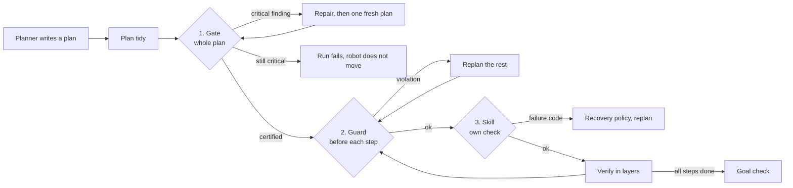

# Checks before motion

!!! abstract "In this page"
    - A plan can be wrong in ways a robot should never find out by moving. The framework checks a plan three times before the robot acts on it: once for the whole plan, once for each step, and once inside the skill.
    - The first two checks run on the [belief](../start/glossary.md#belief) (the robot's written picture of the world), not on hardware. They use one set of rules, the [action model](../start/glossary.md#action-model).
    - A step that ran is not "done" because the skill said so. The result is checked in layers, and the whole task is done only when the goals are seen to hold.
    - These checks are in the [AssistLoop](../start/glossary.md#assistloop) (planner key `sage`). The plain [ClosedLoop](../start/glossary.md#closedloop) (planner key `grace`) has a much smaller version. See [Planners and loops](planners.md).

## The idea in plain words

A language model writes the plan. It can write "pick up the cup" without first looking for the cup. If the robot ran that plan, the Pick would fail, and the robot would have wasted time or moved the wrong way.

So the plan is first **played on paper**. Each step is applied, one after another, to a copy of the belief. A step is only allowed when the rules say it can happen in that state. "Pick needs a Find of the same object before it" is one such rule. If a rule is broken, the plan is not run. It is sent back to be repaired.

The same rules are used again right before each real step. This time they run on the belief as it is *now*, because the world may have changed since the plan was made.

## One example from this repo

The rules come from `embodiplan.action_model`. The hub calls them through `robot_agent/core/planning/action_model.py`. This snippet ran offline, with no robot, using the hub's own `simulate`:

```python
from robot_agent.core.planning import action_model as am
from robot_agent.core.planning.base import WorldState
S = lambda a, o: {"action": a, "object": o}
for plan in ([S("MoveTo", "kitchen"), S("Pick", "cup")],
             [S("MoveTo", "kitchen"), S("Find", "cup"), S("Pick", "cup")]):
    r = am.simulate(plan, WorldState())
    print(r.ok, [(v.index, v.code, v.reason) for v in r.violations])
```

Real output (the first plan, then the second):

```text
False [(1, 'no_find_before_pick', 'Pick requires a preceding Find of the target object')]
True []
```

The first plan breaks the rule at step index 1 (the second step, counting from 0). The second plan passes, and its final belief has `holding='cup'`. The check changes nothing and costs no LLM call.

## The three checks



| Check | Question | Where | When | On a violation |
|---|---|---|---|---|
| 1. [Gate](../start/glossary.md#gate) | Is the whole plan allowed, and does it reach the goals? | `AssistLoop._check`, used by `_generate_and_certify` | Once, before the first step | Repair, then one fresh plan, else the run ends as failed |
| 2. [Guard](../start/glossary.md#guard) | Can this step run in the world as it is now? | `AssistLoop._guard`, `_precondition` | Right before every step | One replan of the rest of the plan, else the run ends |
| 3. Skill | Can the robot do this physically? | In the robot package's skill | During the step | The skill returns a [failure code](../start/glossary.md#failure-code); the recovery policy decides |

### 1. The gate: the whole plan

`_check` simulates the plan as written and returns a list of findings `(step index, text, critical)`. It does three things:

- It asks the action model about each step in the simulated belief (wrong place, Pick without Find, opening with a full hand, and so on). The robot's own limits (its hand count, its action list, what can be opened) are passed in, so the rules fit the robot.
- It adds findings that need the task: the plan does not achieve the goals, or the goals are already reached after step *k* and later steps repeat the task.
- It words each finding in plain text for the planner to read.

`_generate_and_certify` then runs up to three rounds. Each round is one `gate` event:

1. **Round 0.** The planner's plan is tidied and checked.
2. **Round 1.** If any finding is critical, the findings go to the planner's own repair of the part of the plan that owns them. This needs the optional `SubgoalRepair` capability (`subgoal_repair.py`); each repair call uses the run's LLM-call budget. Not used for plans built from templates (go, say, deliver), which have no planner to ask.
3. **Round 2.** If a critical finding remains, or the planner has no repair, the planner is asked for **one fresh plan** with the findings in the prompt. The gate refines at most once.

Then the plan is **certified** only if no blocking finding is left. Blocking means a critical checker finding, or a step the robot cannot run at all (an action it does not have, a place that is not a known place, a step its adapter cannot bind). An uncertified plan never runs. In `_plan_phase` the run ends as `failed` with a message that starts "I could not make a plan that passes my checks:" and lists up to three findings.

### 2. The guard: each step

Right before a step, `_guard` checks it on the belief now (`_precondition`). It rejects, for example, a Place when the robot is not at the target, an Open or Close while holding something, and anything the action model forbids in the current state.

Before it judges, the guard also repairs a belief it can prove is stale:

- If the belief on `arrived` did not come from a sensor and a fresh pose says the robot is somewhere else, the belief is fixed and a `recover` event with `kind=reconcile` is sent.
- If the belief says the robot holds something and the holding sensor says the hand is empty, the belief is fixed and the step is judged again.
- Before a Place or PutIn, if the held object is no longer in the gripper, the run ends as failed with the code `dropped`.

A violation that remains is **not** run. It goes to the planner's replan as `precondition: <reason>`. The same violation at the same step is replanned once; the second time the run ends. A replan is also limited by `max_replans` (6 for the AssistLoop). The new suffix of the plan must pass a smaller check (`_hard_findings`: actions the robot has, places it can reach, steps it can bind). A suffix that fails is dropped and the run ends with "the new plan did not pass my checks".

### 3. The skill's own check

The hub does not own this check. A skill is code in the robot package. It can refuse to run when it cannot do its job, and it reports a failure code such as `unreachable` or `grasp_failed` (see [Skills and failures](skills-and-failures.md)). The hub sees only a failed result with a code. The [recovery policy](skills-and-failures.md), keyed on that code, decides: retry in place, wait for the robot's health, ask the person, replan, or stop.

## Success needs an observation

When a skill reports success, the preconditions are not checked again. The step must pass the layers in `StepVerifier.verify` (`verify.py`). Each layer adds a result:

| Layer | What it checks | Cost |
|---|---|---|
| `isdone` | The skill's own report. If this fails, the later layers are skipped and the step fails. | none |
| `symbolic` | The step's effects hold in the belief. | no LLM call |
| `vlm` | A vision-language model, only if the robot's manifest or the legacy switch asks for it. | one model call |
| `sensor` / `localization` | The skill's declared sensor (for example the pose after a MoveTo). If none is declared, the result is marked unknown. | one sensor read |

In the offline fake-robot run (below), the Pick step printed three layers: `isdone` ok ("grasped"), `symbolic` ok, `sensor` ok ("grasp_succeed: ok"). The failed Find printed only `isdone`, not ok ("apple not found"), because a failed `isdone` stops the check.

At the end of the plan the AssistLoop does not trust the belief. For each `on` or `in` goal it goes back to the destination if needed and looks (a Find), then sends a `goal_check` event with `ok`. The run is `success` only if every goal holds in the belief **and** was seen to hold. A goal that cannot be looked at (inside a closed drawer, or no Find skill) stays on the belief and is marked unknown. The `goal_check` option can be set to `belief` to trust the belief instead; the default is `observe`.

## Plan tidy: removing steps that do nothing

Small planner models repeat themselves ("Find plate, Pick plate" twice). `plan_tidy.tidy` removes steps the action model proves do nothing, before the gate sees the plan. It needs no LLM call. It removes:

- `Find X` or `Pick X` while X is already in the hand;
- `MoveTo P` where the robot already is, `Open C` of an open container, `Close C` of a closed one;
- a `MoveTo` to a room (not a place) right before another `MoveTo`;
- every step after the first point where the goals are reached.

A step with any other finding is kept, so the gate and the planner can see it. Tidy runs on the first plan, after each repair, on the fresh plan, and on every replan suffix. Removed steps are listed as `tidied` on the `gate` event. The option `plan_tidy` (environment variable `ROBOT_AGENT_PLAN_TIDY=0`) turns it off.

Offline example (same snippet style; the robot is already at the kitchen, and the plan repeats itself):

```text
input:  MoveTo kitchen, Find cup, Pick cup, Find cup, Pick cup
output: ['Find cup', 'Pick cup']
notes:  ["step 1 'MoveTo kitchen' does nothing here: removed",
         "step 4 'Find cup' does nothing here: removed",
         "step 5 'Pick cup' does nothing here: removed"]
```

This output is real: it came from `plan_tidy.tidy(plan, world, [], lambda *a: False, {})` with `world.arrived = 'kitchen'`. There were no goals, so the "goals reached" rule did not apply.

## The same run, end to end

The same offline fake robot (the scripted planner and LLM from the hub's tests, no ROS, no LLM) ran the task "Bring the apple from the desk to the dining table". The apple is not on the desk. The events printed, in order, were: `gate` with `problems: []` (the plan passed), `plan`, five steps, a failed Find ("apple not found") that produced `search` and `replan`, five more steps, `goal_check` with `ok: true`, and `done` with `success`. The fake run printed one harmless warning line (`teleop stop_all: 'FakeState' object has no attribute 'cm'`). This is a scripted fake result, not a real robot result.

!!! warning "What the ClosedLoop does instead"
    The plain ClosedLoop (planner key `grace`) has no whole-plan simulation and no per-step guard. Its only gate (`_cl_certify`) refuses steps the robot cannot bind to a skill: it asks the planner for one new plan, and ends the run as failed if that does not help. It checks step results with the same layers, but it never looks at the goals at the end: a plan that ran every step is a success. If you need the checks above, select the AssistLoop (planner key `sage`).

!!! code "Where in the code"
    - Action rules, one source: [`action_model.py`](https://github.com/mtbui2010/robot_agent/blob/ad501cf15ece/robot_agent/core/planning/action_model.py#L18-L53) (calls `embodiplan.action_model`)
    - Gate: [`_check`](https://github.com/mtbui2010/robot_agent/blob/ad501cf15ece/robot_agent/core/planning/assist_loop.py#L654-L677), [`_generate_and_certify`](https://github.com/mtbui2010/robot_agent/blob/ad501cf15ece/robot_agent/core/planning/assist_loop.py#L1269-L1314), [`_blocking` and `_hard_findings`](https://github.com/mtbui2010/robot_agent/blob/ad501cf15ece/robot_agent/core/planning/assist_loop.py#L1324-L1359), [`_plan_phase`](https://github.com/mtbui2010/robot_agent/blob/ad501cf15ece/robot_agent/core/planning/assist_loop.py#L1240-L1267)
    - Sub-goal repair: [`subgoal_repair.py`](https://github.com/mtbui2010/robot_agent/blob/ad501cf15ece/robot_agent/core/planning/subgoal_repair.py)
    - Guard: [`_precondition`](https://github.com/mtbui2010/robot_agent/blob/ad501cf15ece/robot_agent/core/planning/assist_loop.py#L1753-L1761), [`_guard`](https://github.com/mtbui2010/robot_agent/blob/ad501cf15ece/robot_agent/core/planning/assist_loop.py#L1801-L1833)
    - Tidy: [`plan_tidy.py`](https://github.com/mtbui2010/robot_agent/blob/ad501cf15ece/robot_agent/core/planning/plan_tidy.py#L45-L62)
    - Verify layers: [`StepVerifier.verify`](https://github.com/mtbui2010/robot_agent/blob/ad501cf15ece/robot_agent/core/planning/verify.py#L137-L192); goal check: [`_observe_goals`](https://github.com/mtbui2010/robot_agent/blob/ad501cf15ece/robot_agent/core/planning/assist_loop.py#L1691-L1714), [`_final_check`](https://github.com/mtbui2010/robot_agent/blob/ad501cf15ece/robot_agent/core/planning/assist_loop.py#L2141-L2150)
    - Reasons and history (dense): [`docs/guard.md`](https://github.com/mtbui2010/robot_agent/blob/ad501cf15ece/docs/guard.md)

See also: [Skills and failures](skills-and-failures.md), [Belief and reconcile](belief-and-reconcile.md), [Planners and loops](planners.md).
