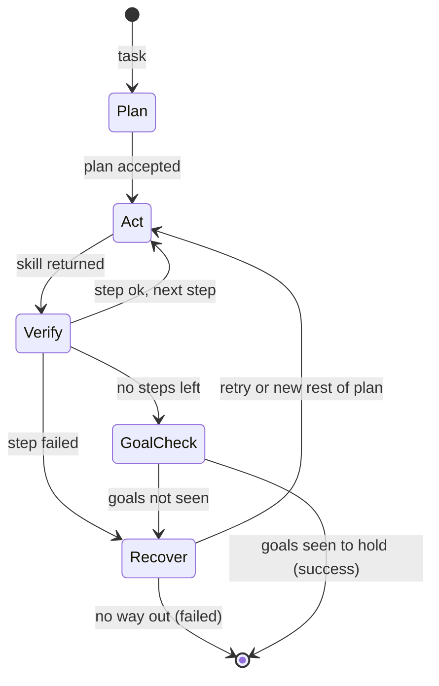
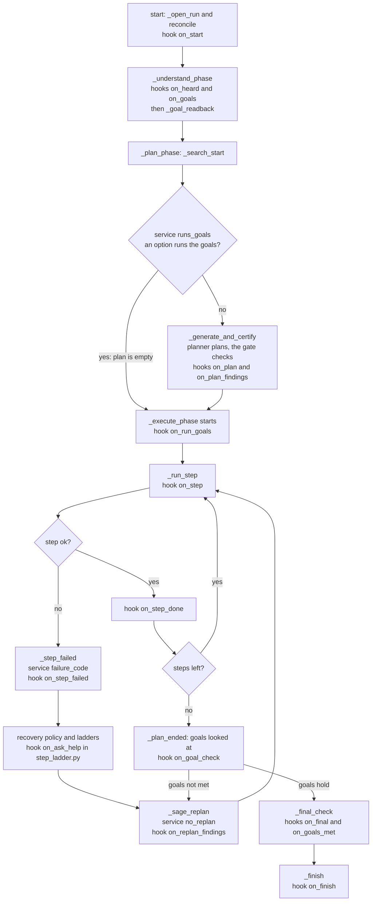
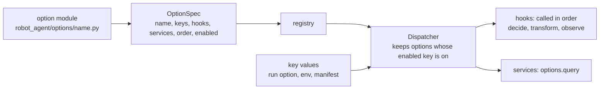

# The closed loop

A robot that makes one plan and then runs it blindly fails as soon as the world differs from the plan. A robot agent works in a loop instead: it plans, acts one step, checks what happened, and when the check fails it repairs the rest of the plan. This page shows that loop on one real offline run and points at the code for each stage.

!!! abstract "In this page"
    - The loop has four stages: plan, act, verify, recover. Every step passes through "act" and "verify". "Recover" runs only when a step fails.
    - When a step fails, the planner replaces **the failed step and every step after it**. Steps that already succeeded stay.
    - A run is "done" only when the goals are seen to hold, not when the last step returns.
    - Example: a run on the hub's fake robot, 33 events. A `Find apple` fails, the loop searches, replans, and ends with `success`. It is a scripted fake, **not run on a real robot**.

!!! code "Where in the code"
    - Choice of path: [`unified_agent.py` L365-L384](https://github.com/mtbui2010/robot_agent/blob/e65e9aa/robot_agent/core/unified_agent.py#L365-L384)
    - Plain loop: [`ClosedLoop.run_blocking`](https://github.com/mtbui2010/robot_agent/blob/e65e9aa/robot_agent/core/planning/loop.py#L574-L594) and [`_cl_step`](https://github.com/mtbui2010/robot_agent/blob/e65e9aa/robot_agent/core/planning/loop.py#L737-L778)
    - Loop with checks and recovery: [`AssistLoop.run_blocking`](https://github.com/mtbui2010/robot_agent/blob/e65e9aa/robot_agent/core/planning/assist_loop.py#L779-L784) (it wraps `_run_blocking`, [L1662-L1703](https://github.com/mtbui2010/robot_agent/blob/e65e9aa/robot_agent/core/planning/assist_loop.py#L1662-L1703), where the four phases are called), [`_execute_phase`](https://github.com/mtbui2010/robot_agent/blob/e65e9aa/robot_agent/core/planning/assist_loop.py#L3205-L3233), [`_run_step`](https://github.com/mtbui2010/robot_agent/blob/e65e9aa/robot_agent/core/planning/assist_loop.py#L3551-L3597), [`_step_failed`](https://github.com/mtbui2010/robot_agent/blob/e65e9aa/robot_agent/core/planning/assist_loop.py#L3660-L3708), [`_sage_replan`](https://github.com/mtbui2010/robot_agent/blob/e65e9aa/robot_agent/core/planning/assist_loop.py#L2960-L2995), [`_plan_ended`](https://github.com/mtbui2010/robot_agent/blob/e65e9aa/robot_agent/core/planning/assist_loop.py#L3245-L3274), [`_final_check`](https://github.com/mtbui2010/robot_agent/blob/e65e9aa/robot_agent/core/planning/assist_loop.py#L4066-L4081)
    - The own ladders of a failed Pick, MoveTo and release: [`step_ladder.py`](https://github.com/mtbui2010/robot_agent/blob/e65e9aa/robot_agent/core/planning/step_ladder.py) (`_recover_pick`, `_recover_move`, `_recover_place`)
    - Options that change the flow: [`bt_goal.py`](https://github.com/mtbui2010/robot_agent/blob/e65e9aa/robot_agent/options/bt_goal.py), [`look_then_ask.py`](https://github.com/mtbui2010/robot_agent/blob/e65e9aa/robot_agent/options/look_then_ask.py), [`fetch_guard.py`](https://github.com/mtbui2010/robot_agent/blob/e65e9aa/robot_agent/options/fetch_guard.py), [`bring_ask.py`](https://github.com/mtbui2010/robot_agent/blob/e65e9aa/robot_agent/options/bring_ask.py)
    - The offline fakes: [`tests/fakes.py`](https://github.com/mtbui2010/robot_agent/blob/e65e9aa/tests/fakes.py) and [`tests/test_assist_loop_fake_robot.py`](https://github.com/mtbui2010/robot_agent/blob/e65e9aa/tests/test_assist_loop_fake_robot.py)

## The idea in plain words

Think of a person who carries an apple from a desk to a table. They walk to the desk and look for the apple. It is not there. They do not give up and they do not keep going to the table. They think "where else could it be?", look in another place, find it, and only then carry on. At the end they look at the table to be sure the apple is there.

The robot agent does the same, in four stages.

| stage | question it answers | what the code does |
|---|---|---|
| **plan** | what steps reach the goal? | a planner turns the task into a list of steps such as `Find apple` |
| **act** | do one step | the step is mapped to a robot skill and the skill runs |
| **verify** | did it work? | the skill's own answer and extra checks (symbolic rule, sensor) are combined into one verdict |
| **recover** | what now? | retry in place, search elsewhere, ask the person, or ask the planner for a new rest of the plan |



`GoalCheck` is a fifth state that the diagram needs: after the last step the loop looks at the world again before it says "done" (see event 31 below).

## One run, event by event

The run below uses the hub's offline fake robot. A scripted language model reads the task, a scripted planner returns the plans, and a symbolic fake house plays the robot. No ROS, no real LLM, no network. This shows how the loop behaves. It says nothing about how a real robot or a real planner performs.

The task: "Bring the apple from the desk to the dining table." In the fake house the apple is on the counter, not on the desk. The first plan is:

```text
MoveTo desk@study room, Find apple, Pick apple, MoveTo dining table@kitchen, Place dining table@kitchen
```

The run produced 33 events (numbered 0 to 32). The table keeps the ones that explain the loop. Fields are cut down; the event names and values are as printed.

| # | event | key fields | stage |
|---|---|---|---|
| 0 | `task_start` | | start |
| 1 | `reconcile` | `when: start`, `changed: {arrived: [null, "entrance"]}` | the [belief](../start/glossary.md#belief) is checked against the sensors, see [The belief and reconcile](belief-and-reconcile.md). A `found` kept from an earlier run is dropped here when the base has moved (not in this run: the belief started empty) |
| 3 | `understand` | `status: clear` | the task becomes a goal |
| 5 | `gate` | `problems: []` | plan: checked before it may run |
| 6 | `plan` | 5 steps, `certified: true` | plan |
| 7-9 | `step_start`, `step_verify`, `step_done` | step 0 `MoveTo desk@study room`, `status: success` | act, verify |
| 10-12 | `step_start`, `step_verify`, `step_done` | step 1 `Find apple`, `status: failed`, `reason: apple not found`, `code: absent` | act, verify fails |
| 13 | `search` | `order: [sofa@living room, side table@living room, desk@study room, drawer@kitchen, counter@kitchen]` | recover: where to look next |
| 14 | `replan` | `at_index: 1`, `plan: [MoveTo counter@kitchen, Find apple, Pick apple, MoveTo dining table@kitchen, Place dining table@kitchen]` | recover: new rest of the plan |
| 15-29 | `step_start`, `step_verify`, `step_done` (x5) | steps 1 to 5, all `success` | act, verify |
| 31 | `goal_check` | `ok: true`, `evidence: the apple is seen on the dining table in the kitchen` | final verify |
| 32 | `done` | `status: success` | end |

The other events (2, 4, 30) are `status` messages that the dashboard shows or speaks, such as "Checking the goals...".

### What each stage looked like

**Plan (events 3 to 6).** The task is first turned into a goal (event 3, in this run scripted). The planner's plan then goes through a gate before anything moves (event 5, no problems found). The [gate](../start/glossary.md#gate) and the [guard](../start/glossary.md#guard) (the check before each step) are the subject of [Checks before motion](checks-before-motion.md).

**Act and verify (events 7 to 12).** `step_start` names the step and the robot skill it maps to (`MoveTo` becomes the skill `move`, `Find` becomes `find`). The skill runs, then `step_verify` lists the layers that were checked. For step 0 it lists three: `isdone` (the skill said yes), `symbolic` (the action rules agree) and `localization` (the base is `0.00 m from desk@study room`). The step is a success only if every layer agrees. For step 1 the skill said no, and the failure carries a typed code, `absent` ("the thing is not there"). Codes are explained in [Skills and failure codes](skills-and-failures.md).

**Recover (events 13 and 14).** A failed step does not go straight to the planner. The loop first applies the recovery rules for that failure code. For a `Find` that failed with `absent` it marks the current place as searched, emits `search` with the places still worth a look, and then asks the planner for a new rest of the plan. A `Find` that failed with no code and no reason text (`UNKNOWN`) is turned into `absent` first by the option `fetch_guard` (part `absent_find`), so it takes this same path; without that, the loop would replan and could get the same plan back. In this run the reason is "apple not found", so the code is `absent` already. The `replan` event carries the reason it sent (`E: Find apple failed. R: apple not found; it is not at desk@study room. ...`) and the new plan.

Two honest notes about this run:

- The reason text says "Look next at sofa@living room", but the new plan goes to `counter@kitchen`. The planner here is a script that returns its second plan whatever the reason says. The apple is on the counter by construction.
- The `replan` event also lists a `problems` entry from the plan checker about step 3 of the old plan (the user said the apple is on the desk). The run went on regardless.

**What "replan" replaces.** In the code the plan after a failure is `steps[:i] + suffix`, where `i` is the index of the failed step ([`_sage_replan`](https://github.com/mtbui2010/robot_agent/blob/e65e9aa/robot_agent/core/planning/assist_loop.py#L2960-L2995)). In the run, step 0 (the move to the desk) stays and the new plan starts at index 1. A new plan that fails the gate never runs; the rest of the old plan is dropped instead.

**Verify the goal (events 30 to 32).** When the steps run out, the loop does not trust its own bookkeeping. `_plan_ended` checks that the goals hold in the belief, then `goal_check` looks at the world: the robot goes to the dining table (if it is not there) and runs `Find apple`. Only after `ok: true` does the run end with `success`. That is why the skill trace ends with one more `find` than the plan has.

The skill calls the fake robot received, in order:

```text
move desk@study room (ok), find apple (failed: apple not found), move counter@kitchen (ok),
find apple (ok), pick apple (ok), move dining table@kitchen (ok), place dining table@kitchen (ok),
find apple (ok, the goal check)
```

## Where options act in one run

`_run_blocking` calls four phases in order: understand, plan, execute, final check ([L1690-L1696](https://github.com/mtbui2010/robot_agent/blob/e65e9aa/robot_agent/core/planning/assist_loop.py#L1690-L1696)). The diagram follows one run and names, in the boxes, the hook (`on_...`) or service of the option dispatcher that is called at that point. A hook is a call the loop makes to every option that lists it. A service is a question the loop asks (`options.query`). Only names that exist in `core/options/spec.py` are drawn; some hooks are left out to keep it short.



*Drawn from the code at e65e9aa, not from a recorded run.* Not drawn: the retries in place inside the recovery policy, a run that ends because no new plan came, and a cancel. The `on_goal_check` hook is called from `_observe_goal`, which `_plan_ended` reaches through `_observe_goals`.

| hook or service | when it runs | example option |
|---|---|---|
| `on_start` (observe) | run set-up, [L1670](https://github.com/mtbui2010/robot_agent/blob/e65e9aa/robot_agent/core/planning/assist_loop.py#L1670) | `bring_ask` |
| `on_heard` (decide) | the words, before the reader is called, [L1824](https://github.com/mtbui2010/robot_agent/blob/e65e9aa/robot_agent/core/planning/assist_loop.py#L1824) | `asr_guard` (named in the code comment) |
| `on_goals` (decide) | the understood goals, before the read-back, [L1870](https://github.com/mtbui2010/robot_agent/blob/e65e9aa/robot_agent/core/planning/assist_loop.py#L1870) | `look_then_ask` |
| `runs_goals` (service) | after `_search_start`, [L2660](https://github.com/mtbui2010/robot_agent/blob/e65e9aa/robot_agent/core/planning/assist_loop.py#L2660): true means no planner call | `bt_goal` |
| `on_plan` (transform) | in `_tidy`, before no-op steps are removed, [L2896](https://github.com/mtbui2010/robot_agent/blob/e65e9aa/robot_agent/core/planning/assist_loop.py#L2896) | `place_find` (code comment) |
| `on_plan_findings` (transform) | the gate's hard findings, [L2909](https://github.com/mtbui2010/robot_agent/blob/e65e9aa/robot_agent/core/planning/assist_loop.py#L2909) | `fetch_guard` |
| `on_run_goals` (decide) | when execute starts with an empty plan, [L3215](https://github.com/mtbui2010/robot_agent/blob/e65e9aa/robot_agent/core/planning/assist_loop.py#L3215) | `bt_goal` |
| `on_step` (decide) | before a step runs, [L3554](https://github.com/mtbui2010/robot_agent/blob/e65e9aa/robot_agent/core/planning/assist_loop.py#L3554) | `reach_delivery` (code comment) |
| `on_step_done` (observe) | a step succeeded, [L3638](https://github.com/mtbui2010/robot_agent/blob/e65e9aa/robot_agent/core/planning/assist_loop.py#L3638) | none of the four options |
| `failure_code` (service) | the typed code of a failure, [L3676](https://github.com/mtbui2010/robot_agent/blob/e65e9aa/robot_agent/core/planning/assist_loop.py#L3676) | `fetch_guard` (`absent_find`) |
| `on_step_failed` (decide) | before the recovery policy, [L3680](https://github.com/mtbui2010/robot_agent/blob/e65e9aa/robot_agent/core/planning/assist_loop.py#L3680) | `bt_goal` |
| `on_ask_help` (decide) | a failed step used its retries, [`step_ladder.py` L119](https://github.com/mtbui2010/robot_agent/blob/e65e9aa/robot_agent/core/planning/step_ladder.py#L119) | none of the four options |
| `no_replan` (service) | in `_sage_replan`, [L2963](https://github.com/mtbui2010/robot_agent/blob/e65e9aa/robot_agent/core/planning/assist_loop.py#L2963): true keeps the step failed | `bt_goal` |
| `on_replan_findings` (transform) | a replan's findings, [L3010](https://github.com/mtbui2010/robot_agent/blob/e65e9aa/robot_agent/core/planning/assist_loop.py#L3010) | none of the four options |
| `on_goal_check` (decide) | the check of one goal, [L3425](https://github.com/mtbui2010/robot_agent/blob/e65e9aa/robot_agent/core/planning/assist_loop.py#L3425) | `reach_delivery` (code comment) |
| `on_final`, `on_goals_met` (decide) | the end-of-run check, [L4067](https://github.com/mtbui2010/robot_agent/blob/e65e9aa/robot_agent/core/planning/assist_loop.py#L4067) and [L4076](https://github.com/mtbui2010/robot_agent/blob/e65e9aa/robot_agent/core/planning/assist_loop.py#L4076) | `unapplied_change`, `hazard` (code comments) |
| `on_finish` (observe) | the `done` event's fields, [L1726](https://github.com/mtbui2010/robot_agent/blob/e65e9aa/robot_agent/core/planning/assist_loop.py#L1726) | `hazard` (code comment) |

The kinds come from `HOOKS` in [`spec.py`](https://github.com/mtbui2010/robot_agent/blob/e65e9aa/robot_agent/core/options/spec.py): `decide` means the first answer that is not `None` wins, `transform` means the options are chained and each returns a new value, `observe` means all run and the results are dropped. Examples marked "code comment" are the options named in the comment at the call site; I did not open those options. "None of the four options" means none of `look_then_ask`, `bring_ask`, `fetch_guard`, `bt_goal` lists that hook in its `OptionSpec`.

### How an option plugs in

An option is a module in `robot_agent/options/` that registers one `OptionSpec` (and a factory). The `Dispatcher` builds only the options whose `enabled` key is on, and calls their hooks in `order`.



What each option of this page declares, read from its `OptionSpec`:

| option | hooks | services | order | enabled |
|---|---|---|---|---|
| `look_then_ask` | `on_goals` | none | 29 | key `enabled` |
| `bring_ask` | `on_start` | `person_where` | 75 | key `enabled` |
| `fetch_guard` | `on_plan_findings` | `rank_first`, `failure_code` | 32 | key `enabled` |
| `bt_goal` | `on_run_goals`, `on_step_failed` | `runs_goals`, `no_replan` | 5 | key `enabled` |

*Drawn from the code at e65e9aa (`spec.py`, `dispatch.py`, the four option modules), not from a recorded run.* The default value of each `enabled` key is not shown here; the text above says all four are on by default.

## Four ways a request is run

`UnifiedAgent.run` picks how a request is executed ([`unified_agent.py` L365-L384](https://github.com/mtbui2010/robot_agent/blob/e65e9aa/robot_agent/core/unified_agent.py#L365-L384)). `run_direct` is a separate method.

| path | when | what runs |
|---|---|---|
| open loop (legacy) | no `planner` in the request and `ROBOT_AGENT_CLOSED_LOOP` is not `1` | the language model writes a `skill::input` plan once, steps run in order, no per-step recovery |
| `ClosedLoop` | planner `sage_plain`, `direct`, or a plug-in planner name | plan, act, verify, replan, as in `loop.py` |
| `AssistLoop` | planner `sage` (or env `ROBOT_AGENT_PLANNER=sage`) | the same loop plus understanding and clarification of the task, a certified gate, a guard before each step, per-action recovery and a goal check |
| `run_direct` | a plan that is already `skill::input` text | runs the steps without an LLM |

`ClosedLoop` and `AssistLoop` are glossary names; see the [glossary](../start/glossary.md#closedloop) and [planners](planners.md) for how the planner behind each key is chosen. The run above is an `AssistLoop` run, which is why it has `understand`, `gate` and `goal_check` events. The plain `ClosedLoop` has the same plan, act, verify and replan shape (`_cl_plan`, `_cl_execute`, `_cl_step`) without those extras.

## Options that change the flow

The `AssistLoop` does not hold every behaviour in its own code. Some are **options**: small modules that the loop calls at fixed points (hooks). They are listed in [`docs/options.md`](https://github.com/mtbui2010/robot_agent/blob/e65e9aa/docs/options.md). Four of them change what the stages above do. All four are on by default.

| Option | What it changes | Switch off |
|---|---|---|
| `look_then_ask` | **Before the plan, for a goal whose source is not said.** An `on` or `in` goal with no `from`, whose object the memory does not hold as a trusted sighting, gets one `Find` where the robot stands. Seen: that place is the source, no question. Not seen: the robot asks once, "I don't see the X here. Where is it?". A place in the answer is the source. "I don't know", silence or an answer with no place leaves the goal to the ranked search, and the question is not asked again. If the answer names no place the map has (a typo, an unknown name), the robot asks ONE follow-up that offers up to 3 near places (key `offer_near`, default on; never the goal's destination); a second answer with no place leaves the goal to the ranked search. If the robot has no `Find` it can use, nothing changes. | run option `look_then_ask=0` (or `ROBOT_AGENT_LOOK_THEN_ASK=0`): the search by belief runs first and the question comes after the misses |
| `fetch_guard` | **Before the plan, in the gate and when a `Find` fails.** For an `on` or `in` goal whose object has no source (no `from`, no trusted sighting), the place it must end up is never taken for the place it is now. (1) `rank_unknown`: the ranked search gives the object a first place to look before planning, never its destination. (2) `plan_finding`: a plan that drives to the destination and Finds or Picks the object there gets a gate finding, so the planner is asked for another plan (see [Checks before motion](checks-before-motion.md#a-finding-from-an-option-fetch_guard)). (3) `absent_find`: a failed `Find` with code `UNKNOWN` becomes `ABSENT`, so the search and then the question run, not a replan of the same plan. | run option `fetch_guard=0` (or `ROBOT_AGENT_FETCH_GUARD=0`); one part with `fetch_guard.rank_unknown=0`, `.plan_finding=0` or `.absent_find=0` |
| `bring_ask` | **In grounding, for "bring me X".** One combined question, "Where are you? Or where should I put it?", also when the robot tracks the person. Asked once per request. Not asked when the words ask for a hand-over ("hand me the mug"). | run option `bring_ask=0` (or `ROBOT_AGENT_BRING_ASK=0`) |
| `bt_goal` | **Plan and act.** When the manifest declares `trees` (a behaviour tree per goal kind), the goals with a tree are run by the tree and the planner is not called for them. Each tree step goes through the loop's own step path and recovery ladder. With key `mixed` (default on), neighbouring goals without a tree are planned by SAGE once, when the run reaches them. A step with no way left hands the goals still open to the SAGE replan. A robot that declares no `trees`: nothing changes. | run option `bt_goal=0`; `bt_goal.mixed=0` gives the older all-or-nothing rule |

What was checked and what was not:

- `look_then_ask` and `bring_ask` were checked with **English phrases only** (the core's own texts for `q_where_is_here` and `q_where_bring`). A run in Korean or Vietnamese is **not verified** for these two options. The follow-up of `offer_near` has only an English phrase (`q_place_unknown`); Korean and Vietnamese are not provided, and other languages go through the translator.
- `fetch_guard` and `offer_near` are **not measured** on any benchmark and were **not run with a real LLM**. The real-robot evidence is two run records of 2026-11-20: in the good run the answer "on the dining table" was grounded and the run succeeded; in the bad run "on the dinning table" was not grounded, the plan looked for the banana at its destination, and the run had 5 failed Finds and 4 identical replans.
- For `bt_goal` with `mixed`, a SAGE part skips the loop's certify gate (only the planner's own verifier runs). Its effect on a benchmark is **not measured**. Design: [`docs/bt_goal.md`](https://github.com/mtbui2010/robot_agent/blob/e65e9aa/docs/bt_goal.md).
- While a tree runs, a failed step is not replanned (`no_replan`): the step stays failed and the tree's own fallback decides. So "the planner replaces the failed step and every step after it" holds for the plain path, not for a tree step.
- The offline run on this page declares no trees, so it does not use `bt_goal`. It also gives every goal a source, so `look_then_ask` does not ask in it and `fetch_guard` has nothing to guard. I ran the script again on 2026-11-20 at e65e9aa: the same 33 events and the same skill trace.

## Where each stage lives

| stage | `ClosedLoop` (`loop.py`) | `AssistLoop` (`assist_loop.py`) |
|---|---|---|
| start, reconcile | `run_blocking`, `_reconcile` | `run_blocking`, `_reconcile` |
| plan | `_cl_plan`, `_cl_certify` | `_understand_phase`, `_plan_phase`, `_generate_and_certify` |
| act | `_cl_step` | `_run_step` (after `_guard`) |
| verify | `StepVerifier` inside `_cl_step`, `verdict` | `_post_check`, `verdict`, then `_final_check` and `_observe_goals` |
| recover | `_cl_failed`, `_cl_replan` | `_step_failed`, `_apply_policy`, `_recover_find`, `_sage_replan`; `_recover_pick`, `_recover_move`, `_recover_place` are in `step_ladder.py` (the `StepLadder` mixin of `AssistLoop`) |

## Run it yourself

The script below is the one used for this page. It mirrors `make_assist` in `tests/conftest.py`: scripted LLM, scripted planner, fake robot. It needs a Python with `pyyaml`, no ROS and no network. It replaces `requests` with an empty module because the planner library imports it and nothing here calls it. Run it with `python -B` so no bytecode lands in the repos.

```python
"""AssistLoop (planner 'sage') on the hub's symbolic FakeRobot: scripted LLM + scripted planner."""
import json, os, sys, types
from pathlib import Path
REPOS, OUT = Path(os.environ["REPOS"]), sys.argv[1]   # REPOS: folder holding robot_agent and embodiplan
sys.path[:0] = [str(REPOS / "robot_agent"), str(REPOS / "robot_agent" / "tests"), str(REPOS / "embodiplan")]
sys.modules.setdefault("requests", types.ModuleType("requests"))
from fakes import FakeLLM, FakeRobot, ScriptedPlanner, FakeState, FakeSkillRegistry, load_env, run_task, done, steps
import robot_agent.state as state_mod, robot_agent.core.planning.assist_loop as AL, robot_agent.core.planning.loop as LP
import robot_agent.skill_configs as sc
from robot_agent.core.run_control import begin_run
st = FakeState(Path(OUT))
for m in (AL, LP, state_mod): m.current = lambda: st
for m in (AL, LP): m.host_id = lambda: "test"
env = load_env(); sc.ENV = env
AL.reconcile_world = lambda node, world, threshold=0.8: world
begin_run()
DT, DS, CT = "dining table@kitchen", "desk@study room", "counter@kitchen"
robot = FakeRobot(env, {"apple": CT, "mug": DS, "banana": DT})          # the apple is NOT on the desk
llm = FakeLLM({"status": "clear", "reason": "", "question": "",
               "goals": [{"type": "on", "object": "apple", "from": "desk", "to": "dining table"}]})
planner = ScriptedPlanner(steps(f"MoveTo {DS}", "Find apple", "Pick apple", f"MoveTo {DT}", f"Place {DT}"),
                          replans=[steps(f"MoveTo {CT}", "Find apple", "Pick apple", f"MoveTo {DT}", f"Place {DT}")])
agent = types.SimpleNamespace(skill_registry=FakeSkillRegistry(robot), device_manager=types.SimpleNamespace(_ros_node=None),
                              _llm_cfg={"name": "fake", "url": None, "model": "scripted"})
loop = AL.AssistLoop(agent, emit=None, log_dir=OUT + "/runs", live_path=OUT + "/live.jsonl", memory_path=OUT + "/om.json",
                     mute_skill_tts=False, speak_backend=False, vlm_enabled=False)
loop._llm_client, loop._make_planner = llm, (lambda: planner)
evs = run_task(loop, "Bring the apple from the desk to the dining table.")
for i, e in enumerate(evs):
    print(i, json.dumps({k: e[k] for k in ("event", "index", "action", "object", "skill", "status", "ok", "reason", "problems") if k in e})[:200])
print("TRACE", robot.trace)
print("DONE", done(evs).get("status"))
```

Output (event lines 0 to 14 and 30 to 32 shown; the middle repeats the pattern of events 7 to 9):

```text
teleop stop_all: 'FakeState' object has no attribute 'cm'
0 {"event": "task_start"}
1 {"event": "reconcile"}
2 {"event": "status"}
3 {"event": "understand", "status": "clear", "reason": ""}
4 {"event": "status"}
5 {"event": "gate", "problems": []}
6 {"event": "plan"}
7 {"event": "step_start", "index": 0, "action": "MoveTo", "object": "desk@study room", "skill": "move"}
8 {"event": "step_verify", "index": 0}
9 {"event": "step_done", "index": 0, "status": "success"}
10 {"event": "step_start", "index": 1, "action": "Find", "object": "apple", "skill": "find"}
11 {"event": "step_verify", "index": 1}
12 {"event": "step_done", "index": 1, "status": "failed", "reason": "apple not found"}
13 {"event": "search", "object": "apple"}
14 {"event": "replan", "reason": "E: Find apple failed. R: apple not found; it is not at desk@study room. Look next at sofa@living room. S: robot at desk@study room, holding nothing; goals: on apple from
...
30 {"event": "status"}
31 {"event": "goal_check", "ok": true}
32 {"event": "done", "status": "success"}
DONE success
```

The first line is a harmless warning from the fake state object, which has no config manager. I ran this script offline on 2026-11-18 and it printed 33 events (indexes 0 to 32) and the skill trace shown above.

!!! warning "What this example is not"
    The language model, the planner and the robot are all scripted or fake. The run shows the order of events and what each stage does. It is not a measurement and **not run on a real robot**. A real planner may not return the plan you expect, and a real `Find` depends on a camera and a detector.
