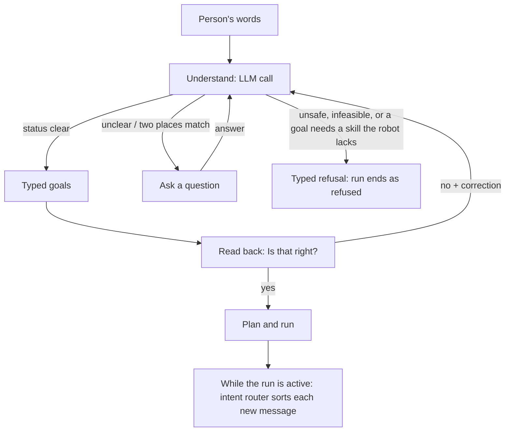
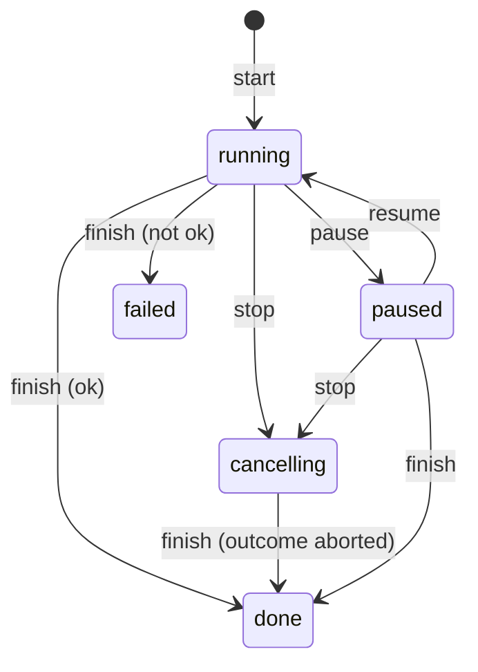

# Dialog and intent

A person talks to the robot in two situations. Before the task starts, the robot has to understand the words and sometimes ask a question. While the task runs, the person may say something more: "stop", "also bring a cup", "what are you doing?". This page explains how the code handles both.

!!! abstract "In this page"
    - **Understand**: the person's words become **typed goals** (`on`, `in`, `open`, `close`, `go`, `say`, `deliver`). If something is unclear, the robot asks. If the robot cannot do it, it refuses with a typed reason.
    - **Ask**: while the robot waits for an answer, the run is marked as waiting. An answer can come from the robot's own microphone or be typed from any client. Yes/no answers are read by a small word-list reader.
    - **Questions the robot adds itself**: `look_then_ask` (looks where it stands, then asks once "I don't see the X here. Where is it?") and `bring_ask` (one question, "Where are you? Or where should I put it?"). Both are on by default.
    - **Intent router**: a message that arrives during a run is sorted into one of nine kinds. Stop, pause and resume are matched by keywords, never by an LLM, so they work when the LLM server is down.
    - Examples here run offline. Where an LLM reply is needed, it is **a scripted LLM reply** and is labelled so.

!!! code "Where in the code"
    - [`intent_router.py`](https://github.com/mtbui2010/robot_agent/blob/3269923/robot_agent/interact/intent_router.py#L30-L222): `Intent`, `IntentRouter`, the keyword lists
    - [`dialog.py`](https://github.com/mtbui2010/robot_agent/blob/3269923/robot_agent/interact/dialog.py#L64-L213): `ask`, `ask_heard`, `yes_no`, `read_yes_no`, `ask_yes_no`
    - [`RunManager.inject`](https://github.com/mtbui2010/robot_agent/blob/3269923/robot_agent/interact/run_manager.py#L611-L651) and [`Refusal`](https://github.com/mtbui2010/robot_agent/blob/3269923/robot_agent/interact/run_manager.py#L88-L92)
    - [`goals.py`](https://github.com/mtbui2010/robot_agent/blob/3269923/robot_agent/core/planning/goals.py#L25-L55): the goal kinds. [`typed_refusal`](https://github.com/mtbui2010/robot_agent/blob/3269923/robot_agent/core/planning/understand.py#L673-L712) in `understand.py`.
    - The understand and clarify rounds: [`assist_loop.py`](https://github.com/mtbui2010/robot_agent/blob/3269923/robot_agent/core/planning/assist_loop.py#L1787-L1893), [`_ask_clarify`](https://github.com/mtbui2010/robot_agent/blob/3269923/robot_agent/core/planning/assist_loop.py#L2563-L2594), [`_read_back`](https://github.com/mtbui2010/robot_agent/blob/3269923/robot_agent/core/planning/assist_loop.py#L2438-L2508)
    - The words of the keyword lists: language packs, [`langdata.py`](https://github.com/mtbui2010/robot_agent/blob/3269923/robot_agent/core/planning/langdata.py) and `core/planning/lang/<code>.json` (the `dialogue` block)
    - [`look_then_ask.py`](https://github.com/mtbui2010/robot_agent/blob/3269923/robot_agent/options/look_then_ask.py) and [`bring_ask.py`](https://github.com/mtbui2010/robot_agent/blob/3269923/robot_agent/options/bring_ask.py): the two questions the robot adds before it plans
    - [`languages.py`](https://github.com/mtbui2010/robot_agent/blob/3269923/robot_agent/core/languages.py#L19-L130)

## The idea in plain words

Think of a shop assistant. A customer says "put the mug on the table". The assistant checks: which table? Is that safe? Can I do it at all? If the answer is unclear, the assistant asks one short question (the robot calls this a [clarify](../start/glossary.md#clarify)). If it is clear, the assistant says it back ("I will put the mug from the desk on the dining table. Is that right?") and then starts.

While the assistant works, the customer may talk again. "Stop!" must work at once, every time. "Wait" means pause. "Also bring a cup" is a change of plan. A reply to a question the assistant just asked is an answer, not a new order. The **intent router** is the part that decides which of these a message is. See [intent](../start/glossary.md#intent) in the glossary.



## From words to typed goals

An early LLM call of the [AssistLoop](../start/glossary.md#assistloop) is the **understand** call. It turns the task text into a list of goals, each `{type, object, from, to}`, and gives a status: `clear`, `ambiguous`, `unsafe` or `infeasible`.

The goal `type` must be one of seven kinds. Each kind needs certain abstract actions from the robot's [manifest](../start/glossary.md#manifest) (the `action` field of each skill):

| Kind | Meaning | Actions it needs |
|---|---|---|
| `on` | Move an object onto a surface | `Pick`, `Place` |
| `in` | Move an object into a container | `Pick`, and `PutIn` or `Place` |
| `open` | A container ends open | `Open` |
| `close` | A container ends closed | `Close` |
| `go` | The robot goes to a place | `MoveTo` |
| `say` | The robot says a sentence | `Say` (and `MoveTo` if a place is given) |
| `deliver` | Take what the robot carries to a place and wait until a person takes it | `MoveTo`, `WaitForUnload` |

`go`, `say` and `deliver` are the *template kinds*: they have a fixed sequence of steps compiled in code, with no planner LLM call. The four manipulation kinds go to the planner. The understand prompt only offers the template kinds that the robot has the actions for (`kinds_for`). The manipulation kinds are always offered, so a request the robot cannot do is first understood and then refused with a reason.

A robot or run may also switch on an optional eighth kind, `give` (run option `understand_give_kind`, default off). It means "hand an object to a person" and is turned into an `on` goal whose destination is the person (`goals.canonical`). With the option off, the seven kinds above are all the model is offered.

The code that checks a goal against the robot (`missing_actions`) knows no robot by name. The actions a robot has come from its manifest. See [A robot as data](robot-as-data.md).

### A question from the grounding step

After the LLM answers, the loop maps the words onto the places the robot knows. If one word matches two places, the loop writes a question itself. The example below uses **a scripted LLM reply** (`FakeLLM`) that says the target is just "table". The test house has a side table in the living room and a dining table in the kitchen. The run below is the one from [Runs and records](runs-and-records.md#one-real-record). Its first two lines of dialog were:

```text
clarify: Which table do you mean: side table in the living room or dining table in the kitchen?
clarify: I will put the mug from the desk in the study room on the dining table in the kitchen. Is that right?
```

The fake robot's `Ask` skill answered "the dining table" to the first question. That answer came through the robot's own I/O, so the loop could not be sure it was heard right, and it **read the goals back** with a second question. The fake robot answers "yes" to any "is that right?" unless its scripted answer starts with "no" (`tests/fakes.py`). A real person could have said no.

The loop is bounded:

| Setting (env variable, default) | Meaning |
|---|---|
| `clarify_rounds` (`ROBOT_AGENT_CLARIFY_ROUNDS`, 3) | After this many questions the run fails: "still unclear after N questions". |
| `silence_retries` (`ROBOT_AGENT_SILENCE_RETRIES`, 1) | Times a question is asked again when nobody answers. |
| `yes_no_reasks` (`ROBOT_AGENT_YES_NO_REASKS`, 1) | Times an unclear yes/no answer is asked again. |
| `confirm_answers` (`ROBOT_AGENT_CONFIRM_ANSWERS`, on) | Read the goals back after an answer that was *heard*. |
| `confirm_task` (`ROBOT_AGENT_CONFIRM_TASK`, off) | Always read the goals back, even for a first request. |

All five are also accepted as per-run `options` on `/ws/agent`. A question that the code calls essential (where the person is) may be asked one round past `clarify_rounds`. After two read-backs without a "yes", the run fails with "the user did not confirm the task". A bare "no" makes the robot ask "Sorry. What should I do?". A "no" with words ("no, the shelf in the restroom") is used as the correction.

### Typed refusals

The robot refuses only for a **typed reason**, never because the model wrote something unfriendly. `typed_refusal` returns a `Refusal` with a `kind`:

| Kind | When |
|---|---|
| `capability` | The model's status is `infeasible`, **or** a goal needs an action the manifest has no skill for. |
| `safety` | The model's status is `unsafe`. |
| `declined` | The constant exists, and its docstring says "the person said no". No code path in `robot_agent` returns it at this commit (found by searching for `DECLINED` and `declined`). |

One more rule protects against a misheard answer. If the model refuses right after an answer that came through the microphone, and the person's words contain no word from the robot's safety profile (`refusal_marks`, passed to `typed_refusal` as `marks`), the refusal is **not** applied. A profile with no such words lets the refusal stand. The loop removes that answer and asks the question again: "Sorry, I may have misheard you." A typed answer cannot be misheard, so this rule does not apply to it.

These are real outputs of `typed_refusal(status, reason, missing, words, answer_heard)`:

```text
typed_refusal("unsafe", "it is dangerous", None, "cut with a knife", False)
Refusal(kind='safety', msg='it is dangerous', say="I can't do that: it is dangerous", missing='', misheard=False)
typed_refusal("clear", "", "Open", "open the drawer", False)
Refusal(kind='capability', msg='this robot has no Open skill', say='', missing='Open', misheard=False)
typed_refusal("infeasible", "no", None, "the sofa", True)
Refusal(kind='capability', msg='no', say="I can't do that: no", missing='', misheard=False)
typed_refusal("clear", "", None, "x", False)
None
```

(The call lines above are copied from the script below; the outputs are its real outputs.) When a refusal is applied, the loop ends the run with status `refused` and the `refusal` kind in the final `done` event. Nothing is planned.

Two more rules sit before a refusal is final (`_capability_check`). A model `infeasible` with no goals, and nothing heard that could be refused, makes the robot ask the person to say it again (`q_repeat`) instead of refusing. A model `infeasible` for goals that the robot's manifest can do, with a reason that is only a missing skill or "other", is read back to the person instead of refused. A goal whose object is over the manifest's declared limits is refused as `capability`.

### Language

The robot talks in the languages its manifest declares: `language` (the default) and optionally `languages`. A manifest that names none gives English only. The dashboard builds its picker from `GET /robot/languages`, and a site can switch some of the manifest's languages off in a `languages.json` file. The loop writes its questions in English and, for `ko`, `vi`, `ja` and `zh`, asks the LLM to translate them. If the LLM is not reachable it keeps the English text. The word lists for yes/no, stop/pause/resume, negation and the status/drop/modify/add keywords are not in the code any more: they are language-pack data, the `dialogue` block of `core/planning/lang/<code>.json`. At this commit `en`, `ko` and `vi` have words; `ja` and `zh` have none, so a reply in them is read as a correction and has no keyword command.

## Two questions the robot adds before it plans

After the goals are understood, options can add one question of their own. Two are on by default. They act on the goal list before the read-back (hook `on_goals` for the first, grounding for the second). Both were checked with **English phrases only**: the texts are the core's `q_where_is_here` and `q_where_bring`. Korean and Vietnamese are **not verified**.

**`look_then_ask`: look first, then ask.** It acts on an `on` or `in` goal when the request does not name where the object is and the object memory does not hold a trusted sighting. The robot makes one `Find` where it stands.

- Seen: that place is the source. No question.
- Not seen: one question, "I don't see the mug here. Where is it?" (a `clarify` event of kind `where_source`). A place in the answer becomes the source. A room is looked at first.
- "I don't know", silence, or an answer with no place: the goal goes to the ranked [search by belief](closed-loop.md#options-that-change-the-flow), and the question is not asked again.
- No `Find` the robot can use: nothing changes, the engine's own order stands.

It asks once per object and run. When `ask_source` is also on, `look_then_ask` goes first and `ask_source` does not ask about the same object. Switch off: run option `look_then_ask=0` (or `ROBOT_AGENT_LOOK_THEN_ASK=0`); the search by belief then runs first and the question comes after the misses.

**`bring_ask`: one question for "bring me X".** A request to bring something to the speaker asks one combined question, "Where are you? Or where should I put it?", also when the robot already tracks the person.

- Person not tracked: a place where they are puts the object on the support surface nearest to it. A place to put it puts it there. No place ("hand it to me") is a hand-over.
- Person tracked: the answer is kept, but the delivery stays the engine's own (hand-over, or the surface by the tracked position).
- Asked once per request. The place the person says they are at is never the object's source.
- Not asked when the words already ask for a hand-over ("hand me the mug").

Switch off: run option `bring_ask=0` (or `ROBOT_AGENT_BRING_ASK=0`). Details: [`docs/options.md`](https://github.com/mtbui2010/robot_agent/blob/3269923/docs/options.md) and [`docs/dialog.md`](https://github.com/mtbui2010/robot_agent/blob/3269923/docs/dialog.md). The offline scripts on this page do not run these two options, so their behaviour here comes from reading the code and the option documents, not from a run.

## Asking a question and taking the answer

The robot's own `Ask` skill (from its manifest) only does the I/O: say the question, listen. The **state** lives in `interact/dialog.py`. `ask(run, question, io)` does this:

1. It marks the run as waiting on the question (`Run.set_awaiting`).
2. It starts the robot's I/O in a thread.
3. It returns the first of: the robot's answer, an **ANSWER typed into the run** from any client, or a stop (an empty answer).

The returned `Answer` says where the text came from: `source='robot'` or `source='typed'`. A typed answer cannot have been misheard, so the loop does not read it back.

There are two ways for an answer to come in over HTTP. They are different channels:

| Endpoint | Used for |
|---|---|
| `POST /runs/{id}/inject` | Any text for the run. While the run waits on a question, the router sorts it as ANSWER. |
| `POST /agent/listen/{req_id}` | The dashboard's transcript for a **pending listen request** of a skill that listens through the browser. It answers 404 once nothing is waiting. |

This is a real run with an answer typed in, using `RunManager` and `dialog.ask` (no LLM, no robot). The robot's own listen hears nothing, and the owner types the answer:

```text
awaiting: Which table do you mean?
inject by the owner: answered True answer 
answer: Answer(text='the dining table', source='typed') | awaiting now: None
```

### Yes or no

`read_yes_no(text)` reads an answer with the `dialogue` word lists of the language packs (English, Korean and Vietnamese have words). The `NO` list is checked first, so "no, ok" is a no.

| Kind | Meaning | Real examples |
|---|---|---|
| `yes` | A yes word was heard. | `'yes'`, `'yeah sure'` |
| `no` | A no word was heard. `rest` is what follows. | `'no'` (rest empty), `'no, the one in the restroom'` (rest `'the one in the restroom'`) |
| `correction` | Neither, and there is a real word: treated as a correction. | `'the restroom one'` |
| `unclear` | Only fillers, near-misses of yes/no, or 1-2 letter fragments. | `'yet'`, `'uh'` |
| `silence` | Nothing was heard. | `''` |

Only `unclear` is asked again. `ask_yes_no` asks the same question again with the robot's own short phrase (`yes_or_no`) up to `yes_no_reasks` times. If the answer is still unclear, the loop treats it as a bare "no" and asks an open question next. `Reply.ok` gives the old three-way verdict: `True` for yes, `None` for silence, `False` for anything else.

## What a message means during a run: the intent router

`RunManager.inject(run_id, text, user_id, role)` takes anything said or sent while a run is active. The **router** only decides; `inject` acts. There are nine intents:

| Intent | What `inject` does |
|---|---|
| `stop` | Cancels the run (and stops the robot). |
| `pause` | Pauses the run at its next step boundary. |
| `resume` | Resumes a paused run. |
| `status` | Returns the run's state and the question it waits on. No role check. |
| `answer` | Gives the text to the waiting question. |
| `modify`, `add`, `drop`, `new` | Queues the change on the run. The loop takes it at its next step boundary and applies it. |

A `new` task that comes from a person with a **higher role** than the one who started the run goes first: the current task is put on a stack and taken back after. Otherwise the robot asks "first, or after this task?" and, with no answer, does it after (the AssistLoop code `_new_command`).

### How the router decides

The order is fixed. The cheapest and safest check comes first:

1. **Control words.** `stop`, `pause`, `resume` are matched by whole phrases (the `dialogue` word lists of the language packs: English, Korean and Vietnamese), never by an LLM. The message must be at most 4 words long, must **be** the phrase (after polite fillers like "please" or "robot" and a small set of tail words like "now"), and must not contain a negation. Result: source `keyword`, confidence 1.0.
2. **Answer.** If the run is waiting on a question, the message is an `answer` (source `awaiting`, 0.9).
3. **LLM classifier**, if one is given (a function `llm(text, context)`). It can only return `modify`, `add`, `drop`, `new` or `status`. It never decides stop, pause or answer. If it is missing, raises, or returns something else, step 4 runs.
4. **Keyword fallback** for the rest (source `fallback`): word lists for `status`, `drop`, `modify`, `add`, in that order. A question mark with no other match gives `status` (0.3). Everything else is `new` (0.3).

Real outputs of `IntentRouter().classify(text, awaiting=...)`:

```text
'stop'                       awaiting=False -> stop    keyword   1.0 keyword 'stop'
'pause'                      awaiting=False -> pause   keyword   1.0 keyword 'pause'
'stop now please'            awaiting=False -> stop    keyword   1.0 keyword 'stop'
"don't stop"                 awaiting=False -> new     fallback  0.3 no keyword
'bus stop'                   awaiting=False -> new     fallback  0.3 no keyword
'also bring a cup'           awaiting=False -> add     fallback  0.5 keyword 'also'
'what are you doing?'        awaiting=False -> status  fallback  0.5 keyword 'what are you doing'
'the dining table'           awaiting=True  -> answer  awaiting  0.9 answer to: Which table do you mean?
'yes'                        awaiting=True  -> answer  awaiting  0.9 answer to: Is that right?
'stop'                       awaiting=True  -> stop    keyword   1.0 keyword 'stop'
keyword_fallback('stop') -> new
with a scripted LLM reply: modify llm 0.9
scripted LLM says 'stop': new fallback
```

Read the table this way:

- "Don't stop" and "bus stop" are not commands. A negation or a longer phrase turns the control match off.
- `keyword_fallback('stop')` alone gives `new`. Control words are matched earlier, in `_control`, so the fallback never sees them in a live run.
- With **a scripted LLM reply** `{"intent": "modify", ...}`, the router returned `modify` with source `llm`. With a scripted reply of `"stop"`, the router discarded it and fell back to `new`.
- In the code at this commit, `RunManager` builds its router as `IntentRouter()` with no LLM classifier, and nothing in `robot_agent` sets one (found by searching for `IntentRouter(` and `router.llm`). So in a live process the keyword fallback decides `modify`, `add`, `drop`, `new` and `status`. The LLM hook exists and works, as shown, but is not wired in.

### The run states and the intents that move them



`modify`, `add`, `drop`, `new`, `status` and `answer` do not change the state. A pause is accepted only from `running` and a resume only from `paused`; a repeated pause is a no-op. `finish` after a cancel always ends in `done` with the outcome `aborted`.

### Roles and typed refusals of requests

Each run remembers the role of the person who started it. Roles rank `owner` > `member` > `guest`. A person with a lower role cannot cancel, pause, resume, answer for or change the run. `status` is the only intent that skips this check (see the warning below). The refusal is a `Refusal` or an `InjectResult` with a **code**:

| Code | Meaning | HTTP status from the `/runs/...` endpoints |
|---|---|---|
| `refused` | The caller's role is lower than the run starter's. A `run_refused` event is published, so the owner's dashboard sees it. | 403 |
| `not_found` | No run with this id. | 404 |
| `not_active` | The run has already ended. | 409 |

The `Refusal` dataclass also lists `not_awaiting` in a comment. Nothing in `run_manager.py` produces it at this commit.

Real outputs (the run manager only; one guest-started run, one owner-started run, one run already finished):

```text
{'run_id': '20261118-165807-2610d1', 'action': 'refused', 'ok': False, 'reason': 'run 20261118-165807-2610d1 was started by someone (owner); a guest cannot override it', 'code': 'refused'}
{'run_id': 'nope', 'action': 'refused', 'ok': False, 'reason': "no run 'nope'", 'code': 'not_found'}
{'run_id': '20261118-165807-2610d1', 'action': 'refused', 'ok': False, 'reason': 'run 20261118-165807-2610d1 is done', 'code': 'not_active'}
{'run_id': '20261118-165807-b449bb', 'action': 'cancelled', 'ok': True, 'intent': 'stop', 'intent_source': 'keyword'}
```

!!! warning "While a question is open, every message from someone else is an answer"
    Step 2 of the router runs before the fallback. So a lower-role person who types "how is it going?" while the robot waits on a question gets `intent: answer` and a **refusal**, not a status. In the offline check (`inject` by a `member` and then a `guest` on an owner's run that was waiting on "Which table do you mean?") the first reply was `refused` with the reason `run ... was started by alice (owner); a member cannot override it`, and the guest's status question was `refused` too. The comment "STATUS is open to everyone" is true only when no question is pending.

!!! warning "A control word still wins when you answer a question"
    `'stop'` with `awaiting=True` gave `stop`, not `answer`. Control words are matched before the awaiting check. An answer such as "wait" would pause the run. This is how a person can always stop the robot, but it means those words cannot be used as answers.

## Run it yourself

The two scripts below use only pure Python and the run manager. The router and dialog results do not need an LLM. They ran with `/usr/bin/python3 -B`, in a checkout of `robot_agent` at `3269923` (rerun on 2026-11-20; the printed outputs are unchanged), with `REPOS` set to the folder that holds the repos.

```python
import os; import sys, threading, time
sys.path.insert(0, os.environ["REPOS"] + "/robot_agent")
from robot_agent.interact.intent_router import IntentRouter, keyword_fallback
from robot_agent.interact.run_manager import RunManager
from robot_agent.interact import dialog
from robot_agent.core.planning.understand import typed_refusal
r = IntentRouter()
for text, aw in [("stop", None), ("pause", None), ("stop now please", None), ("don't stop", None), ("bus stop", None),
                 ("also bring a cup", None), ("what are you doing?", None), ("the dining table", "Which table do you mean?"),
                 ("yes", "Is that right?"), ("stop", "Is that right?")]:
    d = r.classify(text, awaiting=aw)
    print(f"{text!r:28} awaiting={aw is not None!s:5} -> {d.intent.value:7} {d.source:9} {d.confidence} {d.reason}")
print("keyword_fallback('stop') ->", keyword_fallback("stop").intent.value)
llm = IntentRouter(llm=lambda text, ctx: {"intent": "modify", "confidence": 0.9, "reason": "scripted"})
d = llm.classify("put it on the desk instead"); print("with a scripted LLM reply:", d.intent.value, d.source, d.confidence)
d = IntentRouter(llm=lambda t, c: "stop").classify("take the cup away"); print("scripted LLM says 'stop':", d.intent.value, d.source)
print()
for t in ["yes", "yeah sure", "no", "no, the one in the restroom", "the restroom one", "yet", "uh", ""]:
    rep = dialog.read_yes_no(t); print(f"{t!r:32} -> kind={rep.kind:10} rest={rep.rest!r:28} ok={rep.ok}")
print()
# a question on a run, answered by a typed ANSWER injected from another client
m = RunManager(); run = m.start("demo", user_id="alice").run
out = {}
def io(q): time.sleep(0.5); return ""            # the robot's own listen: hears nothing
th = threading.Thread(target=lambda: out.update(a=dialog.ask(run, "Which table do you mean?", io))); th.start()
time.sleep(0.1); print("awaiting:", run.awaiting)
res = m.inject(run.run_id, "the dining table", user_id="alice", role="owner"); print("inject by the owner:", res.action, res.ok, res.decision.intent.value, res.reason)
th.join(); print("answer:", out["a"], "| awaiting now:", run.awaiting)
# roles and refusals
g = m.start("x", robot_id="r2", role="guest").run
o = m.start("owner task", robot_id="r3", role="owner").run
print(m.cancel(o.run_id, role="guest", user_id="g1").to_dict())
print(m.cancel("nope").to_dict())
m.finish(o.run_id); print(m.pause(o.run_id).to_dict())
print(m.inject(g.run_id, "stop", role="guest").to_dict())
print()
print(typed_refusal("unsafe", "it is dangerous", None, "cut with a knife", False))
print(typed_refusal("clear", "", "Open", "open the drawer", False))
print(typed_refusal("infeasible", "no", None, "the sofa", True))
print(typed_refusal("clear", "", None, "x", False))
```

The outputs printed on this page come from this script. The run ids in the refusal lines are random and differ on every run. The owner and member check used a short second script:

```python
import os, sys, threading, time
sys.path.insert(0, os.environ["REPOS"] + "/robot_agent")
from robot_agent.interact.run_manager import RunManager
from robot_agent.interact import dialog
m = RunManager(); run = m.start("demo", user_id="alice", role="owner").run
th = threading.Thread(target=lambda: dialog.ask(run, "Which table do you mean?", lambda q: (time.sleep(0.3), "")[1])); th.start()
time.sleep(0.1)
res = m.inject(run.run_id, "the dining table", user_id="bob", role="member")
print(res.to_dict()); print(res.reason)
print(m.inject(run.run_id, "how is it going?", user_id="bob", role="guest").to_dict()["action"])
th.join()
```

It printed `action: refused`, `intent: answer`, `intent_source: awaiting` for the member, the reason `run <id> was started by alice (owner); a member cannot override it`, and `refused` for the guest's status question.

Not run: the real microphone and browser listen paths (`POST /agent/listen/{req_id}`), the LLM translation of questions, and a real LLM `understand` call. No tests were run, because `pytest` is not installed on the machine used.

## Where to go next

- [Runs and records](runs-and-records.md): the `run_input` and `user` rows that record every injected message.
- [Checks before motion](checks-before-motion.md): what happens to the goals after the robot has understood them.
- [Planners](planners.md): the AssistLoop and the planner behind it.
