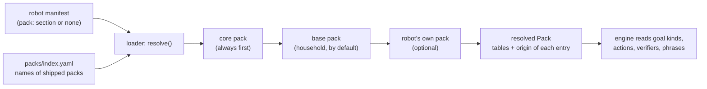
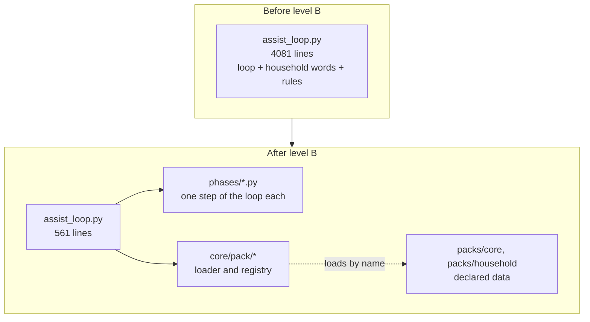

# One core, many robots

The core of `robot_agent` does not know one robot, one model, one language or one benchmark. Everything specific is declared as data and carries a source label. This page shows what is core, what is data, how the core finds the data, and how you can check the claim.

!!! abstract "In this page"
    - The core is code that runs for every robot. A **pack** is a folder of declared data that holds the words and rules of one kind of robot.
    - Two packs ship in the repo: `core` and `household` (the standard pack). A robot package can add its own pack on top.
    - Four checks guard the claim: architecture rules, golden traces, a mutation check and a ratchet. Each one is a script or a test you can run.
    - The page ends with what the claim does **not** cover. Read that part before you rely on it.

State of the code: `robot_agent` at `e8edaca`, the merge of the "level B" core refactor. Numbers carry a label: **MEASURED** (a script printed it), **SOURCE** (a file or a document states it) or **ASSUMED**. Pages elsewhere on this site pin an older commit, `3269923`.

## The idea in plain words

A pack is a set of declared facts: which kinds of goal exist, which actions a robot can do, which words it says. The core reads these facts. It never writes them in its own code.

Think of a library and its catalogue. The library staff do not change when new books arrive. Only the catalogue grows. Here the core is the staff, and a pack is a catalogue.

!!! note "Why this helps"
    - A new robot, a new language or a new benchmark adds data. It does not edit the core.
    - If a pack has no data for a feature, the feature does nothing. The core does not guess.
    - Every entry of a pack can carry a `source:` label. A reader can see where a value came from.

## What is in the core, what is data

| Topic | In the core (code, the same for all robots) | Declared data (a pack, a manifest or a language file) |
|---|---|---|
| Robot | The adapter protocol, the manifest loader, the run loop | The manifest and adapter of one robot package, for example `kcare_robot` |
| Goal kinds | The code that reads a kind and checks it | The kinds themselves: name, needs, rules, phrase (`goal_kinds.yaml`) |
| Actions | The one action model that checks a plan | The action table: class, arguments, preconditions, effects (`actions.yaml`) |
| Checks after a step | The step verifier and the goal check | Which verifier a kind or step uses, by name (`verifiers.yaml`) |
| Failure handling | The recovery loop | Which recovery policy fits a code, a kind or an action (`recovery.yaml`) |
| Words the robot says | The code that fills a phrase | The phrases, one set per language (`phrases.yaml`) |
| Prompt text | The code that sends a prompt | The prompt text of the standard pack (`prompts/understand.en.txt`) |
| Human language | The code that reads a language file | One JSON file per language in `core/planning/lang/` |
| Planner | The planner interface | A planner is a plug-in. It is chosen by name |
| Benchmark | Nothing. The core never imports it | The benchmark repo (`symbolic_robot`) imports the core |

Sources: the section files under `robot_agent/packs/household/`, `docs/languages.md` and `docs/architecture.md` of the hub repo. SOURCE.

## How the core finds a pack

The core does not import a pack. It loads a pack by name. The loader is `resolve(manifest, adapter)` in `robot_agent/core/pack/loader.py`.

The steps, as the loader code does them:

1. The loader reads the `pack:` section of the robot's manifest.
2. If the manifest has no `pack:` section, it is **schema 1**. The loader gives it the base that `index.yaml` names (`household`) and lifts what the manifest already declares, such as options and recovery codes.
3. If it has a `pack:` section (**schema 2**), the loader follows `extends` to build a chain. The core pack is always first.
4. The loader merges the chain. An entry in a later pack replaces the entry of the same name as a whole. `remove` deletes a name. There is one base only.
5. Each pack may name a module of callables. A callable is a named function, for example a rule or a verifier. The pack data names it. A Python module of that pack registers it. The loader never runs code taken from a data value.
6. The loader checks the result. A wrong schema-2 pack stops the load with a `PackError`. A schema-1 manifest never fails here.

To print what a robot resolves to, run `python -m robot_agent.core.pack.show <package or path>`. This command is named in the module docstring. It was not run for this page.

### Why a pack cannot change another pack by accident

The registry checks each registered name. A name is registered once. It carries the prefix of its own pack. A pack is bound to one callables module. So one pack cannot replace the callable of another pack in silence. SOURCE: `robot_agent/core/pack/registry.py`.

## The packs that exist

### Packs that ship in `robot_agent`

`robot_agent/packs/index.yaml` lists them. The engine reads the names from this file and names no pack itself.

| Pack | What it holds | Notes |
|---|---|---|
| `core` | What a run needs at all. Today it has a header and a phrases file (`pack.yaml`, `phrases.yaml`). | Always first in every chain. |
| `household` (named `std` in its header) | The standard pack: the household behaviour that the core used to hold, now as data. Files: goal kinds, predicates, actions, verifiers, recovery, phrases, constants, fleet, and the understand prompt. | The household goal kinds are `on`, `in`, `open`, `close`, `go`, `say`, `deliver`. Its header says: "Nothing in it is new." |

A manifest with `pack: {extends: null}` gets the core pack only. SOURCE: `robot_agent/packs/__init__.py`.

### Robot packages outside `robot_agent`

Two robot packages are named in these docs. Each is its own repo.

| Package | Role | What this page can say |
|---|---|---|
| `kcare_robot` | A real mobile manipulator. See [kcare_robot](../repos/kcare-robot.md). | The result document lists its manifest among those covered by manifest snapshot tests. SOURCE. Whether it uses a `pack:` section was not verified. |
| `symbolic_robot` | The symbolic simulator and benchmark, with a home and a factory domain. See [symbolic_robot](../repos/symbolic-robot.md). | The same snapshot tests cover its home and factory manifests. SOURCE. Whether it uses a `pack:` section was not verified. |

The result document also names a third package, `pex_robot`. It describes a `pack.yaml` for it as a **design example**. It says that moving that robot onto the new pack is "Round C, not started". So no running `pex_robot` pack is claimed here. SOURCE: `docs/proposals/generalize_core_result.md`.

## What changed in "level B"

Level B is the name of the core refactor. Its goal: move the vocabulary and rules of the household robot out of the loop code and into declared pack data, without changing any behaviour.

The git log of `robot_agent` shows 22 waves of small steps. Each step moved one piece. Two examples from the log:

- Step S07: the goal-kind table became pack data.
- Step S10: the action table became pack data.

The big loop file `robot_agent/core/planning/assist_loop.py` shrank. SOURCE: `docs/proposals/generalize_core_result.md` and `docs/proposals/ratchet.json`.

| Measure | Start of run 1 | At the last recorded wave (W22) |
|---|---|---|
| Lines in `assist_loop.py` | 4081 | 561 |
| Tests passed (the ratchet floor) | 3075 | 3979 |

The code moved to phase modules under `robot_agent/core/planning/phases/`, for example `gate.py`, `execute.py` and `finish.py`, and to `loop_config.py`. The result document says every move was a "verbatim extraction" proven by the checks below. The same document says no existing test, golden or cassette was edited. Tests were only added.

## How to check generality

The claim is only useful if you can test it. Four checks exist. Run them from the repo root.

### 1. The architecture rules

`tools/arch_rules.json` declares the layers and who may import whom.

| Rule | What it says |
|---|---|
| Layers | `contract`, `engine` (`robot_agent/core`), `options`, `packs`, `interact`, `api`. |
| Imports | The engine may import only the contract. Packs may import the contract and the engine. Options never import each other. |
| Forbidden modules | No layer may import `bench`, `symbolic_robot`, `tests` or `pytest`. |
| `embodiplan` | It may be imported only in `core/planning/backends/` and `core/planning/action_model.py`. |
| Size | Engine and contract: functions at most 80 lines, files at most 1200. Pack data code: functions at most 60, files at most 400. `assist_loop.py` has its own limit, 400 lines. |
| Language | `tools/lint_loop.py` allows no language literal in `core/pack` or `packs`. |

`make lint-core` runs `tools/lint_arch.py`. The test `tests/test_architecture.py` runs the same checks in `make test`. The engine reaches packs by name, so it has no import edge to them.

### 2. Golden traces

A golden trace is a recorded run of the real `AssistLoop`, with the model and the robot replaced by stubs. It is stored as a **cassette** file. After a refactor, replaying the cassette must give the same events, run record and prompts. A difference prints a diff by section.

- `tests/golden/cassettes/` holds 21 round-A cassettes (**MEASURED**: file count in this worktree).
- `tests/golden/set_cassettes/` holds 67 files with "cassette" in the name for the later steps (**MEASURED**: file count).
- A cassette is never overwritten. A change that is meant must delete the cassette in a reviewed commit and record it again. SOURCE: `tools/golden_record.py`.
- Snapshots of manifests, loop configuration and the planner prompt are kept too. SOURCE: `docs/testing.md`.

### 3. The mutation check

A golden trace is only worth something if it fails when behaviour changes. `tools/golden_mutation_check.py` breaks one behaviour at a time in a child process, then replays every cassette. A mutation counts as caught when at least one cassette differs. The script exits 0 only when the clean replay is clean and every mutation is caught.

- The base set has ten mutations, for example the plan gate, events, the recovery count, the replan budget and the stop word. SOURCE: `docs/testing.md`.
- Each step adds its own set in `tools/golden_mutations/<step>_*.py`. There are 13 such files (**MEASURED**: file count). The total number of mutations was not counted here.
- The script was not run for this page.

### 4. The ratchet

A ratchet is a number that may only move in one direction.

- `tools/arch_baseline.json` records old rule breaks. A new break fails. A fixed break must be removed from the file, so the list only shrinks. SOURCE: `docs/architecture.md`.
- `docs/proposals/ratchet.json` records the line count of `assist_loop.py` (561) and the test floor (3979). The status line there says "wave W22 merged". SOURCE.
- Today the baseline still lists old findings: 39 entries in `layers` and 8 in `size` (**MEASURED**: keys in the JSON file). It also holds ceilings for the loop files: 74 option keys and 58 `self.cfg` branches. So the repo is not free of rule breaks. It is stopped from getting worse.

### A fifth tool for packs

`tools/pack_compat_check.py` compares what a robot's vocabulary was before the pack schema with what the live code gives now. It reads a frozen copy of the old tables (`tools/pack_compat_ref.json`). It exits 0 when there is no difference. It was not run for this page.

## What generality does not claim

State these limits when you describe the project.

- **No real robot was involved.** The result document says nothing was run on a real robot. Cassettes use a stubbed model. A real-model run was not made. SOURCE.
- **One recorded seed per cassette.** Other seeds were not tested. SOURCE.
- **The mutation check is bounded.** It proves the goldens catch the listed mutations. It does not prove they catch every possible change. SOURCE.
- **The household words still ship in the repo.** They are data in the `household` pack, not code. But the standard pack is a household pack. A robot with no `pack:` section gets it by default.
- **Human languages ship as data in the core package.** English, Korean and Vietnamese packs are in `core/planning/lang/`. `ja` and `zh` are stubs. SOURCE: `docs/languages.md`. See also the warning in [A robot as data](robot-as-data.md#where-the-rule-does-not-hold).
- **Some parts were deferred on purpose.** The result document lists them. Examples: no pack can add a new phase to the loop, and a pack's own model call is not part of level B. SOURCE: "Deferred" in `docs/proposals/generalize_core_result.md`.
- **Only one pack was moved fully.** The `pex_robot` pack is a design example. Moving it is not started. SOURCE.
- **The old pages are pinned elsewhere.** Other pages on this site were checked at `3269923`, before level B. Where they describe a file that moved, check the code first.
- **Publication status is not verified.** Whether the level B commits are on the public remote was not checked.

## Where in the code

!!! code "Where in the code"
    - Pack loader and merge rule: `robot_agent/core/pack/loader.py`
    - Callable registry: `robot_agent/core/pack/registry.py`
    - Pack schema: `robot_agent/contract/pack.py`
    - Shipped packs and their index: `robot_agent/packs/`
    - Architecture rules and baseline: `tools/arch_rules.json`, `tools/arch_baseline.json`, `tools/lint_arch.py`
    - Golden traces and mutations: `tests/golden/`, `tools/golden_record.py`, `tools/golden_mutation_check.py`
    - The run record of the refactor: `docs/proposals/generalize_core_result.md`

Next: [A robot as data](robot-as-data.md), or the [Architecture](../start/architecture.md) page.
