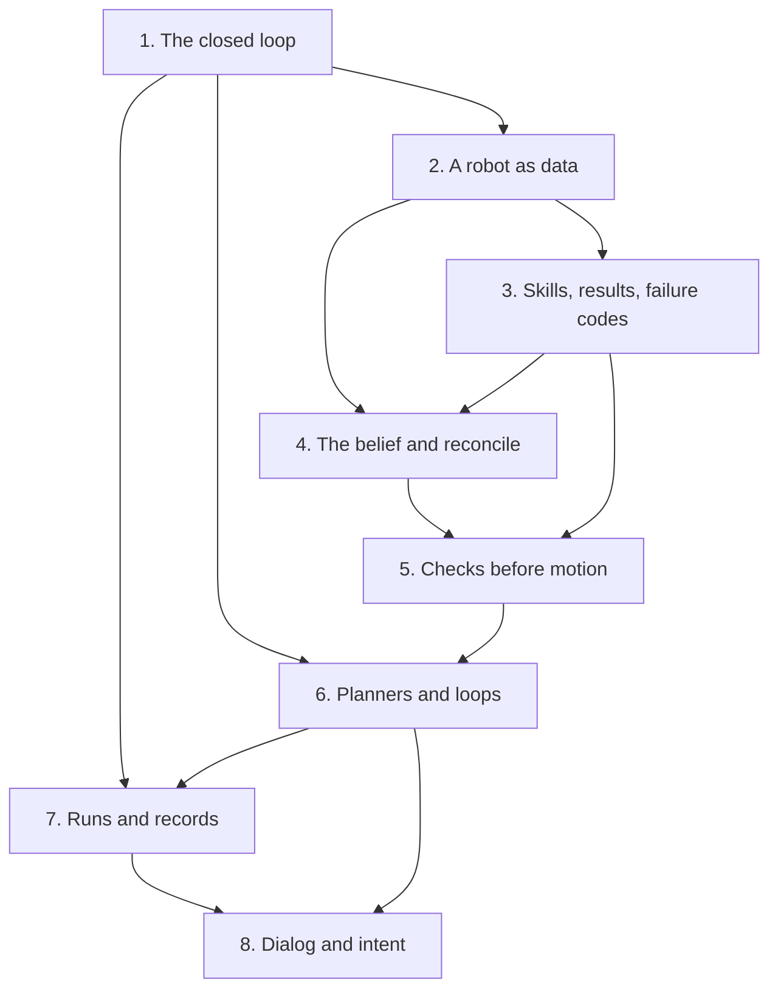

# Concepts

These eight pages explain the ideas behind `robot_agent`. Read them to understand the code before you change it, or to know what the robot is doing when you watch a run. Each page starts with the idea in plain words, gives one example from this repository, and then gives the precise version.

!!! abstract "In this page"
    - The eight concepts, in the order to read them, with one line each.
    - How they depend on each other.
    - Which ones to read first if you integrate a robot, research a planner, or operate a robot.

## The eight concepts, in reading order

| # | Page | In one line |
|---|---|---|
| 1 | [The closed loop](closed-loop.md) | A robot agent plans, acts, verifies and recovers in a loop. A run is done only when the goals are seen to hold. |
| 2 | [A robot as data](robot-as-data.md) | The core contains no robot. A robot is one manifest file and one adapter object, shipped in its own package. |
| 3 | [Skills, results, failure codes](skills-and-failures.md) | A skill does one thing and returns a result with one of 13 failure codes that are the same for every robot. |
| 4 | [The belief and reconcile](belief-and-reconcile.md) | The robot keeps a small written picture of the world. It can be wrong, so it is compared with the sensors at the start and after a hold. |
| 5 | [Checks before motion](checks-before-motion.md) | A plan is checked three times before the robot acts: the whole plan, each step, and inside the skill. A step's result is checked in layers. |
| 6 | [Planners and loops](planners.md) | A planner makes a list of steps. A loop (ClosedLoop or AssistLoop) wraps it with understanding, checks, recovery and recording. |
| 7 | [Runs and records](runs-and-records.md) | Every task is a run with an id. One JSONL record per run is enough to replay it offline. |
| 8 | [Dialog and intent](dialog-and-intent.md) | How the robot understands a request, asks questions (for example where an object is, after it has looked), and sorts what people say during a run. |

## How they depend on each other

An arrow means "read this first to understand that".

Page 1 gives the picture of one run. Pages 2 to 5 are the parts the loop uses: the robot description, the skills, the belief and the checks. Page 6 shows how those parts are put together around a planner. Pages 7 and 8 are about the people and tools around a run: what is recorded, and what people can say to it.

## Who should read what

| You are | Start with | Then |
|---|---|---|
| An **integrator** who adds a robot or a skill | 1, 2, 3 | 4 and 5, then the guides [Add a robot](../guides/add-a-robot.md) and [Add a skill](../guides/add-a-skill.md). The contract pages say exactly what your package must provide: [Robot package](../contracts/robot-package.md). |
| A **researcher** who uses or benchmarks planners | 1, 6, 5 | 7 (record and replay a run) and 4. Then [Add a planner](../guides/add-a-planner.md) and [Benchmark a planner](../guides/benchmark-a-planner.md). |
| An **operator** who runs the robot and reads what it did | 1, 7, 8 | 3 for the failure codes. Then [Run the system](../start/run-the-system.md) and [Debug a failed run](../guides/debug-a-failed-run.md). |

If you only have ten minutes, read [The closed loop](closed-loop.md) and look at the glossary: [Glossary](../start/glossary.md) explains every internal term, such as ClosedLoop, AssistLoop, belief and manifest.

## About the examples

The examples in these pages come from the offline fake robot and from small pure-Python calls that were run without a robot, a simulator, ROS or an LLM. Where an LLM reply is needed, the page says it is a scripted reply. A page says "not run" for anything that was not run. Known defects are described as current behaviour in the page where you meet them, and are collected in [Known pitfalls](../reference/known-pitfalls.md).
