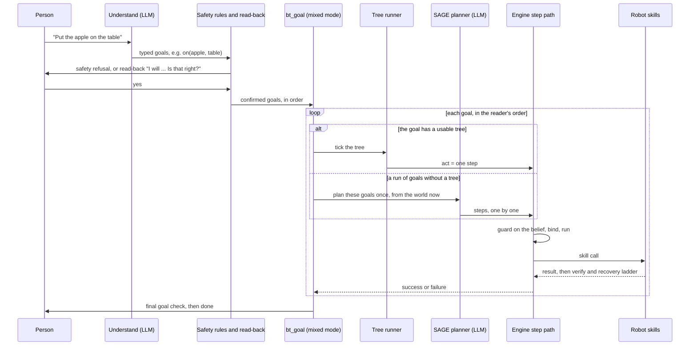

# An LLM and a behaviour tree together

!!! abstract "In this page"
    - A **large language model (LLM)** understands free speech. A **behaviour tree (BT)** runs a goal that is already known, the same way each time.
    - The robot_agent core uses both. The LLM turns a request into typed goals. A tree runs each goal that has one. The planner handles the rest.
    - This is the option `bt_goal`, in its "mixed" mode. It is on by default. It does nothing for a robot that declares no trees.
    - The trees are **data** in the robot's manifest. The core has no tree for any robot.
    - Each claim below has a label. **SOURCE**: read in code or docs. **MEASURED**: a number from a recorded run, with its conditions. **ASSUMED**: a design choice, not tested. **Not verified**: I could not confirm it.

## Why combine them

Each one is good at what the other does badly.

| | LLM | Behaviour tree |
|---|---|---|
| Strong at | Free speech, new requests, open cases | A known goal, run the same way each time |
| Weak at | The same input can give a different plan | It cannot read a sentence or invent a new goal |
| Can it be checked? | Only after the fact, by looking at the plan | Yes. The tree is a short list you can read before the run |
| Recovery | It writes a new plan (a replan) | Declared fallbacks, then the engine's own recovery rules |
| Log | The plan and the model calls | One record per tree node |

A **behaviour tree** is a small program written as nested lists. Each node returns success or failure. A parent node uses these results to decide what to try next. In robot_agent a tree is data, not code. The runner has no robot word in it (SOURCE: `behavior_tree.py`).

The two are not rivals. The LLM only has to answer one question: what does the person want? A tree then answers a second question: how do we do that goal? The core calls the planner only for a goal that no tree covers.

## From a spoken request to a run

The pipeline has four phases: understand, plan, execute, final check (SOURCE: `closed-loop.md`, this site). The tree part sits in the plan and execute phases.



Step by step:

1. **Understand.** One LLM call turns the request into typed goals. A goal has a kind (`on`, `in`, `open`, `close`, `go`, `say`, `deliver`) and fields such as `object`, `from`, `to` (SOURCE: `packs/household/goal_kinds.yaml`).
2. **Safety and read-back.** The robot's safety rules look at the goals. Then the robot reads the goals back to the person and waits for "yes". Both come before any tree or plan.
3. **Choice.** The service `runs_goals` asks, for each goal, whether it has a usable tree.
4. **Run.** A tree is ticked, or the planner plans a run of goals once. Every step goes through the same engine step path.
5. **Final check.** The engine looks at whether the goals hold (`goal_check`).

## Mixed mode: which goals have trees

**Which goals have a tree is data of the robot.** The manifest key is `planner.options.bt_goal.trees`. It has one entry per goal kind, or a list of entries. The first entry that the goal fits and the robot can run is used (SOURCE: `docs/bt_goal.md`).

A goal gets a tree only when all of these hold (SOURCE: `docs/options.md`, `options/bt_goal.py`):

- the kind has an entry;
- no `skip_if` field of the entry is set in the goal;
- every `{slot}` of the tree can be filled from the goal. For `{from}`, the engine's trusted object memory may fill it;
- every `act` names an action the robot declares;
- an `ask`, `confirm` or `reply` leaf has a pack phrase and an Ask skill.

How the choice is made, in the default (mixed) mode:

- Goals run **in the order the reader gave them**.
- A run of neighbouring goals **with** trees is ticked, one tree per goal.
- A run of neighbouring goals **without** a tree is planned by the SAGE planner **once**. This happens when the run reaches it, from the world as it is then. Its steps run one by one with the engine's own recovery.
- If **no** goal has a tree, SAGE plans the whole run. This is the same as with the option off.
- With `bt_goal.mixed=0` the old rule applies: all goals have trees, or SAGE plans everything.

Example (SOURCE: `docs/planners.md`, this site): three goals, `go`, then a kind with no tree, then `go`. The trees run the first and the last. SAGE plans only the middle one, from where the first tree left the robot.

### What happens when a tree fails

Read from `docs/bt_goal.md` and `options/bt_goal.py` (SOURCE):

1. A tree `act` is not a bare robot call. It runs through `try_step(..., ladder=True)`. That is the engine's own step path and its recovery ladder: retry in place, wait, search legs, find again, ask for help.
2. Only the **planner rung** of the ladder is held back. A step that fails without it makes the `act` fail. The tree's own `fallback` and `retry` then go on.
3. A failure code that must not be retried (`estop`, `cancelled`, `software`, `budget_exceeded`) ends the run at once. There is no question and no replan.
4. When the tree has no way left, the key `exhausted` decides:
    - `ask_or_stop` (the default): if a person can help (for example the object is absent or unreachable), the robot asks **once per goal**. A retry word or a place name ticks the tree once more. Otherwise it reports and stops. A robot-health code (such as `hw_fault` or `timeout`) is not asked. It reports and stops.
    - `sage_once`: the remaining goals and the facts of the failure go to the SAGE planner once. If it gives no plan, the run stops.
5. In a SAGE-planned part of a mixed run, a step with no way left hands the goals that are left to the SAGE replan once. That includes this part and every goal after it, trees included.

So the answer to "stop in place or fall back to the planner?" is: the default policy asks or stops. The planner takes over only with `sage_once`, or inside a part that SAGE planned itself. When a run stops while the hand holds something, the pack phrase `say_bt_goal_stop_held` says so.

A goal change said during a tree ends the trees before the next `act`. The engine then applies the change as it does for a plan (SOURCE: `docs/bt_goal.md`).

## What a tree is made of

A node is a list: `[type, *args]` (SOURCE: `behavior_tree.py`).

| Node | Meaning |
|---|---|
| `sequence` | Run the children in order. Stop at the first one that does not succeed. |
| `fallback` | Try the children in order. Stop at the first one that succeeds. |
| `retry n child` | Run the child up to `n` times. |
| `cond name *slots` | Read the belief. It never acts. |
| `act Action slot [{args}]` | One robot step. An optional mapping gives typed arguments of the action. |
| `ask key refs` | Ask the person. It reads the answer with the pack's words. |
| `confirm key`, `reply key` | Say a pack phrase and read a yes or no, or only say it. |

Slots such as `{object}`, `{from}` and `{to}` are filled from the goal. If a slot is empty, the tree is not used.

The tree runner knows no robot word and no clock. It returns success, failure or stopped. After each node it tells the host, so the option can log one record per node (SOURCE: `behavior_tree.py`). With the tree key `events: true`, each node is also sent as the public event `tree_node` (SOURCE: `docs/bt_goal.md`).

### Predicates and callables are pack data

The `cond` names are not fixed in the core. A pack declares them in a **predicate table**. Each row names an evaluator, the arguments and the places where it may be used (SOURCE: `core/pack/predicates.py`).

The standard (household) pack declares these tree conditions (SOURCE: `packs/household/predicates.yaml`):

| Name | Arguments | True when |
|---|---|---|
| `holding` | object | The hand holds that object |
| `hand_free` | none | Nothing is in the hand |
| `at` | place | The robot has arrived at that place |
| `placed` | object, place | The object is put at the place and is not in the hand |
| `opened` | container | The container is open in the belief |
| `closed` | container | The container is not open in the belief |

A row such as `holding: {eval: std.holding, args: ["object?"], scopes: [tree, effect, ...]}` points to a Python function `std.holding`. That function is a **callable**. It is registered by name in `packs/household/callables/predicates.py` and takes `(belief, args)`. The same table also serves the checks of a skill's declared effects. A tree reads an unknown name, a wrong number of arguments or an unreadable argument as False (SOURCE: `predicates.py`).

A robot that removes these names from its pack has no tree conditions. The code says so in its docstring. I did not test this.

Other callables a tree can use: a robot's skills (through `act`), its phrases (`ask`, `confirm`, `reply`) and its `questions` table. A pack question needs a phrase and an answer of type `choice`. The tree then branches on the answer with `[cond, answered, <question>, <choice>]`. The standard pack ships no such question (SOURCE: `docs/bt_goal.md`).

## Add a tree for a new goal

A person, or another robot's pack, adds a tree in the manifest. No core code changes (SOURCE: `docs/bt_goal.md`). The steps:

1. Choose the goal kind. It must exist in the pack's goal kinds. If it is a new kind, declare it first.
2. Write the tree as nested lists. Start with a `cond` that says "already done?". End with `cond` checks that the goal holds and the hand is free. This is the subgoal contract of `docs/bt_goal.md`.
3. Use only actions and conditions the robot declares.
4. Add a `source:` label, or `assumed:`. The option reads labelled entries (SOURCE: `docs/options.md`).
5. Run the tests and a simulated run. Look at the `bt_goal` record to follow each node.

A real tree: the `open` kind of `kcare_robot`. I turned the YAML into one line per node. (SOURCE: `kcare_robot/configs/manifest.yaml`, read from a working copy with uncommitted changes.)

```text
fallback
  cond  opened {object}                    # already open: nothing to do
  sequence
    cond  hand_free                        # open only with a free hand
    act   MoveTo {object}                  # the skill acts where the robot stands
    act   Open   {object}
    cond  opened {object}                  # check the result in the belief
```

The entry also carries a `source` label. It says the order is an owner decision of 2026-11-23. It marks "MoveTo comes first" as **assumed**, because the open skill acts where the robot stands.

That manifest declares trees for four kinds: `on` (three entries), `in` (two), `open` and `close`. The first `on` entry, and the first `in` entry, use `needs_openable`. The entry applies only when the source place is declared openable. It opens the drawer first, takes the object, and closes the drawer. The `on` entry with `skip_if: [from]` first looks around where the robot stands. It is for a request that does not say where the object is (SOURCE: manifest). I found no tree for the other kinds (for example `go`, `say`, `deliver`) in that file, so SAGE would plan them. I did not run the robot.

## Where the LLM does not decide

The LLM writes the goals. After that, these checks do not use an LLM to decide (SOURCE unless said):

| Check | When | Who decides |
|---|---|---|
| Safety refusal (hazard rules) | After understanding, before the read-back | The robot's **safety profile**: declared data, matched by words. See `docs/safety.md`. A robot with no profile gets no hazard refusal (it fails open) |
| Read-back | Before any step | The **person**. The robot says "I will ... Is that right?" and waits for yes |
| Tree choice | Plan phase | Code and data: does the goal have a usable tree? |
| Per-step **guard** | Right before the robot moves, for every step | Code on the **belief as it is now**. It also runs for a tree `act`, because `act` goes through the engine's `_run_step`, which calls `_guard` (`execute.py`) |
| Skill preconditions and verification | Inside and after each skill | The skill and its verify layers |
| Recovery rules | After a failure | A declared table (`contract.recovery`), not the LLM |
| Final goal check | After the last step | The engine's `goal_check` |

Two honest limits on this table:

- The whole-plan **gate** (a simulation of the full plan before it runs) is a check on a *plan*. A part that SAGE plans inside a mixed run skips it. Only the planner's own verifier runs there (SOURCE: `docs/bt_goal.md`, "Not covered"). Whether the gate runs at all for a run made only of trees: **not verified**. There is no plan for it to check.
- The safety profile uses regular expressions on words. It is only as complete as the pack declares. Its words are labelled `sourced` or `assumed` (SOURCE: `docs/safety.md`).

## Who decides what

| Question | Decided by |
|---|---|
| What does the person want? | LLM (understand call) |
| Is the reading right? | The person, through the read-back |
| Is the goal refused for safety? | The safety profile (data) |
| Does this goal kind have a tree? | The robot's manifest (data) and the choice code |
| In what order do the goals run? | The order the reader gave them |
| What steps does a tree-goal take? | The tree (data) |
| What steps does a goal without a tree take? | The SAGE planner (LLM-based) |
| May this step run now? | The guard, on the current belief |
| What happens after a failed step? | The recovery table, then the tree's own fallbacks |
| Ask the person after the tree fails? | The `exhausted` policy and the failure code's rule |
| Is the goal done? | The engine's goal check |

## Honest limits

**Measured.**

- In the symbolic benchmark simulator (`symbolic_robot`, layer `bt_goal`) a tree-run was compared with SAGE on the same tasks. The tasks were the part of the `d5dev` dev set whose goals all have a tree. The numbers come from a replay of cached model answers with a few live calls. The set is called optimistic by its own doc (MEASURED, `docs/home/bench/bt_goal_layer.md`, snapshot of 2026-11-17).
- Measure 2, 30 tasks, 4 cells: success was equal in all four cells, and there were 0 wins and 0 losses against SAGE. The mean LLM calls per run fell, for example in `en_real` from 5.27 to 2.90. Simulated time was slightly higher with trees (for example 185 s for SAGE and 195 s for trees in `en_real`).
- Measure 3, 61 tasks, 4 cells: 2 wins and 0 losses against SAGE, both in `ko_ideal`, and success otherwise equal. The doc gives an exact McNemar p of 0.5. That is not significant.
- The doc says the runs were not independent: they use common random numbers. So these results show "no loss in this set", not "better".
- Those numbers were measured with the earlier all-or-nothing rule. I found no measurement of the mixed mode on a benchmark. The hub doc also says the effect of mixed mode on the benchmark was not measured.

**Not measured, or not verified.**

- **Real robot:** I found no record of a tree run on a real robot. The `kcare_robot` trees have unit tests (`tests/test_bt_*.py`). Their manifest entry is in a working copy with uncommitted changes. Real-robot status: **not verified**. Treat the trees as untested on hardware.
- **Cost and latency on a real model:** the only figures are the simulator ones above (LLM calls and simulated seconds). I found no log of real latency or money. I give none.
- **The shapes of the trees** in the benchmark are labelled `assumed`. They were not tuned on any task.
- **The mixed mode** has golden tests and unit tests (`tests/test_option_bt_goal_mixed.py`). A golden test replays recorded model answers. It shows that the behaviour is stable, not that it is good.
- **A gap in coverage:** a SAGE-planned part skips the certify gate, and only the planner's own verifier runs (SOURCE).

!!! code "Where in the code"
    - Tree runner (pure, no clock): `robot_agent/core/planning/behavior_tree.py`
    - Host of the leaves and pack questions: `robot_agent/core/planning/tree_host.py`
    - The option, the choice and the failure policy: `robot_agent/options/bt_goal.py`
    - Predicate table and evaluators: `robot_agent/core/pack/predicates.py`, `robot_agent/packs/household/predicates.yaml`, `robot_agent/packs/household/callables/predicates.py`
    - The step path with the guard: `robot_agent/core/planning/phases/execute.py` (`_run_step`, `_guard`)
    - Rules and keys: [`docs/bt_goal.md`](https://github.com/mtbui2010/robot_agent/blob/3269923/docs/bt_goal.md)

See also: [Planners and loops](planners.md), [The closed loop](closed-loop.md), [Checks before motion](checks-before-motion.md), [Skills, results, failure codes](skills-and-failures.md).
