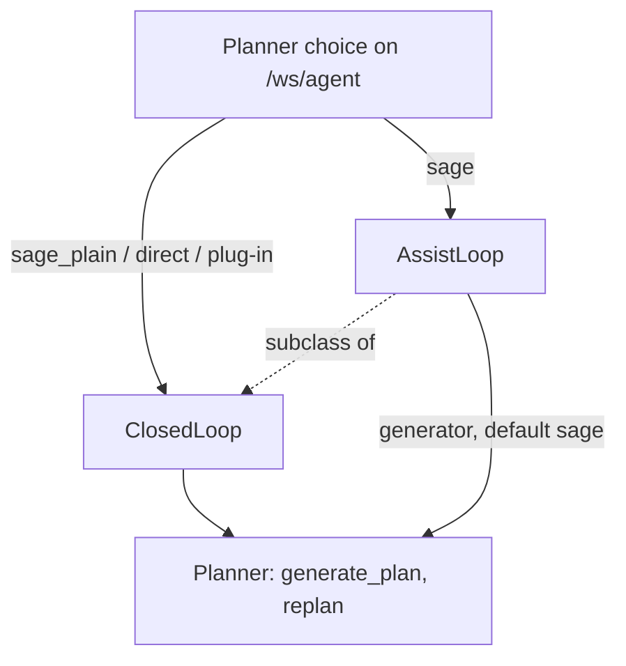
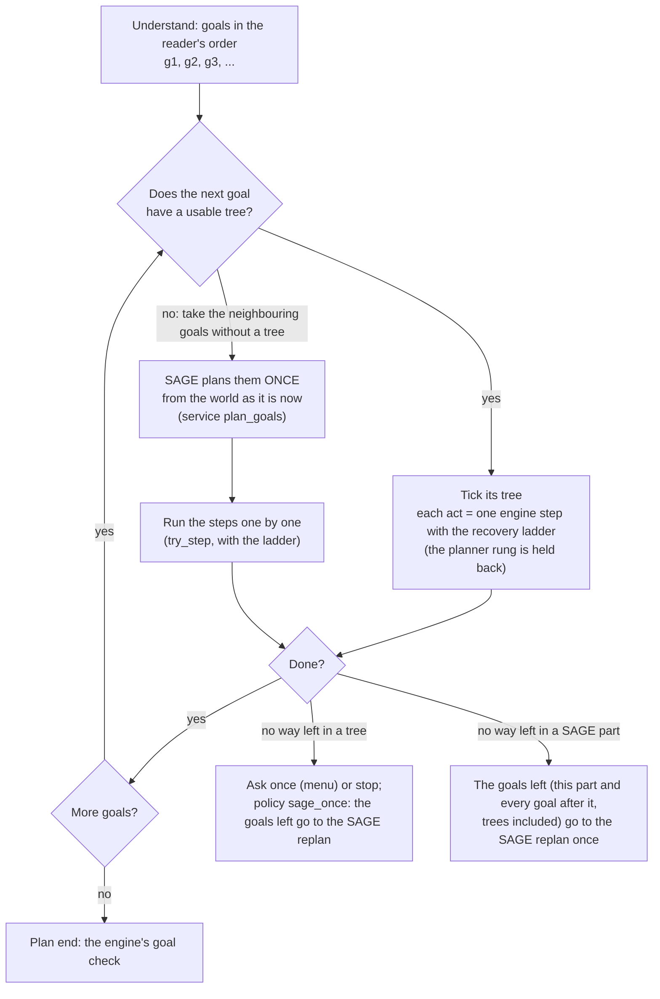
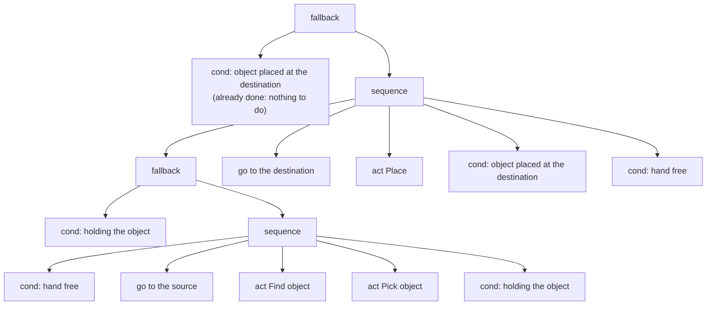

# Planners and loops

!!! abstract "In this page"
    - A **planner** is a plug-in with two methods. It turns a task and a belief into a list of steps. It does not run anything.
    - A **loop** is the code that runs a plan: it checks it, executes each step, recovers from failures and records the run. There are two: [ClosedLoop](../start/glossary.md#closedloop) (planner key `sage_plain`) and [AssistLoop](../start/glossary.md#assistloop) (planner key `sage`).
    - The core adds understanding, gating, recovery, recording and replay around any planner, so a new planner stays small.
    - A name has two levels. The **request** (`planner` on `/ws/agent`, or `ROBOT_AGENT_PLANNER`) names a loop: `sage` is the AssistLoop, `sage_plain` is the ClosedLoop around the SAGE planner, `direct` is the ClosedLoop around `llm_direct`. The **registry** names the planner itself: `sage` and `llm_direct`.
    - SAGE was called GRACE before. The old names still work and are deprecated: the registry and request name `grace`, the robot module `grace_namemap`, the memory store `grace_memory`, and the install extra `.[grace]`. Each use of the old registry or request name logs a deprecation warning once. The dashboard still sends `grace` for its plain-loop option; the bridge makes that work.

## The idea in plain words

Think of a planner as an author and a loop as a stage manager. The author writes the script: "go to the table, find the cup, pick it up". The stage manager checks the script is playable, calls each line in turn, notices when an actor fails, asks the author for a rewrite of the rest, and keeps a record of the night.

This split is why you can swap the author without touching the stage manager. It is also why the name `sage` is easy to misread. As a registry name it is the author. As a request name it is a stage manager (the AssistLoop) that uses that author. The plain stage manager around the same author is `sage_plain`.

## The planner: two methods

A [planner](../start/glossary.md#planner) is any object that has the two methods of the `Planner` protocol (`base.py`). Both return `(steps, metrics)`. A step is a small dict, for example `{"action": "Find", "object": "cup"}`.

| Method | Inputs | Returns |
|---|---|---|
| `generate_plan` | `task` (text), `obs` (text of what the robot sees and believes), `visible_objects` (list) | `(steps, metrics)` for the whole task |
| `replan` | `task`, `completed` (steps already done), `failed_step`, `failure_reason`, `obs`, `visible_objects` | `(steps, metrics)` for the rest of the task, spliced after `completed` |

A planner may offer more, by simply having the methods. The core checks for them and never reaches into the planner's private state.

| Optional capability | What it adds |
|---|---|
| `SubgoalRepair` (`blocks`, `join_blocks`, `repair_block`) | The gate can send a critical finding back to one sub-goal of the plan, instead of asking for a whole new plan. See [Checks before motion](checks-before-motion.md). |
| `ProgressReporting` (a `progress` attribute) | The core streams live planning progress to the dashboard. |
| `EpisodeMemory` (`record_episode`) | The planner learns from runs that ended in success. |
| `chat_override` (a context manager) | The core can answer the planner's LLM calls with a model of its own (option `repair_model`, for the gate's repair calls). |

Two keywords are passed only to a planner whose method has a parameter of that exact name (`accepts` in `base.py`): `subgoals=` (the sub-goals the loop understood) and `budget=` (the run's LLM-call budget). The `Planner` protocol itself is unchanged and still has only the arguments in the table above.

## Which planner keys exist

The registry (`registry.py`) builds a planner from a name. A name is one of three kinds:

| Name | Planner | Notes |
|---|---|---|
| `sage` | `SageBackend` (`backends/pyplanner_sage.py`) | Wraps embodiplan's planner class. Offers all three optional capabilities. Needs `embodiplan` installed. |
| `llm_direct` | `LlmDirectBackend` (`backends/llm_direct.py`) | One LLM call that writes the whole plan as `skill::inputs` lines. The dashboard calls this choice `direct`. |
| `package.module:Class` or an entry-point name | Your plug-in | Any importable class that builds a `Planner`. Entry points use the group `robot_agent.planners`. |

`get_planner` returns the planner wrapped in a proxy that records every `generate_plan` and `replan` call on the current run (see [Runs and records](runs-and-records.md)).

!!! note "`sage` names the planner in the registry and the AssistLoop in a request"
    This ran offline:

    ```python
    from robot_agent.core.planning.registry import resolve_planner
    print(resolve_planner("sage"))
    print(resolve_planner("sage_plain"))
    ```

    ```text
    (<class 'robot_agent.core.planning.backends.pyplanner_sage.SageBackend'>, True)
    ValueError: unknown planner 'sage_plain'; available planners: sage, llm_direct (or 'package.module:Class', or an entry point in group 'robot_agent.planners')
    ```

    `sage_plain` is a **request** name, not a registry name. In `unified_agent.py` the request is turned into a loop by `loop_choice` (`planner_names.py`): `sage` selects the AssistLoop, `sage_plain` selects the ClosedLoop with the planner `sage`, and `direct` selects the ClosedLoop with `llm_direct`. Any other name is tried as a planner name, so a plug-in can be selected directly. With `ROBOT_AGENT_CLOSED_LOOP=1` and no planner in the request, the default is `ROBOT_AGENT_PLANNER`, or `sage_plain` when that is unset.

## The two loops

The AssistLoop is built on the ClosedLoop (it is a subclass). Its planner is called the **generator**. The generator is the `generator` option or the environment variable `ROBOT_AGENT_SAGE_GENERATOR`, and the default is `sage`. So both loops, by default, end up calling the same planner. They differ in what they do around it.



| | ClosedLoop (`sage_plain`) | AssistLoop (`sage`) |
|---|---|---|
| Starts from | The task text, as given | The task, turned into goals by one LLM call; may refuse or ask the person to clarify |
| What the planner is given | The task text; the planner splits it itself | One sub-goal per understood goal (option `sage_subgoals`, default `goals`), so the planner does not decompose; the run's LLM-call budget |
| Plan check | Refuses only steps the robot cannot bind to a skill; one new plan if so | The full [gate](../start/glossary.md#gate): whole-plan simulation, plan tidy, repair, one fresh plan |
| Before each step | Nothing | The [guard](../start/glossary.md#guard) on the current belief |
| After each step | Layered verify, then replan on failure | Layered verify, recovery in place per action (Find, Pick, MoveTo, Place), then replan on failure |
| Replans (default `max_replans`) | 3 | 6 |
| Changes said during a run | Reports the change was not applied | Applies a change to the goals and repairs the plan |
| Done means | Every planned step ran | Every goal was also seen to hold (`goal_check`) |
| Object memory, search | No | Yes: remembers where objects were seen; does not search a place twice. By default (options `look_then_ask`, `bring_ask`) it first looks where it stands for an object whose place is unknown and asks once, "I don't see the mug here. Where is it?"; a bring-me request gets one combined question, "Where are you? Or where should I put it?" |
| Goals run without a plan | No | Option `bt_goal` (on, but it does nothing for a robot with no declared behaviour trees): see below |

Both loops share the same event stream, the same record of the run, and the same recovery policy for failure codes. Both reconcile the belief with the robot at the start and after a pause (see [Belief and reconcile](belief-and-reconcile.md)).

### Goals run by trees (`bt_goal`)

In the AssistLoop a robot can declare a behaviour tree per goal kind, as data. The option `bt_goal` has the key `mixed`, on by default. Goals whose kind has a tree run as trees and the planner is not asked for them. Neighbouring goals without a tree are planned by SAGE once, when the run reaches them, from the world as it is then, and their steps run one by one through the engine's own step path with its recovery ladder. If a step has no way left, the goals that are left (this part and every goal after it, trees included) go to the SAGE replan once. A robot that declares no trees gets no change, and with no goal that has a tree SAGE plans the whole run as before. Not covered: the whole-plan gate (see [Checks before motion](checks-before-motion.md)) is skipped for the parts SAGE plans this way, and the effect on the benchmark was not measured. Rules: the hub's [`docs/bt_goal.md`](https://github.com/mtbui2010/robot_agent/blob/3269923/docs/bt_goal.md).

#### How a mixed run goes

Goals run in the order the reader gave them. A goal with a tree is ticked; a run of neighbouring goals without a tree is planned by SAGE once, when the run reaches it. If no goal has a tree, SAGE plans the whole run as when the option is off.



#### Which goals the trees cover (an example)

Which goals a tree covers is **data of the robot**: the manifest's `planner.options.bt_goal.trees`, one entry (or a list of entries, the first usable one wins) per goal kind. A robot that declares none is covered for no goal, and every goal goes to SAGE. Of the repos checked (`kcare_robot`, `homeloop_robot`, `robotapp`, `symbolic_robot`), only the mock robot of the symbolic benchmark declares trees, and only when the benchmark layer `bt_goal` is selected. Its table, from `bench/suites/home/planners/d1_options.py` in `symbolic_robot` (not linked: that repo's newest commit is not on GitHub yet; the tree shapes are labelled `assumed`, a design choice not tuned on any task):

| Goal kind | Tree (in words) | When it is not used |
|---|---|---|
| `on` | skip if already placed; else go to the source, Find, Pick, go to the destination, Place, check placed and hand free | the goal has a `hand` field (a hand-over): SAGE plans it |
| `in` | open the container (empty hand first), fetch as `on`, PutIn, check placed and hand free | |
| `open` | skip if already open; go to the object, Open, check opened | |
| `close` | skip if already closed; go to the object, Close, check closed | |
| `go` | MoveTo, unless the robot is already there | |
| `say` | go to the place, Say the sentence; a second entry says it here when the goal has no place | |
| any other kind (for example `deliver`, `give`) | none declared in this example | SAGE plans it |

The last row is where `mixed` matters: in a request of three goals where the first and the last are of a kind with a tree (say two `go` goals) and the middle one is of a kind with none, the trees run the first and the last, and SAGE plans only the middle one, from where the first tree left the robot.

#### One tree: the `on` goal

The same example, drawn. A **fallback** tries its children from left to right until one succeeds; a **sequence** runs its children until one fails; `cond` reads the belief, `act` is one robot step. Every `go` is a MoveTo that is skipped when the robot is already at the place.



## What the core adds around any planner

Whichever planner you plug in, the core provides:

1. **Understanding** (AssistLoop): the task becomes goals, or a refusal or a question.
2. **Gating**: the plan is checked before the robot acts (full gate in the AssistLoop, binding check in the ClosedLoop).
3. **Binding**: each step is mapped to a skill of the robot through the [RobotAdapter](../start/glossary.md#robotadapter).
4. **Verification**: each result is checked in layers.
5. **Recovery**: retries, waiting for the robot's health, asking the person, and replans by calling the planner's `replan`.
6. **Recording**: every event and every planner call goes into the run's record; the record can be replayed (see [Runs and records](runs-and-records.md)).

The planner stays free of all of this. It sees only the arguments in the table above.

## How `sage` and `sage_plain` relate to embodiplan

The `sage` planner of the registry wraps a class from the separate `embodiplan` package. That package names its class `SAGEPlanner` (the code spells it "Symbolic Action-Gating and Editing"). Both request names, `sage` and `sage_plain`, end in the same class. They differ in the loop around it.

The AssistLoop uses SAGE as embodiplan 0.2.7 has it. The loop gives SAGE its own sub-goals (no decompose call), and with the option `person_goals` (default off) a goal of a template kind (go, say, deliver) is given as a fixed block with its own steps, which SAGE keeps without an expand call, a gate check or a refine. The run's LLM-call budget is taken before every SAGE call, and a refusal stops the planner between two calls. The details are in the embodiplan repository, file `website/docs/planners/sage.md` (on its site: `planners/sage/`), and on [Planner library (embodiplan)](../repos/embodiplan.md#sage-as-the-hub-uses-it).

For how that planner works inside (sub-goals, expansion, editing, memory), read the embodiplan site: <https://mtbui2010.github.io/embodiplan/>. For the exact interface a new planner must follow, see [Planner library contract](../contracts/planner-library.md). To write one, see [Add a planner](../guides/add-a-planner.md).

!!! code "Where in the code"
    - Planner protocol and optional capabilities: [`base.py` L246-L279](https://github.com/mtbui2010/robot_agent/blob/3269923/robot_agent/core/planning/base.py#L246-L279) and following
    - Registry and built-in names: [`registry.py`](https://github.com/mtbui2010/robot_agent/blob/5058637/robot_agent/core/planning/registry.py#L29-L95)
    - Built-in planners: [`backends/`](https://github.com/mtbui2010/robot_agent/tree/5058637/robot_agent/core/planning/backends)
    - Choosing the loop: [`unified_agent.py` L365-L391](https://github.com/mtbui2010/robot_agent/blob/5058637/robot_agent/core/unified_agent.py#L365-L391), names in [`planner_names.py`](https://github.com/mtbui2010/robot_agent/blob/5058637/robot_agent/core/planning/planner_names.py)
    - ClosedLoop: [`loop.py`](https://github.com/mtbui2010/robot_agent/blob/5058637/robot_agent/core/planning/loop.py#L246-L259); AssistLoop and its generator: [`assist_loop.py`](https://github.com/mtbui2010/robot_agent/blob/5058637/robot_agent/core/planning/assist_loop.py#L369-L376)
    - Longer notes (dense): [`docs/planners.md`](https://github.com/mtbui2010/robot_agent/blob/6d31f58/docs/planners.md)

See also: [The closed loop](closed-loop.md), [Checks before motion](checks-before-motion.md).
