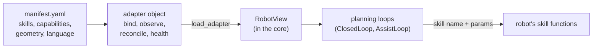
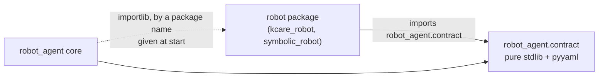

# A robot as data

!!! abstract "In this page"
    - The core (`robot_agent`) does not contain a robot. A robot is **one manifest file plus one adapter object**, shipped in the robot's own package.
    - The manifest says what the robot can do (skills, capabilities, distances, languages). The adapter answers questions the core cannot answer by itself (what the robot sees, how to turn a plan step into a skill call).
    - The dependency points one way: the robot package imports the core's contract; the core finds the robot by a package name it is given at start, never by importing a named robot.
    - There are a few exceptions, listed at the end. They are current behaviour.

## The idea in plain words

Think of a plug and a socket. The core is the socket. It knows the shape of the plug: "a list of skills, a few distances, a way to look at the world". It does not know what is behind the plug. A new robot is a new plug. You do not edit the socket.

Two things make up the plug:

| Part | What it is | Who reads it |
|---|---|---|
| **Manifest** (`configs/manifest.yaml`) | A YAML file. Static facts about the robot. See [manifest](../start/glossary.md#manifest). | `Manifest.from_yaml`, the planners, the checks |
| **Adapter** (`configs/adapter.py`) | A Python object that follows the [RobotAdapter](../start/glossary.md#robotadapter) protocol. Live questions: bind, observe, reconcile, health. | The planning loops, through a `RobotView` |

## One real example: the kcare robot's manifest

The manifest of `kcare_robot` declares a robot that speaks Korean and English, has one right hand, a lift, a head camera and a drawer, and 10 skills. The robot's name inside the file is the robot maker's product name, so this site does not repeat it; it is called "the robot maker's package" here.

Values read from the committed manifest ([`manifest.yaml:24-55`](https://github.com/mtbui2010/kcare_robot/blob/d4f5577b342e/kcare_robot/configs/manifest.yaml#L24-L55)):

| Section | Real values |
|---|---|
| language | `language: ko`, `languages: [ko, en]` (the first is the default) |
| capabilities | `base: true`, `arms: 1`, `hands: [right]`, `lift`, `head`, `drawer`, `voice` all true; `find_reaches: false`; `vlm_verify: false` |
| geometry (metres, seconds) | `arrive_tol_m: 0.3`, `reach_m: 0.78`, `reach_far_m: 1.0`; extra keys `max_reach_y_m: 0.8`, `frame_max_age_s: 2.0`, `pose_max_age_s: 2.0`, `vlm_min_conf: 0.5` |
| skills | `move, find, pick, place, open_drawer, close_drawer, grasp_succeed, mobile_pose, ask, llm` |

A skill entry is a [SkillSpec](../start/glossary.md#skillspec). This is `pick` ([`manifest.yaml:114-131`](https://github.com/mtbui2010/kcare_robot/blob/d4f5577b342e/kcare_robot/configs/manifest.yaml#L114-L131)):

| Key | Value | Meaning |
|---|---|---|
| `action` | `Pick` | The abstract action a planner writes in a plan. The core only knows abstract actions. |
| `params` | JSON schema; `inputs` (string) is required | What the skill function accepts. |
| `pre` | `found(?inputs)`, `hand_empty()` | Must be true before the step runs. `?inputs` means the parameter of that name. |
| `effects` | `holding(?inputs)`, `not found(?inputs)`, `not hand_empty()` | What should be true after it succeeds. |
| `verify` | `symbolic`, and `sensor` with skill `grasp_succeed` | How to check the result. See [VerifySpec](skills-and-failures.md#verifyspec-how-a-step-is-checked). |
| `interruptible` | `false` | A stop request waits until the skill ends, because the arm is mid-grasp. |
| `errors` | `absent, unreachable, grasp_failed, perception_unavailable, hw_fault, timeout, estop, cancelled, software` | Failure codes this skill may return. See [Skills, results, failure codes](skills-and-failures.md). |

Every key above is validated when the file loads. The full key list is in [`manifest.py`](https://github.com/mtbui2010/robot_agent/blob/3269923/robot_agent/contract/manifest.py#L40-L116). Besides the keys shown above, the contract now knows two more top-level sections, `limits` (what the body can carry) and `safety` (a hazard profile), and a long list of optional `planner:` keys, among them `planner.options` (settings of the registered options, see [options](https://github.com/mtbui2010/robot_agent/blob/3269923/docs/options.md)). A bad value stops the load with one error that lists each bad field by path. Keys the contract does not know are kept and ignored; `check_manifest` reports them as warnings.

## The adapter

The protocol is in [`adapter.py:23-51`](https://github.com/mtbui2010/robot_agent/blob/3269923/robot_agent/contract/adapter.py#L23-L51). It does not need a base class.

| Member | Purpose |
|---|---|
| `manifest`, `geometry`, `i18n` | The data above, and the phrases the robot says per language. |
| `bind(step, world)` | An abstract step such as `{'action': 'Pick', 'object': 'Cup'}` becomes `(skill_name, params)`. Returns `None` for a step that does nothing (a wait). Raises `Unbindable` when this robot cannot do it. |
| `observe(node)` | Pose, hands, containers, sensor health. Best effort, does not raise. |
| `reconcile(world, node)` | Bring the [belief](../start/glossary.md#belief) in line with the robot, at start and after a crash. |
| `health(node)` | Frame age, e-stop, battery and so on. The key `ok` is the summary. |
| `pose(node)`, `container_states(node)` | Optional. Not protocol members, so older adapters still match. |

The core wraps the adapter in a `RobotView` ([`robot.py:48-63`](https://github.com/mtbui2010/robot_agent/blob/3269923/robot_agent/core/planning/robot.py#L48-L63)). The loops talk only to the view.

`load_adapter(robot_pkg)` ([`legacy_adapter.py:215-227`](https://github.com/mtbui2010/robot_agent/blob/3269923/robot_agent/contract/legacy_adapter.py#L215-L227)) finds it by this rule:

1. If `<pkg>.configs.adapter` exists, use it. It may expose `ADAPTER` (an instance), `make_adapter()` / `get_adapter()` (a factory) or a class `Adapter`.
2. Otherwise, if `<pkg>.configs.grace_namemap` exists, wrap that older module in `NamemapAdapter`, together with `configs/manifest.yaml` when there is one. Without a manifest, one is made from the module's `SKILL_MAP`.
3. Otherwise it raises `ImportError`.



## Check a manifest before you run anything

`check_manifest` loads a manifest and compares it with the skills the package registers. It imports nothing of the robot and needs no ROS. This is the real output on the local checkouts of kcare and of the home pack of `symbolic_robot`, run with the hub at `3269923` (the robot's name is replaced by `<robot>`; the Python was the conda environment with `pyyaml`, since the system Python has none):

```text
$ python -m robot_agent.contract.check_manifest kcare_robot
manifest .../kcare_robot/configs/manifest.yaml (<robot>, 10 skills): 0 error(s), 0 warning(s)

$ python -m robot_agent.contract.check_manifest symbolic_robot/domains/home
manifest .../domains/home/configs/manifest.yaml (<robot>, 17 skills): 0 error(s), 17 warning(s)
  warning skill 'move' (MoveTo): module 'symbolic_robot.domains.home.configs.ra_skills' is outside home, not inspected
  ... (one such warning per skill)
```

The kcare pack has 0 warnings. The `symbolic_robot` pack has 17: one per skill whose code lives outside the pack folder, which the checker does not read. (With the hub at the earlier commit the same pack had 22: five more for `planner:` keys the contract did not know yet. The contract knows them now.) When the manifest has a `safety.profile`, the checker also prints a `note` line with its counts. Warnings fail the check only with `--strict`. Source: [`check_manifest.py`](https://github.com/mtbui2010/robot_agent/blob/3269923/robot_agent/contract/check_manifest.py#L1-L33). A robot package can run the same check in its own tests with `assert_manifest_matches`.

## A second robot: the symbolic pack

`symbolic_robot` is the official symbolic simulator. Its home pack is a robot made of the same two parts, with no physics behind it:

| | kcare_robot (real robot) | symbolic_robot home pack (simulated) |
|---|---|---|
| Manifest | 10 skills, `ko` and `en`, extra geometry keys for sensor age | 17 skills, English, plus `description`, `limits.payload_kg`, and planner keys (budgets, `seed_memory`, notes) |
| Adapter | A class that extends `NamemapAdapter` and adds Korean phrases, `health()` from the head camera and base-pose age, and a yes/no question on a camera frame | A plain class `Adapter` with no base class, with its own `observe`, `reconcile`, `health`, `pose`, `container_states` |
| Factory | `make_adapter()` at [`adapter.py:224`](https://github.com/mtbui2010/kcare_robot/blob/d4f5577b342e/kcare_robot/configs/adapter.py#L224-L225) | `make_adapter()` at [`adapter.py:289`](https://github.com/mtbui2010/symbolic_robot/blob/f55ace24c3b4/symbolic_robot/domains/home/configs/adapter.py#L289) |
| What `Pick` runs | A real arm, checked by a gripper sensor skill (`grasp_succeed`) | A plain function that calls a mock backend; no motion |

Both load through the same `load_adapter`, and the same planning loops run on both. That is the test of the design: the second robot needed no change in the core.

## A new robot is a new package

To add a robot you create a package, not a patch:

1. Write `configs/manifest.yaml`.
2. Write `configs/adapter.py` with a `make_adapter()` that returns an object following the protocol.
3. Write the skill functions and list them in `configs/skills_config.py`.
4. Run `check_manifest` on it.
5. Start the runtime with the package name.

The full walk-through is in [Add a robot](../guides/add-a-robot.md). The exact promises both sides make are in [Contract: robot package](../contracts/robot-package.md).

## Dependency direction



- The robot package imports the contract: kcare's adapter has `from robot_agent.contract import Manifest, NamemapAdapter`.
- The contract imports no robot, no FastAPI, no ROS and no planner. Its own header says it is pure standard library.
- The core receives the package name as a string: `bootstrap(robot_pkg, ...)` ([`runtime.py:87`](https://github.com/mtbui2010/robot_agent/blob/3269923/robot_agent/runtime.py#L87)) and `RobotView.load(robot_pkg)` use `importlib`.

The rule is enforced by `make lint-core`. It searches `core/`, `interact/` and `contract/` for the patterns `grasp_succeed mobile_pose kcare <maker> MOBILE_HEIGHT` (`<maker>` stands for the robot maker's product name) ([`Makefile:212-227`](https://github.com/mtbui2010/robot_agent/blob/3269923/Makefile#L212-L227)). I ran it on the code at `3269923` and it reports 0 for every pattern. It now also runs `tools/lint_arch.py` first, which checks layers, sizes and how options are wired (the architecture rules in [`docs/architecture.md`](https://github.com/mtbui2010/robot_agent/blob/3269923/docs/architecture.md)); it reported 0 new findings.

## Where the rule does not hold

!!! warning "Robot-specific values still live in the hub"
    The lint passes, but it only matches names. These cases are current behaviour:

    - **Robot values stored as data in the hub.** [`robot_agent/skill_configs.py:104-110`](https://github.com/mtbui2010/robot_agent/blob/3269923/robot_agent/skill_configs.py#L104-L110) holds `MOBILE_HEIGHT = 435`, `ME = 'living room'`, `STANDING_OBJ_NAMES` and `LYING_OBJ_NAMES`. These are one robot's values. The kcare manifest declares the same values (`capabilities.standing_objects`, `capabilities.lying_objects`, `defaults.mobile_height`, `defaults.home_place`), and kcare's skill helpers still import them from the hub ([`_recognition_helpers.py:20-23`](https://github.com/mtbui2010/kcare_robot/blob/d4f5577b342e/kcare_robot/skills/_recognition_helpers.py#L20-L23)). So the values exist in two places. A second robot with other object names must not rely on the hub values.
    - **Names in comments and help text.** Some comments, docstrings and developer-tool usage text in the hub name kcare skills. The developer command `new_robot` defaults its `--from` template to `kcare_robot` ([`new_robot.py:203-204`](https://github.com/mtbui2010/robot_agent/blob/3269923/robot_agent/new_robot.py#L203-L204)). These do not change how the core runs; the lint does not cover them.
    - **Language words.** The stop, pause and resume words are no longer written in [`interact/intent_router.py`](https://github.com/mtbui2010/robot_agent/blob/3269923/robot_agent/interact/intent_router.py#L58-L75). They are read from the `dialogue` block of a language pack, [`core/planning/lang/<code>.json`](https://github.com/mtbui2010/robot_agent/tree/3269923/robot_agent/core/planning/lang) (packs for en, ko, vi, ja, zh are in the folder; how complete each one is was not checked here). They belong to a language, not to a robot, so they do not break the robot rule. They are still language data that ships inside the core package; a language with no pack adds no keyword command.

    How to avoid trouble: put every value that belongs to your robot in your manifest, read it from there, and do not import the hub's `skill_configs` constants in new robot code.

!!! code "Where in the code"
    - Contract: [`robot_agent/contract/`](https://github.com/mtbui2010/robot_agent/tree/3269923/robot_agent/contract)
    - Adapter protocol: [`adapter.py`](https://github.com/mtbui2010/robot_agent/blob/3269923/robot_agent/contract/adapter.py#L23-L51)
    - Manifest loader: [`manifest.py`](https://github.com/mtbui2010/robot_agent/blob/3269923/robot_agent/contract/manifest.py#L155-L245)
    - RobotView: [`core/planning/robot.py`](https://github.com/mtbui2010/robot_agent/blob/3269923/robot_agent/core/planning/robot.py#L48-L63)
    - kcare: [`configs/manifest.yaml`](https://github.com/mtbui2010/kcare_robot/blob/d4f5577b342e/kcare_robot/configs/manifest.yaml), [`configs/adapter.py`](https://github.com/mtbui2010/kcare_robot/blob/d4f5577b342e/kcare_robot/configs/adapter.py)
    - symbolic: [`manifest.yaml`](https://github.com/mtbui2010/symbolic_robot/blob/f55ace24c3b4/symbolic_robot/domains/home/configs/manifest.yaml)

Next: [Skills, results, failure codes](skills-and-failures.md).
