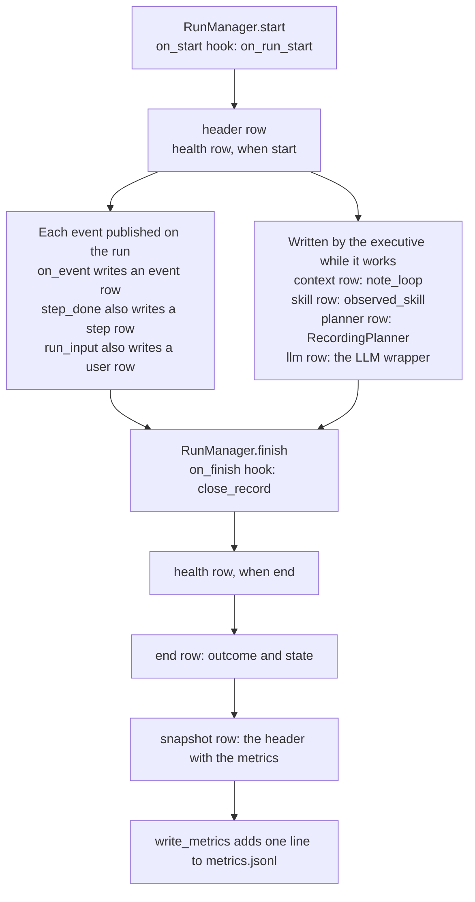
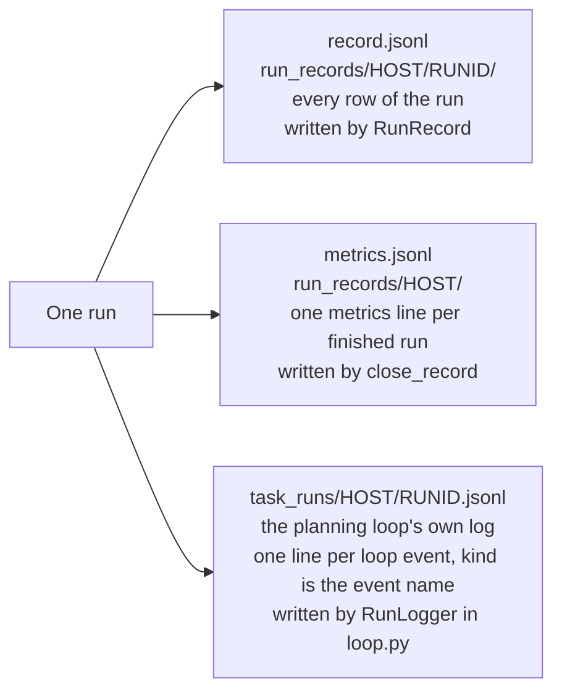

# Runs and records

Every time the robot is given a task, it starts a **run**. A run has an id, an owner, a state, and a log of everything it did. This page explains how a run is started and tracked, what is written to disk, and how you can replay a finished run on a laptop with no robot.

!!! abstract "In this page"
    - A run is one task on one robot. The [run manager](../start/glossary.md#run) allows **one active run per robot** and gives each run an id such as `20261118-165807-acde22`.
    - The [run record](../start/glossary.md#runrecord) is one JSONL file per run. One line is one row, and each row has a `kind` (`header`, `event`, `llm`, `skill`, `step`, ...). When the run ends, a **metrics line** is added.
    - The record is enough to **replay** the run offline: `plan` re-runs understanding, planner and checks; `exec --fake` re-runs the whole run against a fake robot. Exit code 0 means identical.
    - Everything on this page was run on the offline fake robot, with a scripted LLM and a scripted planner. Nothing here comes from a real robot.

!!! code "Where in the code"
    - [`Run`, `RunManager`](https://github.com/mtbui2010/robot_agent/blob/3269923/robot_agent/interact/run_manager.py#L193-L668) and the [run id](https://github.com/mtbui2010/robot_agent/blob/3269923/robot_agent/interact/run_manager.py#L188-L190)
    - [`RunRecord`](https://github.com/mtbui2010/robot_agent/blob/3269923/robot_agent/observe/record.py#L105-L201), [`metrics_of`](https://github.com/mtbui2010/robot_agent/blob/3269923/robot_agent/observe/record.py#L285-L345), [`find_record`](https://github.com/mtbui2010/robot_agent/blob/3269923/robot_agent/observe/record.py#L219-L251)
    - [`paths.py`](https://github.com/mtbui2010/robot_agent/blob/5058637/robot_agent/observe/paths.py#L37-L129) (where files go) and [`replay.py`](https://github.com/mtbui2010/robot_agent/blob/3269923/robot_agent/observe/replay.py#L363-L526) (the replay CLI)
    - The record is opened by hooks that [`run_control`](https://github.com/mtbui2010/robot_agent/blob/3269923/robot_agent/core/run_control.py#L44-L58) adds to the run manager.
    - Tests that record a run and replay it: [`test_observe_record_replay.py`](https://github.com/mtbui2010/robot_agent/blob/3269923/tests/test_observe_record_replay.py)

## The idea in plain words

Think of a flight recorder. While the robot works on one task, a recorder writes down what it was told, what it asked the language model, which skills it called, and what each skill returned. When something goes wrong, you do not have to guess. You open the recording.

Three parts work together:

| Part | Job |
|---|---|
| **Run manager** (`RunManager`) | Starts and ends runs, keeps the rule "one active run per robot", and routes anything said during a run. |
| **Run record** (`RunRecord`) | Writes one JSONL file per run. It listens to the run's event stream and to the capture points inside the LLM clients, the planner boundary and the skill registry. |
| **Replay** (`observe.replay`) | Reads a record and runs the same task again, with every LLM answer and skill result taken from the record instead of from a real service. |

## A run and its id

A `Run` is one execution on one robot. It holds the goal text, the user id and role of the person who started it, a state, and the last 1000 events (`MAX_EVENTS`).

The run id is a time prefix and six random hex characters, so ids sort by start time:

```python
def _new_run_id() -> str:
    # Sortable and short: a time prefix, then random.
    return time.strftime('%Y%m%d-%H%M%S') + '-' + uuid.uuid4().hex[:6]
```

[Permalink](https://github.com/mtbui2010/robot_agent/blob/3269923/robot_agent/interact/run_manager.py#L188-L190). The id is stamped on every event of the run, and it is the key of `GET /runs/{id}` and `POST /runs/{id}/cancel|pause|resume|inject`.

A run has one of five states:

| State | Meaning |
|---|---|
| `running` | The executive is working. |
| `paused` | A pause was asked for. The executive holds at its next step boundary. |
| `cancelling` | A stop was asked for. The executive stops at its next check. |
| `done` | Ended. Also the end state after a cancel, with outcome `aborted`. |
| `failed` | Ended with a failure. |

The first three are the *active* states. `finish` sets `outcome` to the text you pass, or else to `aborted` (after a cancel), `success` or `failed`. A pause is accepted only from `running`, and a resume only from `paused`. A cancel is accepted from any active state and also wakes a paused run and a run that waits on a question. What a stop interrupts, call by call, is listed in the cancel audit of [`docs/run_manager.md`](https://github.com/mtbui2010/robot_agent/blob/3269923/docs/run_manager.md).

### One active run per robot

`RunManager.start` checks whether the robot already has an active run. If it does, it does **not** start a second one. It returns the running one with `started=False` and `decision='busy'`, and the caller becomes an observer: whatever that caller says goes into the running run through `inject` (see [Dialog and intent](dialog-and-intent.md)). On `/ws/agent` this is what a second client gets: a `run_attached` event with `observer: true` and `decision: 'busy'`, then every event of the running run. Its going away does not cancel the run.

This is real output from the offline example below. Bob tries to start a task while Alice's run is active:

```text
second start: False busy | run 20261118-165807-acde22 is running on default
```

The robot id is `default` because one agent process serves one robot. Finished runs stay in memory for `GET /runs`: the last 50 (`MAX_FINISHED`).

## The run record

When a run starts, the run manager calls its `on_start` hooks. `run_control` registers one that opens a record, and one in `on_finish` that closes it. So **every** run gets a record: the closed loop, the [AssistLoop](../start/glossary.md#assistloop), the open-loop LLM plan and `direct` command runs alike.

A `RunRecord` is a subclass of `RunLogger`, the JSONL logger of the planning layer (`core/planning/records.py`). It adds typed rows and a lock, because the executive thread and the API's event loop write to it at the same time.

### The life of a run, and who writes which row

Two writers fill the record. The run manager's hooks write the first and last rows, and the `event`, `step` and `user` rows follow the events of the run ([`on_run_start`](https://github.com/mtbui2010/robot_agent/blob/e65e9aa/robot_agent/observe/record.py#L388-L401), [`on_event`](https://github.com/mtbui2010/robot_agent/blob/e65e9aa/robot_agent/observe/record.py#L160-L182), [`close_record`](https://github.com/mtbui2010/robot_agent/blob/e65e9aa/robot_agent/observe/record.py#L404-L427)). The executive writes the `context`, `skill`, `planner` and `llm` rows from inside the run: [`note_loop`](https://github.com/mtbui2010/robot_agent/blob/e65e9aa/robot_agent/observe/record.py#L532-L576), [`observed_skill`](https://github.com/mtbui2010/robot_agent/blob/e65e9aa/robot_agent/observe/record.py#L503-L531), [`RecordingPlanner`](https://github.com/mtbui2010/robot_agent/blob/e65e9aa/robot_agent/observe/record.py#L601-L636) and the LLM wrapper [`observe/llm.py`](https://github.com/mtbui2010/robot_agent/blob/e65e9aa/robot_agent/observe/llm.py#L66-L100).



The two middle boxes run side by side, so their rows are interleaved in the file by `seq`. In the real record below, the first rows are `header`, `health`, two `event` rows (`run_state`, `start`), then `context`.

*Drawn from the code at e65e9aa. The order of the first and last rows was also checked against one real record, run `20261120-123109-cf6cd8` (read: 108 rows, 78 of them `event`; its kinds are the ones in the table below).*

### Where the file goes

```text
<data_dir>/run_records/<host>/<run_id>/record.jsonl      one record per run
<data_dir>/run_records/<host>/metrics.jsonl              one metrics line per finished run
```

`<host>` is the machine's host id. `<data_dir>` is the value of the environment variable `ROBOT_AGENT_DATA_DIR` (a placeholder in every example here). When the variable is not set, the files stay where they always were, in a `run_records/<host>/` folder under the robot's own config folder. When you look a run up by id, the new place is searched first and the old one second.

There is a second, separate file, off by default: the `trace` option (`trace=1`, `ROBOT_AGENT_TRACE=1`) writes `<dir>/<run_id>/trace.jsonl` with every event, the options' lab entries (for example `look_then_ask` and `bt_goal` write one each time they act), every LLM call (sizes only) and a `recovery` row after each failed step. It adds no LLM or robot call. Format: [`docs/trace.md`](https://github.com/mtbui2010/robot_agent/blob/3269923/docs/trace.md). The record described here does not change when it is on. The offline run on this page did not use it.

Recording is best-effort. It never raises into the run. Setting `ROBOT_AGENT_RECORD=0` turns it off, and a process with no agent state (no data dir) records nothing.

### Which file holds what

One run leaves up to three files. They have different writers, so they are not copies of each other.



`HOST` is the machine's host id and `RUNID` is the run id. The loop's log file is named by the run id when the run was started through the run manager (comment in [`RunContext`](https://github.com/mtbui2010/robot_agent/blob/e65e9aa/robot_agent/core/planning/loop.py#L201-L207)); the `snapshot` line that `_close_run` appends to it ([`loop.py`](https://github.com/mtbui2010/robot_agent/blob/e65e9aa/robot_agent/core/planning/loop.py#L495-L505)) holds the whole task record. The paths follow [`paths.py`](https://github.com/mtbui2010/robot_agent/blob/e65e9aa/robot_agent/observe/paths.py#L8-L18).

*Drawn from the code at e65e9aa, not from a recorded run. I read no real `task_runs` file for this diagram.*

### The rows

Each line is one JSON object `{"seq", "t", "kind", ...}`. `seq` counts from 1, and `t` is the Unix time.

| `kind` | What it holds |
|---|---|
| `header` | `run_id`, `robot_id`, `user_id`, `role`, `goal`, `created`, `host`, `robot_pkg`, `schema` (first row) |
| `context` | What the executive was started with: loop kind, task, language, loop config, `ENV`, the world at start, object memory. Replay needs this. |
| `event` | Every event published on the run: agent events and run-manager notices. |
| `user` | Something a person said or sent during the run, with `user_id`, `role`, the `intent` and the text. |
| `llm` | One LLM call: source, request, response, model, backend, seed, temperature, `latency_ms`, error. |
| `planner` | One planner call at the robot_agent boundary (`generate_plan` or `replan`): inputs (with `subgoals` when the loop passes them), steps, meta. |
| `skill` | One skill call: skill, params, the raw return, its [SkillResult](../start/glossary.md#skillresult), latency, nesting depth, the [belief](../start/glossary.md#belief) before it. |
| `step` | A plan step that ended: index, status, world before and after. |
| `health` | The robot adapter's `health()` at start and at the end. |
| `end` | `outcome` and `state`. |
| `snapshot` | The last row: the header again, now with the `metrics` filled in. |

Long strings are shortened so a record stays small. A string over 4096 characters becomes `{"_omitted": "str", "len": ..., "sha1": ...}`. LLM requests and responses are kept up to 65536 characters, because a prompt must stay whole for replay. The key `say_audio` is dropped.

### One real record

The script below mirrors what [`record_run`](https://github.com/mtbui2010/robot_agent/blob/3269923/tests/test_observe_record_replay.py#L37-L53) and the fixtures do in the tests, without pytest. It runs the AssistLoop on the fake robot `FakeRobot` ([`tests/fakes.py`](https://github.com/mtbui2010/robot_agent/blob/3269923/tests/fakes.py#L91)) **with a scripted LLM reply** (`FakeLLM`) and **a scripted planner** (`ScriptedPlanner`). The mug is not on the desk, so the first plan fails at `Find`, and the loop replans. The fake person answers "the dining table" to the robot's question. A second user, Bob, asks a question in the middle of the run.

```python
"""Record one run of AssistLoop on the offline fake robot through the RunManager (mirrors tests/test_observe_record_replay.py).
Usage: REPOS=<dir holding robot_agent and embodiplan> python -B record_demo.py <out_dir>"""
import json, os, sys, types
from pathlib import Path
REPOS = Path(os.environ["REPOS"])
OUT = Path(sys.argv[1])
os.environ["ROBOT_AGENT_DATA_DIR"] = str(OUT / "data")
os.environ["ROBOT_AGENT_HOST"] = "test"
sys.path[:0] = [str(REPOS / "robot_agent"), str(REPOS / "robot_agent" / "tests"), str(REPOS / "embodiplan")]
sys.modules.setdefault("requests", types.ModuleType("requests"))
from fakes import FakeLLM, FakeRobot, ScriptedPlanner, FakeState, FakeSkillRegistry, load_env, steps
import robot_agent.state as state_mod, robot_agent.core.planning.assist_loop as AL, robot_agent.core.planning.loop as LP
import robot_agent.skill_configs as sc
from robot_agent.core import run_control
from robot_agent.core.unified_agent import _serialize_result
from robot_agent.interact.run_manager import reset_manager
from robot_agent.observe import record as R
st = FakeState(OUT)
for m in (AL, LP, state_mod): m.current = lambda: st
for m in (AL, LP): m.host_id = lambda: "test"
env = load_env(); sc.ENV = env
AL.reconcile_world = lambda node, world, threshold=0.8: world
reset_manager(); run_control.begin_run()
DR, DT, DS, CT = "drawer@kitchen", "dining table@kitchen", "desk@study room", "counter@kitchen"
HOUSE = {"apple": DS, "mug": CT, "banana": DT}
def und(*g): return {"status": "clear", "reason": "", "question": "",
                     "goals": [{"type": t, "object": o, "from": f, "to": to} for t, o, f, to in g]}
robot = FakeRobot(env, HOUSE, answers=["the dining table"])
llm = FakeLLM(und(("on", "mug", "desk", "table")), und(("on", "mug", "desk", "dining table")),
              (r"Rank the places where the mug", {"places": [CT]}))
planner = ScriptedPlanner(steps(f"MoveTo {DS}", "Find mug", "Pick mug", f"MoveTo {DT}", f"Place {DT}"),
    replans=[steps(f"MoveTo {CT}", "Find mug", "Pick mug", f"MoveTo {DT}", f"Place {DT}")])
agent = types.SimpleNamespace(skill_registry=FakeSkillRegistry(robot), device_manager=types.SimpleNamespace(_ros_node=None),
                              _llm_cfg={"name": "fake", "url": None, "model": "scripted"})
loop = AL.AssistLoop(agent, emit=None, log_dir=str(OUT / "runs"), live_path=str(OUT / "live.jsonl"),
                     memory_path=str(OUT / "om.json"), mute_skill_tts=False, speak_backend=False, vlm_enabled=False)
loop._llm_client, loop._make_planner = llm, (lambda: planner)
task = "Put the mug from the desk on the table."
mgr = run_control.manager()
run = mgr.start(goal=task, user_id="alice", role="owner").run
second = mgr.start(goal="another task", user_id="bob")
print("second start:", second.started, second.decision, "|", second.reason)
run_control.begin_run()
R.note_loop(R.instrument(loop), task, "en", kwargs={})
status = None
for ev in loop.run_blocking(task, "en"):
    ev = run.publish(_serialize_result(ev))
    if ev["event"] == "clarify": print("clarify:", ev["question"])
    if ev["event"] == "plan":
        r = mgr.inject(run.run_id, "how is it going?", user_id="bob", role="member"); print("inject:", r.action, r.decision.intent.value, r.decision.source)
    if ev["event"] == "done": status = ev["status"]
mgr.finish(run.run_id, ok=status == "success", outcome=status)
print("RUN_ID", run.run_id, "status", status)
```

Run with `/usr/bin/python3 -B record_demo.py <out_dir>`. It printed (a harmless `teleop stop_all: 'FakeState' object has no attribute 'cm'` warning appears twice on stderr; the fake state has no connection manager):

```text
second start: False busy | run 20261118-165807-acde22 is running on default
clarify: Which table do you mean: side table in the living room or dining table in the kitchen?
clarify: I will put the mug from the desk in the study room on the dining table in the kitchen. Is that right?
inject: status status fallback
RUN_ID 20261118-165807-acde22 status success
```

The record had 76 rows:

| kind | rows |
|---|---|
| `event` | 40 |
| `skill` | 17 |
| `step` | 7 |
| `llm` | 3 |
| `health`, `planner` | 2 each |
| `header`, `context`, `user`, `end`, `snapshot` | 1 each |

The order of the first rows shows how the record is built. Row 1 is the `header`. Rows 3 and 4 are the first `event` (`run_state`) and the `context`. Then come `task_start`, `reconcile`, `status`, the first `llm` call, `understand`, `clarify` and the robot's `ask` skill. The second understanding and a second question follow. After the `planner` row come the `gate` and `plan` events, and then the `user` row for Bob's question (`intent: status`), written next to its `run_input` event. Each plan step then adds `step_start`, one or more `skill` rows, `step_verify`, `step_done` and a `step` row. The failed `Find` is followed by a `search` event, a second `planner` row and a `replan` event. The run ends with `goal_check`, `done`, a `run_state` event, the final `health`, the `end` row (`outcome: success`, `state: done`) and the `snapshot`.

### The metrics line

`metrics_of` reduces the rows to one line. `close_record` appends it to `metrics.jsonl` and stores it in the `snapshot` row. This is the real line from the run above:

```json
{"run_id": "20261118-165807-acde22", "task_run_id": null, "robot_id": "default", "user_id": "alice", "goal": "Put the mug from the desk on the table.", "loop": "assist", "started": 1794988687.1769066, "duration_s": 0.124, "outcome": "success", "status": "success", "llm_calls": 3, "llm_errors": 0, "llm_latency_ms": 0.1, "planner_calls": 2, "skill_calls": 17, "replans": 1, "failure_codes": {"absent": 1}, "failure_code": null, "failure_device": null, "success": true, "verified_success": true}
```

| Field | Meaning |
|---|---|
| `llm_calls`, `llm_errors`, `llm_latency_ms` | Count of `llm` rows, those with an error, and the sum of their latencies. |
| `planner_calls`, `replans` | Count of `planner` rows and of `replan` events. |
| `skill_calls` | Top-level skill calls (nested calls, with a `depth`, are not counted). |
| `failure_codes` | Failure codes of the plan steps that did not succeed. Here one `Find` returned `absent` ([failure codes](skills-and-failures.md)). |
| `success` | The last `done` event had status `success`. |
| `verified_success` | `success`, **and** every verified step's last check passed. A run with no verified steps is never `verified_success`. |
| `task_run_id` | Set only when the loop's `task_start` carries an id different from the run id. Here it is `null`: one id per run. |

You can read the same data over HTTP: `GET /runs/{id}/record` (with `?kinds=llm,skill` and `?limit=N`) and `GET /runs/{id}/metrics`. For a run that is still active, the metrics are computed so far and carry `live: true`.

## The event stream

Everything the executive says about progress is an **event**: a JSON object with an `event` name. The loop yields events, and `Run.publish` does three things with each one: it adds `run_id` if the event has none, it keeps the event on the run, and it passes it to every subscriber. The WebSocket `/ws/agent` publishes each event of the loop on the run and sends it to the client, and it subscribes to the run manager's notices so they reach the client too. The `RunRecord` is another subscriber, so the same events become `event` rows.

The run manager adds its own events, marked `origin: "run_manager"`: `run_state` (state changes), `run_input` (something said during the run), `run_refused` (a request that was not allowed), `task_suspended` and `task_resumed`.

The event names are described by a versioned JSON schema served at `GET /schema/events` (version `1.0.0`, 27 events).

!!! warning "The schema is descriptive and not complete"
    The models in `api/events.py` allow extra fields and the agent does not validate against them. Eight events that the loops emit are **not** in the schema: `goal_change`, `goal_check`, `health`, `reconcile`, `search`, `task_resumed`, `understand_check` and `understand_fallback` (found by searching for `.ev("...")` calls in `core/`, `options/`, `interact/` and `observe/`; `understand_fallback` is new since the earlier check). `task_suspended` is also missing from the schema. If you build a client, handle unknown event names and do not rely on the schema alone.

## Replay

[Replay](../start/glossary.md#replay) runs a recorded task again, offline: no robot, no LLM server, no ROS. There are two modes.

| Mode | What it re-runs | What it compares |
|---|---|---|
| `plan` | Understanding, the planner and the checks (the loop with `plan_only`). | The understanding, the gate verdicts and the plan. |
| `exec --fake` | The whole executive, against a fake robot that returns the recorded skill results. | Every event, the skill calls and the outcome. |

In both modes every LLM call is answered from the record, found by its **request** (the prompt, the format or guide, or embodiplan's messages). If the code now builds a different prompt, replay stops with a `ReplayMismatch` ("the prompt differs") and a diff against the closest recorded prompt. Fields that change by design (clocks, ids, timings) are ignored when comparing.

| Exit code | Meaning |
|---|---|
| 0 | Identical. |
| 1 | Differs. |
| 2 | A mismatch, or the run cannot be replayed (for example, no record found). |

Replay of the record from above, with the recorded robot package and embodiplan importable (`<repos>` is the folder that holds the repos):

```bash
cd <repos>/robot_agent
PYTHONPATH=<repos>/robot_agent/tests:<repos>/embodiplan \
  python3 -B -m robot_agent.observe.replay plan <data_dir>/run_records/test/20261118-165807-acde22
PYTHONPATH=<repos>/robot_agent/tests:<repos>/embodiplan \
  python3 -B -m robot_agent.observe.replay exec <data_dir>/run_records/test/20261118-165807-acde22 --fake
```

Output (both exit with status 0):

```text
replay plan 20261118-165807-acde22 (assist): IDENTICAL
  recorded plan: move::desk@study room
find::mug
pick::mug
move::dining table@kitchen
place::dining table@kitchen
  replayed plan: move::desk@study room
find::mug
pick::mug
move::dining table@kitchen
place::dining table@kitchen
replay exec 20261118-165807-acde22 (assist): IDENTICAL
```

The `exec` replay re-ran the whole run (understanding, two questions, a plan, a miss and a replan) and got the same events, the same skill calls and the same outcome. Both runs also printed `teleop stop_all: 'ReplayState' object has no attribute 'cm'` on stderr. It is harmless here.

`<run>` can be a run folder, a `record.jsonl` file, or a bare run id (with `--data-dir` to say where to look). Other options: `--planner auto|recorded|live`, `--robot-pkg`, `--strict` and `--json`. With `recorded`, the planner is served from the recorded `generate_plan` and `replan` rows. With `live`, the planner's own logic (SAGE) runs and only its LLM calls are served; embodiplan must be importable. `auto` picks `live` when the record has embodiplan calls and embodiplan imports, else `recorded`.

!!! warning "Replay needs the code and the robot package of the run"
    - **The robot package must be importable.** The record names it in `robot_pkg`. Without it, `exec` ended with an `ImportError` (`fakebot: no configs/adapter.py and no configs/sage_namemap.py`) and exit status 2. Put the package on `PYTHONPATH`, or pass `--robot-pkg`.
    - **embodiplan should be importable.** When we left `embodiplan` off the path for the record above, `plan` printed `DIFFERS` with `replayed plan: None` and exited with 1. With embodiplan on the path it printed `IDENTICAL`. So a `DIFFERS` is not always a real difference: check the environment first.
    - Replay patches a few module globals while it runs and restores them. Use it from a command line or a test, not inside a live agent process.

### Golden tests

[`test_observe_record_replay.py`](https://github.com/mtbui2010/robot_agent/blob/3269923/tests/test_observe_record_replay.py) is a golden test of this kind. It records a run of the real AssistLoop on the fake robot through the run manager, replays it in both modes, and asserts the replay is identical. It also edits a record (a place removed from `ENV`, a recorded `place` result turned into a failure) and asserts that the replay reports the change. A second test file, `tests/test_golden_task_runs.py`, replays recorded task runs stored under `tests/data/`. We did not open that data, so this page says nothing about its content. No tests were run for this page, because `pytest` is not installed on the machine used.

## Where to go next

- [Dialog and intent](dialog-and-intent.md): what `inject` does with a message while a run is active.
- [Debug a failed run](../guides/debug-a-failed-run.md): use the record and the metrics line to find the cause.
- [Dashboard API](../contracts/dashboard-api.md): the `/runs` endpoints and the WebSocket.
