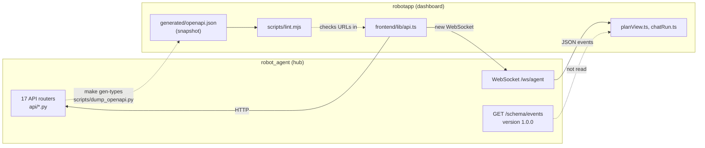

# Dashboard and core

The dashboard (the `robotapp` repo) talks to the hub (`robot_agent`) in two ways: plain HTTP calls described by an OpenAPI file, and one WebSocket that streams run events. This page shows both sides, how the dashboard gets its description of the hub, and three gaps in that description that you should know about before you change either repo.

!!! abstract "In this page"
    - The dashboard calls the hub only from one file, `frontend/lib/api.ts`. A run is started and followed on the WebSocket `/ws/agent`, not over HTTP.
    - The dashboard keeps a **snapshot** of the hub's OpenAPI file (`make gen-types`) and its lint step checks every URL in `api.ts` against it. The hub's event schema (version `1.0.0`) is not used by the dashboard.
    - Three gaps exist today: the snapshot script has its own router list that misses `events`; the loops send events the schema does not list; the dashboard never reads the schema.

The dashboard has its own documentation site: <https://mtbui2010.github.io/robotapp/>. This page covers only the contract with the hub and does not repeat the dashboard's own docs.



## Both sides

| | The hub offers | The dashboard uses |
|---|---|---|
| HTTP routes | 17 routers mounted in a loop in [`app_factory.py`](https://github.com/mtbui2010/robot_agent/blob/ad501cf15ece/robot_agent/app_factory.py#L73-L89) ([the loop](https://github.com/mtbui2010/robot_agent/blob/ad501cf15ece/robot_agent/app_factory.py#L130-L132)). Many routes declare a response model in `api/models.py`. | Only `frontend/lib/api.ts` makes HTTP calls. `scripts/lint.mjs` states this as a rule: a `fetch()` or `new WebSocket()` elsewhere must take its URL from an `api.` helper ([lint.mjs](https://github.com/mtbui2010/robotapp/blob/f30f0b52d969/scripts/lint.mjs#L9-L10)). |
| Which hub to call | The hub is one process per robot. | The dashboard stores a list of named robots and the active one in the browser, and builds each URL from the active robot's base URL (`getAgentUrl()`, [`getWsBase()`](https://github.com/mtbui2010/robotapp/blob/f30f0b52d969/frontend/lib/api.ts#L148-L150) swaps `http` for `ws`). |
| Start a run | The WebSocket [`/ws/agent`](https://github.com/mtbui2010/robot_agent/blob/ad501cf15ece/robot_agent/api/agent.py#L431-L455) reads the first JSON message: `prompt`, `lang`, `direct`, `planner`, `plan_only`, `log_data`, `log_mode`, `log_all`, `options`, `generator`, `user_id`, `role`. | [`page.tsx`](https://github.com/mtbui2010/robotapp/blob/f30f0b52d969/frontend/app/page.tsx#L331-L335) sends the first eight of these. It does not send `options`, `generator`, `user_id` or `role`. |
| Follow a run | The same socket sends one JSON object per event, each with an `event` name. | `ws.onmessage` in `page.tsx`; the plan view is built by `reducePlan` in [`planView.ts`](https://github.com/mtbui2010/robotapp/blob/f30f0b52d969/frontend/lib/planView.ts#L103); the chat state by `chatRun.ts`. |
| Stop and answers | `POST /agent/cancel`; `POST /runs/{run_id}/cancel`, `/pause`, `/resume`, `/inject` ([agent.py](https://github.com/mtbui2010/robot_agent/blob/ad501cf15ece/robot_agent/api/agent.py#L296-L315)); `POST /agent/listen/{req_id}` for an answer to a question the robot asked. | `api.ts` calls `/agent/cancel` and `/agent/listen/<id>`. The dashboard's own notes: `docs/features/cancel-stop.md` and `hri-voice.md` in the robotapp repo. |
| Endpoint list | The OpenAPI file of the running hub, at `/openapi.json`. | A prose list in [`docs/features/backend-contract.md`](https://github.com/mtbui2010/robotapp/blob/f30f0b52d969/docs/features/backend-contract.md), and the machine-checked snapshot below. |

CORS is open in the hub (`allow_origins=['*']` in `app_factory.py`), so a dashboard served from any address can call it. WebSocket routes are not part of OpenAPI. The hub has two: `/ws/agent` and `/ws/camera/{connect_id}` ([camera.py](https://github.com/mtbui2010/robot_agent/blob/ad501cf15ece/robot_agent/api/camera.py#L349)). The lint step skips every path that starts with `/ws/`.

## How the dashboard gets its types

The dashboard does not import anything from the hub. It keeps a copy of the hub's API description and checks itself against it.

1. You run `make gen-types ROBOT_AGENT_DIR=../robot_agent` in the robotapp repo. The Makefile target calls [`scripts/gen_types.sh`](https://github.com/mtbui2010/robotapp/blob/f30f0b52d969/scripts/gen_types.sh).
2. The script runs `scripts/dump_openapi.py` with the hub checkout on `PYTHONPATH`. That script mounts the hub's routers on a bare FastAPI app and writes `frontend/lib/generated/openapi.json`. The hub is not booted: no robot, no ROS. This needs Python with FastAPI.
3. If `openapi-typescript` is installed in `frontend/node_modules`, the script also writes `frontend/lib/generated/openapi.d.ts`. Otherwise it prints "skipped". At the pinned commit only `openapi.json` is in the repo, so no `.d.ts` file is generated or used.
4. `make lint` (part of `make ci`) runs `scripts/lint.mjs`. Its first check is that every hub path built in `frontend/lib/api.ts` exists in `openapi.json`. If the snapshot file is missing, the check is skipped with a message.

So the snapshot protects the dashboard against a typo or a removed route. It does not give the dashboard typed responses: the TypeScript types in `api.ts` are written by hand (`./types`, `./recorder`, `./poses`, and so on).

The snapshot at the pinned commit has 66 paths. It was read from the committed file; `make gen-types` was not run here (it needs FastAPI and `node_modules`).

!!! code "Where in the code"
    - Hub: [`app_factory.py` lines 73-89 and 130-132](https://github.com/mtbui2010/robot_agent/blob/ad501cf15ece/robot_agent/app_factory.py#L73-L132), [`api/agent.py`](https://github.com/mtbui2010/robot_agent/blob/ad501cf15ece/robot_agent/api/agent.py), [`api/events.py`](https://github.com/mtbui2010/robot_agent/blob/ad501cf15ece/robot_agent/api/events.py)
    - Dashboard: [`scripts/dump_openapi.py`](https://github.com/mtbui2010/robotapp/blob/f30f0b52d969/scripts/dump_openapi.py#L16-L18), [`scripts/gen_types.sh`](https://github.com/mtbui2010/robotapp/blob/f30f0b52d969/scripts/gen_types.sh), [`scripts/lint.mjs`](https://github.com/mtbui2010/robotapp/blob/f30f0b52d969/scripts/lint.mjs), [`frontend/lib/api.ts`](https://github.com/mtbui2010/robotapp/blob/f30f0b52d969/frontend/lib/api.ts)

## What crosses: the event stream

Every message on `/ws/agent` from the hub is one JSON object with an `event` name. The hub describes these events with Pydantic models in `api/events.py` and serves them as one JSON schema at `GET /schema/events`. The schema file states what it is:

- It is **descriptive, not a filter**. Every model allows extra fields, and the hub does not check what it sends against the models.
- It lists the fields as they are today. Where the two emitters differ, the field is optional: the older direct path ("open-loop") sends `step` and `task`; the planning loops send `index` and `action`.
- Its version is `EVENT_SCHEMA_VERSION = '1.0.0'` ([events.py line 26](https://github.com/mtbui2010/robot_agent/blob/ad501cf15ece/robot_agent/api/events.py#L26)), a semantic version. Adding an event or an optional field is a minor bump. Renaming or removing one, or making a field required, is a major bump with a CHANGELOG entry.

The 27 listed events, by group:

| Group | Events |
|---|---|
| Run frame | `start`, `log_dir`, `status`, `translated`, `error`, `stopped`, `done`, `world` |
| Planning | `task_start`, `understand`, `clarify`, `gate`, `plan_step`, `plan_raw`, `plan`, `warning`, `replan`, `recover` |
| Steps | `step_start`, `step_verify`, `step_done`, `step_log` |
| Run manager | `run_state`, `run_input`, `run_refused`, `run_injected`, `run_attached` |

The dashboard acts on a small part of them. `reducePlan` in `planView.ts` has cases for `start`, `understand`, `clarify`, `plan`, `replan`, `recover`, `step_start`, `step_done`, `goal_check`, and the end events `stopped`, `done`, `error`. `chatRun.ts` handles the life cycle of the chat (its own states such as `ws-close` and `timeout` are dashboard-side, not hub events).

A real event order for a planning run is in the example of an [AssistLoop](../start/glossary.md#assistloop) run on the offline fake robot, as captured when this site was planned: `task_start, reconcile, status, understand, status, gate, plan, step_start, step_verify, step_done, ..., search, replan, ..., goal_check, done`. Note that `reconcile`, `search` and `goal_check` in that list are not in the schema (see gap 2).

## Three gaps, as they are today

!!! warning "Known gaps in this contract"
    These are the current behaviour at the pinned commits, not planned work.

**1. The snapshot script keeps its own router list, and it misses `events`.**
The hub mounts 17 routers. `scripts/dump_openapi.py` does not ask the hub; it has a hand-written list of 16 names:

```python
ROUTERS = ['devices', 'skills', 'configs', 'buttons', 'agent', 'camera',
           'diagnostics', 'locations', 'planner', 'robot', 'tts', 'map', 'teleop', 'recorder', 'recordings', 'poses']
```

The seventeenth router is `events`, which serves `GET /schema/events`. That path is not in `openapi.json`, so the lint step cannot check it. The same applies to any router you add to the hub later, until someone edits this list by hand.
*How to avoid it:* when you add a router to `app_factory.py`, add its name to `ROUTERS` in the dashboard repo, then run `make gen-types`.

**2. The loops emit events that the schema (version 1.0.0) does not list.**
The planning loops in `robot_agent/core/planning/` send `goal_change`, `understand_check`, `reconcile`, `task_resumed`, `search`, `health` and `goal_check` through `r.ev("...")`. None of these is among the 27 models, so a client that builds types from the schema has no type for them. The dashboard already handles one of them (`goal_check`) by hand.
*How to avoid it:* treat the schema as a lower bound. Write a client so that it ignores an event name it does not know, and read the loop code for the full set. Because every model allows extra fields, extra fields on a listed event are also normal.

**3. The dashboard does not read the schema.**
Nothing in the dashboard fetches `/schema/events` (a search of the repo at the pinned commit finds no use). The event types in the dashboard are hand-written, and the schema's version number is not checked by any code on either side. A major bump of the schema would not fail any test in the dashboard.
*How to avoid it:* when you rename or remove an event or a field, search `planView.ts` and `chatRun.ts` for its name by hand, and bump `EVENT_SCHEMA_VERSION`.

## Version and pin

| What | Value | Checked by |
|---|---|---|
| Event schema | `1.0.0`, in `GET /schema/events` | Nothing on the dashboard side. The hub has a test that reads the endpoint (`tests/test_observe_api.py`). |
| Hub API (OpenAPI) | no version of its own at the pinned commit; the hub package is `0.1.0` | The snapshot file; `make lint` compares URLs only, not request or response shapes. |
| Snapshot | the committed `openapi.json` | Refresh with `make gen-types` after a hub change. |

## How to check

1. In the hub repo, `GET /schema/events` returns the schema (needs the hub running; not run here).
2. In the dashboard repo, run `make gen-types ROBOT_AGENT_DIR=../robot_agent`, then `make ci` (not run: needs FastAPI and `node_modules`).
3. To compare the three lists by hand: `grep -o 'r.ev("[a-z_]*"' robot_agent/core/planning/*.py | sort -u` against the names in `api/events.py`.

The addresses a dashboard uses for a robot are entered in the dashboard by the user. Any host or port you see in the dashboard's docs is an example; use your own.
