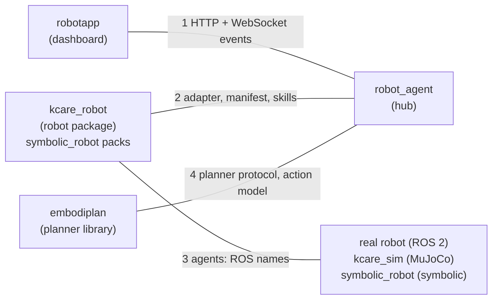

# Contracts between repos

The framework is six repos. A change in one of them can break another without any error in the repo you edited. This section lists the four places where repos meet, what crosses at each, and what (if anything) pins the version.

!!! abstract "In this page"
    - Four contracts: dashboard and hub, robot package and hub, robot package and hardware or simulator, planner library and hub.
    - Only two of the four have something that states a version: the event schema (`1.0.0`) and the planner library pin (`>=0.2.1,<0.3`). The event schema is not read by the dashboard (see the dashboard page).
    - Each page below has both sides, a real example, what breaks and how to check.

## The four contracts

| Contract | The two sides | What crosses | What pins the version | Page |
|---|---|---|---|---|
| 1. Dashboard and core | `robotapp` (`frontend/lib/api.ts`) and the hub's `robot_agent/api/` | HTTP routes described by OpenAPI; run events on the WebSocket `/ws/agent` | Event schema `1.0.0` (not read by the dashboard). A committed OpenAPI snapshot (`make gen-types`) that the dashboard's lint checks URLs against. | [Dashboard and core](dashboard-api.md) |
| 2. Robot package and core | A robot package (`kcare_robot`, or a `symbolic_robot` pack) and the hub's `robot_agent/contract/` and runtime | An adapter (binds a plan step to a skill), a manifest (the robot's data), skills as `skill(node, **params)` returning a result | Nothing states a version. The manifest checker (`python -m robot_agent.contract.check_manifest <package>`) and each package's tests. | [Robot package and core](robot-package.md) |
| 3. Robot package and hardware or simulator | The skills' `node.agents[...]` calls, and a real robot, `kcare_sim` or `symbolic_robot` (or the hub's fake robot in tests) | Named agents: ROS names and message types; or a stub node with the same agent names | Nothing states a version. `kcare_sim` keeps the ROS names in one module (`robot_interfaces.py`) and has a test that pins them. | [Robot, hardware and simulators](robot-and-simulators.md) |
| 4. Planner library and core | `embodiplan` and the hub's `core/planning/` | Planner objects (generate a plan, replan), the action model (check, apply, simulate) | The hub requires `embodiplan>=0.2.1,<0.3`; a hub test asserts that both sides report the same action-model version. | [Planner library and core](planner-library.md) |

## Why contracts matter when you change a repo

When you edit one repo, ask which contract it is on the edge of. A new router in the hub is invisible to the dashboard's lint until a hand-written list in the dashboard repo is edited. A renamed ROS name in a simulator breaks the real robot's software, which still uses the old name. A change to the action rules in the planner library changes the checks before motion in every robot at once. Most of these links have no machine-checked version, so the safe habit is: find the contract page for your change, read "what breaks", and run its "how to check" step in both repos before you call the change done.
