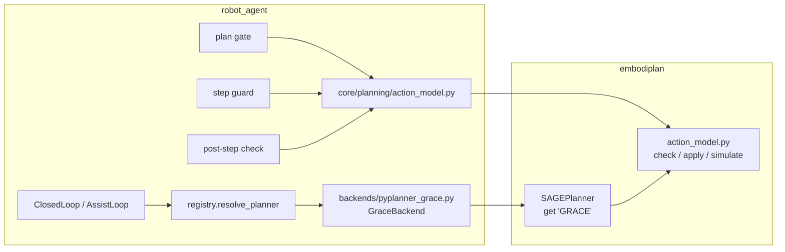

# Planner library and core

This page describes the agreement between the hub (`robot_agent`) and the planner library [embodiplan](../start/glossary.md#embodiplan). You get the two methods a planner must have, the one set of action rules that the hub shares with the library, the version pin, and the few places in the hub that import the library. For how the planners themselves work, read the [embodiplan site](https://mtbui2010.github.io/embodiplan/). This page does not repeat it.

!!! abstract "In this page"
    - A planner is any object with two methods, `generate_plan` and `replan`. Both return `(steps, metrics)`.
    - The rules that say what each action needs and changes (the [action model](../start/glossary.md#action-model)) live in embodiplan only. The hub's plan gate, step guard and post-step check all call that one module.
    - The hub pins embodiplan to `>=0.2.1,<0.3`. The hub imports embodiplan in only three files.
    - `resolve_planner('sage')` fails. `sage` is the name of a loop (AssistLoop), not of a planner. The planner key behind it is `grace`.

!!! code "Where in the code"
    - Hub: [`core/planning/base.py:246-279`](https://github.com/mtbui2010/robot_agent/blob/ad501cf15ece/robot_agent/core/planning/base.py#L246-L279) (the protocol), [`registry.py:72-93`](https://github.com/mtbui2010/robot_agent/blob/ad501cf15ece/robot_agent/core/planning/registry.py#L72-L93) (`resolve_planner`), [`core/planning/action_model.py`](https://github.com/mtbui2010/robot_agent/blob/ad501cf15ece/robot_agent/core/planning/action_model.py) (the only door to the rules), [`backends/pyplanner_grace.py`](https://github.com/mtbui2010/robot_agent/blob/ad501cf15ece/robot_agent/core/planning/backends/pyplanner_grace.py)
    - Library: [`embodiplan/__init__.py`](https://github.com/mtbui2010/embodiplan/blob/a69064255c69/embodiplan/__init__.py), [`embodiplan/action_model.py`](https://github.com/mtbui2010/embodiplan/blob/a69064255c69/embodiplan/action_model.py), [`embodiplan/sage.py`](https://github.com/mtbui2010/embodiplan/blob/a69064255c69/embodiplan/sage.py)
    - Pins: [`pyproject.toml`](https://github.com/mtbui2010/robot_agent/blob/ad501cf15ece/pyproject.toml#L21-L25), [`tests/test_action_model_agreement.py:285-287`](https://github.com/mtbui2010/robot_agent/blob/ad501cf15ece/tests/test_action_model_agreement.py#L285-L287)

## The picture



The same `MODEL` serves the planner (SAGE's own gate, inside the library) and the hub (three checks). That is by design: there is one source of the rules, so the planner and the robot cannot disagree about what a step needs. The terms used here are in the glossary: [gate](../start/glossary.md#certified-gate), [guard](../start/glossary.md#guard), [ClosedLoop](../start/glossary.md#closedloop) (planner key `grace`), [AssistLoop](../start/glossary.md#assistloop) (planner key `sage`).

## 1. The planner protocol: two methods

The hub does not care which class plans. It needs the shape below ([`base.py:246-279`](https://github.com/mtbui2010/robot_agent/blob/ad501cf15ece/robot_agent/core/planning/base.py#L246-L279)):

```python
@runtime_checkable
class Planner(Protocol):
    """Structural interface every planner backend must satisfy.

    Both methods return ``(steps, metrics)`` where ``steps`` is a list of
    PlanStep dicts and ``metrics`` is an arbitrary dict (may be empty ``{}``).
    See ``ACTION_MAPPER_SPEC.md`` section 1 and ``pyplanner/base.py``'s
    ``BasePlanner`` for the reference signatures.
    """

    def generate_plan(
        self,
        task: str,
        obs: str,
        visible_objects: list[str],
    ) -> tuple[list[dict], dict]:
        """Produce a full plan for ``task`` given the current observation."""
        ...

    def replan(
        self,
        task: str,
        completed: list[dict],
        failed_step: dict,
        failure_reason: str,
        obs: str,
        visible_objects: list[str],
    ) -> tuple[list[dict], dict]:
        """Produce a suffix plan recovering from ``failed_step``.

        ``completed`` is the prefix already executed successfully; the returned
        steps are spliced after it by the driver.
        """
        ...
```

| Method | Inputs | Returns |
|---|---|---|
| `generate_plan` | the task text, an observation string, the list of visible object names | `(steps, metrics)` |
| `replan` | the task, the steps already done, the failed step, the failure reason, the observation, the visible objects | `(steps, metrics)`: only the rest of the plan, which the loop adds after the done steps |

A step is a dict such as `{'action': 'Pick', 'object': 'cup'}`. `metrics` may be `{}`.

Some planners offer more. The core looks for these by attribute and uses them when present ([`base.py:289-345`](https://github.com/mtbui2010/robot_agent/blob/ad501cf15ece/robot_agent/core/planning/base.py#L289-L345)):

| Optional capability | Members | What the core does with it |
|---|---|---|
| `SubgoalRepair` | `blocks()`, `join_blocks()`, `repair_block()` | Sends back only the sub-goal block that the plan gate found wrong. Without it the core asks for one fresh plan. |
| `ProgressReporting` | a `progress` attribute | Streams planning progress to the dashboard. |
| `EpisodeMemory` | `record_episode(task, steps)` | Called once with the steps of every run that ended in success. |

`GraceBackend` offers these through embodiplan's SAGE: it reads `last_blocks` and `edit_block` ([`pyplanner_grace.py:252-258`](https://github.com/mtbui2010/robot_agent/blob/ad501cf15ece/robot_agent/core/planning/backends/pyplanner_grace.py#L252-L258)) and calls `flatten` from `embodiplan.sage` ([`:260-263`](https://github.com/mtbui2010/robot_agent/blob/ad501cf15ece/robot_agent/core/planning/backends/pyplanner_grace.py#L260-L263)). In embodiplan these are in [`sage.py`](https://github.com/mtbui2010/embodiplan/blob/a69064255c69/embodiplan/sage.py) (`generate_plan` at line 560, `replan` at 733, `edit_block` at 440, `last_blocks` at 432, `flatten` at 231).

## 2. The action model: one source of rules

The action model is three functions, from embodiplan's header ([`action_model.py:8-10`](https://github.com/mtbui2010/embodiplan/blob/a69064255c69/embodiplan/action_model.py#L8-L10)):

```text
#     check(step, world)     -> list[Violation]   (errors + warnings)
#     apply(step, world)     -> world             (effect of a successful step)
#     simulate(plan, world)  -> VerifierReport    (check + apply over a plan)
```

`world` is duck-typed: any object with the fields `arrived`, `found`, `holding`, `opened` and `on`. Inside embodiplan that is `SymbolicState`; in the hub it is the robot's [belief](../start/glossary.md#belief), the `WorldState` class ([`base.py:49`](https://github.com/mtbui2010/robot_agent/blob/ad501cf15ece/robot_agent/core/planning/base.py#L49)). The data types that cross are `Capabilities` (how many hands, whether `Find` brings the target within reach), `Violation` (a stable `code`, a `reason`, a severity), `ROBOT_ACTIONS` (the action names) and `ACTION_MODEL_VERSION`.

The hub reaches these only through its own file `core/planning/action_model.py`, which loads embodiplan on first use and forwards the call ([`action_model.py:18-53`](https://github.com/mtbui2010/robot_agent/blob/ad501cf15ece/robot_agent/core/planning/action_model.py#L18-L53)). Its header says it plainly: the gate, the guard and the effects "all decide through this module, so they cannot drift apart again" ([`action_model.py:3-7`](https://github.com/mtbui2010/robot_agent/blob/ad501cf15ece/robot_agent/core/planning/action_model.py#L3-L7)).

| Hub user | What it asks the model | Where |
|---|---|---|
| Plan gate (`AssistLoop._check`) | `check` and `apply` over a copy of the belief, step by step | [`assist_loop.py:654-669, 684`](https://github.com/mtbui2010/robot_agent/blob/ad501cf15ece/robot_agent/core/planning/assist_loop.py#L654-L684) |
| Step guard (before the robot moves) | `check` through `symbolic_check`; errors other than `unknown_action` refuse the step | [`verify.py:27-40`](https://github.com/mtbui2010/robot_agent/blob/ad501cf15ece/robot_agent/core/planning/verify.py#L27-L40), called at [`assist_loop.py:1760`](https://github.com/mtbui2010/robot_agent/blob/ad501cf15ece/robot_agent/core/planning/assist_loop.py#L1760) |
| Post-step check (after a skill said it succeeded) | `apply` on a copy, then the manifest's `effects` are tested on it | [`verify.py:69-79`](https://github.com/mtbui2010/robot_agent/blob/ad501cf15ece/robot_agent/core/planning/verify.py#L69-L79) |
| World update after a step | `apply` in place | [`assist_loop.py:901`](https://github.com/mtbui2010/robot_agent/blob/ad501cf15ece/robot_agent/core/planning/assist_loop.py#L901), [`mapper.py:194`](https://github.com/mtbui2010/robot_agent/blob/ad501cf15ece/robot_agent/core/planning/mapper.py#L194) |
| Removal of useless steps, sub-goal repair | `check`, `apply`, `simulate` | `plan_tidy.py:39, 56`, `subgoal_repair.py:92` |

The robot's body comes from the [manifest](../start/glossary.md#manifest): `RobotView.model_capabilities()` turns the manifest's `capabilities` into the model's `Capabilities` ([`robot.py:140-141`](https://github.com/mtbui2010/robot_agent/blob/ad501cf15ece/robot_agent/core/planning/robot.py#L140-L141); `Capabilities.from_any` reads `hands` or `arms`, and `find_reaches`, [`embodiplan/action_model.py:56-80`](https://github.com/mtbui2010/embodiplan/blob/a69064255c69/embodiplan/action_model.py#L56-L80)). This is how a robot manifest, described in [Robot package and core](robot-package.md), changes what a plan may contain. For the rules per action, see the embodiplan pages [Symbolic state](https://mtbui2010.github.io/embodiplan/concepts/symbolic-state/) and [Action model reference](https://mtbui2010.github.io/embodiplan/reference/action-model/).

Real values, run offline with the hub and embodiplan on `PYTHONPATH` (no robot, no LLM):

```text
ACTION_MODEL_VERSION 1.0 embodiplan 0.2.5
ROBOT_ACTIONS 14 Close Find LieOn MoveTo Open Pick Place PutIn Serve Sit TurnOff TurnOn Wait Wash
check Pick cup on empty belief: [('no_find_before_pick', 'error')]
```

and `simulate` on two small plans, printed with `summary()`:

```text
FAIL (1 violation(s)):
  step 1: [no_find_before_pick] Pick requires a preceding Find of the target object (Pick cup)
OK (3 steps verified)
```

The first plan is the single step `Pick cup`. The second is `MoveTo kitchen`, `Find cup`, `Pick cup`.

### `ACTION_MODEL_VERSION`

It is the string `"1.0"` ([`embodiplan/action_model.py:29`](https://github.com/mtbui2010/embodiplan/blob/a69064255c69/embodiplan/action_model.py#L29)), re-exported from the package ([`__init__.py:55`](https://github.com/mtbui2010/embodiplan/blob/a69064255c69/embodiplan/__init__.py#L55)). The header of the model file says rule changes bump it and are listed in embodiplan's `CHANGELOG.md` ([`action_model.py:16`](https://github.com/mtbui2010/embodiplan/blob/a69064255c69/embodiplan/action_model.py#L16)). The hub forwards the name unchanged ([`action_model.py:45-53`](https://github.com/mtbui2010/robot_agent/blob/ad501cf15ece/robot_agent/core/planning/action_model.py#L45-L53)), so `robot_agent.core.planning.action_model.ACTION_MODEL_VERSION` and embodiplan's are the same value by construction. The hub's test asserts this equality ([`test_action_model_agreement.py:285-287`](https://github.com/mtbui2010/robot_agent/blob/ad501cf15ece/tests/test_action_model_agreement.py#L285-L287)). The hub does not otherwise compare the version at run time; no code refuses to start on a different value.

## 3. The version pin

Both sides declare the same range, `>=0.2.1,<0.3`:

| Place | Line | What it says |
|---|---|---|
| Hub `pyproject.toml`, `dependencies` | [`:24`](https://github.com/mtbui2010/robot_agent/blob/ad501cf15ece/pyproject.toml#L24) | `"embodiplan>=0.2.1,<0.3"` |
| Hub `pyproject.toml`, extra `grace` | [`:59`](https://github.com/mtbui2010/robot_agent/blob/ad501cf15ece/pyproject.toml#L59) | the same range again |
| Hub error text when embodiplan is missing | [`action_model.py:23-26`](https://github.com/mtbui2010/robot_agent/blob/ad501cf15ece/robot_agent/core/planning/action_model.py#L23-L26) | "robot_agent needs embodiplan>=0.2.1,<0.3 ..." |
| Hub rule 3 | [`CLAUDE.md`](https://github.com/mtbui2010/robot_agent/blob/ad501cf15ece/CLAUDE.md) | "public API, `>=0.2.1,<0.3`" |
| kcare_robot `pyproject.toml`, extra `planner` | [`:35`](https://github.com/mtbui2010/kcare_robot/blob/d4f5577b342e/pyproject.toml#L35) | the same range |
| embodiplan rule 1 | [`CLAUDE.md`](https://github.com/mtbui2010/embodiplan/blob/a69064255c69/CLAUDE.md) | "Keep the public API (`__all__`) backwards compatible within 0.x; robot_agent pins `>=0.2.1,<0.3`" |

The library at the checked commit is version `0.2.5` ([`pyproject.toml`](https://github.com/mtbui2010/embodiplan/blob/a69064255c69/pyproject.toml), `__init__.py:57`), which is inside the range. The hub's test checks that its own `pyproject.toml` still holds a pin of the form `embodiplan>=0.2[.N],<0.3` ([`test_action_model_agreement.py:285-287`](https://github.com/mtbui2010/robot_agent/blob/ad501cf15ece/tests/test_action_model_agreement.py#L285-L287)). It does not check the installed version. These tests were not run here (`pytest` is not installed on the machine that wrote this page); only what they check was read.

The hub also adapts to older versions in code. For example, a JSONL seed pool is used only if embodiplan lists `jsonl` in `SEED_FORMATS` (embodiplan 0.2.3 and later), otherwise the hub logs a warning and starts without it ([`pyplanner_grace.py:147-163`](https://github.com/mtbui2010/robot_agent/blob/ad501cf15ece/robot_agent/core/planning/backends/pyplanner_grace.py#L147-L163)).

!!! warning "embodiplan is both required and optional"
    In `pyproject.toml` embodiplan is a normal dependency (line 24), and it is also an extra named `grace` (lines 56-59) whose comment says it is "kept out of the core deps so the generic runtime never hard-depends on a planner". In practice the loops need it: the first call to the action model raises `ImportError` without it ([`action_model.py:20-26`](https://github.com/mtbui2010/robot_agent/blob/ad501cf15ece/robot_agent/core/planning/action_model.py#L20-L26)). The package is local, not on PyPI: install it first (`pip install -e ../embodiplan`).

## 4. Where the hub imports embodiplan

Hub rule 3: import `embodiplan` only in `core/planning/backends/` and `core/planning/action_model.py` ([`CLAUDE.md`](https://github.com/mtbui2010/robot_agent/blob/ad501cf15ece/CLAUDE.md)). A search of `robot_agent/` at the checked commit finds real imports only there:

| File and line | What is imported | Why |
|---|---|---|
| [`core/planning/action_model.py:21`](https://github.com/mtbui2010/robot_agent/blob/ad501cf15ece/robot_agent/core/planning/action_model.py#L21) | `embodiplan.action_model` | the rules, on first use |
| [`backends/pyplanner_grace.py:141`](https://github.com/mtbui2010/robot_agent/blob/ad501cf15ece/robot_agent/core/planning/backends/pyplanner_grace.py#L141) | `embodiplan` | `available()`: can the planner be built here |
| [`backends/pyplanner_grace.py:157`](https://github.com/mtbui2010/robot_agent/blob/ad501cf15ece/robot_agent/core/planning/backends/pyplanner_grace.py#L157) | `embodiplan.memory_retriever.SEED_FORMATS` | seed pool format check |
| [`backends/pyplanner_grace.py:192, 219-220`](https://github.com/mtbui2010/robot_agent/blob/ad501cf15ece/robot_agent/core/planning/backends/pyplanner_grace.py#L192-L220) | `embodiplan`, then `embodiplan.get("GRACE", **selected)` | builds the planner |
| [`backends/pyplanner_grace.py:262`](https://github.com/mtbui2010/robot_agent/blob/ad501cf15ece/robot_agent/core/planning/backends/pyplanner_grace.py#L262) | `embodiplan.sage.flatten` | `join_blocks` |
| [`backends/examples.py:67`](https://github.com/mtbui2010/robot_agent/blob/ad501cf15ece/robot_agent/core/planning/backends/examples.py#L67) | `embodiplan.memory_retriever` | ranks example plans, returns `None` without the library |

All imports are inside functions, so `import robot_agent.core.planning` does not load embodiplan ([`core/planning/__init__.py:22-23`](https://github.com/mtbui2010/robot_agent/blob/ad501cf15ece/robot_agent/core/planning/__init__.py#L22-L23)). One other file touches the library without importing it: `observe/replay.py:418` only calls `planner_available('grace')`.

What crosses at `get("GRACE")`: the hub builds a dict of candidate settings (`host`, `model`, `provider`, `api_key`, `gt_path`, `live_path`, `safe_refine`, plus the extra keys the loop passes) and keeps only those named in `_GRACE_KWARGS` ([`pyplanner_grace.py:35-57, 202-217`](https://github.com/mtbui2010/robot_agent/blob/ad501cf15ece/robot_agent/core/planning/backends/pyplanner_grace.py#L35-L57)). `GRACE` is an old name that embodiplan still accepts: `GRACEPlanner = SAGEPlanner` and `ALIASES = {"GRACE": "SAGE"}` ([`__init__.py:79-80`](https://github.com/mtbui2010/embodiplan/blob/a69064255c69/embodiplan/__init__.py#L79-L80)). So `get("GRACE")` returns the SAGE planner.

The test `test_no_private_embodiplan_access` ([`test_action_model_agreement.py:276-282`](https://github.com/mtbui2010/robot_agent/blob/ad501cf15ece/tests/test_action_model_agreement.py#L276-L282)) checks by text search that `assist_loop.py` does not use four of SAGE's private names, and that three planning files do not mention `embodiplan.verifier`.

## 5. `resolve_planner`

`resolve_planner(name)` returns `(factory, builtin)` and takes four kinds of name ([`registry.py:72-93`](https://github.com/mtbui2010/robot_agent/blob/ad501cf15ece/robot_agent/core/planning/registry.py#L72-L93)):

| Name | Result |
|---|---|
| `grace` (any case) | the built-in `GraceBackend` (a wrapper around embodiplan's SAGE planner) |
| `llm_direct` | the built-in `LlmDirectBackend`, one LLM call, no embodiplan |
| `package.module:Class` | any importable class or factory that returns a `Planner` |
| an entry-point name in the group `robot_agent.planners` | what that entry point loads |

Any other name raises `ValueError`. Real results, run offline (a stub `requests` module was put in place, because embodiplan imports it and nothing here calls it):

```text
'grace' -> GraceBackend True
'llm_direct' -> LlmDirectBackend True
'GRACE' -> GraceBackend True
'sage' -> ValueError unknown planner 'sage'; available planners: grace, llm_direct (or 'package.module:Class', or an entry point in group 'robot_agent.planners')
'tests.fakes:ScriptedPlanner' -> ScriptedPlanner False
```

### Why `sage` fails

`sage` is a loop, not a planner. The code that reads the user's choice maps three words ([`unified_agent.py:359`](https://github.com/mtbui2010/robot_agent/blob/ad501cf15ece/robot_agent/core/unified_agent.py#L359)): `grace` to the planner `grace`, `direct` to `llm_direct`, and `sage` to the value `'sage'`. Then the choice of loop is made ([`unified_agent.py:371-372`](https://github.com/mtbui2010/robot_agent/blob/ad501cf15ece/robot_agent/core/unified_agent.py#L371-L372)): `'sage'` selects `AssistLoop`, anything else selects `ClosedLoop`. The word `'sage'` is never given to `get_planner` by that path. `AssistLoop` sets its own planner to the `generator` option, or the environment variable `ROBOT_AGENT_SAGE_GENERATOR`, or `grace` ([`assist_loop.py:306`](https://github.com/mtbui2010/robot_agent/blob/ad501cf15ece/robot_agent/core/planning/assist_loop.py#L306)).

| User choice | Loop | Planner that is built |
|---|---|---|
| `grace` | ClosedLoop | `GraceBackend` (embodiplan's SAGE planner) |
| `direct` | ClosedLoop | `LlmDirectBackend` |
| `sage` | AssistLoop | by default `grace`, so the same `GraceBackend` |
| `package.module:Class` or an entry point | ClosedLoop | that planner |

So both `grace` and `sage` end in the same embodiplan class. They differ in the loop around it: AssistLoop adds understanding of the command, clarification and a guard on each step. The page [Planners](../concepts/planners.md) explains the choice in plain words.

!!! warning "Do not pass `sage` where a planner name is expected"
    `resolve_planner('sage')` and `get_planner('sage')` raise `ValueError` (run, above). By reading the code, the same happens if you set the `generator` option or `ROBOT_AGENT_SAGE_GENERATOR` to `sage`, because that value is passed to `get_planner` ([`loop.py:354`](https://github.com/mtbui2010/robot_agent/blob/ad501cf15ece/robot_agent/core/planning/loop.py#L354)); that case was not run. Use `grace` as the planner, and choose `sage` only as the loop. To add your own planner, see [Add a planner](../guides/add-a-planner.md).

## What breaks when the contract changes

| Change | What happens | Found by |
|---|---|---|
| embodiplan changes an action rule and bumps `ACTION_MODEL_VERSION` | The hub's gate, guard and post-step check change together, because they all call the one module. The manifest's `pre` and `effects` for each skill may now disagree with it. | the robot package's tests, the hub's agreement tests |
| embodiplan changes a rule but does **not** bump the version | The same change, with no signal. The hub's version test still passes, since it compares the two names of one value. | not machine-checked |
| embodiplan removes or renames a name in `__all__` | Breaks only within a major step of the range; embodiplan's rule 1 forbids this within 0.x. The hub names `get`, `LLMBackend`, `action_model`, `memory_retriever`, `sage.flatten`. | hub tests, at install |
| embodiplan `0.3` is released | `pip` refuses it for the hub (`<0.3`). The hub must edit three places (`pyproject.toml` twice, the error text), plus the kcare pin. | install |
| A planner returns something that is not `(steps, metrics)` | The loop cannot read the plan. `GraceBackend` converts embodiplan's metrics object into a dict ([`_metrics_to_dict`](https://github.com/mtbui2010/robot_agent/blob/ad501cf15ece/robot_agent/core/planning/backends/pyplanner_grace.py#L60)). | run time |
| A new key is added to `_GRACE_KWARGS` that an older embodiplan does not take | Per the code comment, versions from 0.2.4 take the `actions` and `robot_description` keys; older ones take `**kwargs` and ignore them ([`pyplanner_grace.py:52-54`](https://github.com/mtbui2010/robot_agent/blob/ad501cf15ece/robot_agent/core/planning/backends/pyplanner_grace.py#L52-L54)). | not machine-checked |

!!! warning "The household benchmark drives the hub by replacing module globals"
    `symbolic_robot`'s in-process benchmark runs the hub's loops without a server. Its adapter replaces `state.current`, `assist_loop.current`, `loop.current`, `host_id`, `skill_configs.ENV` and `connect.llm.init_llm_client` with its own values for each episode, and restores them after ([`robot_agent_adapter.py:1-17`](https://github.com/mtbui2010/symbolic_robot/blob/f55ace24c3b4/bench/suites/home/planners/robot_agent_adapter.py#L1-L17)). That is not the hub's public API. A rename of any of those names inside the hub breaks the benchmark, and no hub test knows about it. Also, the benchmark's home pack sets five `planner:` keys in its manifest that the hub at `main` does not know (see [Robot package and core](robot-package.md)), so it targets a hub revision other than the one this site describes. **To avoid it:** when you benchmark, check that the hub revision you run is the one the benchmark was written for. See [Benchmark a planner](../guides/benchmark-a-planner.md).

For the planners themselves, go to the [embodiplan site](https://mtbui2010.github.io/embodiplan/): [SAGE](https://mtbui2010.github.io/embodiplan/planners/sage/), [action model reference](https://mtbui2010.github.io/embodiplan/reference/action-model/) and [interface reference](https://mtbui2010.github.io/embodiplan/reference/interface/).
