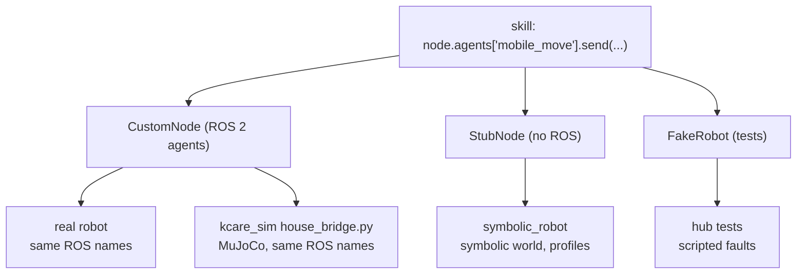

# Robot, hardware and simulators

A skill is a Python function. What it controls is not fixed: it can be a real robot reached through ROS 2, a physics simulation that copies the robot's ROS names, a symbolic simulator that has no ROS at all, or a fake robot inside the hub's tests. This page explains what a skill calls, and how each stand-in plugs in at that point.

!!! abstract "In this page"
    - A skill never touches ROS directly. It calls `node.agents['<name>']`, and the named agent does the ROS work. That one line is the seam where hardware or a simulator plugs in.
    - Three stand-ins exist: `kcare_sim` (MuJoCo physics, same ROS names, unmodified robot software), `symbolic_robot` (the official symbolic simulator and benchmark, no ROS) and the hub's offline fake robot (tests only).
    - At the hub's `main`, the hub imports `rclpy` unconditionally at start-up. The symbolic simulators expect a switch (`ROBOT_AGENT_ROS=off`) that is **not on main, not verified** (details below).

## What a skill calls

In the robot package, a skill receives the connection `node` and asks it for a named agent. Here is the pose skill and the move skill of the example robot package (`kcare_robot`, at the pinned commit):

```python
ret =  node.agents['mobile_pose'].get()
```

```python
return node.agents['mobile_move'].send({'x': x, 'y':y, 'z':0., 'qx': qx, 'qy':qy, 'qz': qz, 'qw': qw, 'wait': wait})
```

([`skills/mobile.py` line 26](https://github.com/mtbui2010/kcare_robot/blob/d4f5577b342e/kcare_robot/skills/mobile.py#L26) and [line 41](https://github.com/mtbui2010/kcare_robot/blob/d4f5577b342e/kcare_robot/skills/mobile.py#L41).)

The hub's class `CustomNode` owns the dictionary `agents`. Its own docstring says it plainly: a skill calls `node.agents['<name>'].send(...)` or `.get()`, and the agent handles the publisher, subscription, service client or action client underneath ([`connect/ros/node.py` lines 1-6](https://github.com/mtbui2010/robot_agent/blob/ad501cf15ece/robot_agent/connect/ros/node.py#L1-L6)). The [`DeviceManager`](https://github.com/mtbui2010/robot_agent/blob/ad501cf15ece/robot_agent/core/device_manager.py#L93-L98) builds one such node per process, on first use, from the robot's `connections.json` (a list of named connections with a ROS name and a message type each).

So there are two facts a stand-in must keep true:

1. Every name the skills ask for (`mobile_pose`, `mobile_move`, ...) exists in `node.agents`.
2. Each agent answers with the shape the skill reads (for the pose, an object with `pose.position` and `pose.orientation`).

## The real robot and the three stand-ins



| | Real robot | `kcare_sim` (physics) | `symbolic_robot` | Hub fake robot |
|---|---|---|---|---|
| What it is | The robot and its ROS 2 workspace | A MuJoCo house with the robot, behind the robot's ROS names | A symbolic simulator and benchmark; the official one | `FakeRobot` in `tests/fakes.py` |
| ROS needed | Yes | Yes (ROS 2 nodes) | No | No |
| How skills reach it | `CustomNode` agents from `connections.json` | The same `CustomNode`; the simulator serves the names | A `StubNode` with three agents | `FakeSkillRegistry.execute` replaces the skill registry |
| Skills that run | The robot package's own | The robot package's own, unmodified | Simulated skills registered by the server | Skills built into `FakeRobot` |
| Outcomes | Real | Physics | Drawn from YAML profiles with a `source` label per value | Scripted faults |
| Use it for | Real results | Sim-to-real checks, data for learned policies | Benchmarks of planners, no robot needed | Unit and loop tests |

### 1. A real robot

The skill calls an agent; the agent talks ROS 2 using the name and message type written in the site's `connections.json`. This is the only row that gives real-robot results. Nothing in this site was run on a real robot.

### 2. `kcare_sim`: a MuJoCo house behind the robot's ROS names

`kcare_sim` runs the robot in a simulated house with physics. Its bridge, [`sim/scripts/house_bridge.py`](https://github.com/mtbui2010/kcare_sim/blob/a288298acede/sim/scripts/house_bridge.py#L1-L28), says in its docstring that the robot package's connections "talk to these exactly as on the robot, so its skills (move, find, ...) run unchanged". It publishes topics such as `/joint_states` and `/robot_pose/mobile_pose`, camera images, and serves actions and services such as `/navigate_to_pose` and the arm, lift and head actions.

The names are fixed on purpose. They are collected in one module, [`robot_interfaces.py`](https://github.com/mtbui2010/kcare_sim/blob/a288298acede/sim/scripts/robot_interfaces.py#L1-L14), and the reason is in [`docs/external_contract.md`](https://github.com/mtbui2010/kcare_sim/blob/a288298acede/docs/external_contract.md): the robot package sends its goals to these names with these types, and the real robot serves them, so "renaming them in the sim alone would break both the sim-to-real switch and kcare_robot". The interface types come from the robot maker's package, copied unmodified into the simulator.

| Skill-side agent | Kind | ROS name | Message type | Served by the simulator at |
|---|---|---|---|---|
| `mobile_move` | action | `/navigate_to_pose` | `nav2_msgs/action/NavigateToPose` | [`house_bridge.py` line 722](https://github.com/mtbui2010/kcare_sim/blob/a288298acede/sim/scripts/house_bridge.py#L722) |
| `mobile_pose` | topic | `/robot_pose/mobile_pose` | `geometry_msgs/msg/PoseStamped` | [`house_bridge.py` lines 704-705](https://github.com/mtbui2010/kcare_sim/blob/a288298acede/sim/scripts/house_bridge.py#L704-L705) |
| arm, lift, head moves | action | under the maker's worker namespace, named in `robot_interfaces.py` | the maker's action types | [`house_bridge.py` lines 722-727](https://github.com/mtbui2010/kcare_sim/blob/a288298acede/sim/scripts/house_bridge.py#L722-L727) |

The ROS name of `mobile_move` and the type of each row come from the bridge's code. That the robot package's `connections.json` binds `mobile_move` to `/navigate_to_pose` is stated by the bridge's docstring and by the simulator's helper `make_kcare_sim_location.py`; the site files themselves were not opened here, because they hold per-site data.

!!! warning "A skill the simulator's README names has moved"
    The `kcare_sim` README says the trained drawer policy is called from the robot package's skill `vla_drawer_open`. At the pinned commit `vla_drawer_open` is in [`skills_config.py` line 53](https://github.com/mtbui2010/kcare_robot/blob/d4f5577b342e/kcare_robot/configs/skills_config.py#L53). In the working tree of that repository (not committed when this page was written) the entry is removed and a different skill, `vla_stack`, is added. If you follow the simulator's README, check which VLA skills your checkout of the robot package registers.

### 3. `symbolic_robot`: no ROS, a stub node

`symbolic_robot` is the official symbolic simulator and benchmark. It has packs of skills (a "domain", for example a household and a factory) whose outcomes are drawn from YAML profiles with a probability or duration and a `source` label for each value ([architecture](https://github.com/mtbui2010/symbolic_robot/blob/f55ace24c3b4/docs/architecture.md)). The older copy of this idea in the `symbolic/` folder of `kcare_sim` is replaced by `symbolic_robot`.

It plugs in at the same seam. Its server builds the hub's app for the domain's pack, then replaces the ROS node by a stub that holds three agents:

```python
state.dm._ros_node = StubNode({"mobile_pose": PoseAgent(live), "sim_world": WorldAgent(live), "sim_command": CommandAgent(live, cmds)})
```

([`server.py` line 149](https://github.com/mtbui2010/symbolic_robot/blob/f55ace24c3b4/symbolic_robot/server.py#L149); the class [`StubNode`](https://github.com/mtbui2010/symbolic_robot/blob/f55ace24c3b4/symbolic_robot/server.py#L54-L69) offers `agents`, `cancel_all`, `clear_cancel` and `stop`, "what robot_agent's API needs from a node when there is no ROS".) It then registers its simulated skills in the hub's skill registry. Nothing was started here: this paragraph is from reading the code.

### 4. The hub's offline fake robot (tests)

The hub's tests use `FakeRobot` ([`tests/fakes.py` line 91](https://github.com/mtbui2010/robot_agent/blob/ad501cf15ece/tests/fakes.py#L91)): a symbolic house with kcare-like skills (`move`, `find`, `pick`, `place`, `open_drawer`, `close_drawer`, `ask`, `mobile_pose`, `grasp_succeed`). A test can script faults by skill, object and call number. Fault kinds include `fail`, `raise`, `slip`, `wrong_pose`, `drop` and `partial_open`. `FakeSkillRegistry` gives it the `execute` call that the planning loops expect, and `FakeState` gives them the few state fields they read. No ROS, LLM or network is used. A result from the fake robot is a scripted result, never a result from a real robot.

## The switch for "no ROS" is not on main

The two symbolic servers state the same requirement. `symbolic_robot/server.py` says it "needs ... a robot_agent with the ROBOT_AGENT_ROS=off switch" ([line 4](https://github.com/mtbui2010/symbolic_robot/blob/f55ace24c3b4/symbolic_robot/server.py#L4)) and sets `ROBOT_AGENT_ROS=off` as a default ([line 74](https://github.com/mtbui2010/symbolic_robot/blob/f55ace24c3b4/symbolic_robot/server.py#L74)). The `kcare_sim` launcher does the same ([`symbolic/serve.py` line 56](https://github.com/mtbui2010/kcare_sim/blob/a288298acede/symbolic/serve.py#L56)).

The hub at `main` does not read this variable. This is the verified `main` behaviour, in `bootstrap` ([`runtime.py` lines 141-148](https://github.com/mtbui2010/robot_agent/blob/ad501cf15ece/robot_agent/runtime.py#L141-L148)):

```python
        try:
            import rclpy
            if not rclpy.ok():
                rclpy.init()
        except ImportError:
            print('ERROR: ROS2 not found. Source /opt/ros/*/setup.bash before running.',
                  file=sys.stderr)
            raise
```

`rclpy` is imported with no condition, and a missing ROS 2 stops start-up with the error above. The module `connect/ros/node.py` also imports `rclpy` at its top and calls `rclpy.init()` when it is loaded.

!!! warning "Status of `ROBOT_AGENT_ROS=off`: not on main, not verified"
    - At `main`, a search of the whole hub finds no use of `ROBOT_AGENT_ROS`. I also searched the five branches known locally (`main`, `domain-profile` and three `sage-v2/...` branches, including `sage-v2/r14`): none uses it either. It does appear in one place: the gitignored synced copy of the hub inside kcare_sim (`sim/kcare_code/robot_agent/`, see [kcare_sim](../repos/kcare-sim.md)). That copy is the hub revision the simulators in this workspace run against. It differs from `main` in many files, and I did not run it.
    - Some manifest keys that the household pack declares (`translate_budget` and others) are found on the remote branch `origin/sage-v2/r14` and not on `main`. They are **not on main, not verified** on this site.
    - From the code, the symbolic servers cannot start without ROS 2 on a hub at this commit. This is reasoned from the code above and was not run.
    - *How to avoid it:* to use the symbolic simulators, use a hub revision that the simulator's repository says it targets, and check that revision for the switch yourself. For the guarantee on this site, describe the hub as `main`: ROS 2 must be installed.

## What breaks when it changes

- If you rename a ROS name or message type in the simulator alone, the robot package and the real robot no longer agree with it. The simulator's `robot_interfaces.py` says to change them only together with the real robot and the robot package.
- If you add a skill that calls a new agent name, add the agent to the real `connections.json`, to the simulator that serves it, and to the stub node of the symbolic server.
- Inline device code in `connections.json` (`encode_func` and `decode_func` as source text) is deprecated. It still works by default and the hub warns once per device ([`codecs.py` lines 11-16](https://github.com/mtbui2010/robot_agent/blob/ad501cf15ece/robot_agent/connect/codecs.py#L11-L16)). Setting `ROBOT_AGENT_NO_INLINE_CODE=1` turns it off. The hub provides `python -m robot_agent.connect.codecs --scan <connections.json>` to list the inline entries; on one real site file of the example robot it found 39 (run on the planning date; the values are not printed here).

!!! code "Where in the code"
    - Hub: [`connect/ros/node.py`](https://github.com/mtbui2010/robot_agent/blob/ad501cf15ece/robot_agent/connect/ros/node.py), [`core/device_manager.py`](https://github.com/mtbui2010/robot_agent/blob/ad501cf15ece/robot_agent/core/device_manager.py), [`runtime.py`](https://github.com/mtbui2010/robot_agent/blob/ad501cf15ece/robot_agent/runtime.py), [`tests/fakes.py`](https://github.com/mtbui2010/robot_agent/blob/ad501cf15ece/tests/fakes.py)
    - Robot package: [`skills/mobile.py`](https://github.com/mtbui2010/kcare_robot/blob/d4f5577b342e/kcare_robot/skills/mobile.py)
    - Simulators: [`house_bridge.py`](https://github.com/mtbui2010/kcare_sim/blob/a288298acede/sim/scripts/house_bridge.py), [`external_contract.md`](https://github.com/mtbui2010/kcare_sim/blob/a288298acede/docs/external_contract.md), [`server.py`](https://github.com/mtbui2010/symbolic_robot/blob/f55ace24c3b4/symbolic_robot/server.py)
    - kcare_sim documentation site: <https://mtbui2010.github.io/kcare_sim/>
