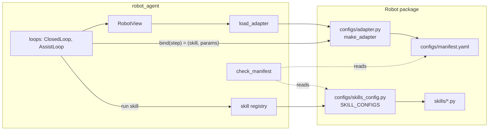

# Robot package and core

This page describes the agreement between the hub (`robot_agent`) and a robot package. You get the exact list of what a package must provide, what the hub calls, what comes back, and what breaks when either side changes. Both sides are shown: the hub's contract code, and two real packages that follow it (`kcare_robot` and the packs of `symbolic_robot`).

!!! abstract "In this page"
    - A robot package gives the hub **one adapter object** and **one manifest file**. The hub core never names a robot; it asks the adapter and reads the manifest.
    - The hub finds the adapter with `load_adapter(<package name>)`. The adapter's most important method is `bind`: it turns an abstract plan step into `(skill name, parameters)` for this robot.
    - `check_manifest` is the one machine check of the agreement. It runs without ROS and without importing the robot.
    - There is **no version number** that the hub checks on this contract. A change on either side is found only by `check_manifest`, by the package's own tests, or at run time.

!!! code "Where in the code"
    - Hub: [`contract/adapter.py`](https://github.com/mtbui2010/robot_agent/blob/3269923/robot_agent/contract/adapter.py#L18-L51), [`contract/legacy_adapter.py`](https://github.com/mtbui2010/robot_agent/blob/3269923/robot_agent/contract/legacy_adapter.py#L187-L227), [`contract/manifest.py`](https://github.com/mtbui2010/robot_agent/blob/3269923/robot_agent/contract/manifest.py#L155-L282), [`contract/types.py`](https://github.com/mtbui2010/robot_agent/blob/3269923/robot_agent/contract/types.py#L188-L217), [`contract/check_manifest.py`](https://github.com/mtbui2010/robot_agent/blob/3269923/robot_agent/contract/check_manifest.py#L1-L26)
    - Hub, where the contract is used: [`core/planning/robot.py:59-105`](https://github.com/mtbui2010/robot_agent/blob/3269923/robot_agent/core/planning/robot.py#L59-L105), [`runtime.py:195-204`](https://github.com/mtbui2010/robot_agent/blob/3269923/robot_agent/runtime.py#L195-L204)
    - Robot: [`kcare_robot/configs/adapter.py`](https://github.com/mtbui2010/kcare_robot/blob/d4f5577b342e/kcare_robot/configs/adapter.py), [`kcare_robot/configs/manifest.yaml`](https://github.com/mtbui2010/kcare_robot/blob/d4f5577b342e/kcare_robot/configs/manifest.yaml)
    - Second robot: [`symbolic_robot/domains/home/configs/`](https://github.com/mtbui2010/symbolic_robot/tree/f55ace24c3b4/symbolic_robot/domains/home/configs)

## The picture



The loops never import the robot package directly. `RobotView.load(robot_pkg)` calls `load_adapter(robot_pkg)` ([`robot.py:59-61`](https://github.com/mtbui2010/robot_agent/blob/3269923/robot_agent/core/planning/robot.py#L59-L61)) and keeps the adapter. For the words used here, see the glossary: [adapter](../start/glossary.md#adapter), [manifest](../start/glossary.md#manifest), [SkillSpec](../start/glossary.md#skillspec), [bind](../start/glossary.md#bind).

## What a robot package must provide

| Piece | Where | Who reads it | What it holds |
|---|---|---|---|
| Entry point | `<pkg>/main.py` | the person who starts the server | A call `create_app(robot_pkg='<pkg>', config_dir=...)`. In kcare: [`main.py:27-29`](https://github.com/mtbui2010/kcare_robot/blob/d4f5577b342e/kcare_robot/main.py#L27-L29). The hub side is [`app_factory.py:50`](https://github.com/mtbui2010/robot_agent/blob/3269923/robot_agent/app_factory.py#L50). |
| Skill table | `<pkg>/configs/skills_config.py` | the skill registry at boot, and `check_manifest` | `SKILL_CONFIGS = {skill name: (module path, function name)}` ([kcare `skills_config.py:6`](https://github.com/mtbui2010/kcare_robot/blob/d4f5577b342e/kcare_robot/configs/skills_config.py#L6), read at [`runtime.py:200-201`](https://github.com/mtbui2010/robot_agent/blob/3269923/robot_agent/runtime.py#L200-L201)). |
| Skills | `<pkg>/skills/*.py` | the skill registry | One function per skill, called as `func(node=node, **params)`, returning a result dict. |
| Manifest | `<pkg>/configs/manifest.yaml` | `Manifest.from_yaml` | Skills, capabilities, geometry, language, planner data. See below. |
| Adapter | `<pkg>/configs/adapter.py` | `load_adapter` | `ADAPTER` (an instance), or `make_adapter()` / `get_adapter()`, or a class `Adapter`. |
| Site files | `<pkg>/configs/locations/<site>/` | the hub, at boot | `connections.json`, `skill_configs_override.json`, and a `.env` file for secrets (not committed). |

!!! note "Older robots"
    A package with no `configs/adapter.py` can still load. Then the hub wraps `<pkg>.configs.grace_namemap` (an older module of name maps) in a `NamemapAdapter`. See "How the hub loads a robot" below.

## The adapter: `RobotAdapter`

`RobotAdapter` is a Python `Protocol`: a robot's adapter does not have to inherit from anything, it only needs these members ([`adapter.py:23-51`](https://github.com/mtbui2010/robot_agent/blob/3269923/robot_agent/contract/adapter.py#L23-L51)).

```python
@runtime_checkable
class RobotAdapter(Protocol):
    manifest: Manifest          # skills + capabilities
    geometry: Geometry          # arrive tolerance, reach, workspace (not in the core)
    i18n: Messages              # phrases + default language

    def bind(self, step: dict, world: Any = None) -> Optional[tuple]:
        """Abstract step ``{'action': 'Pick', 'object': 'Cup'}`` ->
        ``(skill_name, params)``; None for a no-op step (Wait, Sit ...).
        Raises :class:`Unbindable` when this robot cannot do it."""
        ...

    def observe(self, node: Any = None) -> Observation:
        """Pose, hands, containers, sensor health — best effort, never raises."""
        ...

    def reconcile(self, world: Any, node: Any = None) -> Any:
        """Bring the belief ``world`` in line with the robot (at start / after
        a crash) and return it."""
        ...
```

`health(node)` is the fourth method ([`adapter.py:48-51`](https://github.com/mtbui2010/robot_agent/blob/3269923/robot_agent/contract/adapter.py#L48-L51)): it returns a dict whose keys belong to the adapter, with `ok` (`True`, `False` or `None`) as the summary.

Two more methods are **optional** and deliberately not Protocol members, "so older adapters still match" ([`adapter.py:44-46`](https://github.com/mtbui2010/robot_agent/blob/3269923/robot_agent/contract/adapter.py#L44-L46)):

| Optional method | Returns | Used for |
|---|---|---|
| `pose(node)` | `{x, y, yaw?, ts? or age_s?}`, or `{}` when the pose cannot be read | [reconcile](../start/glossary.md#reconcile) of the base position |
| `container_states(node)` | `{key: True / False / None}` (open, closed, not read) | the belief about drawers and doors |

### What `bind` returns

| `bind(step, world)` returns | Meaning | What the loop does |
|---|---|---|
| `(skill_name, params)` | The robot can do this step with this skill. | Runs the skill through the skill registry. |
| `None` | A no-op step (the robot has nothing to do for it, for example `Wait` on kcare). | Skips the step. |
| raises `Unbindable` | The robot has no skill for the action, or the step lacks an argument. | The caller turns it into a replan reason ([`adapter.py:18-20`](https://github.com/mtbui2010/robot_agent/blob/3269923/robot_agent/contract/adapter.py#L18-L20)). |

A plan step that already names its skill (`skill` plus `params`, as the direct planner writes it) does not reach the adapter; `RobotView.bind` checks it against the robot's skill list instead ([`robot.py:99-105`](https://github.com/mtbui2010/robot_agent/blob/3269923/robot_agent/core/planning/robot.py#L99-L105)).

Real values, from the kcare adapter, run offline (no robot, no ROS; the adapter reads its own manifest and name maps). The robot's maker-product name in the error text is written as `<robot>`:

```text
{'action': 'MoveTo', 'object': 'kitchen'} -> ('move', {'inputs': 'kitchen'})
{'action': 'Pick', 'object': 'cup'} -> ('pick', {'inputs': 'cup', 'type': 'fine_move'})
{'action': 'Wait'} -> None
{'action': 'Fly', 'object': 'x'} -> Unbindable: no skill for action 'Fly' on object 'x' on robot '<robot>'
```

The `type: fine_move` in the second line is added by kcare's own `build_params` (the adapter calls it, [`legacy_adapter.py:108-112`](https://github.com/mtbui2010/robot_agent/blob/3269923/robot_agent/contract/legacy_adapter.py#L108-L112)); the hub knows nothing about it. On the same adapter, outside a running server, `health()` gives `{'frame_age_s': None, 'fps': None, 'depth': None, 'pose_age_s': None, 'ok': None}` and `pose()` gives `{}`: with no ROS node nothing can be read, and both methods return that instead of raising.

## The manifest and `SkillSpec`

The manifest is the robot as data. `Manifest.from_yaml` reads it and checks every field ([`manifest.py:176-245`](https://github.com/mtbui2010/robot_agent/blob/3269923/robot_agent/contract/manifest.py#L176-L245)). Top-level keys the contract knows: `robot`, `version`, `language`, `languages`, `capabilities`, `geometry`, `planner`, `skills`, `limits` and `safety` ([`manifest.py:40`](https://github.com/mtbui2010/robot_agent/blob/3269923/robot_agent/contract/manifest.py#L40)). `limits` holds what the body can carry (`payload_kg`, `max_object_size_m`). `safety` holds an optional hazard profile (`safety.profile`, a file path or an inline mapping; schema in [`docs/safety.md`](https://github.com/mtbui2010/robot_agent/blob/3269923/docs/safety.md)); a robot that declares none gets no hazard check from the core. Inside `planner:` the contract now accepts many optional keys, among them `planner.options` for the registered options ([`docs/options.md`](https://github.com/mtbui2010/robot_agent/blob/3269923/docs/options.md)); see below. Other keys are kept in `Manifest.extra`, not rejected.

Each entry under `skills:` becomes a `SkillSpec` ([`types.py:188-217`](https://github.com/mtbui2010/robot_agent/blob/3269923/robot_agent/contract/types.py#L188-L217)):

| Field | Meaning |
|---|---|
| `name` | The skill's name in the registry (`pick`). |
| `action` | The abstract action it realises (`Pick`). A skill can also serve more actions with `alias_actions` (kcare's `place` also serves `PutIn`). |
| `params` | A JSON schema of the skill's keyword arguments. |
| `pre`, `hold`, `effects` | Predicates that must hold before, while, and after the skill. |
| `verify` | Checks after success: `symbolic`, `sensor` (another skill reads the outcome) or `vlm` (a yes/no question on a camera image). |
| `interruptible` | `false` means a stop must not cut the skill in the middle (for example while the arm holds something). |
| `errors` | The failure codes the skill may return. Each must be one of the 13 `FailureCode` values, or loading fails. |
| `version` | The skill's own version string, default `"1.0"`. |

The kcare `pick` entry, copied from [`manifest.yaml:114-131`](https://github.com/mtbui2010/kcare_robot/blob/d4f5577b342e/kcare_robot/configs/manifest.yaml#L114-L131):

```yaml
  - name: pick
    action: Pick
    params:
      type: object
      properties:
        inputs: {type: string, description: "'obj[@location][|trials]'; the core passes world.found"}
        type: {type: string, description: "grace_namemap.build_params sends 'fine_move'"}
        islying: {type: boolean, description: "override the detected lying / standing pose"}
        num_trials: {type: integer, default: 2}
      required: [inputs]
    pre: ["found(?inputs)", "hand_empty()"]
    hold: []
    effects: ["holding(?inputs)", "not found(?inputs)", "not hand_empty()"]
    verify: [{kind: symbolic}, {kind: sensor, skill: grasp_succeed}]
    interruptible: false        # the arm is in the grasp: finish or release safely
    # timeout: the pick action server does not answer in time (the skill raises); estop: the arm stops
    errors: [absent, unreachable, grasp_failed, perception_unavailable, hw_fault, timeout, estop, cancelled, software]
    version: "1.0"
```

The `pre` and `effects` here must agree with the shared action model (see [Planner library and core](planner-library.md)); the kcare manifest says so in its own header comment.

Other values read from the kcare manifest at this commit: language `ko`, languages `[ko, en]`, geometry `arrive_tol_m 0.3`, `reach_m 0.78`, `reach_far_m 1.0`, plus free-form extras such as `max_reach_y_m`, `frame_max_age_s` and `pose_max_age_s`. Any `geometry` key that ends in `_m` must be a number; the loader checks this ([`manifest.py:212-219`](https://github.com/mtbui2010/robot_agent/blob/3269923/robot_agent/contract/manifest.py#L212-L219)).

A bad manifest fails at load time, with every bad field listed by path. Real output, run offline:

```text
invalid manifest: skills[0] (p).errors[0]: 'oops' is not a FailureCode (valid: absent, perception_unavailable, unreachable, blocked, grasp_failed, dropped, hw_fault, estop, timeout, cancelled, software, unknown, budget_exceeded)
invalid manifest: robot: required, a non-empty string
```

`Manifest.skill_for(action)` is the lookup the adapters use: exact action name, then case-insensitive, then `alias_actions` ([`manifest.py:268-282`](https://github.com/mtbui2010/robot_agent/blob/3269923/robot_agent/contract/manifest.py#L268-L282)). For a manifest with one `move` skill for `MoveTo`, `skill_for('moveto')` finds it and `skill_for('Fly')` gives `None` (run offline).

## How the hub loads a robot: `load_adapter`

`load_adapter(robot_pkg)` is the one entry point ([`legacy_adapter.py:215-227`](https://github.com/mtbui2010/robot_agent/blob/3269923/robot_agent/contract/legacy_adapter.py#L215-L227)):

```python
def load_adapter(robot_pkg: str) -> RobotAdapter:
    """The robot's adapter: ``<pkg>.configs.adapter`` if present, else
    ``configs/manifest.yaml`` (when there is one) wrapped around
    ``<pkg>.configs.grace_namemap``."""
    if _has_module(f"{robot_pkg}.configs.adapter"):
        return _from_adapter_module(importlib.import_module(f"{robot_pkg}.configs.adapter"))
    manifest = None
    d = _pkg_dir(robot_pkg)
    if d is not None and (d / "configs" / "manifest.yaml").is_file():
        manifest = Manifest.from_yaml(d / "configs" / "manifest.yaml")
    if not _has_module(f"{robot_pkg}.configs.grace_namemap"):
        raise ImportError(f"{robot_pkg}: no configs/adapter.py and no configs/grace_namemap.py")
    return NamemapAdapter(importlib.import_module(f"{robot_pkg}.configs.grace_namemap"), manifest)
```

Steps, in order:

1. If `<pkg>.configs.adapter` exists, import it. Inside it the hub looks for `ADAPTER` (or `adapter`) as an instance, then calls `make_adapter()`, `get_adapter()` or `Adapter()`. If none of these exists: `ImportError` ([`legacy_adapter.py:201-212`](https://github.com/mtbui2010/robot_agent/blob/3269923/robot_agent/contract/legacy_adapter.py#L201-L212)).
2. Otherwise read `configs/manifest.yaml` if there is one, and wrap `<pkg>.configs.grace_namemap` in a `NamemapAdapter`. Without a manifest, the shim builds a small one from the name map's `SKILL_MAP`, so `adapter.manifest` always exists ([`legacy_adapter.py:51-60`](https://github.com/mtbui2010/robot_agent/blob/3269923/robot_agent/contract/legacy_adapter.py#L51-L60)).
3. With neither file: `ImportError`.

`<pkg>` may be a dotted name. The home pack of `symbolic_robot` loads as `load_adapter('symbolic_robot.domains.home')` (run offline).

## A real robot: kcare_robot

The kcare adapter wraps the older name map and the manifest, and adds the robot's own sensing and Korean phrases. Its constructor ([`adapter.py:92-96`](https://github.com/mtbui2010/kcare_robot/blob/d4f5577b342e/kcare_robot/configs/adapter.py#L92-L96)):

```python
    def __init__(self, manifest: Manifest | None = None):
        super().__init__(grace_namemap, manifest if manifest is not None else Manifest.from_yaml(MANIFEST))
        phrases = dict(PHRASES)
        phrases.update(self.i18n.phrases)          # grace_namemap.PHRASES, if it ever has any, wins
        self.i18n.phrases = phrases
```

The adapter class subclasses the hub's `NamemapAdapter` (its name contains the robot maker's product name, so it is not repeated here). `make_adapter()` at [`adapter.py:224-225`](https://github.com/mtbui2010/kcare_robot/blob/d4f5577b342e/kcare_robot/configs/adapter.py#L224-L225) is what `load_adapter` calls. The adapter adds:

- `pose()` ([`adapter.py:111-137`](https://github.com/mtbui2010/kcare_robot/blob/d4f5577b342e/kcare_robot/configs/adapter.py#L111-L137)): the base pose and its receive time from the `mobile_pose` ROS agent, or `{}` outside a runtime. It has no `container_states()`: the robot has no sensor for drawer state, so "opened" stays a belief.
- `health()` ([`adapter.py:139-167`](https://github.com/mtbui2010/kcare_robot/blob/d4f5577b342e/kcare_robot/configs/adapter.py#L139-L167)): camera frame age, frame rate, depth, and pose age, compared with `frame_max_age_s` and `pose_max_age_s` from the manifest's geometry.
- `reconcile()`, `vlm_ask()`, `quiet_skills` and Korean phrases for the announcer.

The file's own header says it uses only the hub's public `robot_agent.contract` ([`adapter.py:17`](https://github.com/mtbui2010/kcare_robot/blob/d4f5577b342e/kcare_robot/configs/adapter.py#L17)); the lines that import `robot_agent.state` sit inside functions (`_gripper_holds`, `_node`) and fall back to "unknown" when no runtime exists.

## A second implementation: the symbolic_robot packs

`symbolic_robot` ships robot packs with no ROS. Each domain has a `configs/` folder with the same pieces: `manifest.yaml`, `adapter.py`, `skills_config.py` and a backend that plays the world. The server builds the hub app from the pack: `create_app(dom.pack, config_dir=cfg_dir)` ([`server.py:146`](https://github.com/mtbui2010/symbolic_robot/blob/f55ace24c3b4/symbolic_robot/server.py#L146)). There are two packs, home and factory.

The home adapter does **not** inherit anything from the hub. It is a plain class with the Protocol's members ([`adapter.py:138-144`](https://github.com/mtbui2010/symbolic_robot/blob/f55ace24c3b4/symbolic_robot/domains/home/configs/adapter.py#L138-L144), `make_adapter()` at [`:289-290`](https://github.com/mtbui2010/symbolic_robot/blob/f55ace24c3b4/symbolic_robot/domains/home/configs/adapter.py#L289-L290)):

```python
class Adapter:
    quiet_skills = {"say", "ask", "announce", "wait"}

    def __init__(self, manifest: Manifest | None = None):
        self.manifest = manifest or Manifest.from_yaml(MANIFEST_PATH)
        self.geometry = Geometry.from_dict(self.manifest.geometry)
        self.i18n = Messages(language=self.manifest.language, phrases=PHRASES)
```

Its `bind` uses `manifest.skill_for(action)` and raises `Unbindable` with a message that lists what the robot can do ([`adapter.py:180-220`](https://github.com/mtbui2010/symbolic_robot/blob/f55ace24c3b4/symbolic_robot/domains/home/configs/adapter.py#L180-L220)). Run offline on the home pack:

```text
{'action': 'MoveTo', 'object': 'kitchen'} -> ('move', {'inputs': 'kitchen'})
{'action': 'Fly', 'object': 'x'} -> Unbindable: no skill for 'Fly' on <robot> (it can Announce, Ask, Close, Dock, Find, Handover, Look, MoveTo, Open, Pick, Place, PutI...
```

(The text is cut at 120 characters, and the pack's robot name is shown as `<robot>`.)

How the two packs compare. All values were read from the files at the pinned commits or printed by `check_manifest` (run offline):

| | kcare_robot (real robot) | symbolic_robot home pack | symbolic_robot factory pack |
|---|---|---|---|
| Skills in the manifest | 10 | 17 | 12 |
| `check_manifest` result | 0 errors, 0 warnings | 0 errors, 17 warnings | 0 errors, 12 warnings |
| Default language | `ko` (also `en`) | `en` | not read |
| Adapter | subclass of the hub's `NamemapAdapter`, over `grace_namemap` | own plain class, no inheritance | own `adapter.py` (not read in detail) |
| Where skills run | on the robot through ROS agents | in a mock backend (`configs/backend.py`), no motion | same |
| Reads ROS | yes | no | no |

Why the warnings. Each one is "skill module is outside the inspected pack folder, not inspected", one per skill: the skills live in `ra_skills.py` under a different import path than the folder `check_manifest` was given. With the hub at the earlier pin of this site the home pack had 22 warnings and the factory pack 17: the extra five (home) were `planner.*` keys (`input_pivot`, `llm_budget`, `search_legs`, `translate_budget`, `translate_model`) that the hub did not know yet. The hub's `PLANNER_KEYS` ([`manifest.py:86`](https://github.com/mtbui2010/robot_agent/blob/3269923/robot_agent/contract/manifest.py#L86)) now lists them, so they no longer warn. The counts in this table were printed by `check_manifest` at hub `3269923` on the local checkouts of both repos (their commit may differ from the pinned ones above).

## `check_manifest`: the machine check

```text
python -m robot_agent.contract.check_manifest <pkg_dir> [--manifest PATH] [--strict]
```

It needs no ROS and imports nothing of the robot: it reads `SKILL_CONFIGS` and the saved `skills.json` the way the registry does, and reads skill signatures from the source text ([`check_manifest.py:1-26`](https://github.com/mtbui2010/robot_agent/blob/3269923/robot_agent/contract/check_manifest.py#L1-L26)). `<pkg_dir>` is the inner package folder, its repo root, or an importable name.

| Result | Causes |
|---|---|
| **Error** (exit 1) | The manifest does not load; a manifest skill is not in the registry or its module or function is missing; a manifest parameter the function cannot take; a function parameter with no default that the manifest does not declare; a `sensor` verify naming a skill the robot lacks; a `planner.seed_memory` file that is missing or not JSON lines; a `planner.options` that is not a mapping of mappings; a `planner.detector_miss_rate` outside 0 to 0.9; a bad field in the `safety.profile` (reported by path). |
| **Warning** (exit 1 only with `--strict`) | Unknown manifest keys; an action that the name map binds to a different skill; skills that cannot be inspected; the safety profile's own warnings (for example a source still to verify). |
| **Note** (never a failure) | Counts, for example the safety profile's classes, rules and sourced / assumed words. |
| Exit 2 | The package or manifest was not found. |

Real runs, offline (path and robot name shortened; the first line of each run, hub at `3269923`):

```text
manifest <repo>/kcare_robot/kcare_robot/configs/manifest.yaml (<robot>, 10 skills): 0 error(s), 0 warning(s)
manifest <repo>/symbolic_robot/symbolic_robot/domains/home/configs/manifest.yaml (<robot>, 17 skills): 0 error(s), 17 warning(s)
manifest <repo>/symbolic_robot/symbolic_robot/domains/factory/configs/manifest.yaml (<robot>, 12 skills): 0 error(s), 12 warning(s)
```

A robot package can call the same check from its own tests with `assert_manifest_matches(path)` ([`check_manifest.py:332-336`](https://github.com/mtbui2010/robot_agent/blob/3269923/robot_agent/contract/check_manifest.py#L352-L356)). kcare keeps `tests/test_manifest.py` and `tests/test_adapter*.py` for this. These tests were not run here (`pytest` is not installed on the machine that wrote this page); only what they check was read.

## What breaks when the contract changes

| Change | What happens | Found by |
|---|---|---|
| Robot: a manifest field is wrong (unknown failure code, a duplicate skill name, a non-numeric `*_m` geometry value) | `ManifestError` at load, listing each bad field by path | `check_manifest`, and at boot |
| Robot: a skill is in the manifest but missing from `SKILL_CONFIGS`, or its parameters differ from the function | A `check_manifest` error | `check_manifest` |
| Robot: the manifest has no skill for an action the planner uses | `bind` raises `Unbindable`; the loop uses it as a reason to replan | run time |
| Robot: `configs/adapter.py` defines none of `ADAPTER`, `make_adapter()`, `get_adapter()`, `Adapter` | `ImportError` when the loop starts | run time |
| Hub: a new required member is added to the `RobotAdapter` Protocol | Existing adapters no longer match. This is why `pose` and `container_states` were added as optional | not machine-checked |
| Hub: a new failure code | The manifest's `errors:` lists accept it; the contract docs list 12 codes, the code has 13 (`budget_exceeded` is the 13th, [`types.py:31`](https://github.com/mtbui2010/robot_agent/blob/3269923/robot_agent/contract/types.py#L31)) | `git grep`, tests |
| Hub: a rule in the shared action model changes | The manifest's `pre` and `effects` can disagree with it | the package's tests |

There is no contract version that either side compares. The hub's own rule says "SemVer + CHANGELOG on contract changes" ([`CLAUDE.md`](https://github.com/mtbui2010/robot_agent/blob/3269923/CLAUDE.md), rule 8), and the hub package is at version `0.1.0` ([`pyproject.toml:7`](https://github.com/mtbui2010/robot_agent/blob/3269923/pyproject.toml#L7)). The kcare package depends on `robot_agent` without a version range.

## Current behaviour to know

!!! warning "A skill in `skills_config.py` may not load at boot"
    At boot the hub first tries `configs/common/skills.json`. If that file exists and is a list, the hub uses it and does **not** read `skills_config.py` ([`runtime.py:195-204`](https://github.com/mtbui2010/robot_agent/blob/3269923/robot_agent/runtime.py#L195-L204), `load_saved` returns `True` at [`skill_registry.py:319-329`](https://github.com/mtbui2010/robot_agent/blob/3269923/robot_agent/core/skill_registry.py#L319-L329)). kcare tracks that `skills.json` in git. So a new line in `SKILL_CONFIGS` appears only after you call `POST /skills/reload` ([`api/skills.py:44-71`](https://github.com/mtbui2010/robot_agent/blob/3269923/robot_agent/api/skills.py#L44-L71)). `check_manifest` reads both sources, so it can pass while the running server does not yet have the skill. This was read from the code, not run on a server. **To avoid it:** after adding a skill, reload skills (or delete the saved file on purpose) and check `GET /skills`.

!!! warning "One robot's values live inside the hub"
    `robot_agent/skill_configs.py` holds `MOBILE_HEIGHT = 435`, `ME = 'living room'`, `STANDING_OBJ_NAMES` and `LYING_OBJ_NAMES` ([`skill_configs.py:104-110`](https://github.com/mtbui2010/robot_agent/blob/3269923/robot_agent/skill_configs.py#L104-L110)). These are the same values the kcare manifest declares under `capabilities.standing_objects`, `capabilities.lying_objects` and `defaults` ([`manifest.yaml:41-44, 58-60`](https://github.com/mtbui2010/kcare_robot/blob/d4f5577b342e/kcare_robot/configs/manifest.yaml#L41-L44)), and kcare imports them from the hub ([`_recognition_helpers.py:20-23`](https://github.com/mtbui2010/kcare_robot/blob/d4f5577b342e/kcare_robot/skills/_recognition_helpers.py#L20-L23)). The hub's check `make lint-core` finds no robot names in `core/`, `interact/` and `contract/`, but it does not look at this file, and the values carry no name. So a second robot that imports `robot_agent.skill_configs` gets kcare's object lists. kcare's own rule allows importing `robot_agent.skill_configs` ([`docs/rules.md`](https://github.com/mtbui2010/kcare_robot/blob/d4f5577b342e/docs/rules.md), rule 1). **To avoid it:** in a new robot, read these lists from your own manifest, not from the hub module.

!!! warning "The robot-copy command defaults to kcare_robot"
    `python -m robot_agent.new_robot <new_pkg>` copies an existing robot package. Its `--from` option defaults to `kcare_robot` ([`new_robot.py:203-204`](https://github.com/mtbui2010/robot_agent/blob/3269923/robot_agent/new_robot.py#L203-L204)). Always pass `--from` with a package you have, and `--blank-configs` if you do not want the source robot's numbers.

!!! warning "The robot template is not in the repository set"
    The hub's `Makefile` looks for a template folder at `../robot_template` (`TEMPLATE_DIR`, [`Makefile:38`](https://github.com/mtbui2010/robot_agent/blob/3269923/Makefile#L38)). On the machine where this page was checked, no such folder exists next to the six repositories. The `make` target that uses it was not run. **To avoid it:** use `new_robot` with `--from`, or follow [Add a robot](../guides/add-a-robot.md).

For the other checks in the hub, see [Planner library and core](planner-library.md). The full contract text in the hub's own docs is [`docs/contract.md`](https://github.com/mtbui2010/robot_agent/blob/3269923/docs/contract.md); it is source material, and where it differs from the code (it lists 12 failure codes), this page follows the code.
