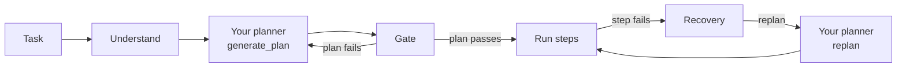

# Add a planner

A [planner](../concepts/planners.md) is the part that writes the plan. This guide shows how to write a small one, how to make the system load it by name, and how to run it on the offline fake robot before it ever meets a real robot.

!!! abstract "In this page"
    - A planner is a class with two methods, `generate_plan` and `replan`. Nothing else is required, and you register nothing in the core.
    - You select it by name: `package.module:Class`, or an entry-point name from the group `robot_agent.planners`.
    - The core understands the task, checks your plan (the [gate](../start/glossary.md#certified-gate)), recovers from failures, and records the run. Your planner does none of that.
    - Every command and output below was run offline on the fake robot with a scripted LLM answer. Nothing here comes from a real robot.

!!! code "Where in the code"
    - Planner protocol: [`base.py` L246-L279](https://github.com/mtbui2010/robot_agent/blob/3269923/robot_agent/core/planning/base.py#L246-L279); optional capabilities: [`base.py` L289-L364](https://github.com/mtbui2010/robot_agent/blob/3269923/robot_agent/core/planning/base.py#L289-L401)
    - Name lookup: [`resolve_planner`](https://github.com/mtbui2010/robot_agent/blob/3269923/robot_agent/core/planning/registry.py#L72-L93), [`accepted_kwargs`](https://github.com/mtbui2010/robot_agent/blob/3269923/robot_agent/core/planning/registry.py#L105-L116), [`get_planner`](https://github.com/mtbui2010/robot_agent/blob/3269923/robot_agent/core/planning/registry.py#L134-L160)
    - What the core offers a plug-in: [`loop.py` L362-L375](https://github.com/mtbui2010/robot_agent/blob/3269923/robot_agent/core/planning/loop.py#L362-L375)
    - The generator setting of the AssistLoop: [`assist_loop.py` L372](https://github.com/mtbui2010/robot_agent/blob/3269923/robot_agent/core/planning/assist_loop.py#L372)
    - Choosing a loop and a planner: [`unified_agent.py` L364-L391](https://github.com/mtbui2010/robot_agent/blob/3269923/robot_agent/core/unified_agent.py#L364-L391)
    - The recording proxy: [`record.py` `RecordingPlanner`](https://github.com/mtbui2010/robot_agent/blob/3269923/robot_agent/observe/record.py#L601)
    - Fake robot and scripted planner used below: [`tests/fakes.py`](https://github.com/mtbui2010/robot_agent/blob/3269923/tests/fakes.py#L63-L91); a test of the plug-in route: [`tests/test_v2_planner_plugin.py`](https://github.com/mtbui2010/robot_agent/blob/3269923/tests/test_v2_planner_plugin.py)

## Before you start

You need the `robot_agent` and `embodiplan` repositories on `PYTHONPATH` (the loops import `embodiplan`'s action model, see [Planners and loops](../concepts/planners.md)), Python 3.10 or newer, and `pyyaml`. Nothing else: no ROS, no robot, no LLM server. For the library planners that already exist (GRACE and SAGE, with sub-goals, editing and memory), read the [embodiplan site](https://mtbui2010.github.io/embodiplan/) and the [planner library contract](../contracts/planner-library.md). This guide is about a planner of your own.



## Step 1. Write the class

The `Planner` protocol has two methods. Both return `(steps, metrics)`. A step is a plain dict with `action` and `object`. `metrics` is any dict, and it can be empty.

| Method | Called when | Arguments |
|---|---|---|
| `generate_plan` | Once at the start | `task`, `obs`, `visible_objects` |
| `replan` | A step failed and recovery asks for a new rest of the plan | `task`, `completed` (steps already done), `failed_step`, `failure_reason`, `obs`, `visible_objects` |

`obs` is text: the places the robot can go to, the goals, and the [belief](../start/glossary.md#belief). The steps you return are spliced after `completed`. The suffix goes through a smaller check (steps the robot can bind, places it can reach) before it runs; a suffix that fails it is dropped and the run ends.

This is the whole planner used in this guide. It fetches one object and tries the places in a fixed order. Save it as `search_planner.py` in a folder of your own (not inside a repo):

```python
"""A minimal planner: fetch one object, trying the places in a fixed order."""
import re


class SearchPlanner:
    def __init__(self, places=("desk@study room", "counter@kitchen"),
                 destination="dining table@kitchen", actions=None):
        self.places = list(places)
        self.destination = destination
        self.actions = actions          # the core passes this one (the robot's plan actions)
        self.tried = []

    def _steps(self, obj, place):
        return [{"action": "MoveTo", "object": place},
                {"action": "Find", "object": obj},
                {"action": "Pick", "object": obj},
                {"action": "MoveTo", "object": self.destination},
                {"action": "Place", "object": self.destination}]

    def generate_plan(self, task, obs, visible_objects):
        obj = re.search(r"the (\w+)", task).group(1)
        self.tried = [self.places[0]]
        return self._steps(obj, self.places[0]), {"method": "search_planner"}

    def replan(self, task, completed, failed_step, failure_reason, obs, visible_objects):
        obj = re.search(r"the (\w+)", task).group(1)
        left = [p for p in self.places if p not in self.tried]
        if not left:
            return [], {"method": "search_planner", "note": "no place left"}
        self.tried.append(left[0])
        return self._steps(obj, left[0]), {"method": "search_planner"}
```

The action names (`MoveTo`, `Find`, `Pick`, `Place`) are the vocabulary of the action model. The object names are the robot's own places and objects. `obs` lists the places to use; the plan above takes them from its constructor to stay short.

## Step 2. Choose how the core finds it

`resolve_planner(name)` turns a name into a class. It returns `(factory, builtin)`. Three kinds of name work:

| Name | What happens |
|---|---|
| `grace`, `llm_direct` | Built-in planners (`builtin` is `True`). |
| `package.module:Class` | The module is imported and the class is read from it. Nothing is registered. `builtin` is `False`. |
| A bare name such as `search` | Looked up in the entry points of the group `robot_agent.planners`. A planner package declares one in its own `pyproject.toml`. |

Entry-point declaration (**not run**: it needs an installed package, and nothing is installed on the machine used for this page):

```toml
[project.entry-points."robot_agent.planners"]
search = "my_package.search_planner:SearchPlanner"
```

Put the folder with `search_planner.py` on `PYTHONPATH` and ask the registry. This ran offline:

```python
from robot_agent.core.planning.registry import resolve_planner
print(resolve_planner("search_planner:SearchPlanner"))
```

```text
(<class 'search_planner.SearchPlanner'>, False)
```

To select it for a real run, use one of these (the first two are read in the code; no real run was made):

| Where | Setting |
|---|---|
| ClosedLoop, from the dashboard | Send the name as the `planner` choice on `/ws/agent`. Any name that `is_planner_name` accepts is used as given (`unified_agent.py` L368-L372). |
| ClosedLoop, by default | The environment variable `ROBOT_AGENT_PLANNER` (default `grace`). |
| AssistLoop (`sage`) | The `generator` option on `/ws/agent`, or the environment variable `ROBOT_AGENT_SAGE_GENERATOR` (default `grace`). The AssistLoop's planner is called the generator. |

!!! warning "`sage` is not a planner name"
    `resolve_planner("sage")` raises `ValueError`. `sage` selects the [AssistLoop](../start/glossary.md#assistloop). To plug your planner into it, set the generator to your name. See [Planners and loops](../concepts/planners.md).

## Step 3. Know what the core passes to the constructor

For a plug-in the core builds the planner through `get_planner(name, **cfg)`. It offers these keys (`_planner_cfg` in `loop.py`): `host`, `model`, `live_path`, `llm_cfg`, `robot_pkg`, `capabilities`, `actions`, `robot_description`. `accepted_kwargs` keeps only the keys your constructor names, or all of them if it takes `**kwargs`. A key whose value is `None` is dropped, so your own default applies.

`SearchPlanner` names only `actions`, so it receives only `actions`. This ran offline:

```python
from robot_agent.core.planning.registry import get_planner
p = get_planner("search_planner:SearchPlanner", host="x", model=None, actions=["MoveTo", "Find"])
print(type(p).__name__, p.actions)
```

```text
RecordingPlanner ['MoveTo', 'Find']
```

`get_planner` wraps every planner in a proxy, `RecordingPlanner`. The proxy forwards attribute reads and calls to your object, and it writes each call to the run record. Your code does not change.

If the class does not have both methods, `get_planner` raises `TypeError`. A wrong name raises `ValueError` that says what is missing. These errors are real output:

```text
TypeError: planner 'bad:OnlyOneMethod' built a OnlyOneMethod, which has no generate_plan / replan (see docs/planners.md)
ValueError: planner 'search_planner:Missing': 'search_planner' has no 'Missing'
ValueError: unknown planner 'nosuch_planner'; available planners: grace, llm_direct (or 'package.module:Class', or an entry point in group 'robot_agent.planners')
```

## Step 4. Optional capabilities

A planner can offer more by having the methods or the attribute. The core checks for them with plain attribute reads and never reaches into your private state.

| Capability | You add | The core then |
|---|---|---|
| `SubgoalRepair` | `blocks()`, `join_blocks(blocks)`, `repair_block(block, feedback, *, task, state, obs)` | Sends a critical gate finding back to one sub-goal, not the whole plan. Without it, the gate asks for one fresh `generate_plan` with the findings. |
| `ProgressReporting` | a `progress` attribute | Sets it to a callable that takes a dict; each call is streamed as a `plan_step` event. |
| `EpisodeMemory` | `record_episode(task, steps)` | Calls it once with the executed steps of every run that ended in success. |

Two more optional hooks were added since the earlier pin of this site. They are read the same way and are not needed for a simple planner:

- `chat_override(fn)` (a context manager): lets the core run your planner's LLM calls with a model of its own for a role. The core finds it with `base.chat_override`, looking through proxies such as `RecordingPlanner`.
- Optional keywords of the plan calls (the code names `subgoals=` and `budget=`; which method gets which was not checked): the core passes them only when your method has a parameter of that exact name (`base.accepts`). A method that takes `**kwargs` and no named parameter is not given them. `RecordingPlanner` now forwards such keywords.

`SearchPlanner` has none of the capabilities. `planner_capabilities` returns the empty set for it. Skip this step until you need one.

## Step 5. Run it on the fake robot

The script below runs the AssistLoop on the fake robot from `tests/fakes.py`, with your planner chosen **by name** through the `generator` option. Only the LLM that understands the task is scripted: it returns one fixed goal. The apple is on the counter, not on the desk, so your first plan fails at `Find` and the loop asks your `replan`.

```python
"""AssistLoop on the offline fake robot with a plug-in planner chosen by name 'module:Class'.
Usage: REPOS=<dir with robot_agent and embodiplan> python -B run_planner.py <out_dir>"""
import json, os, sys, types
from pathlib import Path
REPOS, OUT = Path(os.environ["REPOS"]), sys.argv[1]
sys.path[:0] = [str(REPOS / "robot_agent"), str(REPOS / "robot_agent" / "tests"), str(REPOS / "embodiplan"),
                str(Path(__file__).parent)]
sys.modules.setdefault("requests", types.ModuleType("requests"))
from fakes import FakeLLM, FakeRobot, FakeState, FakeSkillRegistry, load_env, run_task, done
import robot_agent.state as state_mod, robot_agent.core.planning.assist_loop as AL, robot_agent.core.planning.loop as LP
import robot_agent.skill_configs as sc
from robot_agent.core.run_control import begin_run
st = FakeState(Path(OUT))
for m in (AL, LP, state_mod): m.current = lambda: st
for m in (AL, LP): m.host_id = lambda: "test"
env = load_env(); sc.ENV = env
AL.reconcile_world = lambda node, world, threshold=0.8: world
begin_run()
robot = FakeRobot(env, {"apple": "counter@kitchen", "mug": "desk@study room", "banana": "dining table@kitchen"})
llm = FakeLLM({"status": "clear", "reason": "", "question": "",
               "goals": [{"type": "on", "object": "apple", "from": "desk", "to": "dining table"}]})
agent = types.SimpleNamespace(skill_registry=FakeSkillRegistry(robot), device_manager=types.SimpleNamespace(_ros_node=None),
                              _llm_cfg={"name": "fake", "url": None, "model": "scripted"})
loop = AL.AssistLoop(agent, emit=None, generator="search_planner:SearchPlanner", log_dir=OUT + "/runs",
                     live_path=OUT + "/live.jsonl", memory_path=OUT + "/om.json",
                     mute_skill_tts=False, speak_backend=False, vlm_enabled=False)
loop._llm_client = llm                      # the only stub: the LLM that understands the task
evs = run_task(loop, "Bring the apple from the desk to the dining table.")
for e in evs:
    print(json.dumps({k: e[k] for k in ("event", "index", "action", "object", "status", "ok", "reason", "problems") if k in e})[:170])
print("TRACE", robot.trace)
print("DONE", done(evs).get("status"))
```

Run it from the `robot_agent` folder, with the script and `search_planner.py` in one folder of your own (`<repos>` holds the repos, `<work>` is your folder):

```bash
cd <repos>/robot_agent
REPOS=<repos> PYTHONDONTWRITEBYTECODE=1 /usr/bin/python3 -B <work>/run_planner.py <work>/out
```

Use `-B` so that no bytecode files are written into the repos. Do not use `python -I`: it ignores `PYTHONDONTWRITEBYTECODE`. This is the real output (trimmed to the first plan, the miss, the replan and the end; a harmless `teleop stop_all: 'FakeState' object has no attribute 'cm'` line is also printed on stderr):

```text
{"event": "understand", "status": "clear", "reason": ""}
{"event": "gate", "problems": []}
{"event": "plan"}
{"event": "step_start", "index": 0, "action": "MoveTo", "object": "desk@study room"}
{"event": "step_done", "index": 0, "status": "success"}
{"event": "step_start", "index": 1, "action": "Find", "object": "apple"}
{"event": "step_done", "index": 1, "status": "failed", "reason": "apple not found"}
{"event": "search", "object": "apple"}
{"event": "replan", "reason": "E: Find apple failed. R: apple not found; it is not at desk@study room. Look next at sofa@living room. S: robot ...
{"event": "step_start", "index": 1, "action": "MoveTo", "object": "counter@kitchen"}
...
{"event": "step_done", "index": 5, "status": "success"}
{"event": "goal_check", "ok": true}
{"event": "done", "status": "success"}
TRACE [('move', 'desk@study room', True, 'arrived at desk@study room'), ('find', 'apple', False, 'apple not found'), ('move', 'counter@kitchen', True, 'arrived at counter@kitchen'), ('find', 'apple', True, ''), ('pick', 'apple', True, 'grasped'), ('move', 'dining table@kitchen', True, 'arrived at dining table@kitchen'), ('place', 'dining table@kitchen', True, 'placed'), ('find', 'apple', True, '')]
DONE success
```

What this shows:

- **Your planner ran twice**: once in `generate_plan` (the first `plan`) and once in `replan` (the `replan` event, then a new suffix that starts at step 1).
- **The core did the rest.** The `understand` and `gate` events came before your plan ran. The `gate` event has `problems: []`, so the plan was certified. `goal_check` after the last step confirms the apple is on the dining table in the belief.
- **The replan text is a hint, not an order.** The loop's reason names `sofa@living room` as the next place to look. `SearchPlanner` ignored it and used its own list. The run still succeeded because the apple is on the counter.

!!! note "What is scripted here"
    The robot is the symbolic `FakeRobot`, and the understanding LLM is a script (`FakeLLM`). The planner and the loops are the real code. A real robot, a real LLM and the real planners were not run.

## Step 6. Read what your planner did

Every call to `generate_plan` and `replan` becomes a `planner` row in the run record. For the first call it holds the inputs your method received and what it returned. This is the real row (trimmed: the full `obs` text lists the places and the belief):

```text
{"kind": "planner", "method": "generate_plan", "inputs": {"task": "Bring the apple from the desk to the dining table.", "obs": "Places the robot can go to (use exactly these):\n- sofa@living room\n- side table@living room\n- desk@study room ...\nGoals: on apple from desk@study room to dining table@kitchen\nRobot state: arrived=entrance found=- holding=- opened=[-] on=[-]", "visible": []}, "steps": [{"action": "MoveTo", "object": "desk@study room"}, {"action": "Find", "object": "apple"}, ...], "meta": {"method": "search_planner"}, "latency_ms": 0.1}
```

Use it to see exactly what `obs` looked like when your planner went wrong. [Debug a failed run](debug-a-failed-run.md) shows how to read the rest of the record and how to replay it.

## What the core adds around your planner

| Stage | What it does with your plan | Where you see it |
|---|---|---|
| Understand (AssistLoop) | Turns the task into goals, or refuses, or asks a question, before your planner is called. | `understand`, `clarify` |
| Gate (AssistLoop) | Checks the whole plan against the action model. With `SubgoalRepair` it sends findings back to a block; otherwise it asks for one new plan. A plan that never passes does not run. | `gate`, `plan` with `certified` |
| Bind | Maps each step to a skill of the robot. A step with no skill sends the loop to `replan`. | `step_start` with `skill` |
| Guard, verify, recover | Checks each step on the belief, checks each result in layers, and applies the [recovery policy](../start/glossary.md#recovery-policy). | `step_verify`, `recover` |
| Record | Writes every call and event to the run record, which can be replayed. | [Runs and records](../concepts/runs-and-records.md) |

In the ClosedLoop the gate only refuses steps that cannot be bound to a skill, and it gives one new plan if so. The full gate is part of the AssistLoop. See [Checks before motion](../concepts/checks-before-motion.md).

!!! warning "Common mistakes"
    - **A plan that fails every gate round ends the run.** The gate checks the plan, repairs it, and asks for one fresh plan (`round` 0, 1 and 2 in the `gate` events). If the last plan still fails, the run ends as `failed` with the message "I could not make a plan that passes my checks" and the first three findings. No step runs. Read the `gate` events: each lists `problems`.
    - **Missing `Find` before `Pick`, or missing `MoveTo` before `Place`**, are the usual findings. The action model needs `Find <object>` just before a `Pick`, and the robot at the place before a `Place`.
    - **Constructor keys are matched by name.** A key you misspell is not passed, and your default silently applies. Name keys exactly as in the list in Step 3, or take `**cfg`.

## Where to go next

- [Planners and loops](../concepts/planners.md): why there are two loops and how they differ.
- [Planner library contract](../contracts/planner-library.md): the exact interface and what the library planners promise.
- [Debug a failed run](debug-a-failed-run.md): when your planner's plan fails.
- To compare your planner with the library planners on a benchmark, see [Benchmark a planner](benchmark-a-planner.md).
