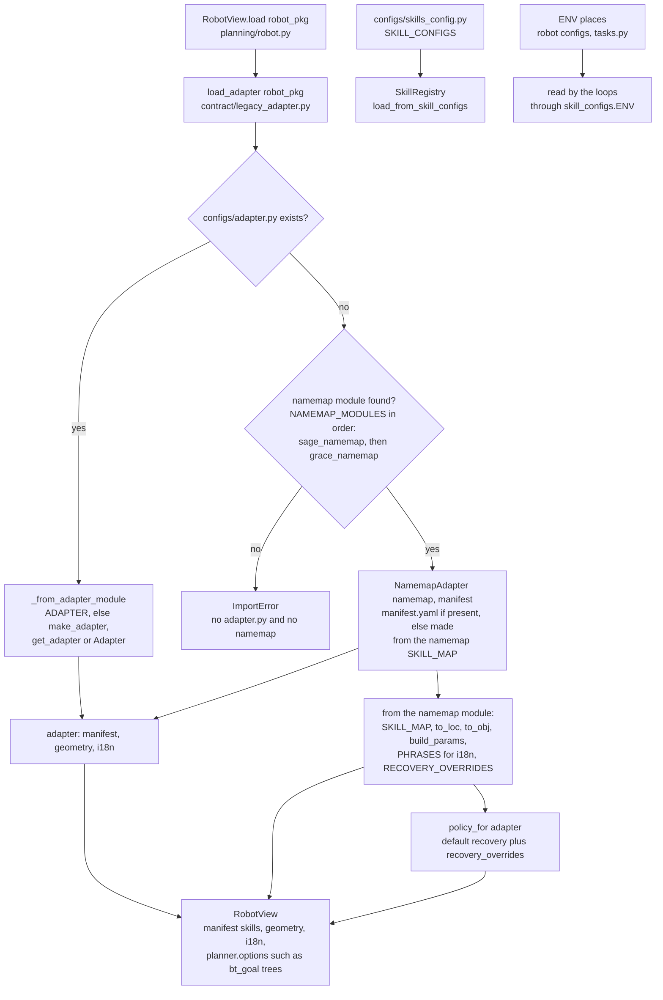
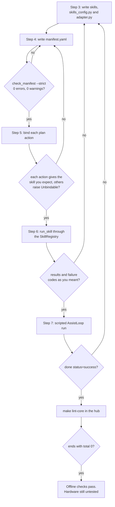

# Add a new robot

This guide takes you to the smallest robot package that the hub (`robot_agent`) can drive, and shows how to check it against an offline fake robot before you touch any hardware. You build a three-skill package called `tinybot`, check its manifest, bind plan steps to its skills, and run a whole task through the hub's `AssistLoop` with no ROS, no LLM and no network.

!!! abstract "In this guide"
    - A robot package is **one adapter, one manifest and a skill table**. Nothing else is needed for the hub to plan and run it.
    - `check_manifest` tells you in seconds if the manifest and the skills agree. Run it after every edit.
    - A full task can run offline through the real `AssistLoop` with the real skill registry. The planner and the language model are scripted. This proves the wiring, not the hardware.
    - Not run here: any real robot, ROS, a running server, `make test`. They are marked where they come up.

!!! code "Where in the code"
    - Hub: [`new_robot.py`](https://github.com/mtbui2010/robot_agent/blob/3269923/robot_agent/new_robot.py#L1-L40), [`contract/check_manifest.py`](https://github.com/mtbui2010/robot_agent/blob/3269923/robot_agent/contract/check_manifest.py#L1-L26), [`contract/legacy_adapter.py:215-227`](https://github.com/mtbui2010/robot_agent/blob/3269923/robot_agent/contract/legacy_adapter.py#L215-L227), [`tests/fakes.py`](https://github.com/mtbui2010/robot_agent/blob/3269923/tests/fakes.py#L91-L91), [`tests/conftest.py:74`](https://github.com/mtbui2010/robot_agent/blob/3269923/tests/conftest.py#L74-L100), [`tests/fakebot/`](https://github.com/mtbui2010/robot_agent/tree/3269923/tests/fakebot)
    - A real robot: [`kcare_robot/configs/`](https://github.com/mtbui2010/kcare_robot/tree/d4f5577b342e/kcare_robot/configs), [`kcare_robot/main.py`](https://github.com/mtbui2010/kcare_robot/blob/d4f5577b342e/kcare_robot/main.py#L27-L29)
    - A second, ROS-free example: [`symbolic_robot/domains/factory/configs/`](https://github.com/mtbui2010/symbolic_robot/tree/f55ace24c3b4/symbolic_robot/domains/factory/configs)

## 1. What the hub expects

The hub never names a robot. It loads the robot package by its Python name and asks two things: the [adapter](../start/glossary.md#adapter) (`bind` turns an abstract plan step into a skill call) and the [manifest](../start/glossary.md#manifest) (what skills exist and what each one needs and gives). The full agreement, with both sides, is on [Robot package and core](../contracts/robot-package.md). The short version:

| Piece | File in your package | Needed to |
|---|---|---|
| Adapter | `<pkg>/configs/adapter.py` with `make_adapter()` | plan and run |
| Manifest | `<pkg>/configs/manifest.yaml` | plan and run |
| Skill table | `<pkg>/configs/skills_config.py` with `SKILL_CONFIGS` | run, and `check_manifest` |
| Skills | `<pkg>/skills/*.py` | run |
| Entry point | `<pkg>/main.py` calling `create_app(robot_pkg=...)` | start the HTTP server (needs ROS) |

The concepts behind them are in [A robot as data](../concepts/robot-as-data.md) and [Skills, results, failure codes](../concepts/skills-and-failures.md).

### How the hub loads a package

The hub loads a robot in one place: `RobotView.load` calls `load_adapter`. The diagram shows the order of the checks and what each piece of the package ends up feeding. The places map (`ENV`) and the skill table are not read by `load_adapter`; the loops and the skill registry read them.



Drawn from the code at e65e9aa ([`legacy_adapter.py:205-240`](https://github.com/mtbui2010/robot_agent/blob/e65e9aa/robot_agent/contract/legacy_adapter.py#L205-L240), [`NAMEMAP_MODULES`](https://github.com/mtbui2010/robot_agent/blob/e65e9aa/robot_agent/contract/legacy_adapter.py#L25-L27), [`robot.py:48-62`](https://github.com/mtbui2010/robot_agent/blob/e65e9aa/robot_agent/core/planning/robot.py#L48-L62)), not from a recorded run. A package with `adapter.py` does not need a namemap; the old name `grace_namemap` still loads. The `tinybot` below takes the left branch.

## 2. Choose how to start

There are three routes to a package. This guide writes the files by hand.

| Route | What it gives you | Status here |
|---|---|---|
| Fork an existing package with `python -m robot_agent.new_robot` | A copy with the package name rewritten everywhere. | Run on the guide's own `tinybot` (below). Not run on `kcare_robot`: that copy is hundreds of megabytes. |
| Write the files by hand (this guide) | The smallest package, with nothing you do not understand. | Run in full. |
| The `robot_template` project that the hub's `Makefile` mentions | A clean skeleton with mock skills. | **Not available.** The `Makefile` looks for `../robot_template` ([`Makefile:38`](https://github.com/mtbui2010/robot_agent/blob/3269923/Makefile#L38)). No such folder exists next to the six repositories, and the target was not run. |

!!! warning "`new_robot` defaults to kcare_robot"
    `--from` defaults to `kcare_robot` ([`new_robot.py:203-204`](https://github.com/mtbui2010/robot_agent/blob/3269923/robot_agent/new_robot.py#L203-L204)). Without `--dest`, the copy goes **next to the source repository**. Always pass `--from` and `--dest`. A fork also carries over the source's site files (device addresses); pass `--reset-sites` if the new robot has other hardware, and `--blank-configs` to empty `configs/tasks.py`. Both options are read from the code; only the plain fork below was run.

Real run of a fork, on the `tinybot` built in step 3 (paths shortened). It writes only to `--dest`:

```text
$ python -m robot_agent.new_robot minibot --from tinybot --dest <scratch>/forks/minibot
[new_robot] tinybot  (<scratch>/repo2/tinybot)
[new_robot]   -> minibot  (<scratch>/forks/minibot)
[new_robot] copied 8 files
[new_robot] package dir tinybot/ -> minibot/
[new_robot] rewrote the package identifier in 4 files
[new_robot] configs/locations/ carried over: none
[new_robot] skills_config.py points at minibot (4 skills)

Next:
    cd <scratch>/forks/minibot
    make install                  # or: make install USE_CURRENT=1
    make doctor                   # verifies ROS + every skill imports
    # then fill in configs/tasks.py and add devices in the Connection panel
```

`check_manifest` passes on the copy (`minibot, 4 skills: 0 error(s), 0 warning(s)`). The "Next" lines mention a `Makefile`; `tinybot` has none, so those lines apply only to a fork of a package that has one.

### The steps as a checklist

The next steps in this guide each end in a check. If a check fails, fix the step and run it again.



What `check_manifest` reads: the manifest loads, each skill is in the registry, its function takes the declared params, a `sensor` verify names a real skill, and `planner.seed_memory` is a JSONL file ([`check_manifest.py:1-26`](https://github.com/mtbui2010/robot_agent/blob/e65e9aa/robot_agent/contract/check_manifest.py#L1-L26), [`check`](https://github.com/mtbui2010/robot_agent/blob/e65e9aa/robot_agent/contract/check_manifest.py#L237-L311)). Drawn from the code at e65e9aa and the steps of this page, not from a recorded run. Where a failed check sends you back is a suggestion, not something the tools enforce.

## 3. Write the smallest package

Make this layout. The package is called `tinybot`; replace the name with yours (lower case, letters, digits and `_`).

```text
tinybot/                       the repository folder
  pyproject.toml
  tinybot/                     the Python package
    __init__.py
    configs/
      __init__.py
      adapter.py
      manifest.yaml
      skills_config.py
    skills/
      __init__.py
      basic.py
```

This is a pretend robot written for this guide. It is not in any repository. Its "world" is a Python dict, so the skills do not need a motor, a camera or ROS.

**The skills**, `tinybot/skills/basic.py`. Each skill is called as `func(node=node, **params)` and returns a [SkillResult](../start/glossary.md#skillresult). How to write one well is in [Add a skill](add-a-skill.md).

```python
from robot_agent.contract import FailureCode, SkillResult

WORLD = {"at": "entrance", "holding": None, "objects": {"apple": "kitchen"}}


def move(node=None, inputs: str = "", **_) -> SkillResult:
    WORLD["at"] = inputs
    return SkillResult.success(f"arrived at {inputs}")


def find(node=None, inputs: str = "", **_) -> SkillResult:
    if WORLD["objects"].get(inputs) != WORLD["at"]:
        return SkillResult.failure(FailureCode.ABSENT, f"{inputs} not seen at {WORLD['at']}")
    return SkillResult.success(f"found {inputs}")


def pick(node=None, inputs: str = "", **_) -> SkillResult:
    if WORLD["objects"].get(inputs) != WORLD["at"]:
        return SkillResult.failure(FailureCode.GRASP_FAILED, f"no {inputs} in reach")
    WORLD["holding"] = inputs
    WORLD["objects"][inputs] = "gripper"
    return SkillResult.success(f"picked {inputs}")
```

**The skill table**, `tinybot/configs/skills_config.py`. The `_PKG` line matters: the scaffolding tool in [Add a skill](add-a-skill.md) writes entries that use it.

```python
# skill name -> (module, function)
_PKG = 'tinybot.skills'

SKILL_CONFIGS: dict = {
    'move': (f'{_PKG}.basic', 'move'),
    'find': (f'{_PKG}.basic', 'find'),
    'pick': (f'{_PKG}.basic', 'pick'),
}
```

**The adapter**, `tinybot/configs/adapter.py`. It is a plain class with the members of the `RobotAdapter` protocol ([`adapter.py:23-51`](https://github.com/mtbui2010/robot_agent/blob/3269923/robot_agent/contract/adapter.py#L23-L51)); it needs no base class. `bind` finds the skill for an action through the manifest; `reconcile` has nothing to sense, so it returns the belief unchanged. See [belief](../start/glossary.md#belief) and [reconcile](../start/glossary.md#reconcile).

```python
from pathlib import Path

from robot_agent.contract import Geometry, Manifest, Messages, Observation, Unbindable

MANIFEST_PATH = Path(__file__).with_name("manifest.yaml")


class Adapter:
    quiet_skills: set = set()

    def __init__(self):
        self.manifest = Manifest.from_yaml(MANIFEST_PATH)
        self.geometry = Geometry.from_dict(self.manifest.geometry)
        self.i18n = Messages(language=self.manifest.language)

    def bind(self, step: dict, world=None):
        action = (step.get("action") or "").strip()
        obj = str(step.get("object") or "").strip()
        spec = self.manifest.skill_for(action)
        if spec is None:
            raise Unbindable(f"no skill for {action!r} on {self.manifest.robot}")
        if not obj:
            raise Unbindable(f"{action} needs an argument")
        return spec.name, {"inputs": obj}

    def observe(self, node=None) -> Observation:
        return Observation(text="tinybot has no sensors")

    def reconcile(self, world, node=None):
        return world            # nothing to sense: keep the belief as it is

    def health(self, node=None) -> dict:
        return {"ok": True}


def make_adapter() -> Adapter:
    return Adapter()
```

The hub finds `make_adapter()` through `load_adapter('tinybot')` (see [How the hub loads a robot](../contracts/robot-package.md#how-the-hub-loads-a-robot-load_adapter)). A real robot adds more here: kcare's adapter also reads the base pose, the camera health and the gripper. That is optional; the three members above are enough for the hub to plan and run.

## 4. Describe the robot: the manifest

`tinybot/configs/manifest.yaml` says what the robot is and what each skill needs (`pre`), gives (`effects`), may fail with (`errors`) and how to check it (`verify`). Each entry under `skills:` becomes a [SkillSpec](../start/glossary.md#skillspec). The fields are explained on [Robot package and core](../contracts/robot-package.md#the-manifest-and-skillspec). The `pre` and `effects` here follow the shared [action model](../start/glossary.md#action-model); the kcare manifest uses the same predicates for `Pick`.

```yaml
robot: tinybot
version: "1.0"
language: en
capabilities:
  base: true
  arms: 1
  hands: [right]
geometry:
  arrive_tol_m: 0.3
  reach_m: 0.7
skills:
  - name: move
    action: MoveTo
    params:
      type: object
      properties:
        inputs: {type: string, description: "name of a place"}
      required: [inputs]
    pre: []
    effects: ["arrived(?inputs)"]
    verify: [{kind: symbolic}]
    interruptible: true
    errors: [unreachable, timeout, software]
  - name: find
    action: Find
    params:
      type: object
      properties:
        inputs: {type: string, description: "name of an object"}
      required: [inputs]
    pre: []
    effects: ["found(?inputs)"]
    verify: [{kind: symbolic}]
    interruptible: true
    errors: [absent, software]
  - name: pick
    action: Pick
    params:
      type: object
      properties:
        inputs: {type: string, description: "name of an object; the core passes the found one"}
      required: [inputs]
    pre: ["found(?inputs)", "hand_empty()"]
    effects: ["holding(?inputs)", "not found(?inputs)", "not hand_empty()"]
    verify: [{kind: symbolic}]
    interruptible: false
    errors: [absent, grasp_failed, software]
```

Run the check. It needs no ROS and does not import your package. Run it from a checkout of the hub with `/usr/bin/python3` or any Python that has `pyyaml`. `--strict` also fails on warnings.

```text
$ python -m robot_agent.contract.check_manifest <scratch>/repo/tinybot --strict
manifest <scratch>/repo/tinybot/tinybot/configs/manifest.yaml (tinybot, 3 skills): 0 error(s), 0 warning(s)
```

Success is `0 error(s)` and exit code 0. The tool and its result table are on [Robot package and core](../contracts/robot-package.md#check_manifest-the-machine-check). Repeat it after every change to the manifest or to `skills_config.py`.

### Optional: behaviour trees for goal kinds (`planner.options.bt_goal.trees`)

A robot may declare a small behaviour tree for a kind of goal (`go`, `on`, `in`, `open`, `close`, `say`, ...). The option `bt_goal` (default on) then runs a goal of that kind as the tree, with the engine's own retry and recovery inside each step, instead of a SAGE plan. The place to declare trees is `planner.options.bt_goal.trees` in your manifest. It maps a goal type to an entry `{tree, skip_if?, needs_openable?, source | assumed}`, or to a list of such entries (the first one the goal fills and the robot can run is used). Details: [`docs/bt_goal.md`](https://github.com/mtbui2010/robot_agent/blob/3269923/docs/bt_goal.md).

- **Data with a label.** Every entry must carry a `source` string (where the shape comes from) or `assumed: true`. An entry with neither is not used.
- **Declare none, and `bt_goal` does nothing.** A robot with no `trees` runs exactly as with the option off: SAGE plans every goal. This is the case for `tinybot` as built above, and for the kcare manifest (it has no `trees` key).
- **What a tree may use.** Actions the robot's manifest has (`act`), the conditions `holding`, `hand_free`, `at`, `placed`, `opened`, `closed` (`cond`), and phrases the robot's language pack has (`ask`, `confirm`, `reply`). An entry that names an action or phrase the robot lacks is skipped for that goal, and the goal falls back to SAGE.
- **Mixed runs.** With the key `mixed` (default on), goals with a tree run as trees and neighbouring goals without one are planned by SAGE once when the run reaches them. How that works, and what is not covered (the certify gate is skipped for those parts), is in `docs/bt_goal.md`. The effect on benchmark results is **not measured**.

A minimal entry for `tinybot` (a `go` tree: move unless already there). Checked offline: `check_manifest --strict` still gives `0 error(s), 0 warning(s)`, and the pure function `plan_trees` of the option fills the tree for a `go` goal to `kitchen`, and gives no tree when the `source` / `assumed` label is removed. A full run with the tree was not run here.

```yaml
planner:
  options:
    bt_goal:
      trees:
        go:
          tree: ["fallback", ["cond", "at", "{to}"], ["act", "MoveTo", "{to}"]]
          source: "tinybot manifest: skill move = MoveTo; the tree shape is assumed"
          assumed: true
```

## 5. Bind plan steps to skills

The first thing the hub does with a plan step is `bind`. Check it alone, with no loop:

```python
from robot_agent.contract import Unbindable, load_adapter

a = load_adapter("tinybot")
for step in ({"action": "MoveTo", "object": "kitchen"}, {"action": "Find", "object": "apple"},
             {"action": "Pick", "object": "apple"}, {"action": "Fly", "object": "x"}):
    try:
        print(step, "->", a.bind(step))
    except Unbindable as e:
        print(step, "-> Unbindable:", e)
```

Run it with the hub and the `tinybot` repository folder on `PYTHONPATH`. Real output:

```text
{'action': 'MoveTo', 'object': 'kitchen'} -> ('move', {'inputs': 'kitchen'})
{'action': 'Find', 'object': 'apple'} -> ('find', {'inputs': 'apple'})
{'action': 'Pick', 'object': 'apple'} -> ('pick', {'inputs': 'apple'})
{'action': 'Fly', 'object': 'x'} -> Unbindable: no skill for 'Fly' on tinybot
```

The last line is how a robot says "I cannot do that". The loop turns it into a reason to replan.

## 6. Run the skills through the hub's registry

Load `SKILL_CONFIGS` into the real `SkillRegistry` and call each skill through `run_skill`, the function the loops use. The registry needs a data folder; give it a temporary one.

```python
import tempfile
from pathlib import Path
from robot_agent.core.skill_registry import SkillRegistry
from robot_agent.core.planning.robot import run_skill
from tinybot.configs.skills_config import SKILL_CONFIGS

reg = SkillRegistry(Path(tempfile.mkdtemp()))
reg.load_from_skill_configs(SKILL_CONFIGS)
for skill, params in (("find", {"inputs": "apple"}), ("move", {"inputs": "kitchen"}),
                      ("find", {"inputs": "apple"}), ("pick", {"inputs": "apple"})):
    print(skill, params["inputs"], "->", run_skill(reg, skill, params))
```

Real output:

```text
find apple -> SkillResult(ok=False, code=<FailureCode.ABSENT: 'absent'>, msg='apple not seen at entrance', device=None, data={})
move kitchen -> SkillResult(ok=True, code=None, msg='arrived at kitchen', device=None, data={})
find apple -> SkillResult(ok=True, code=None, msg='found apple', device=None, data={})
pick apple -> SkillResult(ok=True, code=None, msg='picked apple', device=None, data={})
```

The first line fails on purpose: the robot is at the entrance and the apple is in the kitchen. Note the failure code `absent`. The core decides what to do next from that code (see [Skills, results, failure codes](../concepts/skills-and-failures.md)).

## 7. Run a whole task against the fake robot

Now run the hub's [AssistLoop](../start/glossary.md#assistloop) with your adapter and your skills. This follows the same wiring as the hub's own tests (which set `look_then_ask`, `bring_ask` and `bt_goal` to `0` in `make_assist`, because they are on by default in the engine; the script below leaves them at the default, and the `go` run is the same) (`make_assist` in [`tests/conftest.py`](https://github.com/mtbui2010/robot_agent/blob/3269923/tests/conftest.py#L74-L100)) and uses the doubles from [`tests/fakes.py`](https://github.com/mtbui2010/robot_agent/blob/3269923/tests/fakes.py): `FakeLLM` (scripted answers), `FakeState` (the part of the agent state the loop reads), `run_task` (collects the events). Three things are replaced and nothing else:

| Replaced | By | Why |
|---|---|---|
| the language model | `FakeLLM` with one scripted answer | no LLM is called |
| the agent state | `FakeState`, with `robot_pkg = "tinybot"` | the loop loads your adapter from this name |
| the places map (`ENV`) | a small dict with one place | the gate checks that a goal names known places |

Your adapter, your manifest, the real `SkillRegistry` and your skills are the real ones. The goal below is `go`: a task with nothing to move. The hub compiles it into steps itself, so no planner is needed.

```python
import json, sys, types
from pathlib import Path
from fakes import FakeLLM, FakeState, run_task, done
import robot_agent.state as state_mod
import robot_agent.core.planning.assist_loop as AL
import robot_agent.core.planning.loop as LP
import robot_agent.skill_configs as sc
from robot_agent.core.run_control import begin_run
from robot_agent.core.skill_registry import SkillRegistry
from tinybot.configs.skills_config import SKILL_CONFIGS

OUT = sys.argv[1]                              # an empty folder outside any repository
st = FakeState(Path(OUT))
st.robot_pkg = "tinybot"                       # the hub loads tinybot's adapter
for m in (AL, LP, state_mod):
    m.current = lambda: st
for m in (AL, LP):
    m.host_id = lambda: "test"
sc.ENV = {"kitchen": {"loc": {"x": 1.0, "y": 2.0, "rz": 0.0}}}
AL.reconcile_world = lambda node, world, threshold=0.8: world
begin_run()

reg = SkillRegistry(Path(OUT) / "skills")
reg.load_from_skill_configs(SKILL_CONFIGS)
llm = FakeLLM({"status": "clear", "reason": "", "question": "",
               "goals": [{"type": "go", "object": "", "from": "", "to": "kitchen"}]})
agent = types.SimpleNamespace(skill_registry=reg, device_manager=types.SimpleNamespace(_ros_node=None),
                              _llm_cfg={"name": "fake", "url": None, "model": "scripted"})
loop = AL.AssistLoop(agent, emit=None, log_dir=OUT + "/runs", live_path=OUT + "/live.jsonl",
                     memory_path=OUT + "/om.json", mute_skill_tts=False, speak_backend=False, vlm_enabled=False)
loop._llm_client = llm
evs = run_task(loop, "Go to the kitchen.")
for e in evs:
    print(json.dumps({k: e[k] for k in ("event", "index", "action", "object", "skill", "status", "ok",
                                        "reason", "problems") if k in e})[:200])
print("DONE", done(evs).get("status"))
```

Run it with `-B` (no bytecode files) and with these folders on `PYTHONPATH`: the hub, the hub's `tests` folder (for `fakes`), your repository folder, and `embodiplan`. The hub imports the planning rules from `embodiplan` ([`action_model.py:14-26`](https://github.com/mtbui2010/robot_agent/blob/3269923/robot_agent/core/planning/action_model.py#L14-L26)). Without it, the run ends with an `error` event that says `robot_agent needs embodiplan>=0.2.1,<0.3`. Real output:

```text
teleop stop_all: 'FakeState' object has no attribute 'cm'
{"event": "task_start"}
{"event": "status"}
{"event": "understand", "status": "clear", "reason": ""}
{"event": "status"}
{"event": "gate", "problems": []}
{"event": "plan"}
{"event": "step_start", "index": 0, "action": "MoveTo", "object": "kitchen", "skill": "move"}
{"event": "step_verify", "index": 0}
{"event": "step_done", "index": 0, "status": "success"}
{"event": "status"}
{"event": "goal_check", "ok": null}
{"event": "done", "status": "success"}
DONE success
```

Success is `done status=success`. The first line is a harmless warning: `FakeState` has no connection manager, and the loop's stop routine says so. The events are the loop's steps: understand the task, the [gate](../start/glossary.md#certified-gate) (here with `problems: []`), run each step (bind, run the skill, verify), then check the goal. `goal_check` is `null` for a `go` goal: the check reads no belief for it. How the loop works is on [The closed loop](../concepts/closed-loop.md).

The same script, with a `place` skill added and a plan with five steps, is in [Add a skill](add-a-skill.md#6-run-a-whole-task-offline). There the run also shows a failure and a replan.

!!! note "The fake robot of the hub's tests"
    The hub's tests use `tests/fakebot/`, a stand-in **package** (adapter, name map and manifest copied from kcare) and the class `FakeRobot` in `tests/fakes.py`, which plays the skills. `tests/fakebot` has no `skills_config.py` and no skill code, so `check_manifest` on it fails. Real output (first lines):

    ```text
    manifest <hub>/tests/fakebot/configs/manifest.yaml (fakebot, 10 skills): 13 error(s), 1 warning(s)
      ERROR   skill 'move' (MoveTo): verify skill 'mobile_pose' is not a registered skill
      ERROR   skill 'move' (MoveTo): not in the skill registry (configs/skills_config.py / skills.json)
    ```

    That is expected for that fixture: `FakeRobot` supplies the skills, not the package. It is not a template for a new robot. Use `tinybot`-style packages, with a real skill table, instead.

## 8. What the offline checks cannot tell you

Everything above is symbolic. It proves that the hub reads your files and runs your skill functions. It cannot show that a motor moves, that a camera sees, or that your failure codes match what the hardware does.

- **The HTTP server** needs ROS unless you switch it off. `runtime.py` imports `rclpy` at start unless the environment variable `ROBOT_AGENT_ROS` is `0`, `off`, `false` or `no`: if it is missing and the switch is not set, the hub prints `ERROR: ROS2 not found. Source /opt/ros/*/setup.bash before running (or set ROBOT_AGENT_ROS=off for a simulated robot).` and re-raises ([`runtime.py:141-148`](https://github.com/mtbui2010/robot_agent/blob/3269923/robot_agent/runtime.py#L141-L152)). A simulated package such as `tinybot` can start with `ROBOT_AGENT_ROS=off` (the switch is in the code at `3269923`; a server start with it was not run here). A real robot keeps the default and needs ROS.
- **Entry point.** A robot's `main.py` calls `create_app(robot_pkg='<pkg>', config_dir=...)`, as kcare's does ([`main.py:27-29`](https://github.com/mtbui2010/kcare_robot/blob/d4f5577b342e/kcare_robot/main.py#L27-L29), hub side [`app_factory.py:50`](https://github.com/mtbui2010/robot_agent/blob/3269923/robot_agent/app_factory.py#L50)). Not run.
- **Before the robot.** The hub's own rule: `make lint-core` must stay clean (it counts robot-specific names in `core/`, `interact/` and `contract/`). Real result on the hub at this commit, last line: `total 0`. A robot repository has its own tests (kcare: `make test`, offline, needs `pytest`, which is not installed on the machine that wrote this page, so it was **not run**) and, on the robot, `make doctor` and `make smoke-live` ([`Makefile:676-688`](https://github.com/mtbui2010/kcare_robot/blob/d4f5577b342e/Makefile#L676-L688)). Those two need ROS and a running agent. Not run.
- **The kcare rules** for a robot package are in its [`CLAUDE.md`](https://github.com/mtbui2010/kcare_robot/blob/d4f5577b342e/CLAUDE.md): use only the hub's public API, give every skill the planner uses a SkillSpec, treat world state as a belief.

## 9. Worked examples to read next

| Package | Why read it | Status |
|---|---|---|
| `kcare_robot` | A real robot. Its adapter subclasses the hub's `NamemapAdapter`, reads the pose and the gripper, and has Korean phrases. Manifest with 10 skills; `check_manifest` gives 0 errors, 0 warnings. | Read, and `check_manifest` run. |
| `symbolic_robot`, factory pack | The smallest complete pack on disk: `adapter.py`, `backend.py`, `manifest.yaml`, `ra_skills.py`, `skills_config.py`, `tasks.py` ([folder](https://github.com/mtbui2010/symbolic_robot/tree/f55ace24c3b4/symbolic_robot/domains/factory/configs)). 12 skills; `check_manifest` gives 0 errors, 12 warnings (every warning is a skill module outside the inspected folder) (see [Robot package and core](../contracts/robot-package.md#a-second-implementation-the-symbolic_robot-packs)). | `check_manifest` run. |

## 10. Common errors

All run offline on `tinybot`, with `--strict`. Paths are shortened.

| Symptom | Cause | What to do |
|---|---|---|
| `Unbindable: no skill for 'Fly' on tinybot` | The manifest has no skill for that action. | Add a skill for it, or the planner will replan around it. |
| `ERROR skill 'place' (Place): not in the skill registry (configs/skills_config.py / skills.json)` | The manifest names a skill that `SKILL_CONFIGS` does not list. | Add the entry to `skills_config.py`. |
| `'oops' is not a FailureCode (valid: absent, perception_unavailable, unreachable, blocked, grasp_failed, dropped, hw_fault, estop, timeout, cancelled, software, unknown, budget_exceeded)` | An `errors:` value is not one of the 13 codes. | Use a listed code. |
| `ERROR skill 'place' (Place): param 'inputs' is not accepted by place() (takes nothing)` | The manifest declares a parameter that the function cannot take. | Change the function or the manifest. |
| `ERROR skill 'place' (Place): verify skill 'gripper_full' is not a registered skill` | A `sensor` verify names a skill the robot does not have. | Add that skill, or use another verify kind. |
| `ERROR robot_agent needs embodiplan>=0.2.1,<0.3 ...` (an `error` event) | `embodiplan` is not importable. | Put the `embodiplan` repository on `PYTHONPATH`, or install it. |
| `ERROR: ROS2 not found. Source /opt/ros/*/setup.bash before running.` | Starting the real server without ROS. | Source ROS. Not run here. |

!!! warning "A new skill may not appear in a running server"
    If the package has a saved `configs/common/skills.json`, the hub loads that and does **not** read `skills_config.py` at boot. After you add a skill, restart and call `POST /skills/reload`, then check `GET /skills`. This was read from the code ([`runtime.py:192-201`](https://github.com/mtbui2010/robot_agent/blob/3269923/robot_agent/runtime.py#L195-L204)), not run on a server. `tinybot` has no `skills.json`, so the offline runs above are not affected. The details are on [Robot package and core](../contracts/robot-package.md#current-behaviour-to-know).

## Done when

- `check_manifest <pkg> --strict` prints `0 error(s), 0 warning(s)`.
- The bind check turns each plan action into the skill you expect and raises `Unbindable` for the rest.
- The scripted `AssistLoop` run ends with `done status=success`.
- `make lint-core` in the hub still ends with `total 0`.

Next: [Add a skill](add-a-skill.md). To see how the pieces fit, read [Robot package and core](../contracts/robot-package.md).
