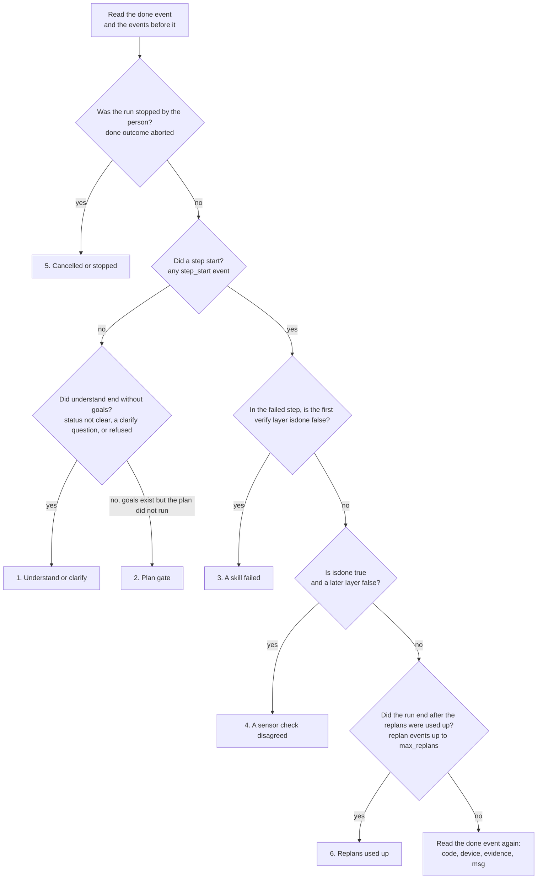

# Debug a failed run

A run failed and you want to know why. This guide shows how to find out which stage failed, what the failure code says, what the robot believed at that moment, and how to replay the run on a laptop. Each step has a command and the output of a real run.

!!! abstract "In this page"
    - Every run leaves a [run record](../start/glossary.md#runrecord) and a metrics line. Start with the `done` event: it carries the message, the [failure code](../start/glossary.md#failurecode), the device and the evidence.
    - The event stream tells you the **stage** that failed: `understand`, `gate`, the per-step [guard](../start/glossary.md#guard), the skill, or the [verify layers](../start/glossary.md#verify-layers).
    - The belief at the end of the run says what the robot assumed, and which values a sensor vouched for.
    - Three runs were made for this page on the offline fake robot, with a scripted LLM answer. They are fake. Nothing here comes from a real robot, and no recorded real run was opened.

!!! code "Where in the code"
    - The record and the metrics line: [`observe/record.py`](https://github.com/mtbui2010/robot_agent/blob/3269923/robot_agent/observe/record.py#L254-L345) (`load_record`, `run_metrics`, `metrics_of`); replay CLI: [`observe/replay.py`](https://github.com/mtbui2010/robot_agent/blob/3269923/robot_agent/observe/replay.py#L495-L522)
    - HTTP endpoints for runs: [`api/agent.py` L251-L287](https://github.com/mtbui2010/robot_agent/blob/3269923/robot_agent/api/agent.py#L251-L287); diagnostics: [`api/diagnostics.py`](https://github.com/mtbui2010/robot_agent/blob/3269923/robot_agent/api/diagnostics.py#L26-L52), [`diagnose.py`](https://github.com/mtbui2010/robot_agent/blob/3269923/robot_agent/diagnose.py)
    - The gate's end state: [`assist_loop.py` L2677-L2678](https://github.com/mtbui2010/robot_agent/blob/3269923/robot_agent/core/planning/assist_loop.py#L2677-L2678) and the gate rounds [L2704-L2737](https://github.com/mtbui2010/robot_agent/blob/3269923/robot_agent/core/planning/assist_loop.py#L2704-L2737); the per-step guard: [`_guard` L3515](https://github.com/mtbui2010/robot_agent/blob/3269923/robot_agent/core/planning/assist_loop.py#L3515); what a failed step does: [`_step_failed` L3660](https://github.com/mtbui2010/robot_agent/blob/3269923/robot_agent/core/planning/assist_loop.py#L3660); pick recovery: [`_recover_pick` in `step_ladder.py` L23-L82](https://github.com/mtbui2010/robot_agent/blob/3269923/robot_agent/core/planning/step_ladder.py#L23-L82)
    - Verify layers and their verdict: [`verify.py` L251-L262](https://github.com/mtbui2010/robot_agent/blob/3269923/robot_agent/core/planning/verify.py#L251-L262)
    - Failure codes and the recovery table: [`contract/failures.py`](https://github.com/mtbui2010/robot_agent/blob/3269923/robot_agent/contract/failures.py), [`contract/recovery.py` L66-L92](https://github.com/mtbui2010/robot_agent/blob/3269923/robot_agent/contract/recovery.py#L66-L92) and the step ladders [L94-L112](https://github.com/mtbui2010/robot_agent/blob/3269923/robot_agent/contract/recovery.py#L94-L112)
    - Tracebacks from a skill: [`skill_registry.py` L231-L245](https://github.com/mtbui2010/robot_agent/blob/3269923/robot_agent/core/skill_registry.py#L231-L245)
    - The fake robot with scripted faults: [`tests/fakes.py` L91](https://github.com/mtbui2010/robot_agent/blob/3269923/tests/fakes.py#L91)

## The runs used in this guide

Both ideas come from [Runs and records](../concepts/runs-and-records.md): a run has an id, and the record is a JSONL file with one row per line. To have something to debug, three runs were recorded on the fake robot `FakeRobot` through the run manager (the same set-up as the one in [Runs and records](../concepts/runs-and-records.md#one-real-record)). The task is always "Bring the apple from the desk to the dining table." The planner is the small one from [Add a planner](add-a-planner.md). What differs is the fault that was scripted:

| Run | Scripted fault | What it will show |
|---|---|---|
| A | Every `pick` of the apple returns `isdone: false`, "could not grasp the apple: gripper is empty" | A failure in the **skill** |
| B | Every `pick` of the apple reports success, but the gripper stays empty (fault kind `slip`) | A failure in **verify** |
| C | No fault. The planner returns a plan with no `Find` and no `MoveTo` | A failure in the **gate** |

The fault is set with the `faults` argument of `FakeRobot`, for run A:

```python
robot = FakeRobot(env, {"apple": "desk@study room", "mug": "counter@kitchen"},
                  faults=[{"skill": "pick", "obj": "apple", "nth": "all", "kind": "fail",
                           "msg": "could not grasp the apple: gripper is empty"}])
```

Run B uses `"kind": "slip"` instead. Run C uses `faults=[]` and a planner whose `generate_plan` returns only `Pick apple` and `Place dining table@kitchen`. The recording script is the one in [Runs and records](../concepts/runs-and-records.md#one-real-record), with the planner chosen by name through the `generator` option. The runs were recorded again on 2026-11-20 with the hub at `3269923` (the earlier recording, at the earlier pin of this site, ended differently; see the notes below). Their ids are `20261120-094744-f1d627` (A), `20261120-094744-eb0916` (B) and `20261120-094745-8623dc` (C). All three ended with status `failed`. The planner is chosen by name with the `generator` option, as in [Add a planner](add-a-planner.md); for run C it is a stand-in class that returns only the two steps.

## Step 1. Find the run and its metrics line

A live robot gives you three read-only HTTP endpoints (read in `api/agent.py`; **not run**, because no server can be started here):

| Endpoint | Returns |
|---|---|
| `GET /runs/{id}` | The run: state, outcome and its last events |
| `GET /runs/{id}/record` | The record rows. `?kinds=event,skill` filters, `?limit=N` keeps the last N rows. Works for finished runs, from disk. |
| `GET /runs/{id}/metrics` | The metrics line. Marked `live: true` while the run is active. |

Without a server, read the files. The record is `<data_dir>/run_records/<host>/<run_id>/record.jsonl` and the metrics lines are in `<data_dir>/run_records/<host>/metrics.jsonl`, where `<data_dir>` is the value of `ROBOT_AGENT_DATA_DIR` ([where the files go](../concepts/runs-and-records.md#where-the-file-goes)). This is the real metrics line of run A:

```json
{"run_id": "20261120-094744-f1d627", "task_run_id": null, "robot_id": "default", "user_id": "alice", "goal": "Bring the apple from the desk to the dining table.", "loop": "assist", "started": 1795135664.4461446, "duration_s": 0.123, "outcome": "failed", "status": "failed", "llm_calls": 2, "llm_errors": 1, "llm_latency_ms": 0.0, "planner_calls": 4, "skill_calls": 14, "replans": 2, "failure_codes": {"grasp_failed": 2, "absent": 1}, "failure_code": "grasp_failed", "failure_device": "pick", "success": false, "verified_success": false}
```

Read it like this:

- `outcome: failed` and `success: false`: the run did not reach its goal.
- `failure_code: grasp_failed` and `failure_device: pick`: the deciding failure, and the skill that raised it.
- `failure_codes: {"grasp_failed": 2, "absent": 1}`: two plan steps failed with `grasp_failed` and one with `absent` (the later `Find` at the counter).
- `replans: 2`, `planner_calls: 4`: the planner was asked again twice, after the grasp failed and after the next `Find` failed. (Earlier, at the older pin, the same run was not replanned: it ended at the question. The engine now replans after an unanswered question for a `Pick`.)
- `llm_errors: 1`: the scripted LLM of the fake run had no answer for one more call. This is a trace of the fake set-up, not of the fault.

The metrics line is a summary. It cannot tell you the stage or the belief. For that, read the events.

## Step 2. Read the event stream

Every event of the run is an `event` row in the record. This short script prints one line per event and leaves out the bulky fields (the belief, the clocks). Save it outside the repos:

```python
"""Print one line per event of a run record. Usage: python3 -B trace.py <record.jsonl>"""
import json, sys
for line in open(sys.argv[1]):
    row = json.loads(line)
    if row["kind"] != "event":
        continue
    e = row["event"]
    if e["event"] in ("run_state", "status", "task_start", "reconcile"):
        continue
    keep = {k: e[k] for k in ("event", "index", "at_index", "action", "object", "kind", "status", "code", "reason", "msg", "problems", "question") if k in e}
    if e["event"] == "step_verify":
        keep["layers"] = [(v["layer"], v["ok"]) for v in e["verifies"]]
    print(json.dumps(keep))
```

Run A, a failure in the skill:

```text
{"event": "understand", "status": "clear", "reason": "", "question": null}
{"event": "gate", "problems": []}
{"event": "plan"}
{"event": "step_start", "index": 0, "action": "MoveTo", "object": "desk@study room"}
{"event": "step_verify", "index": 0, "layers": [["isdone", true], ["symbolic", true], ["localization", true]]}
{"event": "step_done", "index": 0, "status": "success"}
{"event": "step_start", "index": 1, "action": "Find", "object": "apple"}
{"event": "step_verify", "index": 1, "layers": [["isdone", true], ["symbolic", true], ["sensor", true]]}
{"event": "step_done", "index": 1, "status": "success"}
{"event": "step_start", "index": 2, "action": "Pick", "object": "apple"}
{"event": "step_verify", "index": 2, "layers": [["isdone", false]]}
{"event": "step_done", "index": 2, "status": "failed", "reason": "could not grasp the apple: gripper is empty"}
{"event": "recover", "at_index": 2, "kind": "retry", "msg": "pick apple failed; looking again"}
{"event": "step_start", "index": 2, "action": "Find", "object": "apple"}
...
{"event": "step_start", "index": 3, "action": "Pick", "object": "apple"}
{"event": "step_verify", "index": 3, "layers": [["isdone", false]]}
{"event": "step_done", "index": 3, "status": "failed", "reason": "could not grasp the apple: gripper is empty"}
{"event": "clarify", "question": "I can't pick up the apple. Could you move it closer to the edge, then say yes?"}
{"event": "replan", "at_index": 3, "reason": "E: Pick apple failed. R: could not grasp the apple: gripper is empty; the grasp of the apple failed 2 times and nobody could help: try it again. S: robot at desk@study room, holding nothing; goals: on app...
{"event": "step_start", "index": 3, "action": "MoveTo", "object": "counter@kitchen"}
{"event": "step_verify", "index": 3, "layers": [["isdone", true], ["symbolic", true], ["localization", true]]}
{"event": "step_done", "index": 3, "status": "success"}
{"event": "step_start", "index": 4, "action": "Find", "object": "apple"}
{"event": "step_verify", "index": 4, "layers": [["isdone", false]]}
{"event": "step_done", "index": 4, "status": "failed", "reason": "apple not found"}
{"event": "search", "object": "apple"}
{"event": "replan", "at_index": 4, "reason": "E: Find apple failed. R: apple not found; it is not at counter@kitchen. Look next at desk@study room. S: robot at counter@kitchen, holding nothing; goals: on apple from desk@study room to dining table@kitchen", "problems": [...]}
{"event": "done", "status": "failed", "code": "grasp_failed", "msg": "plan finished but the goals do not hold: on apple from desk@study room to dining table@kitchen"}
```

The `...` stands for the repeated `Find` that succeeded (three lines). Read the stream from the top and ask one question at each event: did this stage pass?

1. `understand` says `clear`: the task was understood.
2. `gate` has an empty `problems` list: the plan was certified.
3. Steps 0 and 1 end with `success`, and all their verify layers pass.
4. Step 2 (`Pick`) has one verify layer, `isdone`, and it is **false**. The skill itself said it failed. That is where the run went wrong.
5. `recover` shows the loop retried (look again, grasp again). The retry failed in the same way.
6. `clarify` shows the loop asked the person for help. The fake person gave no answer, so the loop asked the planner for a new plan (`replan`). The scripted planner tried the next place, and its `Find` failed too. The run ended: `done` with `status: failed`. The `code` of `done` is still the deciding failure, `grasp_failed`; the `msg` is the loop's last word about the goals.

### Which stage failed

The event that fails first tells you the stage. Run A is the `skill` row of this table; B and C are shown below.

| Stage | What you see in the events | In the end state |
|---|---|---|
| Understand | `understand` with a status other than `clear`, or a `clarify` question | `done` with status `refused` for a refusal. **Not run** here; read in `assist_loop.py`. |
| Gate | Up to four `gate` events (`round` 0, then `"symbolic"` when the engine's own repair ran, then 1 and 2) whose `problems` are not empty, then `plan` with `certified: false` | `done` with "I could not make a plan that passes my checks". No step runs. |
| Guard | A `recover` with `kind` `reconcile` or `dropped`, or a `replan` whose reason starts with `precondition:`, right before a `step_start` | See [Checks before motion](../concepts/checks-before-motion.md). **Not run** here; read in `_guard`. |
| Skill | `step_verify` where the first layer, `isdone`, is false; `step_done` with `status: failed` and a `code` in its `result` | A recovery (`recover`, `search`, `replan`, `clarify`), then `done` if recovery runs out |
| Verify | `step_verify` where `isdone` is true and a later layer (`symbolic`, `sensor`, `localization`) is false | The same recovery as for a skill |

The verify layers are the checks after a skill says it worked. See [Checks before motion](../concepts/checks-before-motion.md) and the [glossary](../start/glossary.md#verify-layers). `verdict` in `verify.py` says a step passes only when every layer passed, and its reason is the first failing detail.

### Where did my run fail? A decision tree

Start from the `done` event and the first event that went wrong. The tree asks the same questions as the table above, in the order the loop meets them. Each leaf is a branch; the table under the picture says which record rows and which page to read for it.



*Drawn from the code at e65e9aa, not from a recorded run.* The question order follows `assist_loop.py`: the refusal and clarify path, the gate end state (`I could not make a plan that passes my checks`), `_cancelled` (asked first in the picture because a stop can come at any time), and the step verdict in `verify.py`, then `_replan_or_fail` and `max_replans` (default 6). Several branches can show up in one run: a skill failure that is retried and then replanned until the budget is used is branch 3 first and branch 6 at the end. Read the first failure first.

| Branch | What you see | Record rows to read | Where to read more |
|---|---|---|---|
| 1. Understand or clarify | `understand` with a status other than `clear`, a `clarify` question, or `done` with status `refused` and a `refusal` kind. No `plan` of steps. | `event` rows `understand`, `clarify`, `done`; `user` rows for the answers; `llm` rows for the model's reading | [Dialog and intent](../concepts/dialog-and-intent.md#typed-refusals): typed refusals and the questions before a plan |
| 2. Plan gate | `gate` events with non-empty `problems`, then `plan` with `certified: false`; `done` says "I could not make a plan that passes my checks"; no `step_start` | `event` rows `gate`, `plan`, `done`; `planner` rows for what the planner returned | [Run C above](#run-c-the-plan-never-ran), [Checks before motion](../concepts/checks-before-motion.md#1-the-gate-the-whole-plan), [Add a planner](add-a-planner.md) |
| 3. A skill failed | `step_verify` with `isdone` false, `step_done` with `status: failed`, then `recover`, `search`, `clarify` or `replan` | `skill` rows (the raw return and the SkillResult with its `code`), `event` rows `step_done`, `recover`, `done` | [Step 3 above](#step-3-read-the-failure-code), [Skills, results, failure codes](../concepts/skills-and-failures.md#the-failure-codes) and its [recovery picture](../concepts/skills-and-failures.md#one-failed-step-to-its-recovery) |
| 4. A sensor check disagreed | `isdone` true, then a later layer (`symbolic`, `sensor`, `localization`) false in `step_verify`; the step still fails | `event` rows `step_verify`, `step_done`; the `skill` row of the check skill (for example the sensor skill) | [Run B above](#run-b-the-skill-said-yes-a-check-said-no), [Checks before motion](../concepts/checks-before-motion.md#success-needs-an-observation), [VerifySpec](../concepts/skills-and-failures.md#verifyspec-how-a-step-is-checked) |
| 5. Cancelled or stopped | `done` with outcome `aborted` and the message "Cancelled by user"; or a stop by the recovery table (`estop`, `software`, `budget_exceeded`: `retry_allowed` false) | `event` row `done`; `end` row; `user` rows for a stop said during the run | [Runs and records](../concepts/runs-and-records.md#a-run-and-its-id) for the run states, [Skills, results, failure codes](../concepts/skills-and-failures.md#the-failure-codes) for codes that never retry |
| 6. Replans used up | Several `replan` events; `replans` in the metrics line; `done` ends with "(replan budget used)" or "the new plan did not pass my checks" | `event` rows `replan` and `gate` after it; `planner` rows of each repair; the metrics line | [Step 1 above](#step-1-find-the-run-and-its-metrics-line), [The closed loop](../concepts/closed-loop.md), [Planners](../concepts/planners.md) |

Branches 5 and 6 are about how a run ended, not where it began. Branch 5 by a stop from the table is also a skill failure (branch 3): read the failure code to tell them apart. When the tree gives no leaf, the checklist at the end of this page is the fallback.

### Run B: the skill said yes, a check said no

Run B had the same fault in the world but a different symptom. The part of its events that differs:

```text
{"event": "step_start", "index": 2, "action": "Pick", "object": "apple"}
{"event": "step_verify", "index": 2, "layers": [["isdone", true], ["symbolic", true], ["sensor", false]]}
{"event": "step_done", "index": 2, "status": "failed", "reason": "pick reported success but the gripper is empty"}
...
{"event": "done", "status": "failed", "code": "grasp_failed", "msg": "could not pick up the apple: pick reported success but the gripper is empty"}
```

Here `isdone` is **true**. The skill claimed success. The `sensor` layer disagreed: the gripper sensor saw an empty hand. The step failed anyway, with the first failing detail as the reason. This is why a step counts as done only after observation, not after the skill's word.

### Run C: the plan never ran

```text
{"event": "understand", "status": "clear", "reason": "", "question": null}
{"event": "gate", "problems": ["step 1 'Pick apple': needs 'Find apple' just before it, at the same place", "step 2 'Place dining table@kitchen': the robot must MoveTo dining table@kitchen first"]}
{"event": "gate", "problems": ["step 1 'Pick apple': needs 'Find apple' just before it, at the same place", "step 2 'Place dining table@kitchen': the robot must MoveTo dining table@kitchen first"]}
{"event": "gate", "problems": ["step 1 'Pick apple': needs 'Find apple' just before it, at the same place", "step 2 'Place dining table@kitchen': the robot must MoveTo dining table@kitchen first"]}
{"event": "gate", "problems": ["step 1 'Pick apple': needs 'Find apple' just before it, at the same place", "step 2 'Place dining table@kitchen': the robot must MoveTo dining table@kitchen first"]}
{"event": "plan"}
{"event": "done", "status": "failed", "code": "unknown", "msg": "I could not make a plan that passes my checks: step 1 'Pick apple': needs 'Find apple' just before it, at the same place; step 2 'Place dining table@kitchen': the robot must MoveTo dining table@kitchen first"}
```

There is no `step_start`: no skill was called and the fake robot's trace was empty. The `gate` events are the evidence, and each lists what is wrong with the plan. The `msg` of `done` repeats the first three. The four `gate` events are the rounds of the gate: the check (`round` 0), the engine's own symbolic repair (`round` `"symbolic"`, added since the earlier pin of this site), the planner's repair (`round` 1) and one fresh plan (`round` 2). The script above does not print the `round` key; it is in the record. To fix this you change the planner, not the robot.

## Step 3. Read the failure code

The `done` event of a failed run carries `code`, `device` and `evidence`. The record has the same code in the `result` of the failed `skill` row and in the failed `step_done` event. For run A:

```text
code: grasp_failed | device: pick | evidence: {'step': 'Pick apple', 'reason': 'could not grasp the apple: gripper is empty'}
```

A [failure code](../start/glossary.md#failurecode) says **why**, in a form that is the same for every robot. The core uses the code, not the text, to choose the recovery. The default rules for the codes you meet most often (from `contract/recovery.py`; the full table of 13 codes is in [Skills and failures](../concepts/skills-and-failures.md)):

| Code | Default recovery | Meaning |
|---|---|---|
| `absent` | Search on from the belief, up to 3 times, then ask the person | Looked, the object is not there |
| `grasp_failed` | Retry once, then replan | The gripper closed on nothing, or the wrong thing |
| `unreachable` | Move closer once, then replan | Seen, but out of reach |
| `blocked` | Retry once, then ask the person | The path or the spot is occupied |
| `perception_unavailable` | Wait for the robot's health twice, then stop | Could not look; not proof the object is absent |
| `software` | Stop at once | A bug in the skill. Retrying cannot help |
| `unknown` | Observe, then replan | No usable reason in the result |

!!! note "The table is the default, the loop can do more"
    Run A got `grasp_failed`, and the table says "retry once, then replan". The AssistLoop handles a `Pick` through a step ladder of its own first (`_recover_pick` in `step_ladder.py`; the ladders are declared in `STEP_LADDER` in `contract/recovery.py`, for `Pick` and `MoveTo`): it looks and grasps again in place, then asks the person to move the object closer, and then, when nobody helps, it asks the planner for a new plan (the failed code's own rule says `then=REPLAN`). So the events you see (`recover`, `clarify`, `replan`) are the ladder's rungs, not the generic table. At the earlier pin of this site the run ended at the question with "could not pick up the apple"; it no longer does. The same kind of ladder exists for `Find` and `MoveTo`. Read the events, not only the table.

A failed `Find` with code `unknown` (the skill said "not done" and gave no text the engine knows) is read as `absent` while the option `fetch_guard` is on (it is on by default; see Step 6). If you see `absent` on a `Find` with no reason text, that is why; with `fetch_guard=0` it stays `unknown` and the loop replans.

The code comes from the skill's result. A skill that still returns only `{'isdone': False, 'msg': '...'}` gets its code read off the text by `classify_legacy_failure`, in one place. A message that matches nothing becomes `unknown`. If you see `unknown` and the message is clear to a person, the text did not match any rule: the fix is in the skill (return a code) or in that function, not in the loop. A message that mentions a Python error, such as `TypeError` or `has no attribute`, becomes `software`, and the run stops.

!!! warning "Two cases where the metrics line is thin"
    - **A gate failure has no useful code.** Run C ended with `failure_code: unknown` and `failure_codes: {}` (its metrics line, from the file: `"failure_codes": {}, "failure_code": "unknown", "failure_device": null`). The code is `unknown` because no skill failed. Read `done.msg` and the `gate` events.
    - **A verify failure may leave `failure_codes` empty.** Run B's skill reported success, so no step *result* carried a code. Its metrics line (run B, re-recorded) has `"failure_codes": {"absent": 1}` and `"failure_code": "grasp_failed"`: the two failed picks are not counted, the later failed `Find` is. The deciding code is `failure_code`; `failure_codes` counts only codes that came from step results.

## Step 4. Read the belief at the failure

The belief is what the robot assumed. The `done` event, each `step_done` event and each `skill` row carry a copy (`world`, and `world_before` on the skill row), with a provenance for each value: `sensor` (read off the robot), `operator` (a person edited it) or `belief` (an effect of a skill, or loaded from disk). The meaning is in [Belief and reconcile](../concepts/belief-and-reconcile.md).

This script prints the belief of the last `done` event and the failure fields:

```python
"""Print the belief at the end of a run and where each value came from. Usage: python3 -B belief.py <record.jsonl>"""
import json, sys
done = [json.loads(l)["event"] for l in open(sys.argv[1]) if json.loads(l)["kind"] == "event" and json.loads(l)["event"]["event"] == "done"][-1]
w = done["world"]
for k in ("arrived", "found", "holding"):
    print(f"{k:8} = {w[k]!r:18} source: {w['provenance'][k]['source']}")
print("code:", done.get("code"), "| device:", done.get("device"), "| evidence:", done.get("evidence"))
```

Real output for run A (run B gives the same belief lines):

```text
arrived  = 'counter@kitchen'  source: sensor
found    = None               source: belief
holding  = None               source: belief
code: grasp_failed | device: pick | evidence: {'step': 'Pick apple', 'reason': 'could not grasp the apple: gripper is empty'}
```

What it tells you:

- The belief is taken at the end, after the replan. The robot moved on to the counter, and a sensor (the pose check after `MoveTo`) vouched for that. A belief from the moment of the failed grasp is in the `step_done` event of step 3 (read it with the same keys).
- `found = None`: the last `Find`, at the counter, did not see the apple, so the belief was cleared. It is a belief value, not a sensor reading.
- `holding = None` matches the failed grasp: nothing is in the hand.
- The code, device and evidence in the last line are those of the failed pick, which stay the deciding failure although later steps ran.

- **A `found` that is missing at the start.** A run that starts with `found` set from an earlier run (the belief is kept on disk) can lose it at once. At run start the sensor reconcile drops that `found` when the base has moved more than 0.25 m from where the object was seen ([`drop_stale_found`](https://github.com/mtbui2010/robot_agent/blob/e65e9aa/robot_agent/core/planning/reconcile.py#L151-L162)). The first `reconcile` event then has the old name in `sensors.found_dropped` (the report is built in [`reconcile_sensors` L165-L175](https://github.com/mtbui2010/robot_agent/blob/e65e9aa/robot_agent/core/planning/reconcile.py#L165-L175)), and `changed` shows `found` going to `None`:

```text
{"event": "reconcile", "when": "start", "changed": {"found": ["widget", null]}, "sensors": {..., "found_dropped": "widget"}, ...}
```

  That line is the shape the code builds; it was written from the code and the test `tests/test_reconcile_stale_found.py`, not copied from a run. Read it as: the plan has to look (or ask) again, as it should. A sighting with no base pose, or a pose that could not be read, is **not** dropped, so a stale `found` can still survive in that case. Before this change a run on the real kcare robot began with `found=plastic spoon` from a find 10 minutes and more than 3 m earlier, and the planner skipped the Find (from the engine's changelog of 2026-11-20).

Compare this with a belief that is wrong. If `holding` shows an object but the run failed with `dropped` or a "not in the gripper" reason, the belief and the robot disagreed, and the guard or reconcile should have fixed it. See [Belief and reconcile](../concepts/belief-and-reconcile.md).

## Step 5. Replay the run offline

[Replay](../start/glossary.md#replay) runs the recorded task again with no robot. It answers every LLM call and every skill call from the record. Use it to test a fix and to be sure the record is what you think it is. There are two modes (`plan` re-runs understanding, the planner and the checks; `exec --fake` re-runs the whole run against a fake robot). The exit codes are 0 for identical, 1 for differs, 2 for a mismatch or a record that cannot be replayed.

```bash
cd <repos>/robot_agent
PYTHONPATH=<repos>/robot_agent/tests:<repos>/embodiplan PYTHONDONTWRITEBYTECODE=1 \
  python3 -B -m robot_agent.observe.replay plan <data_dir>/run_records/<host>/<run_id>
PYTHONPATH=<repos>/robot_agent/tests:<repos>/embodiplan PYTHONDONTWRITEBYTECODE=1 \
  python3 -B -m robot_agent.observe.replay exec <data_dir>/run_records/<host>/<run_id> --fake
```

Real output for run C (the gate failure), both commands, exit status 0 each (re-run at `3269923`):

```text
replay plan 20261120-094745-8623dc (assist): IDENTICAL
  recorded plan: pick::apple
place::dining table@kitchen
  replayed plan: pick::apple
place::dining table@kitchen
replay exec 20261120-094745-8623dc (assist): IDENTICAL
```

The replay reproduced the bad plan and the same failure. That tells you the cause is in the plan, and that the record is faithful.

For run A, `plan` printed `IDENTICAL` (exit 0), but `exec --fake` printed this and exited with 1:

```text
replay exec 20261120-094744-f1d627 (assist): DIFFERS
  diff: event #5 (plan vs plan):
--- recorded
+++ replayed
@@ -42,2 +42,6 @@
    "object": "desk@study room"
+  },
+  {
+   "action": "Find",
+   "object": "apple"
   },
```

!!! warning "A retried pick makes `exec --fake` report DIFFERS"
    The same `DIFFERS` came from run B, where the pick was also retried. The run was **not** different: the skill calls and the outcome are the same. The difference is one extra `Find` in the `plan` event. In the code, the `plan` event is sent with the loop's own list of steps (`steps=r.steps`), and the pick recovery then inserts a `Find` into that same list (`r.steps[r.i:r.i] = [...]`). The record writes the event when it is sent. Replay keeps the event objects and compares them after the run, so the replayed `plan` event shows the later list. (This is a reading of the code that fits the output; it was not tested by a change.) When `exec --fake` reports one `plan` difference that only adds a retry `Find`, treat the run as replayed. Use `plan` mode to compare the plan, and look at `--json` (`"identical": false`, one entry in `diffs`) to confirm that there is no other difference.

Replay needs the robot package of the run and `embodiplan` importable, as described in [Runs and records](../concepts/runs-and-records.md#replay). Without them you can get a `DIFFERS` that is only an environment problem, or an exit status of 2. Use it from a command line or a test, not inside a live agent process.

## Step 6. Read a lab flag (for example `bt_goal`)

Some options record what they did in a **lab flag**. Lab flags are not events: they never reach `/ws/agent` and are not rows of the run record. Two places hold them (`AssistLoop._lab` in `assist_loop.py`, and `docs/trace.md`):

- **`loop.lab_log`**, a list on the loop object, one dict per entry, `{"flag": "<option>", ...}`. It keeps at most 50 entries and is read by a harness (a script or a test) after the run. A dashboard user cannot see it.
- **The run trace**, when the option `trace` is on (`trace=1`, or `$ROBOT_AGENT_TRACE=1`, or `planner.options.trace.enabled`): `<dir>/<run_id>/trace.jsonl` has a row `{"k": "lab", "flag": ..., "step": ..., "data": {...}}` for every entry, also past the 50-entry cap ([`docs/trace.md`](https://github.com/mtbui2010/robot_agent/blob/3269923/docs/trace.md)). Filter on `k == "lab"` and `flag == "bt_goal"`.

What the `bt_goal` flag says ([`docs/bt_goal.md`](https://github.com/mtbui2010/robot_agent/blob/3269923/docs/bt_goal.md)):

| Entry | Meaning |
|---|---|
| `{goal: N, status: "claimed"}` (once) | The option took over N goals as trees. **No `claimed` entry: no goal of the run had a usable tree**, so SAGE planned the run (always so for a robot that declares no `trees`). |
| `{goal, node, status}` per node | One tree node ran. `node` is its path and label (for example `0.1 act MoveTo kitchen`); `status` is `success` or `failure`. Read these in order to follow a goal node by node. |
| `{goal, status}` at a goal's end | How the goal's tree ended (`success`, `failure`, `changed` when a goal change was said meanwhile). |
| `{goal, status: "exhausted", action, ...}` | The tree had no way left. `action` says what followed: a question to the person, a stop, or the goals left handed to the SAGE replan (`sage_once`). |
| `{goal, status: "sage", steps, count}` | In a mixed run, a run of goals without a tree was planned by SAGE once (service `plan_goals`); `steps` are its steps. |

Real entries, from the `tinybot` of [Add a new robot](add-a-robot.md) with one `go` tree declared and the task "Go to the kitchen." (offline fake run, `loop.lab_log` printed after the run; the run has no `gate` and no `plan` event, because the tree ran the goal and no planner was called):

```text
{'flag': 'bt_goal', 'goal': 1, 'status': 'claimed'}
{'flag': 'bt_goal', 'goal': 0, 'node': '0.0 cond at kitchen', 'status': 'failure'}
{'flag': 'bt_goal', 'goal': 0, 'node': '0.1 act MoveTo kitchen', 'status': 'success'}
{'flag': 'bt_goal', 'goal': 0, 'node': '0 fallback', 'status': 'success'}
{'flag': 'bt_goal', 'goal': 'go  kitchen', 'status': 'success'}
```

The first node, `cond at kitchen`, is the tree's "already achieved?" test: it was false (`failure`), so the fallback went on to the move. A tree that fails is not a failed run: look at `exhausted` and at the `done` event.

How to tell in a failed run whether `bt_goal` was involved: (1) read the manifest, `planner.options.bt_goal.trees` ([Add a new robot](add-a-robot.md)); with no `trees` the option does nothing and the lab log has no `bt_goal` entry. (2) With `trees`, look for `claimed`. (3) You can switch it off for one run with the run option `bt_goal=0` (on the WebSocket, `options: {"bt_goal": 0}`, `sage` planner) and run the task again to see whether the result changes. Its effect on benchmark results is **not measured**.

The step events of a tree run are the usual `step_start`, `step_verify` and `step_done`: a tree acts through the engine's own step path and recovery ladder, so the guide's Steps 2 and 3 apply to them unchanged.

### The `fetch_guard` flag

The option `fetch_guard` (on by default) keeps the place an object must end up at from being taken for the place where it is now ([`docs/options.md`](https://github.com/mtbui2010/robot_agent/blob/e65e9aa/docs/options.md#L138-L149)). It writes a lab entry `{"flag": "fetch_guard", "part": ...}` for each of its three parts:

| Entry | Meaning |
|---|---|
| `{part: "rank_unknown", object}` | An `on` / `in` goal had no source and no trusted sighting, so the ranked search ran first and its first place that is not the destination became the goal's `from`. |
| `{part: "plan_finding", finding}` | The plan made its first `Find` or `Pick` of that object at the goal's destination, so the gate got an extra finding (`finding` is its text) and the plan was refined. A run that still ends uncertified may have this entry. |
| `{part: "absent_find"}` | A failed `Find` with code `unknown` was changed to `absent`, so the search ladder and then the question "I couldn't find the X. Where is it?" ran instead of a replan. |

The three entries are written in [`options/fetch_guard.py` L80-L100](https://github.com/mtbui2010/robot_agent/blob/e65e9aa/robot_agent/options/fetch_guard.py#L80-L100). `docs/options.md` lists only `rank_unknown` and `plan_finding` for the flag; the code at this pin also writes `absent_find`.

How to read a failed run with it:

- **Many failed `Find` steps at one place, and `replan` events that bring the same plan back**: the pattern of the real kcare run of 2026-11-20 that led to this option (5 failed Finds, 4 identical replans, the banana searched for at its destination). With `fetch_guard` on, look for `absent_find` (the loop moves on to the search ladder and the question) and `plan_finding` (the plan is refined before it runs).
- **No `fetch_guard` entry in a run like that**: the object had a source or a trusted sighting, or the option was off. Check `fetch_guard=0` in the run options (also `$ROBOT_AGENT_FETCH_GUARD=0`); one part off is `fetch_guard.rank_unknown=0`, `fetch_guard.plan_finding=0` or `fetch_guard.absent_find=0`.
- **Switch it off for one run** to see whether the result changes. Its effect is **not measured** on any benchmark and it was **not run with a real LLM**; the two real-robot run records of 2026-11-20 (one good, one bad) are the only evidence.

A related lab entry comes from `look_then_ask` with its key `offer_near`: `answered_unmatched` and `second_answer` say that an answer such as "on the dinning table" named no place and got one follow-up that offered up to 3 near places ([Dialog and intent](../concepts/dialog-and-intent.md)).

## Step 7. Check the robot and the skill

The record says what the loop saw. If the cause is in the robot, check the robot.

- **`GET /diagnostics`** is a snapshot of the environment, the skills and the devices (Python version, robot package, ROS status, selected environment variables, the state of each skill and device, the count of boot errors and the log file path). **`GET /diagnostics/boot`** lists the errors captured at start-up, with full tracebacks. Both are read in `api/diagnostics.py` and were **not run** (no server).
- **`python -m robot_agent.diagnose <robot_pkg> [<data_dir>]`** is a check to run before a robot agent starts: the Python version, ROS imports, the skills config and every skill import, and `connections.json`. It exits 0 when all checks pass and 1 otherwise. It was **not run**, because it needs ROS.
- **`ROBOT_AGENT_DEBUG_RESPONSE=1`** (also `true`, `yes`, `on`). When an internal skill raises an exception, the result is `{'isdone': False, 'msg': <the exception text>}`. With this variable set, the result also carries `skill`, `module_path`, `func_name` and the full `traceback`. Set it on the robot agent's process and run the task again. It does not change anything else. This was read in `skill_registry.py` and not run.

!!! note "Where each kind of cause usually lives"
    - **Gate or understand failed**: the planner, the task text, or the manifest's actions and places. Fix and replay with `plan` mode.
    - **Skill failed**: the skill, or the world (the object really is not there). The code and the message say which.
    - **Verify failed with the skill saying success**: the skill reports success too early, or a sensor or its limits in the manifest are wrong.
    - **`software`**: a bug in the skill code. The traceback (above) points at the line.

## A short checklist

1. Open the metrics line. Note `outcome`, `failure_code`, `failure_device`, `replans`.
2. Print the events. Find the first event that failed: `gate` problems, `step_verify` with a false layer, `recover`, `done`.
3. Name the stage with the table in Step 2.
4. Read the `done` event: `code`, `device`, `evidence`, `msg`.
5. Read the belief and its sources.
6. Replay with `plan` and `exec --fake`. Expect exit 0, except the retry case above.
7. If an option is suspected (for example `bt_goal`), read its lab flag (Step 6) and run again with the option off.
8. In a run of many failed `Find` steps or an opening `reconcile` with `found_dropped`, read the `fetch_guard` entries (Step 6) and the first `reconcile` event (Step 4).
9. If the cause is in the robot, run the diagnostics and turn on the debug response.

## Where to go next

- [Runs and records](../concepts/runs-and-records.md): the full list of record rows, the metrics fields and the replay options.
- [Checks before motion](../concepts/checks-before-motion.md): the gate, the guard and the skill's own check.
- [Skills, results, failure codes](../concepts/skills-and-failures.md): the 13 codes and the recovery table.
- [The belief and reconcile](../concepts/belief-and-reconcile.md): why a belief can be wrong and how it is repaired.
- [Add a planner](add-a-planner.md): fix a plan that fails the gate.
