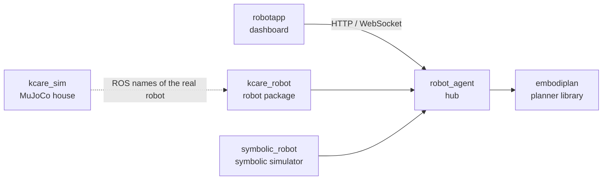

---
hide:
  - navigation
---

# robot_agent framework

**A robot-agnostic core that turns a typed request into checked robot actions, with the robot, the planner, the dashboard and the simulators plugged in around it.**

You give it a task in words, for example "Bring the apple from the desk to the dining table". It understands the request, asks a planner for a list of steps, checks the plan before the robot moves, runs the steps through the robot's own skills, and writes a record of the run that you can replay on a laptop. It is written for people who integrate a new robot, researchers who use or benchmark task planners, and the team that operates the dashboard.

An arrow points from a repo to the one it depends on. The full picture, with the optional links, is in [Repo map and versions](start/repo-map.md).

## One core, many robots

The core is built to be independent of any one robot, model, language or benchmark. Everything specific is declared as data, in a **pack**, and each entry can carry a source label. In 2026 the core was refactored ("level B") to move the household vocabulary out of the loop code and into such a pack. The recorded checks say the behaviour did not change. What is checked, and what is not claimed, is on one page: [One core, many robots](concepts/generality.md).

## Start here

1. [Key ideas](start/key-ideas.md): seven ideas that explain the design, each with a place in the code.
2. [Architecture](start/architecture.md): the layers, and one command followed from the dashboard to the robot and back.
   Then read [One core, many robots](concepts/generality.md): what is core, what is declared data, and how to check it.
3. [Run the whole system](start/run-the-system.md): what each set-up needs. Only the offline set-up was run.
4. [Repo map and versions](start/repo-map.md): the six repos, their version pins and the commits this site was checked against.
5. [Glossary](start/glossary.md): every internal term in plain words.

## Where to go

| If you want to ... | Read |
|---|---|
| Integrate a new robot | [Add a robot](guides/add-a-robot.md), then [A robot as data](concepts/robot-as-data.md) and [Contract: robot package and core](contracts/robot-package.md). Add behaviour with [Add a skill](guides/add-a-skill.md). |
| Benchmark a planner | [Benchmark a planner](guides/benchmark-a-planner.md) and [Add a planner](guides/add-a-planner.md), with [Planners and loops](concepts/planners.md) behind them. |
| Understand a failed run | [Debug a failed run](guides/debug-a-failed-run.md), [Skills, results, failure codes](concepts/skills-and-failures.md), [Checks before motion](concepts/checks-before-motion.md) and [Runs and records](concepts/runs-and-records.md). |
| Operate the dashboard | [Contract: dashboard and core](contracts/dashboard-api.md), the [dashboard repo page](repos/robotapp.md) and the dashboard's own [site](https://mtbui2010.github.io/robotapp/). |
| Know what is broken today | [Known pitfalls](reference/known-pitfalls.md). |

## Verified so far

What was run for these pages was offline, on the machine used to write them:

- The hub's planning loop on its **fake robot**, with a scripted language model and a scripted planner. A failed `Find` led to a search, a replan and a successful end. See [The closed loop](concepts/closed-loop.md) and [Run the whole system](start/run-the-system.md). The run was repeated on the current engine (`robot_agent` `3269923`, `embodiplan` `76da520`) and printed the same events.
- Failure, check and record behaviour on the same fake robot: [Skills, results, failure codes](concepts/skills-and-failures.md), [Checks before motion](concepts/checks-before-motion.md), [Runs and records](concepts/runs-and-records.md) (including an offline replay) and [Debug a failed run](guides/debug-a-failed-run.md).
- A small robot package and a manifest check, without ROS: [Add a robot](guides/add-a-robot.md) and [A robot as data](concepts/robot-as-data.md).
- The **symbolic simulator** (`symbolic_robot`): listing its domains and planners, and small smoke runs of the household benchmark with the two reference planners that need no language model. They show the output format only, not results. They were run at an older `symbolic_robot` commit and were not repeated. See [symbolic_robot](repos/symbolic-robot.md) and [Benchmark a planner](guides/benchmark-a-planner.md).

## Not yet

- **No real robot, no ROS, no MuJoCo and no real language model** were used. Pages that describe those parts are read from code and are marked "not run".
- **The pages were not written from a test run.** Where a test is mentioned, the page says what the test checks, from reading it. For the record, `pytest tests` on the merged code `3269923` gave 2827 passed and 4 skipped (run on 2026-11-20, with a fake robot and scripted planner; no real robot, no real language model).
- The pages describe the **committed code at the pinned commits**. The `robot_agent` pin `3269923` (`main` plus the merge of `live/no-ros`) was pushed to GitHub `main` on 2026-11-20, so its code links resolve. The other pins were on the remote-tracking branches known locally when the pages were checked.
- Known defects are written as current behaviour in [Known pitfalls](reference/known-pitfalls.md).

## The six repos

| Repo | Role | GitHub | Page here |
|---|---|---|---|
| `robot_agent` | The hub: robot contract, planning loops, run manager, records, API | [repo](https://github.com/mtbui2010/robot_agent) | This site |
| `embodiplan` | Planner library and the action model | [repo](https://github.com/mtbui2010/embodiplan) | [embodiplan](repos/embodiplan.md) |
| `kcare_robot` | Robot package for one real mobile manipulator | [repo](https://github.com/mtbui2010/kcare_robot) | [kcare_robot](repos/kcare-robot.md) |
| `robotapp` | Web dashboard | [repo](https://github.com/mtbui2010/robotapp) | [robotapp](repos/robotapp.md) |
| `kcare_sim` | Physics (MuJoCo) simulation of a house | [repo](https://github.com/mtbui2010/kcare_sim) | [kcare_sim](repos/kcare-sim.md) |
| `symbolic_robot` | Symbolic simulator and planner benchmark | [repo](https://github.com/mtbui2010/symbolic_robot) | [symbolic_robot](repos/symbolic-robot.md) |

More detail, including which repos have their own documentation site, is in [Other repos](repos/index.md).
