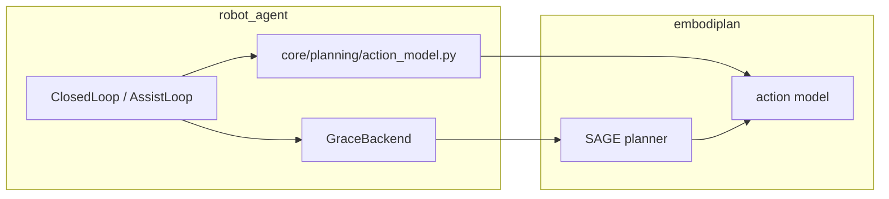

# Planner library (embodiplan)

embodiplan is a Python library of 11 LLM planners and the one set of action rules that the hub shares with them. This page tells you what is in the repository, how the hub uses it, and where its own documentation is. It does not teach the planners; their site does.

!!! abstract "In this page"
    - embodiplan gives the hub two things: the SAGE planner (behind the planner key `grace`) and the [action model](../start/glossary.md#action-model), the rules that the plan gate, the step guard and the post-step check all call.
    - The hub pins it as `embodiplan>=0.2.1,<0.3` and imports it in only three files.
    - The library has its own finished documentation site. Use it for the planners; use this page for how they plug in.

!!! code "Where in the code"
    - Library at the pinned commit: [`embodiplan/__init__.py`](https://github.com/mtbui2010/embodiplan/blob/a69064255c69/embodiplan/__init__.py) (the registry is at [lines 98-110](https://github.com/mtbui2010/embodiplan/blob/a69064255c69/embodiplan/__init__.py#L98-L110)), [`embodiplan/action_model.py`](https://github.com/mtbui2010/embodiplan/blob/a69064255c69/embodiplan/action_model.py), [`embodiplan/sage.py`](https://github.com/mtbui2010/embodiplan/blob/a69064255c69/embodiplan/sage.py)
    - Hub side: [`core/planning/action_model.py`](https://github.com/mtbui2010/robot_agent/blob/ad501cf15ece/robot_agent/core/planning/action_model.py), [`backends/pyplanner_grace.py`](https://github.com/mtbui2010/robot_agent/blob/ad501cf15ece/robot_agent/core/planning/backends/pyplanner_grace.py), [`registry.py:72-93`](https://github.com/mtbui2010/robot_agent/blob/ad501cf15ece/robot_agent/core/planning/registry.py#L72-L93)

## Role

You give a planner a task in words, a short description of the scene and the names of the visible objects. It calls an LLM and returns a list of steps such as `Find cup`, `Pick cup`. Every planner has the same two methods, `generate_plan` and `replan`, so they can be swapped without changing the caller. The package version at the pinned commit is `0.2.5`, with Python 3.10 or later and the licence MIT ([`pyproject.toml`](https://github.com/mtbui2010/embodiplan/blob/a69064255c69/pyproject.toml)).

The library plans. It does not run anything on a robot, check sensors or record runs. That is the hub's work; see [Planners and loops](../concepts/planners.md).

## How the hub uses it

| What the hub takes | How | Where |
|---|---|---|
| The SAGE planner | `GraceBackend` builds it with `embodiplan.get("GRACE", ...)`. `GRACE` is an old name that the library still accepts for SAGE. It is the planner key `grace`. The loop called [AssistLoop](../start/glossary.md#assistloop) (key `sage`) wraps it with understanding, the gate and the guard. | [`pyplanner_grace.py:192-220`](https://github.com/mtbui2010/robot_agent/blob/ad501cf15ece/robot_agent/core/planning/backends/pyplanner_grace.py#L192-L220), [`__init__.py:79-80`](https://github.com/mtbui2010/embodiplan/blob/a69064255c69/embodiplan/__init__.py#L79-L80) |
| The action model | The hub reaches the rules only through its own `core/planning/action_model.py`, which loads the library on first use. Gate, guard and post-step check all decide through it, so they cannot disagree with the planner. | [`action_model.py:18-53`](https://github.com/mtbui2010/robot_agent/blob/ad501cf15ece/robot_agent/core/planning/action_model.py#L18-L53) |
| The version pin | `embodiplan>=0.2.1,<0.3` in the hub's `pyproject.toml`. The hub's test compares `ACTION_MODEL_VERSION` on both sides. | [`pyproject.toml:24`](https://github.com/mtbui2010/robot_agent/blob/ad501cf15ece/pyproject.toml#L24) |

The details (the protocol, the three hub users of the action model, every import) are on [Planner library and core](../contracts/planner-library.md). A newcomer's view of planners and loops is on [Planners and loops](../concepts/planners.md). Note that `resolve_planner('sage')` raises `ValueError`: `sage` names a loop, and the planner behind it is `grace`.

## The 11 planners

All 11 are registered in `REGISTRY` ([`__init__.py:98-110`](https://github.com/mtbui2010/embodiplan/blob/a69064255c69/embodiplan/__init__.py#L98-L110)). The last column links to the library's own page for each one, on `https://mtbui2010.github.io/embodiplan/`.

| Registry key | File | Idea in one line | Library page |
|---|---|---|---|
| `Direct` | `direct.py` | One LLM call writes the whole plan. | [Single-call](https://mtbui2010.github.io/embodiplan/planners/single-call/) |
| `CoT` | `cot.py` | One call: reason first, then plan. | [Single-call](https://mtbui2010.github.io/embodiplan/planners/single-call/) |
| `Few-Shot CoT` | `few_shot.py` | Like CoT, with built-in worked examples. | [Single-call](https://mtbui2010.github.io/embodiplan/planners/single-call/) |
| `Self-Refine` | `self_refine.py` | Generate, critique, refine, in a loop. | [Critique loops](https://mtbui2010.github.io/embodiplan/planners/critique/) |
| `LLM Router` | `llm_router.py` | A local model plans; an outside LLM checks the plan. | [Critique loops](https://mtbui2010.github.io/embodiplan/planners/critique/) |
| `ReAct` | `react.py` | One action per LLM call, from thought to action. | [Step-by-step](https://mtbui2010.github.io/embodiplan/planners/stepwise/) |
| `SayCan` | `saycan.py` | One step per call; each candidate is scored and rule-checked. | [Step-by-step](https://mtbui2010.github.io/embodiplan/planners/stepwise/) |
| `Hierarchical` | `hierarchical.py` | Split into sub-goals, then expand each into actions. | [Decomposition](https://mtbui2010.github.io/embodiplan/planners/hierarchical/) |
| `Hierarchical Few-Shot` | `my_planner.py` | Hierarchical, with examples retrieved for the task. | [Decomposition](https://mtbui2010.github.io/embodiplan/planners/hierarchical/) |
| `LLM+P` | `llmp.py` | The LLM writes a PDDL problem; a classical solver plans. | [LLM+P](https://mtbui2010.github.io/embodiplan/planners/llm-p/) |
| `SAGE` | `sage.py` | Sub-goals, a symbolic gate on each block, local repair and memory. | [SAGE planning](https://mtbui2010.github.io/embodiplan/planners/sage/) and [repair](https://mtbui2010.github.io/embodiplan/planners/sage-repair/) |

The table was read from the registry and from the library site's page list; the one-line ideas follow the file headers and the library's overview page. No planner was run here, and nothing on this page ranks them by quality.

## Other modules in the library

| File | What it holds |
|---|---|
| [`base.py`](https://github.com/mtbui2010/embodiplan/blob/a69064255c69/embodiplan/base.py) | `BasePlanner`, the LLM backend, `PlanMetrics`, `parse_steps`, `ROBOT_ACTIONS`. |
| [`action_model.py`](https://github.com/mtbui2010/embodiplan/blob/a69064255c69/embodiplan/action_model.py) | `check`, `apply`, `simulate` and `ACTION_MODEL_VERSION` (the shared rules). |
| [`verifier.py`](https://github.com/mtbui2010/embodiplan/blob/a69064255c69/embodiplan/verifier.py) | The symbolic verifier for SAGE: a rule-based, LLM-free facade over the action model. |
| [`memory_retriever.py`](https://github.com/mtbui2010/embodiplan/blob/a69064255c69/embodiplan/memory_retriever.py), [`memory_tools.py`](https://github.com/mtbui2010/embodiplan/blob/a69064255c69/embodiplan/memory_tools.py) | SAGE's retrieval memory of example plans (`memory_retriever.py`) and the tools that clean its pools (`memory_tools.py`). |
| [`robot_prompt.py`](https://github.com/mtbui2010/embodiplan/blob/a69064255c69/embodiplan/robot_prompt.py), `few_shot_examples.py` | Prompt building and the built-in examples. |
| `data/eval_dataset_gt.json` | A bundled 38-task benchmark used as the default seed pool of SAGE's memory ([`__init__.py`](https://github.com/mtbui2010/embodiplan/blob/a69064255c69/embodiplan/__init__.py), comment above `GT_DATASET`). |

The repository also holds `apps/` (an AI2-THOR evaluation harness), `pddl/` (the fixed domain for LLM+P), `tests/` and `docs/` (short notes on memory, rules and usage). The hub uses none of these.

## What it needs to run

- Python 3.10 or later. The required packages are `ollama` and `requests`; optional extras are `chromadb` (memory backend), `pyperplan` (for LLM+P) ([`pyproject.toml`](https://github.com/mtbui2010/embodiplan/blob/a69064255c69/pyproject.toml)).
- An LLM for real planning. The library calls `ollama`, `openai` or `gemini` backends. A planner built without `host=` sends prompts to a remote default host, so pass your own `host=` ([`base.py:23`](https://github.com/mtbui2010/embodiplan/blob/a69064255c69/embodiplan/base.py#L23)). This was not run here: no LLM was called while writing these pages.
- The action model and the symbolic checks need no LLM and no robot.
- For the hub, install it before the hub (the package is local, not on PyPI): see [Planner library and core, section 3](../contracts/planner-library.md#3-the-version-pin).

## Its own documentation

The library has its own finished site: <https://mtbui2010.github.io/embodiplan/>. It has these parts (names from its `mkdocs.yml`):

| Part | What is there |
|---|---|
| Key ideas, Getting started | What the library is for and a first offline run. |
| Concepts | The planning problem, the plan format and metrics, symbolic state, LLM calls and cost, replanning, retrieval memory. |
| Planners | An overview and comparison table of all 11, then one page per family (the links above). |
| Reference | The planner interface and registry, the action model and verifier, prompt building. |
| [Known pitfalls](https://mtbui2010.github.io/embodiplan/pitfalls/) | Problems read in the code, with symptom, cause, how to avoid them and the page with the detail. It covers setup and backends, plan parsing, the symbolic gate, each planner family, LLM+P, and SAGE with memory. Read it before you benchmark. |

The hub's own pitfalls are on [Known pitfalls](../reference/known-pitfalls.md).
