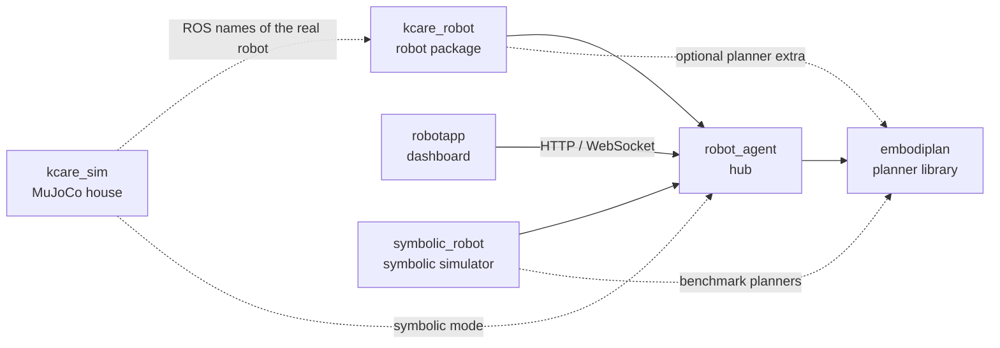

# Other repos

This page lists the six repos of the framework, what each is for and how they depend on each other. `robot_agent` is the hub and is the subject of this whole site. The other five have an overview page each, linked below, and some have their own documentation site.

!!! abstract "In this page"
    - Six repos, one hub. The robot package, the dashboard and the simulators connect to `robot_agent`; the planner library sits under it.
    - Three repos have their own live documentation site: `embodiplan`, `kcare_sim` and `robotapp`. This site links to them and does not copy them.
    - The pages here are overviews: role, how the repo plugs into the hub, its parts and what it needs. Detail stays in each repo.

## The six repos

| Repo | Role | Language | Depends on | Its own docs site | Page here |
|---|---|---|---|---|---|
| `robot_agent` | The hub: robot contract, planning loops, run manager, records, connect layer, HTTP and WebSocket API. | Python | embodiplan | This site | The whole site; start at [Architecture](../start/architecture.md) |
| `embodiplan` | Planner library: the SAGE planner, baselines and the action model. | Python | none of the other repos | [mtbui2010.github.io/embodiplan](https://mtbui2010.github.io/embodiplan/) | [embodiplan](embodiplan.md) |
| `kcare_robot` | Robot package for one real mobile manipulator: skills, manifest, site configuration. | Python | robot_agent, visionserve, embodiplan (optional extra) | None; `docs/` in the repo | [Robot package (kcare_robot)](kcare-robot.md) |
| `robotapp` | Web dashboard for any `robot_agent` backend. | TypeScript (Next.js) | the HTTP and WebSocket API of robot_agent | [mtbui2010.github.io/robotapp](https://mtbui2010.github.io/robotapp/) | [Dashboard (robotapp)](robotapp.md) |
| `kcare_sim` | Physics (MuJoCo) simulation of a house with the robot's ROS names; VLA drawer-policy data, training and tests. Its `symbolic/` folder is the older symbolic simulator. It also has an Isaac Lab mode that its README calls unverified. | Python | kcare_robot (ROS names), robot_agent (symbolic mode) | [mtbui2010.github.io/kcare_sim](https://mtbui2010.github.io/kcare_sim/) | [kcare_sim](kcare-sim.md) |
| `symbolic_robot` | The official symbolic simulator and planner benchmark (home and factory domains). | Python | robot_agent, embodiplan | None; `docs/` in the repo | [symbolic_robot](symbolic-robot.md) |

These roles and dependencies match [Repo map and versions](../start/repo-map.md), which also lists the version pins and the commit each page was checked against.

## How they depend on each other

An arrow points from a repo to the one it depends on. A dotted arrow is an optional or partial dependency.

- **The hub never imports a robot by name.** It loads a robot package by name at run time and reads its manifest. See [Robot package and core](../contracts/robot-package.md).
- **The dashboard is the only repo that is not Python.** It depends on the hub's API, not on its code. See [Dashboard and core](../contracts/dashboard-api.md).
- **A simulator takes the place of the robot.** See [Robot and simulators](../contracts/robot-and-simulators.md).
- **Planners come from the library through one door.** See [Planner library and core](../contracts/planner-library.md).

## Which repos have their own site

| Repo | Site | What is there |
|---|---|---|
| `embodiplan` | <https://mtbui2010.github.io/embodiplan/> | The planner library's concepts, planners and guides. |
| `kcare_sim` | <https://mtbui2010.github.io/kcare_sim/> | The MuJoCo house, the data and training steps, and the symbolic mode. |
| `robotapp` | <https://mtbui2010.github.io/robotapp/> | The dashboard's architecture, commands, one page per feature and a changelog. |

`kcare_robot` and `symbolic_robot` have no site. Their notes are in the repo `docs/` folders, which each overview page links to.

!!! note "Commits that are not pushed yet"
    Four repos (`robot_agent`, `kcare_robot`, `robotapp`, `kcare_sim`) have the checked commits only on the owner's machine so far, so code links to them resolve after the owner pushes. For `kcare_sim` that is 41 commits that are not on its remote branch; the checked commit is the newest of them.
