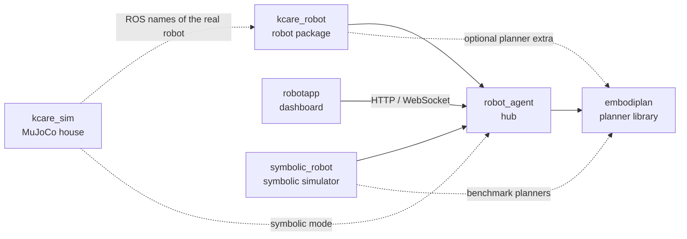

# Other repos

This page lists the six repos of the framework, what each is for and how they depend on each other. `robot_agent` is the hub and is the subject of this whole site. The other five have an overview page each, linked below, and some have their own documentation site.

!!! abstract "In this page"
    - Six repos, one hub. The robot package, the dashboard and the simulators connect to `robot_agent`; the planner library sits under it.
    - Three repos have their own live documentation site: `embodiplan`, `kcare_sim` and `robotapp`. This site links to them and does not copy them. `symbolic_robot` has the source of a site in `website/` too; that it is published is not verified.
    - The pages here are overviews: role, how the repo plugs into the hub, its parts and what it needs. Detail stays in each repo.

## The six repos

| Repo | Role | Language | Depends on | Its own docs site | Page here |
|---|---|---|---|---|---|
| `robot_agent` | The hub: robot contract, planning loops, run manager, records, connect layer, HTTP and WebSocket API. | Python | embodiplan | This site | The whole site; start at [Architecture](../start/architecture.md) |
| `embodiplan` | Planner library: the SAGE planner, baselines and the action model. | Python | none of the other repos | [mtbui2010.github.io/embodiplan](https://mtbui2010.github.io/embodiplan/) | [embodiplan](embodiplan.md) |
| `kcare_robot` | Robot package for one real mobile manipulator: skills, manifest, site configuration. | Python | robot_agent, visionserve, embodiplan (optional extra) | None; `docs/` in the repo | [Robot package (kcare_robot)](kcare-robot.md) |
| `robotapp` | Web dashboard for any `robot_agent` backend. | TypeScript (Next.js) | the HTTP and WebSocket API of robot_agent | [mtbui2010.github.io/robotapp](https://mtbui2010.github.io/robotapp/) | [Dashboard (robotapp)](robotapp.md) |
| `kcare_sim` | Physics (MuJoCo) simulation of a house with the robot's ROS names; VLA drawer-policy data, training and tests. Its `symbolic/` folder is the older symbolic simulator. It also has an Isaac Lab mode that its README calls unverified. | Python | kcare_robot (ROS names), robot_agent (symbolic mode) | [mtbui2010.github.io/kcare_sim](https://mtbui2010.github.io/kcare_sim/) | [kcare_sim](kcare-sim.md) |
| `symbolic_robot` | The official symbolic simulator and planner benchmark (home and factory domains). | Python | robot_agent, embodiplan | Source in `website/` (MkDocs, with a GitHub Pages workflow); publication not verified. Notes also in `docs/` | [symbolic_robot](symbolic-robot.md) |

These roles and dependencies match [Repo map and versions](../start/repo-map.md), which also lists the version pins and the commit each page was checked against.

## How they depend on each other

An arrow points from a repo to the one it depends on. A dotted arrow is an optional or partial dependency.

- **The hub never imports a robot by name.** It loads a robot package by name at run time and reads its manifest. See [Robot package and core](../contracts/robot-package.md).
- **The dashboard is the only repo that is not Python.** It depends on the hub's API, not on its code. See [Dashboard and core](../contracts/dashboard-api.md).
- **A simulator takes the place of the robot.** See [Robot and simulators](../contracts/robot-and-simulators.md).
- **Planners come from the library through one door.** See [Planner library and core](../contracts/planner-library.md).

## Which repos have their own site

| Repo | Site | What is there |
|---|---|---|
| `embodiplan` | <https://mtbui2010.github.io/embodiplan/> | The planner library's concepts, planners and guides. |
| `kcare_sim` | <https://mtbui2010.github.io/kcare_sim/> | The MuJoCo house, the data and training steps, and the symbolic mode. |
| `robotapp` | <https://mtbui2010.github.io/robotapp/> | The dashboard's architecture, commands, one page per feature and a changelog. |

`kcare_robot` has no site; its notes are in the repo `docs/` folder, which its overview page links to. `symbolic_robot` has the source of a site (`website/mkdocs.yml`, `site_url` `https://mtbui2010.github.io/symbolic_robot/`, and the workflow `.github/workflows/docs.yml`). Whether that site is live was not checked, so it is not listed in the table above.

!!! note "Commits that are not pushed yet"
    The `robot_agent` pin `3269923` is on a local branch (`main` plus the merge of `live/no-ros`) and is not on GitHub yet, so code links into `robot_agent` resolve after the owner pushes it. `kcare_robot` `f4a8384c59d2`, `robotapp` `4a810a3717ab` and `symbolic_robot` `587664465e76` are the newest commits of their local remote-tracking branches. `kcare_sim` `c6e32368f1cf` is 7 commits ahead of its remote-tracking branch, so its code links resolve after a push. The remote-tracking branches may be out of date: nothing was fetched.
