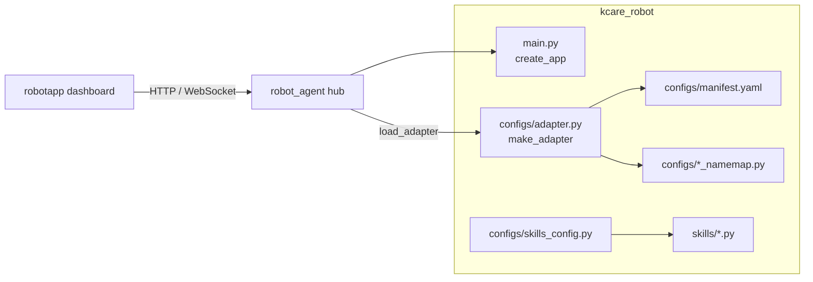

# Robot package (kcare_robot)

This page tells you what `kcare_robot` is, how it connects to the hub, which skills it holds (grouped into four families), and what you need to run it. It is an overview. The deep detail stays in the repo's own `docs/`.

!!! abstract "In this page"
    - `kcare_robot` is the **robot package** for one real mobile manipulator (base, lift, head, one arm and gripper). It holds the robot's skills and its configuration. It has no server code of its own: `main.py` calls the hub's `create_app`.
    - It plugs into the hub through a [manifest](../start/glossary.md#manifest) and an [adapter](../start/glossary.md#adapter). That agreement is described in [Robot package and core](../contracts/robot-package.md).
    - It **runs on a real robot**, so its rules say every change must stay backwards compatible. Nothing here was run: no robot and no ROS are available on the machine that wrote this site.

!!! code "Where in the code"
    - Entry point: [`kcare_robot/main.py`](https://github.com/mtbui2010/kcare_robot/blob/d4f5577b342e/kcare_robot/main.py)
    - Contract files: [`configs/manifest.yaml`](https://github.com/mtbui2010/kcare_robot/blob/d4f5577b342e/kcare_robot/configs/manifest.yaml), [`configs/adapter.py`](https://github.com/mtbui2010/kcare_robot/blob/d4f5577b342e/kcare_robot/configs/adapter.py), [the name-map file `configs/*_namemap.py`](https://github.com/mtbui2010/kcare_robot/blob/d4f5577b342e/kcare_robot/configs/grace_namemap.py) (its file name is the old one; the hub's loader reads it), [`configs/skills_config.py`](https://github.com/mtbui2010/kcare_robot/blob/d4f5577b342e/kcare_robot/configs/skills_config.py)
    - Skills: [`kcare_robot/skills/`](https://github.com/mtbui2010/kcare_robot/tree/d4f5577b342e/kcare_robot/skills)
    - Repo docs: [`docs/README.md`](https://github.com/mtbui2010/kcare_robot/blob/d4f5577b342e/docs/README.md) (index), [`docs/notes/architecture.md`](https://github.com/mtbui2010/kcare_robot/blob/d4f5577b342e/docs/notes/architecture.md), [`docs/SKILLS.md`](https://github.com/mtbui2010/kcare_robot/blob/d4f5577b342e/docs/SKILLS.md), [`docs/testing.md`](https://github.com/mtbui2010/kcare_robot/blob/d4f5577b342e/docs/testing.md). The repo has no docs site.

!!! note "Which version this page describes"
    The tables below describe the commit `d4f5577b342e` and nothing else. The newest commit of the repo's local remote-tracking branch is `f4a8384c59d2` (one commit later, checked in git, not run). It holds the changes that an earlier version of this page called uncommitted. Compared with `d4f5577b342e`: `vla_drawer_open` is no longer in `configs/skills_config.py` (**the tables below still list it, because it is registered at the pinned commit**); `vla_stack` (new file `skills/vla_stack.py`, a dry run by default, its header says it is not tested on the robot) and `rotatet` are registered; `skills/_vla_io.py` is new; the registry then has 60 entries (59 + 2 - 1) and `tests/` has 11 test files. The manifest still has 10 SkillSpecs. The working copy has further uncommitted files (for example `skills/handover.py`, `skills/pi05_act.py`); they are not described. The rest of the page was not re-checked at the later commit.

## Role

`kcare_robot` makes the hub drive one specific robot. The hub knows no robot by name (see [Robot as data](../concepts/robot-as-data.md)); this package gives it what it needs: the skills the robot can do, a manifest that describes them, an adapter that turns an abstract plan step into a skill call, and the numbers for this machine.

Its own rules ([`CLAUDE.md`](https://github.com/mtbui2010/kcare_robot/blob/d4f5577b342e/CLAUDE.md)) include:

- Use only the hub's public API.
- Give every skill the planner uses a [SkillSpec](../start/glossary.md#skillspec) in the manifest and keep both in sync.
- Keep `configs/` for configuration only. Runtime data goes elsewhere.
- Write each skill as `def skill(node, **params) -> dict`, return a result with `isdone`, and register it in `configs/skills_config.py`.
- **The package runs on the real robot, so keep changes backwards compatible.**

## How it plugs into the hub

| Piece | What it does | Where |
|---|---|---|
| App entry | `create_app(robot_pkg='kcare_robot', config_dir=...)` makes the hub's web app for this package. | `main.py` |
| Adapter | `make_adapter()` returns the robot's adapter object. It builds on the hub's name-map adapter, adds the robot's own `reconcile` (it also senses the gripper), `pose`, `health` and a vision-model hook. The hub finds it with `load_adapter('kcare_robot')`. | `configs/adapter.py` |
| Name map | Maps abstract actions (`MoveTo`, `Find`, `Pick`, ...) to skills, converts names, and applies each skill's effect to the [belief](../start/glossary.md#belief). Read about the idea in [Skills and failures](../concepts/skills-and-failures.md). | `configs/*_namemap.py` |
| Manifest | The robot as data: capabilities, geometry, defaults, the path of the seed plans, and one SkillSpec per planner skill. The committed manifest has 10 SkillSpecs: `move`, `find`, `pick`, `place`, `open_drawer`, `close_drawer`, `grasp_succeed`, `mobile_pose`, `ask`, `llm`. | `configs/manifest.yaml` |
| Skill registry | A dictionary from skill name to `(module, function)`. The committed file has 59 entries. `skills/__init__.py` wraps every entry with the hub's `skill_entry`. | `configs/skills_config.py` |
| Seed plans | Example plans that the SAGE planner retrieves before the robot has its own memory. A test checks that they pass the action model. | `planner/seed_memory.jsonl` |

Only 10 of the 59 skills have a SkillSpec. The other skills (arm moves, lift, head, devices and so on) are called by those skills, by the dashboard or by plans a person writes. The planner does not see them.

## Skills by family

The committed registry has 59 entries. They live in the Python files under `skills/` (30 files at the commit, counting `__init__.py` and the `_` helper modules). The tables group them in four families. Each line is checked against the function's code or docstring. The grouping is this page's, not the repo's.

### 1. Perception

| Skill | File | What it does |
|---|---|---|
| `detect` | `recognition.py` | Object detection with the open-vocabulary detector (`grounding-dino`). |
| `find` | `recognition.py` | Looks for an object with the head camera and returns its 3D pose in the base frame. |
| `find_grasp` | `recognition.py` | Looks with the wrist camera and, by default, estimates a grasp pose. |
| `find_place` | `recognition.py` | Finds where on the destination an object can be put down (used by `place`). |
| `grasp_succeed` | `recognition.py` | Checks that something is near the gripper after a grasp. |
| `get_side_pose_3d` | `recognition.py` | Finds a free pose to the side of a scene from the head camera. |
| `get3d`, `get3d_arm` | `pointcloud.py` | Turn image points into 3D points (head and arm camera). |
| `llm` | `vlm.py` | Sends the input text to the connected language model client. |
| `rest_detect` | `rest_detect.py` | A detector skill generated from the repo's `skill-detect` template. |

Helper modules: `_recognition_helpers.py` (the largest, over 1000 lines) and `_products.py` (tells look-alike products apart in two steps: detect the generic class, then identify the brand).

### 2. Manipulation

| Skill | File | What it does |
|---|---|---|
| `pick` | `pick.py` | Approach, grasp with `fine_move`, retract, with spoken progress lines. |
| `approach_pick` | `pick.py` | The approach part of a pick. |
| `fine_move` | `pick.py` | Detects a grasp pose with the wrist camera and executes it. |
| `pick_vla` | `pick.py` | A pick that uses a [VLA](../start/glossary.md#vla) policy for the approach and `fine_move` for the grasp. |
| `open_drawer`, `close_drawer` | `pick.py` | Approach a drawer, grab the handle and pull it open; push a known drawer shut. |
| `place`, `approach_place` | `place.py` | Pick if needed, then approach the destination and release. |
| `wipe` | `place.py` | `place` with the wrist tilted for wiping. |
| `pnp` | `pnp.py` | Pick and place at one location as one motion. |
| `stack` | `stack.py` | Stacks objects of one kind (cups) into a tower; it has a `dry_run` option that moves nothing. |
| `align_shoes` | `align_shoes.py` | Pushes a pair of shoes side by side, picks both and puts them down. |
| `vla_pick_approach` | `vla.py` | The "reach to view" phase of a pick, driven by a VLA policy. |
| `vla_drawer_open` | `vla.py` | Opens a drawer with a policy served by a VLA server. Registered at the commit; removed in the uncommitted working copy. |
| `grip` | `grip.py` | Opens, closes or sets the gripper position, clipped to its range. |
| `real2sim_capture` | `real2sim_capture.py` | Sweeps the wrist camera around an object and captures RGB-D and camera poses for real-to-sim 3D reconstruction. |

Helper modules: `_pick_helpers.py`, `_place_helpers.py`. `skills/demo_robotworld.py` is a demo that calls `place` and is not in the registry.

### 3. Body motion

| Skill | File | What it does |
|---|---|---|
| `move` | `mobile.py` | Drives to an ENV location key (a named place in the site's location table). |
| `moveb`, `forward`, `turn`, `rotate` | `mobile.py` | Base moves to a goal, a distance or an angle. |
| `mobile_pose` | `mobile.py` | Reads the base pose. |
| `arm_joints`, `arm_pose` | `arm.py` | Read the joint angles (degrees) and the tool pose. |
| `movej`, `movel`, `movet`, `movelf` | `arm.py` | Arm moves: by joints; a linear tool move relative to the current pose; a tool move with a position and rotation offset; and `movelf`, which splits one request into a linear and a rotation move. |
| `init_arm` | `goto_ready.py` | Enables the arm and sends it to the ready pose of the current mode. |
| `lift`, `dlift`, `lift_state` | `lift.py` | Set, change and read the lift height. |
| `moveh`, `head_state` | `head.py` | Move and read the head angles. |

### 4. Talking, safety and devices

| Skill | File | What it does |
|---|---|---|
| `reply`, `ask`, `qa`, `announce`, `wait` | `hri.py` | Speech skills: say something, ask and listen, answer a question, announce, wait. The robot's own speaker and microphone are the default; the dashboard's are the other choice. |
| `inform` | `inform.py` | Tells whether the room light looks on, from a camera frame. |
| `select_response` | `select.py` | Confirms a spoken choice and places that object on a table. |
| `check_fall`, `check_restroom`, `call_119` | `emergency.py` | Emergency checks. The file says they are **simulated**: there is no real detector and nothing is dialled. |
| `turn_light`, `light_state` | `switchbot.py` | Push a Bluetooth light-switch button and read its state. |
| `warmup_servers` | `warmup.py` | Loads the models on the AI servers before a scenario so the first answer is not slow. It moves nothing. |
| `new_skill` | `new_skill.py` | A generated stub that the `make skill-generic` scaffold started from. |

`template_skills/` holds three example skills for other ways of writing a skill (`grip_external`, `grip_node_agent`, `grip_pure_ros2`). `skills/template.py` is a template for a standalone node.

## Configuration

`configs/` holds configuration only. The layout is described in `main.py`:

| Path | Content |
|---|---|
| `configs/common/` | Files shared by all sites: `skills.json`, `buttons.json`, `button_groups.json`. |
| `configs/locations/<site>/` | One folder per site: `connections.json` (device connections), `skill_configs_override.json` (the dashboard's Edit-then-Save writes here), a gitignored `.env`, and a map. The active site is read from `configs/common/active_location` and defaults to `default`. This page does not list the site folders. |
| `configs/tasks.py` | Per-group numbers (lift, head, grip, speech, emergency, teleop, poses and more). A site override replaces a whole group; this module is the fallback. |
| `configs/products/` | Product data for the look-alike product step. |

### Two robot-data settings added on 2026-11-20 (not on GitHub yet)

!!! warning "Commits not on GitHub yet"
    The two settings below are in two local commits of `kcare_robot` (`9136094` and `b584f44`). Those commits are **not on GitHub yet**, so this page links nothing in them, and the tables above (pinned at `d4f5577b342e`) do not show them. They are read from the commit messages and diffs, not run on the robot here.

The real kcare robot now declares two numbers in its own repo, as data. The core did not change for either.

- **Arrival tolerance 0.5 m.** `geometry.arrive_tol_m` in `configs/manifest.yaml` went from 0.3 m to 0.5 m. The robot's base navigation stops about 0.35 m from a target by design, so 0.3 m reported good arrivals as "stopped 0.35 m from ...". The arrival check in the hub reads this value from the manifest. Places closer than 0.5 m to each other are not checked, and it is not measured over many runs.
- **A Find that sees nothing is tried 2 times, not 3.** The file `configs/grace_namemap.py` (its name is the old one; the hub still reads it) has a `RECOVERY_OVERRIDES` entry for the failure code `absent`: continue the search from the belief, 2 looks, then ask the person where the object is. The core default is 3 looks ([Skills and failures](../concepts/skills-and-failures.md)); the other fields of the rule are the core's own. The owner decided this on the real robot on 2026-11-20: the third look found nothing the first two had not. It is not measured over many runs, and the kcare_robot app must be restarted for it to apply (the module is imported once).

## Teleoperation

Teleoperation with a SpaceMouse is **not part of this package**. It lives in a separate repo (`robot_teleop`), which holds the robot's profile. What `kcare_robot` provides is the `TELEOP` group in `configs/tasks.py` (one function, `arm`); the hub lists it at `GET /teleop` and the dashboard shows a strip for it. While teleoperation is on, no skill may move the arm. Details: [`docs/teleop.md`](https://github.com/mtbui2010/kcare_robot/blob/d4f5577b342e/docs/teleop.md). Not run.

## Where runtime data goes

`configs/` must stay configuration only. The hub writes run records, memories, the persisted world belief and logs, and the package does not write any of them. By default the hub puts them under `configs/common/` (named per host) and logs under `data/logs/`; all of these paths are gitignored. A few older run records and one world-state file are still tracked in the repo; they are not read on this site. The repo's note [`docs/notes/runtime_data.md`](https://github.com/mtbui2010/kcare_robot/blob/d4f5577b342e/docs/notes/runtime_data.md) lists who writes what. For the record format see [Runs and records](../concepts/runs-and-records.md).

## What it needs to run

| Need | Why |
|---|---|
| The real robot | Skills read ROS topics and drive the base, lift, head, arm and gripper. |
| ROS 2 | `make run` and `make cli` source the ROS environment first. |
| `robot_agent` and `visionserve` | The two dependencies in `pyproject.toml`, with `numpy==1.26.4`. |
| `embodiplan` (extra `planner`) | The SAGE planner. `make install` installs a sibling checkout and checks the version range. |
| AI servers | Vision, speech and language models, reached through the site's connections. |

Commands from the Makefile (none were run here): `make install`, `make run` (starts the web app), `make cli ARGS="find::apple"` (one skill from the command line), `make doctor` and `make smoke-live` (on the robot), `make test` (offline). `make test` needs no ROS and no network: ten test files in `tests/` check the configuration, the manifest, the name map, the adapter and a few skills. This site ran none of them; `pytest` is not installed on the machine that wrote it.

## See also

- [Robot package and core](../contracts/robot-package.md), the full agreement.
- [Add a robot](../guides/add-a-robot.md) and [Add a skill](../guides/add-a-skill.md).
- [Robot and simulators](../contracts/robot-and-simulators.md) for how the simulators reuse the robot's names.
- [Other repos](index.md).
