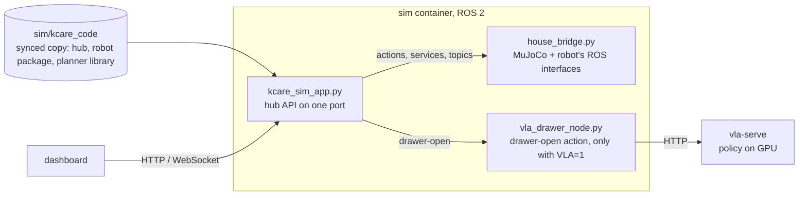

# Physics simulation (kcare_sim)

kcare_sim is a MuJoCo simulation of a home with a physics model of the robot in it. It serves the robot's own ROS 2 interfaces, so the robot package runs unchanged and drives a simulated robot. The repository also holds the data, training and evaluation code for a drawer-opening vision-language-action policy. This page is an overview: the role, how the repository plugs into the hub, its modules in one table, and what you need to run it. Nothing in it was run here: the container is where ROS runs, and no container, ROS or MuJoCo was started.

!!! abstract "In this page"
    - kcare_sim is the **physics** simulator. The official **symbolic** simulator and benchmark is [symbolic_robot](symbolic-robot.md); the older `symbolic/` folder in kcare_sim is superseded by it.
    - It does not contain the hub or the robot package. It runs them from a synced, gitignored copy, `sim/kcare_code`, which is not tied to `main`.
    - It has its own live site with guides and a reference: <https://mtbui2010.github.io/kcare_sim/>.
    - The MuJoCo house starts with three commands: `make build-mujoco`, `make run-sim`, `make run SIM=mujoco`. Options on the last one: `PORT=<n>` (the API port) and `VLA=1` (also start the VLA drawer node; off by default). Stop it with `make terminate SIM=mujoco`. Not run here.
    - It has an Isaac Lab mode that its own README calls unverified (`make build-issac`, `make run SIM=issac`). Not run here.
    - To run it you need Docker, a ROS 2 Humble base image from the robot's maker, MuJoCo and, for training, a GPU. None of this was run here.

!!! code "Where in the code"
    - Overview: [`README.md`](https://github.com/mtbui2010/kcare_sim/blob/c6e32368f1cf/README.md), [`sim/README.md`](https://github.com/mtbui2010/kcare_sim/blob/c6e32368f1cf/sim/README.md)
    - The bridge: [`sim/scripts/house_bridge.py`](https://github.com/mtbui2010/kcare_sim/blob/c6e32368f1cf/sim/scripts/house_bridge.py); the launcher: [`sim/scripts/run_house.sh`](https://github.com/mtbui2010/kcare_sim/blob/c6e32368f1cf/sim/scripts/run_house.sh); the sync: [`sim/scripts/sync_kcare_code.sh`](https://github.com/mtbui2010/kcare_sim/blob/c6e32368f1cf/sim/scripts/sync_kcare_code.sh)

## Role

The repository has 547 files at the pinned commit. In plain words:

1. **A simulated home.** A MuJoCo house built from a floor plan and photos: 10 rooms and 16 scanned household objects ([`README.md:8`](https://github.com/mtbui2010/kcare_sim/blob/c6e32368f1cf/README.md#L8)).
2. **The robot's own ROS 2 interfaces.** Navigation, arm, lift, head and gripper actions and the cameras are served under the same names as on the real robot, so the unmodified robot package drives the simulated robot ([`README.md:9-10`](https://github.com/mtbui2010/kcare_sim/blob/c6e32368f1cf/README.md#L9-L10); the topic and action list is the header of [`house_bridge.py`](https://github.com/mtbui2010/kcare_sim/blob/c6e32368f1cf/sim/scripts/house_bridge.py)).
3. **Camera models.** The renders are changed to look like the real cameras' images: lens, exposure, white balance, noise, JPEG, motion blur and depth artefacts ([`README.md:11-12`](https://github.com/mtbui2010/kcare_sim/blob/c6e32368f1cf/README.md#L11-L12), [`camera_model.py`](https://github.com/mtbui2010/kcare_sim/blob/c6e32368f1cf/sim/scripts/camera_model.py)).
4. **A policy pipeline.** A scripted expert makes demonstrations, which become LeRobot datasets. A SmolVLA policy is fine-tuned on them and tested closed-loop on fixed scenes. The trained policy is served by a separate service, `vla-serve`, and called from the robot package's `vla_drawer_open` skill (the README's wording; in `kcare_robot` that skill is no longer registered at its newest commit, see [kcare_robot](kcare-robot.md)) ([`README.md:13-15`](https://github.com/mtbui2010/kcare_sim/blob/c6e32368f1cf/README.md#L13-L15)). See [VLA](../start/glossary.md#vla).

### Results, as the README states them

The README gives this table ([`README.md:17-21`](https://github.com/mtbui2010/kcare_sim/blob/c6e32368f1cf/README.md#L17-L21)). The numbers are quoted from it as they are; they were **not re-measured here**.

| Policy | Scenes | Drawers opened |
|---|---|---|
| trained in the office, 20k steps | office | 44/50 |
| same | house | 4/50 |
| + 2.5k steps on office + house data | house | 26/50 |

The site's training guide defines success as a drawer opened at least 20 cm within 15 s, judged by the simulator's ground truth ([`website/docs/guides/train-and-evaluate.md`](https://github.com/mtbui2010/kcare_sim/blob/c6e32368f1cf/website/docs/guides/train-and-evaluate.md)). All results are in simulation. They say nothing about a real robot.

## How it plugs into the hub

kcare_sim is a simulator in the sense of [Robot and simulators contract](../contracts/robot-and-simulators.md): it takes the place of the robot's ROS side, and the hub and the robot package do not know the difference. The planner library is used the same way as on the robot ([Planner library](embodiplan.md)).

- **The robot package.** [`make_kcare_sim_location.py`](https://github.com/mtbui2010/kcare_sim/blob/c6e32368f1cf/sim/scripts/make_kcare_sim_location.py) writes a site profile for the house. It keeps the real site's ROS connections unchanged and replaces the table of places (`ENV`) with the house's places from `sim/config/house_layout.yaml`.
- **The hub.** [`kcare_sim_app.py`](https://github.com/mtbui2010/kcare_sim/blob/c6e32368f1cf/sim/scripts/kcare_sim_app.py) serves the hub's HTTP API on one port, so the dashboard can connect as to a real robot. Its header says it runs the robot's code read-only and patches two hub issues at import time. [`run_house.sh`](https://github.com/mtbui2010/kcare_sim/blob/c6e32368f1cf/sim/scripts/run_house.sh) starts the bridge and this API in the container, and the drawer node only when `VLA=1` is set.
- **Interface names.** [`robot_interfaces.py`](https://github.com/mtbui2010/kcare_sim/blob/c6e32368f1cf/sim/scripts/robot_interfaces.py) is the one file that names the interfaces shared with the real robot. They must change only together with the robot and the robot package. The robot maker's message package is copied unmodified into `sim/ros/` (its `PROVENANCE.md` has the source and licence status).

### The synced copy `sim/kcare_code`

kcare_sim does not hold the hub, the robot package or the planner library. The README says they are not part of the repository ([`README.md:33-37`](https://github.com/mtbui2010/kcare_sim/blob/c6e32368f1cf/README.md#L33-L37)). The simulation reaches them this way:

1. [`sync_kcare_code.sh`](https://github.com/mtbui2010/kcare_sim/blob/c6e32368f1cf/sim/scripts/sync_kcare_code.sh) runs on the host. For each of `robot_agent`, `kcare_robot` and `embodiplan` it copies the checkout found under `SRC` into `sim/kcare_code/<repo>/` with `rsync -a --delete`, leaving out `.git` and bytecode. It copies the files that are in that folder now, not a named commit or branch.
2. `sim/kcare_code/` is gitignored ([`.gitignore:52-53`](https://github.com/mtbui2010/kcare_sim/blob/c6e32368f1cf/.gitignore#L52-L53)). It is a working copy, so it is not versioned with kcare_sim and it can differ from every pinned commit on this site.
3. [`run_house.sh:29-40`](https://github.com/mtbui2010/kcare_sim/blob/c6e32368f1cf/sim/scripts/run_house.sh#L29-L40) puts the three copies first on `PYTHONPATH` (`KCARE_CODE` defaults to `/sim/kcare_code`) and starts the API. After a sync, restart it with `run_house.sh restart-kcare`.

**How the copy relates to `main`.** Nothing keeps them equal. In the workspace where an earlier version of this page was checked, the copied hub differed from `robot_agent` at `main` in many files; one difference mattered: the copy could start without ROS 2 when `ROBOT_AGENT_ROS=off`. That switch is now in the hub at `3269923` ([`runtime.py:141-150`](https://github.com/mtbui2010/robot_agent/blob/3269923/robot_agent/runtime.py#L141-L150); default `on`, so a real robot is unchanged). A copy synced from that revision or a later one has it; a copy synced from the older pin `ad501cf15ece` has not, and then only the container (with ROS 2) can run it and the symbolic mode below cannot. The copy was not compared with `3269923` here.

## Running the house: three commands

Not run here. The README gives three commands from the repository root ([`README.md:46-56`](https://github.com/mtbui2010/kcare_sim/blob/c6e32368f1cf/README.md#L46-L56), [`docs/mujoco_flow.md`](https://github.com/mtbui2010/kcare_sim/blob/c6e32368f1cf/docs/mujoco_flow.md)):

| Command | What it does, from the committed files |
|---|---|
| `make build-mujoco` | Builds the image `kcare-sim:humble` on the maker's base image, makes the data folder, creates the container `kcare_sim` and, inside it, runs `setup_sim.sh` (ROS messages, house scene, kcare site). Each step skips what is already done and names what is missing ([`mk/mujoco.mk:38-79`](https://github.com/mtbui2010/kcare_sim/blob/c6e32368f1cf/mk/mujoco.mk#L38-L79)). |
| `make run-sim` | Opens a shell in the container at `/sim` with ROS 2 sourced; it needs a terminal ([`mk/mujoco.mk:81-85`](https://github.com/mtbui2010/kcare_sim/blob/c6e32368f1cf/mk/mujoco.mk#L81-L85)). |
| `make run SIM=mujoco` | Starts the house in the container: a check, then `run_house.sh start` (the bridge and the robot package's API on port 8001; `PORT=<n>` changes the port, and the VLA drawer node starts only with `VLA=1`). It prints the port of the API and whether the VLA node is on or off ([`mk/mujoco.mk:87-98`](https://github.com/mtbui2010/kcare_sim/blob/c6e32368f1cf/mk/mujoco.mk#L87-L98)). |

Stop it with `make terminate SIM=mujoco`; `make status` and `make logs` take the same `SIM`. The network inside the container is used only when you ask (`INSTALL_KCARE_VENV=1`, `FETCH_ASSETS=1`). The container is where ROS runs; the host needs docker, not ROS. `make build-container` is the old name: it now only prints that it was renamed and fails ([`Makefile:80-82`](https://github.com/mtbui2010/kcare_sim/blob/c6e32368f1cf/Makefile#L80-L82)). The step-by-step version is in [Run the system](../start/run-the-system.md#c-the-physics-simulation-kcare_sim).

**The VLA drawer node is off by default.** `make run SIM=mujoco` starts only the bridge and the `kcare_robot` API. `make run SIM=mujoco VLA=1` also starts `vla_drawer_node.py`; it needs `vla-serve` on port 11450 with a policy loaded, and `make status SIM=mujoco` lists the node only when it is running or `VLA=1` is set ([`run_house.sh`](https://github.com/mtbui2010/kcare_sim/blob/c6e32368f1cf/sim/scripts/run_house.sh), [`docs/mujoco_flow.md`](https://github.com/mtbui2010/kcare_sim/blob/c6e32368f1cf/docs/mujoco_flow.md)). Use the same `PORT` for `make terminate`, `status` and `run`. The node imports `max_interfaces.action.OpenDrawer`; the simulator rebuilds that package in `sim/ros/max_interfaces`, so a missing package no longer blocks the build. Whether it matches the real robot's package is unverified. Not run here.

**Python environments on the host.** `make install SIM=symbolic|mujoco|issac` makes one conda environment per mode ([`README.md:70-89`](https://github.com/mtbui2010/kcare_sim/blob/c6e32368f1cf/README.md#L70-L89)). The mode is spelled `issac` here, which is the owner's choice; NVIDIA's package is `isaaclab`. `SIM=isaaclab` is refused with a message that names `issac` ([`Makefile:72-75`](https://github.com/mtbui2010/kcare_sim/blob/c6e32368f1cf/Makefile#L72-L75)). This is not the container flow above: it installs nothing for ROS.

### Isaac Lab mode (not run, unverified by its authors)

The repository has a second container mode, for Isaac Lab, in its own venv `/sim/.issac_venv` inside the same container.

- `make build-issac ISSAC_SPEC='isaaclab[isaacsim,all]==<version>'` prepares the venv. The pip spec is never guessed, so the command refuses to start without it.
- `make run SIM=issac` loads the robot's URDF on a ground plane, without a window, and writes `sim/out/issac/view.json`.
- The README says: "Nothing of this has been run against a real Isaac Lab yet" ([`README.md:58-68`](https://github.com/mtbui2010/kcare_sim/blob/c6e32368f1cf/README.md#L58-L68)). The flow was tested only with stubs. It shares the GPU with the house, so run one at a time. Details and the list of checks: [`docs/issac_flow.md`](https://github.com/mtbui2010/kcare_sim/blob/c6e32368f1cf/docs/issac_flow.md).

## The older `symbolic/` folder

`symbolic/` (35 files, 19 of them under `tests/`) is a symbolic mode: the same planning stack on a small symbolic world, with no MuJoCo, ROS or Docker. It is started with `make run` ([`Makefile:96-115`](https://github.com/mtbui2010/kcare_sim/blob/c6e32368f1cf/Makefile#L96-L115)). For a [symbolic simulator](../start/glossary.md#symbolic-simulator) and for benchmarks, use [symbolic_robot](symbolic-robot.md) instead. This is the project's decision. It is consistent with symbolic_robot's own files: its `CLAUDE.md` calls it "the ONE repository for the household simulator" and its `README.md` says the repository is for benchmark runs, with live launchers kept elsewhere. Its `docs/architecture.md` (line 43) lists what it took from the sibling symbolic simulator and what it did not keep. kcare_sim's `symbolic/` is not deleted, so it still works, but it is not where new work goes. Like symbolic_robot, it needs a hub with the `ROBOT_AGENT_ROS=off` switch (`3269923` or later, see above) and takes hub and robot-package folders from `ROBOT_AGENT_DIR` and `KCARE_ROBOT_DIR` ([`symbolic/serve.py:26-27`](https://github.com/mtbui2010/kcare_sim/blob/c6e32368f1cf/symbolic/serve.py#L26-L27)).

## Modules

Counts are from `git ls-tree` at the pinned commit. Left out: `sim/.kcare_venv`, `sim/kcare_code*` and `.venv`, which are gitignored or local.

| Path | Files | What it holds |
|---|---|---|
| [`sim/scripts/house_scene.py`](https://github.com/mtbui2010/kcare_sim/blob/c6e32368f1cf/sim/scripts/house_scene.py) | 1 (1121 lines) | Builds the house MJCF and `config/house_layout.yaml` (rooms, furniture, spots, objects) from the floor plan. |
| [`sim/scripts/house_bridge.py`](https://github.com/mtbui2010/kcare_sim/blob/c6e32368f1cf/sim/scripts/house_bridge.py) | 1 (1330 lines) | MuJoCo plus the robot's ROS 2 topics, actions and services; a kinematic base with path planning on a grid; a `/sim/command` service for resetting and editing scenes. |
| [`sim/scripts/robot_interfaces.py`](https://github.com/mtbui2010/kcare_sim/blob/c6e32368f1cf/sim/scripts/robot_interfaces.py) | 1 | The interface names shared with the real robot. |
| [`sim/scripts/camera_model.py`](https://github.com/mtbui2010/kcare_sim/blob/c6e32368f1cf/sim/scripts/camera_model.py) | 1 (344 lines) | Makes a render look like the real camera image. |
| [`sim/scripts/expert_open_drawer.py`](https://github.com/mtbui2010/kcare_sim/blob/c6e32368f1cf/sim/scripts/expert_open_drawer.py), `expert_close_drawer.py`, `expert_pick_approach.py`, `expert_place.py` | 4 | Scripted experts that make the demonstrations. |
| [`sim/scripts/randomize.py`](https://github.com/mtbui2010/kcare_sim/blob/c6e32368f1cf/sim/scripts/randomize.py), `drawer_ready.py` | 2 | Samples one episode's scene; builds the drawer scene and the ready pose. |
| [`sim/scripts/gen_dataset.py`](https://github.com/mtbui2010/kcare_sim/blob/c6e32368f1cf/sim/scripts/gen_dataset.py) | 1 (236 lines) | Generates a LeRobot "open drawer" dataset from the expert. |
| [`sim/scripts/eval_policy.py`](https://github.com/mtbui2010/kcare_sim/blob/c6e32368f1cf/sim/scripts/eval_policy.py), `watch_eval.py`, `eval_clips.py`, `analyze_eval.py` | 4 | Closed-loop evaluation of a trained policy on fixed seeds; clips and analysis. |
| [`sim/scripts/vla_drawer_node.py`](https://github.com/mtbui2010/kcare_sim/blob/c6e32368f1cf/sim/scripts/vla_drawer_node.py), `vla_pick_node.py` | 2 | ROS actions that run the served policy at 30 Hz for the robot package's VLA skills. |
| [`sim/scripts/kcare_sim_app.py`](https://github.com/mtbui2010/kcare_sim/blob/c6e32368f1cf/sim/scripts/kcare_sim_app.py), `make_kcare_sim_location.py`, `run_house.sh`, `sync_kcare_code.sh` | 4 | The hub API for the house, the site profile, the launcher and the sync. |
| [`sim/scripts/task_runner.py`](https://github.com/mtbui2010/kcare_sim/blob/c6e32368f1cf/sim/scripts/task_runner.py), `skill_bench.py`, `sim_skills/` | 4 | Run tasks and skills through the hub in the simulator and grade each step against the simulator's ground truth; one site skill (`stack_on`). |
| [`sim/scripts/setup_sim.sh`](https://github.com/mtbui2010/kcare_sim/blob/c6e32368f1cf/sim/scripts/setup_sim.sh), [`setup_issac.sh`](https://github.com/mtbui2010/kcare_sim/blob/c6e32368f1cf/sim/scripts/setup_issac.sh), [`issac_view.py`](https://github.com/mtbui2010/kcare_sim/blob/c6e32368f1cf/sim/scripts/issac_view.py) | 3 | Run inside the container: `setup_sim.sh` makes or checks what the house needs (ROS messages, house scene, kcare venv, site); `setup_issac.sh` and `issac_view.py` are the Isaac Lab mode (unverified, see below). |
| `sim/scripts/` (other) | about 75 | Scene and asset builders, calibration, benchmarks, video tools, debug scripts. |
| [`sim/config/`](https://github.com/mtbui2010/kcare_sim/tree/c6e32368f1cf/sim/config) | 88 | Task, randomisation, camera and layout files; `scenes/` holds 58 saved scenes. |
| [`sim/mjcf/`](https://github.com/mtbui2010/kcare_sim/tree/c6e32368f1cf/sim/mjcf), `sim/urdf/`, `sim/assets/` | 2 + 2 + 111 | The robot model (vendored from its maker's workspace) and its meshes and textures. The scanned objects are fetched by `fetch_ycb.sh`. |
| [`sim/ros/`](https://github.com/mtbui2010/kcare_sim/tree/c6e32368f1cf/sim/ros) | 21 | The robot's ROS interface package, copied unmodified; `sim_msgs` (the `SimCommand` service); and `max_interfaces`, the `OpenDrawer` action the VLA nodes import, rebuilt from the fields the skills use and **unverified against the real package** (`PROVENANCE.md`). Built with `make msgs`. |
| [`sim/third_party/`](https://github.com/mtbui2010/kcare_sim/tree/c6e32368f1cf/sim/third_party) | 20 | A vendored copy of the `vla-serve` client. |
| [`sim/docker/`](https://github.com/mtbui2010/kcare_sim/tree/c6e32368f1cf/sim/docker), `sim/docker-compose*.yml`, `sim/Makefile` | 4 | The image, the container and its make targets. |
| [`symbolic/`](https://github.com/mtbui2010/kcare_sim/tree/c6e32368f1cf/symbolic) | 35 | The older symbolic mode, with 19 test files (see above). |
| [`install/install_env.sh`](https://github.com/mtbui2010/kcare_sim/blob/c6e32368f1cf/install/install_env.sh), `Makefile` | 2 | `make install SIM=symbolic\|mujoco\|issac` makes one Python environment per mode; `make run`, `status`, `test`. |
| [`mk/mujoco.mk`](https://github.com/mtbui2010/kcare_sim/blob/c6e32368f1cf/mk/mujoco.mk), `mk/issac.mk` | 2 | The make targets of the two container modes, included by the root `Makefile` (`build-mujoco`, `run-sim`, `build-issac`, and `run`, `terminate`, `status`, `logs` per `SIM`). |
| [`website/`](https://github.com/mtbui2010/kcare_sim/tree/c6e32368f1cf/website) and `docs/` | 99 + 50 | The MkDocs site, video tools, and a few notes (`docs/external_contract.md`, `data_location.md`, `legacy_names.md`, `mujoco_flow.md`, `issac_flow.md`, a floor-plan drawing). |

## What it needs to run

Not run here: this machine has no ROS 2, MuJoCo, Docker image or GPU for it.

| Need | For what | Source |
|---|---|---|
| Docker and a ROS 2 Humble base image built in the robot maker's repository | The container with the bridge and the robot software. `make build-mujoco` stops with a message if the base image is missing. | [`mk/mujoco.mk:47-51`](https://github.com/mtbui2010/kcare_sim/blob/c6e32368f1cf/mk/mujoco.mk#L47-L51), [`sim/Makefile`](https://github.com/mtbui2010/kcare_sim/blob/c6e32368f1cf/sim/Makefile) |
| MuJoCo with EGL (headless rendering) | The house and the cameras. `make install SIM=mujoco` makes the Python environment on the host; native libraries are only reported. | [`README.md:70-89`](https://github.com/mtbui2010/kcare_sim/blob/c6e32368f1cf/README.md#L70-L89) |
| ROS 2 Humble | The bridge; `rclpy` is not a pip package, so the house runs in the container. | [`README.md:85-87`](https://github.com/mtbui2010/kcare_sim/blob/c6e32368f1cf/README.md#L85-L87) |
| An NVIDIA GPU | The container requests one ([`docker-compose.yml`](https://github.com/mtbui2010/kcare_sim/blob/c6e32368f1cf/sim/docker-compose.yml)); SmolVLA fine-tuning and policy serving use it. The training guide measures steps on one workstation GPU. | [`train-and-evaluate.md`](https://github.com/mtbui2010/kcare_sim/blob/c6e32368f1cf/website/docs/guides/train-and-evaluate.md) |
| The hub, the robot package and the planner library, synced into `sim/kcare_code` | The robot software behind the bridge. | see the section above |
| An LLM server and a speech server | For tasks given in words; their addresses are written into the site's connections. | [`README.md:116-121`](https://github.com/mtbui2010/kcare_sim/blob/c6e32368f1cf/README.md#L116-L121) |

The licence of the code is Apache-2.0 and the object scans are CC BY 4.0 ([`README.md:137`](https://github.com/mtbui2010/kcare_sim/blob/c6e32368f1cf/README.md#L137)).

## Its own documentation

kcare_sim has a live site: <https://mtbui2010.github.io/kcare_sim/>. This page does not copy it. The file names in `website/docs/` show what is there:

| Part | What is there |
|---|---|
| Getting started | From an empty shell to the robot moving in the simulated house. |
| Guides (5 pages) | Run the house with the robot software, generate open-drawer data, train and evaluate a policy, run the policy through the robot package, edit the house. |
| How it works | A code map, one request end to end, and how correctness was checked. |
| Learn (7 chapters) | The ideas: running real robot software in a simulator, a scene from photos, camera and depth models, the scripted expert, VLA policies and evaluation. |
| Reference | The ROS 2 and hub API, the command line, the configuration files. |
