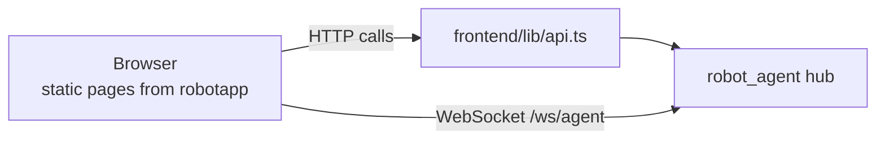

# Dashboard (robotapp)

This page gives you a short tour of `robotapp`: what the dashboard is for, which panels it has, how it talks to the hub, which `make` targets it has and what it needs. It is an overview. The dashboard has its own, much larger documentation site, and this page links to it instead of copying it.

!!! abstract "In this page"
    - `robotapp` is a web dashboard (Next.js, TypeScript) for **any** `robot_agent` backend. It is not needed to operate the robot.
    - It talks to the hub only through one file, `frontend/lib/api.ts`, over HTTP and one WebSocket. The agreement is described in [Dashboard and core](../contracts/dashboard-api.md).
    - To build and check it you need Node, not a robot. To use it you need a running hub.

!!! code "Where in the code"
    - Page: [`frontend/app/page.tsx`](https://github.com/mtbui2010/robotapp/blob/4a810a3717ab/frontend/app/page.tsx). Panels: [`frontend/components/`](https://github.com/mtbui2010/robotapp/tree/4a810a3717ab/frontend/components). The one HTTP client: [`frontend/lib/api.ts`](https://github.com/mtbui2010/robotapp/blob/4a810a3717ab/frontend/lib/api.ts).
    - Build and checks: [`Makefile`](https://github.com/mtbui2010/robotapp/blob/4a810a3717ab/Makefile), [`scripts/`](https://github.com/mtbui2010/robotapp/tree/4a810a3717ab/scripts)
    - Repo rules: [`CLAUDE.md`](https://github.com/mtbui2010/robotapp/blob/4a810a3717ab/CLAUDE.md)

!!! note "Which version this page describes"
    This page describes the commit `4a810a3717ab`, which is the newest commit of its local remote-tracking branch `origin/main`. It contains the changes that an earlier version of this page listed as uncommitted. The working copy has a few newer uncommitted changes (`docs/`, `frontend/lib/skill_configs.json`); they are not described. A branch `docs/website-site` replaces the Astro site by a MkDocs site in `website/`; it is not on `main`, so the site text below is about `main`.

## Role

The dashboard is the "UI mode" of the robot stack. A person uses it to connect to a robot, see its cameras and map, edit its configuration, send a command and watch the plan run. It holds no robot data of its own: its repo rule says to get robot data from the backend and to call only endpoints that are in the hub's OpenAPI file.

## The panels

All of these files are in `frontend/components/` and are used by `frontend/app/page.tsx`. The descriptions come from the code and the comments at the top of each file. Nothing was started or clicked: the dashboard was not run for this page.

| Panel | What it is for |
|---|---|
| `DevicePanel` | Pick the robot (a registry of backends kept in the browser) and the site, edit the connections (cameras, ROS, AI servers, devices), test a connection, and warm up the AI servers. |
| `AgentPanel` | The capture row and the Run / Stop buttons. It also holds the structured step editor with saved presets, and repeat modes (once, N times, forever). Free-text commands go through the chat card. |
| `ChatPanel` | A two-way chat: a message starts a new run when the robot is idle, and answers a question when the robot is waiting for one. |
| `PlanPanel` | The plan as it runs: steps with their logs and images, newest first, and the robot's world state (the [belief](../start/glossary.md#belief)) with where each value came from. |
| `SkillPanel` | The robot's skills. Edit each skill's configuration as a form or as raw JSON. Skills defined as plans are listed too. |
| `EnvPanel` | The global configuration groups that no skill owns. For the robot package on this site that is the location table (`ENV`). |
| `PlannerPromptPanel` | A read-only view of the prompt the Direct planner would use for a command. SAGE builds its own prompts, and the panel says so. |
| `ButtonPanel` | Shortcut buttons, kept in groups on the server, that run a skill without speech. |
| `MapPanel` | The site map with the robot on it: click a free spot to send the robot there, click a place to go to it, rotate with the arrow keys. |
| `DataPanel` | Look at the recorded episodes, clean them with a non-destructive edit list, and prepare an export for training. The raw files are not changed. |
| `GuidePanel` | A short step-by-step guide: start a robot agent, register it, connect a language model and ROS, add a camera, send a command. |

Two bars sit next to the cameras: `TeleopBar` (one row per teleoperation function the hub lists, with On and Off) and `RecorderBar` (record raw teleoperation episodes, with a prompt made from the fields you fill in). Each draws nothing when the robot has no such function.

## How it talks to the hub

- The base URL of each backend is chosen by the user in the Device panel and stored in the browser's local storage. The code carries no fixed backend address.
- A run is started and followed on the WebSocket, not over HTTP. Read the details, and three gaps in the dashboard's description of the hub, in [Dashboard and core](../contracts/dashboard-api.md).
- The dashboard keeps a snapshot of the hub's OpenAPI file, made by `make gen-types`. Its lint step checks that every URL in `api.ts` is in that snapshot.

## Make targets

From the [`Makefile`](https://github.com/mtbui2010/robotapp/blob/4a810a3717ab/Makefile). None was run here.

| Target | What it does |
|---|---|
| `make install` | Installs the frontend packages with `npm`. |
| `make run-frontend` | Starts the development server. |
| `make build-frontend` | Builds the static pages. |
| `make lint` | Repo rules in `scripts/lint.mjs` (endpoints are in the OpenAPI snapshot, HTTP only in `lib/api.ts`, no new bundled robot data), plus ESLint when it is installed. |
| `make typecheck` | `tsc --noEmit`. |
| `make unit` | Tests of the pure `lib` modules (`scripts/test_lib.mjs`). Includes the plan view replayed on recorded event files from `scripts/fixtures/events/`. |
| `make smoke` | A static build must produce `out/index.html`. Needs no robot. |
| `make ci` | `lint`, `typecheck`, `unit` and `smoke`. The repo asks for it before every commit. |
| `make gen-types` | Refreshes the OpenAPI snapshot from a `robot_agent` checkout (`ROBOT_AGENT_DIR`). |
| `make terminate`, `make deploy`, `make deploy-status` | Stop the dev server; publish the static pages to the repo owner's hosting. You do not need these. |

## What it needs

| Need | For |
|---|---|
| Node and `npm` | Everything above. Next.js 14, React 18 and TypeScript are declared in `frontend/package.json`. |
| A running `robot_agent` backend | Using the dashboard. Without one it builds and passes `make ci` but shows nothing live. |
| A `robot_agent` checkout | Only for `make gen-types`. |

The repo's rule 7 warns that two clients driving one robot is unsafe: Cancel stops both. Rule 8 says to ask before motion on real robots.

## The dashboard's own site

`robotapp` has its own live documentation site: <https://mtbui2010.github.io/robotapp/>. It is built from the repo's `docs/` folder (Astro). It has the dashboard's architecture, the commands, one page per feature (chat, map tab, data tab, recorder, teleoperation strip, shortcut buttons, skill aliases, AI servers and more), the backend-coupling notes and a changelog. Go there for how a feature works. This site covers only how the dashboard fits into the framework.

See also: [Other repos](index.md), [Robot package (kcare_robot)](kcare-robot.md).
