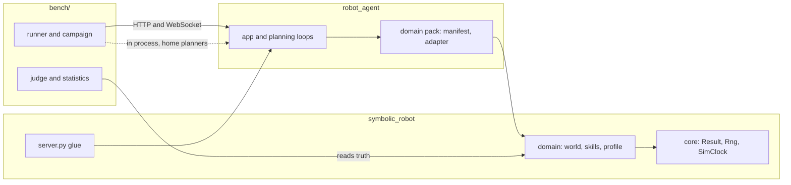

# Symbolic simulator and benchmark (symbolic_robot)

`symbolic_robot` is the official [symbolic simulator](../start/glossary.md#symbolic-simulator) of this framework and the benchmark for task planners. A skill in it does not move anything. It checks its preconditions on a small symbolic world, draws its outcome from declared probabilities, and returns the result. This page tells you what is in the repository, how it plugs into the hub, and what it needs to run. It does not teach the modules one by one.

!!! abstract "In this page"
    - The repository has four layers: a core with no robot facts, the domains (`home` and `factory`), a server that presents a domain to the hub, and a separate benchmark package `bench/`.
    - It plugs into the hub as a robot package whose skills are simulated. The server is the **benchmark backend**, not a live demo launcher.
    - Every random draw depends only on the seed and the call, so the same seed gives the same run.
    - It does not run live demos and it does not drive a real robot.

!!! code "Where in the code"
    - Rules and layers: [`CLAUDE.md`](https://github.com/mtbui2010/symbolic_robot/blob/587664465e76/CLAUDE.md), [`docs/architecture.md`](https://github.com/mtbui2010/symbolic_robot/blob/587664465e76/docs/architecture.md), [`tests/test_layering.py`](https://github.com/mtbui2010/symbolic_robot/blob/587664465e76/tests/test_layering.py)
    - Hub side of the seam: [`server.py:120-153`](https://github.com/mtbui2010/symbolic_robot/blob/587664465e76/symbolic_robot/server.py#L120-L153) (`build`), [`Makefile:30-33`](https://github.com/mtbui2010/symbolic_robot/blob/587664465e76/Makefile#L30-L33)
    - Benchmark: [`bench/`](https://github.com/mtbui2010/symbolic_robot/tree/587664465e76/bench); the guide is [Benchmark a planner](../guides/benchmark-a-planner.md)

## Role

A planner needs something to plan against. A real robot is slow and costly, and a physics simulation such as [kcare_sim](https://mtbui2010.github.io/kcare_sim/) is heavy. `symbolic_robot` is the light option. Its world is a list of places, objects and people. A skill call such as `move` or `pick` is checked against that world and returns a result: success, or a failure with a [failure code](../start/glossary.md#failurecode). The result also carries a record called `truth`, which says what really happened. The robot never sees `truth`; a judge reads it.

```python
@dataclass
class Result:
    ok: bool
    msg: str = ""
    code: str | None = None                 # a robot_agent FailureCode value when ok is False
    data: dict = field(default_factory=dict)
```

([`result.py:7-12`](https://github.com/mtbui2010/symbolic_robot/blob/587664465e76/symbolic_robot/result.py#L7-L12); the class goes on with `duration_s` and `truth`.)

The repository has two jobs and states them in its first lines: one engine for symbolic robots, and the benchmarks that run on it ([`CLAUDE.md`](https://github.com/mtbui2010/symbolic_robot/blob/587664465e76/CLAUDE.md)). Two [domains](../start/glossary.md#domain) ship with it:

| Domain | What it simulates | Worlds | Profiles |
|---|---|---|---|
| `home` | A household: houses, rooms, furniture, a simulated person, a safety monitor. The simulator code is frozen: a change needs a new freeze tag. | 8 houses, default `senior_flat` | `ideal`, `real`, `stress` |
| `factory` | A factory floor: zones, benches, bins, a lockable cabinet, a forklift lane, one arm and gripper. | 2 floors, `assembly_hall` (default) and `small_workshop` | `ideal`, `real`, `stress` |

This table is the output of `python -m symbolic_robot list` (run offline here, with the repository copied outside the workspace). A *profile* is a YAML file of fault and duration values; `real` holds the values, `ideal` is derived from it with every failure probability at 0, and `stress` is derived by a scale factor ([`docs/architecture.md`](https://github.com/mtbui2010/symbolic_robot/blob/587664465e76/docs/architecture.md), section "The core").

## How it plugs into the hub

The hub drives a robot through a [robot package](../contracts/robot-package.md): a [manifest](../start/glossary.md#manifest), an [adapter](../start/glossary.md#adapter) and a set of skill functions. Each domain contains such a package in its `configs/` folder (called a *pack*). Its skills call the simulator instead of a robot. So the hub's planners, gate and checks run on it without change. The details of the pack are in [Robot package and core](../contracts/robot-package.md#a-second-implementation-the-symbolic_robot-packs) and the stand-in is placed among the others in [Robot, hardware and simulators](../contracts/robot-and-simulators.md).



What the server does, from [`build` in `server.py`](https://github.com/mtbui2010/symbolic_robot/blob/587664465e76/symbolic_robot/server.py#L120-L153):

1. It looks up the domain and wraps its episode in a `LiveBackend`, so the world can be replaced between runs and every call is logged with its `truth`.
2. It builds the hub's app for the domain's pack: `create_app(dom.pack, config_dir=cfg_dir)`.
3. It replaces the ROS node by a stub node that holds three agents, `mobile_pose`, `sim_world` and `sim_command`. The stub is what the hub's API needs from a node when there is no ROS.
4. It registers the simulated skills, and adds `reset_world`, `spawn_object` and two headless dialogue skills (`ask` and `say`). In a benchmark the scripted person answers the robot's questions through the hub's listen endpoint.
5. It writes the planner's [environment description](../start/glossary.md#env) for the current world.

Two settings link it to the hub's code:

| Setting | What it does | Where |
|---|---|---|
| `ROBOT_AGENT_DIR` | Optional. A directory holding the hub. The Makefile puts it on `PYTHONPATH` in front of the repository. Put it in `env.local.mk`, which is not committed. | [`Makefile:30-32`](https://github.com/mtbui2010/symbolic_robot/blob/587664465e76/Makefile#L30-L32) |
| `ROBOT_AGENT_ROS=off` | The Makefile exports it, and `planner_env` sets it as a default. It is meant to tell the hub not to start ROS. | [`Makefile:33`](https://github.com/mtbui2010/symbolic_robot/blob/587664465e76/Makefile#L33), [`server.py:74`](https://github.com/mtbui2010/symbolic_robot/blob/587664465e76/symbolic_robot/server.py#L74) |

!!! note "The ROS-off switch is in the hub since `3269923`"
    The hub reads `ROBOT_AGENT_ROS` at start-up. If it is `off` (also `0`, `false`, `no`) the hub imports no `rclpy` and starts no node; the default is `on` ([`runtime.py:141-150`](https://github.com/mtbui2010/robot_agent/blob/3269923/robot_agent/runtime.py#L141-L150)). The earlier pin `ad501cf15ece` had no such switch, and the README of this repo still says the server needs "robot_agent with its `ROBOT_AGENT_ROS=off` switch". So the server can start without ROS 2 against a hub at `3269923` or later. This is read from the code; no server was started here. The offline parts of the benchmark (see below) do not need the hub.

The benchmark side has its own link to the hub. The household planners named `robot_agent:*` import the hub inside functions and drive its loops in process. This is the one allowed exception to the rule "`bench/` talks to servers over HTTP only" ([`CLAUDE.md`](https://github.com/mtbui2010/symbolic_robot/blob/587664465e76/CLAUDE.md), rule 3). The [guide](../guides/benchmark-a-planner.md) explains it.

## Layers and the rules that keep them apart

| Layer | Folder | What it holds | May import |
|---|---|---|---|
| Core | `symbolic_robot/*.py` | `Result`, the seeded random draws, the clock, profiles, the domain protocol, the registry. No fact about a robot, a domain, a language or a benchmark. | nothing above it |
| Domains | `symbolic_robot/domains/<name>/` | A world, skills, profiles, data in YAML with a `source` label for each number, and the pack for the hub. | the core |
| Server glue | `server.py`, `server_skills.py`, `cli.py` | Presents a domain to the hub. The only core modules that import the hub. | the hub, inside functions |
| Benchmark | `bench/` | The runner, the judge, the statistics, the suites. | everything below it |

The one-way rule is checked by a test: the core and the domains never import `bench`; the hub is imported only in the glue and in the domain packs; domains do not import each other ([`tests/test_layering.py`](https://github.com/mtbui2010/symbolic_robot/blob/587664465e76/tests/test_layering.py), listed in [`docs/architecture.md`](https://github.com/mtbui2010/symbolic_robot/blob/587664465e76/docs/architecture.md)). The judge lives only in `bench/`, so the system under test cannot import it.

## Deterministic by seed

The repository's rule 6 says a draw depends on the seed and on the call, with no wall clock and no Python `hash()`. Two classes in [`rng.py`](https://github.com/mtbui2010/symbolic_robot/blob/587664465e76/symbolic_robot/rng.py) do it, both based on SHA-256:

- `Rng` ([line 15](https://github.com/mtbui2010/symbolic_robot/blob/587664465e76/symbolic_robot/rng.py#L15)): a draw depends on the seed, a key and the n-th time that key was asked.
- `CallDraws` ([line 44](https://github.com/mtbui2010/symbolic_robot/blob/587664465e76/symbolic_robot/rng.py#L44)): one vector of 16 uniform numbers per skill call, from the seed, the skill, its arguments and the n-th call with them. Each rule in a skill reads its own slot.

Simulated time moves only by the durations that skills report; nothing waits in real time ([`clock.py`](https://github.com/mtbui2010/symbolic_robot/blob/587664465e76/symbolic_robot/clock.py)). Two planners that make the same call in the same episode therefore get the same outcome, which lowers the noise of a paired comparison.

This script ran offline on a copy of the repository (`PYTHONPATH` set to the copy; no hub, no network). It makes three factory episodes in the `stress` profile and calls `move` three times in each:

```python
from symbolic_robot.domains.factory.episode import make_episode

for seed in (3, 3, 4):
    ep = make_episode("assembly_hall", "stress", seed)
    row = []
    for place in ("charging dock", "pallet stand", "inbound rack"):
        r = ep.robot.call("move", target=place)
        row.append(f"{'ok' if r.ok else r.code}")
    print(seed, row, "simulated seconds:", round(ep.t, 2))
```

```text
3 ['ok', 'ok', 'ok'] simulated seconds: 16.13
3 ['ok', 'ok', 'ok'] simulated seconds: 16.13
4 ['ok', 'hw_fault', 'ok'] simulated seconds: 11.0
```

Seed 3 gives the same result twice, with the same simulated time. Seed 4 gives a hardware fault on the second move. The fault is the simulator's draw, not a bug of the robot.

## Modules

Links point to the code at the pinned commit. The per-module pages come later; until then the repository's own docs are the detail.

| Module | What it does |
|---|---|
| [`result.py`](https://github.com/mtbui2010/symbolic_robot/blob/587664465e76/symbolic_robot/result.py) | `Result`: what a skill returns, with the hidden `truth`. |
| [`rng.py`](https://github.com/mtbui2010/symbolic_robot/blob/587664465e76/symbolic_robot/rng.py) | The seeded draws `Rng` and `CallDraws`, and `derive_seed`. |
| [`clock.py`](https://github.com/mtbui2010/symbolic_robot/blob/587664465e76/symbolic_robot/clock.py) | `SimClock`: simulated time that moves only by reported durations. |
| [`profile.py`](https://github.com/mtbui2010/symbolic_robot/blob/587664465e76/symbolic_robot/profile.py) | Reads a profile YAML; every parameter has `kind`, `value`, `source`, `note`; derives `ideal` and `stress`. |
| [`domain.py`](https://github.com/mtbui2010/symbolic_robot/blob/587664465e76/symbolic_robot/domain.py) | `BaseDomain`: the protocol a domain implements; a hook it does not override does nothing. |
| [`registry.py`](https://github.com/mtbui2010/symbolic_robot/blob/587664465e76/symbolic_robot/registry.py) | The built-in domains (loaded on demand), plug-ins from the entry-point group `symbolic_robot.domains`, and `register()`. |
| [`backend.py`](https://github.com/mtbui2010/symbolic_robot/blob/587664465e76/symbolic_robot/backend.py) | `LiveBackend`: wraps an episode, logs every call with its `truth`, lets the world be replaced. |
| [`simcommand.py`](https://github.com/mtbui2010/symbolic_robot/blob/587664465e76/symbolic_robot/simcommand.py) | The generic `sim_command` handler: `state`, `truth`, `reset`, `load`, `move_object`, `spawn`. |
| [`server.py`](https://github.com/mtbui2010/symbolic_robot/blob/587664465e76/symbolic_robot/server.py), [`server_skills.py`](https://github.com/mtbui2010/symbolic_robot/blob/587664465e76/symbolic_robot/server_skills.py) | The glue to the hub: stub node, `reset_world`, `spawn_object`, headless `ask` and `say`. |
| [`cli.py`](https://github.com/mtbui2010/symbolic_robot/blob/587664465e76/symbolic_robot/cli.py) | `python -m symbolic_robot list` and `run`. |
| [`domains/factory/`](https://github.com/mtbui2010/symbolic_robot/tree/587664465e76/symbolic_robot/domains/factory) | The factory domain: `world.py`, `robot.py` (skills), `floors/*.yaml`, `profiles/real.yaml`, scripted people (`person.py`, `user.py`, `messy.py`), task generators, and `configs/` (its pack). |
| [`domains/home/`](https://github.com/mtbui2010/symbolic_robot/tree/587664465e76/symbolic_robot/domains/home) | The household domain: `world.py`, `skills.py`, `outcomes.py` (how a failure is drawn), `user.py` and `dialog.py` (the simulated person), `safety.py`, `hazards.py`, `goals.py`, `oracle.py`, `houses/*.yaml`, `profiles/`, and `configs/` (its pack). Frozen apart from `domain.py`. |
| [`bench/runner.py`](https://github.com/mtbui2010/symbolic_robot/blob/587664465e76/bench/runner.py), [`campaign.py`](https://github.com/mtbui2010/symbolic_robot/blob/587664465e76/bench/campaign.py) | Run episodes against a running server, judged from `truth`; run all episodes of a suite and append them to a file. |
| [`bench/stats.py`](https://github.com/mtbui2010/symbolic_robot/blob/587664465e76/bench/stats.py), [`protocol.py`](https://github.com/mtbui2010/symbolic_robot/blob/587664465e76/bench/protocol.py) | Paired statistics; the hash of the pre-registered protocol file. |
| [`bench/suite.py`](https://github.com/mtbui2010/symbolic_robot/blob/587664465e76/bench/suite.py), [`suites/`](https://github.com/mtbui2010/symbolic_robot/tree/587664465e76/bench/suites) | What a suite is, and the suites: `factory/` (three, driven over HTTP) and `home/` (the household benchmark with its own runner, planners, metrics and data). |
| [`bench/cli.py`](https://github.com/mtbui2010/symbolic_robot/blob/587664465e76/bench/cli.py), [`orchestrate.py`](https://github.com/mtbui2010/symbolic_robot/blob/587664465e76/bench/orchestrate.py) | `python -m bench`; starts a server on a free test port and stops only the one it started. |
| [`tests/`](https://github.com/mtbui2010/symbolic_robot/tree/587664465e76/tests) | Core, factory, layering, server and parity tests, and `tests/home/` for the household parts. |

The repository also has the source of its own documentation site in [`website/`](https://github.com/mtbui2010/symbolic_robot/tree/587664465e76/website) (MkDocs; a workflow publishes it to GitHub Pages). That it is live was not checked. Further reading in the repository: [`docs/domains.md`](https://github.com/mtbui2010/symbolic_robot/blob/587664465e76/docs/domains.md) (how to add a domain), [`docs/bench.md`](https://github.com/mtbui2010/symbolic_robot/blob/587664465e76/docs/bench.md) and [`docs/home/`](https://github.com/mtbui2010/symbolic_robot/tree/587664465e76/docs/home) (the household simulator and benchmark; some of these files still use the names of the standalone packages that were merged in).

## What it needs to run

| To do this | You need |
|---|---|
| List domains, make episodes, call skills (as in the script above) | Python 3.10 or later and `pyyaml`. Nothing else ([`pyproject.toml`](https://github.com/mtbui2010/symbolic_robot/blob/587664465e76/pyproject.toml)). |
| Run the household benchmark with the planners `oracle` and `naive` | The same, plus the extra `bench` (`websockets`): the front end `python -m bench` imports it even for the household suites. Run offline here. |
| Run the household benchmark with an LLM planner, or any `robot_agent:*` planner | The hub and embodiplan importable, and an LLM. Not run here. |
| Start the server (`make run`) and the factory suites | The extra `server` (`fastapi`, `uvicorn`), the extra `bench`, a hub that has the ROS-off switch (`3269923` or later, see the note above), and for the factory suites an LLM server. Not run here. |
| Run the tests (`make test`) | `pytest`. Not installed on the machine used for these pages, so no test was run. The server tests skip themselves when the hub is not importable ([`tests/test_server.py:10`](https://github.com/mtbui2010/symbolic_robot/blob/587664465e76/tests/test_server.py#L10)). |

No ROS, no sensors and no robot are involved in any of it.

## What it does not do

- **No live demos.** The README opens with the scope: benchmark runs only. The server has no map picture, no voice dialogue and no display pacing; live use belongs to other repositories ([`README.md`](https://github.com/mtbui2010/symbolic_robot/blob/587664465e76/README.md)).
- **No real robot and no physics.** Outcomes are drawn from declared probabilities. For physics use [kcare_sim](https://mtbui2010.github.io/kcare_sim/); for the real robot use [kcare_robot](kcare-robot.md). A result from this simulator is a simulated result and must never be presented as a robot result.
- **No result data in the repository to rely on.** New benchmark runs are not committed. Recorded household runs came with a merge and are read-only data.

## Household planner layers: `SYMBOLIC_D1_LAYERS`

The household benchmark's D1 planners (`sage_s8n_d1`, `sage_s8n_ft_d1`) switch `robot_agent` options on through `loop_options`. The environment variable `SYMBOLIC_D1_LAYERS` picks which layers they turn on: `all` (the default), `d3`, `d2`, or a list ([`d1_options.py`](https://github.com/mtbui2010/symbolic_robot/blob/587664465e76/bench/suites/home/planners/d1_options.py)). The old name `HOMELOOP_D1_LAYERS` is still read when the new one is unset or empty; if both are set and differ, the new one wins and one line goes to stderr ([`docs/CHANGELOG.md`](https://github.com/mtbui2010/symbolic_robot/blob/587664465e76/docs/CHANGELOG.md)). Records of finished rounds keep the old name.

The file says every option it sets is off by default in `robot_agent`. That was true at the older pin. At `3269923` the options `look_then_ask`, `bring_ask` and `bt_goal` are on by default in `robot_agent` ([`docs/options.md`](https://github.com/mtbui2010/robot_agent/blob/3269923/docs/options.md)). A search of `bench/` and `symbolic_robot/` finds no `look_then_ask` or `bring_ask`, so a planner run against a new hub may use those two without being asked (`bt_goal` is named in the layer file, so it is set there). What that does to benchmark numbers was not measured. Not run here.

## Licence

The root [`LICENSE`](https://github.com/mtbui2010/symbolic_robot/blob/587664465e76/LICENSE) is MIT. It covers the engine, the factory domain and the generic benchmark front end (`symbolic_robot/*.py`, `symbolic_robot/domains/factory/`, `bench/*.py`, `bench/suites/factory/`). The household simulator and benchmark (`symbolic_robot/domains/home/`, `bench/suites/home/`) are Apache-2.0 under their own `LICENSE` files. The household task data is Apache-2.0 apart from the Korean text written by the EXAONE 3.5 model, which is research use only: read `bench/suites/home/LICENSE-DATA` and `NOTICE` before using or redistributing it ([`README.md`](https://github.com/mtbui2010/symbolic_robot/blob/587664465e76/README.md), section "Licences"). An earlier version of this repo said there was no licence file for the first group.

## Parity with the engines it replaced

The repository states that its refactors must show identical behaviour. For the factory it replays the call sequences of an earlier campaign and compares every call; the file `docs/architecture.md` reports 774 episodes, 15,690 calls and 0 mismatches ([`docs/architecture.md`](https://github.com/mtbui2010/symbolic_robot/blob/587664465e76/docs/architecture.md), section "Parity checks", at the pinned commit). This was not re-run here: the recorded results it needs are not in the repository.

## Next

- [Benchmark a planner](../guides/benchmark-a-planner.md): suites, the runner, the judge, results and the paired test.
- [Robot, hardware and simulators](../contracts/robot-and-simulators.md): where this stand-in plugs into the hub, next to a real robot and a physics simulation.
- [Planners and loops](../concepts/planners.md): the planners that the benchmark compares.
