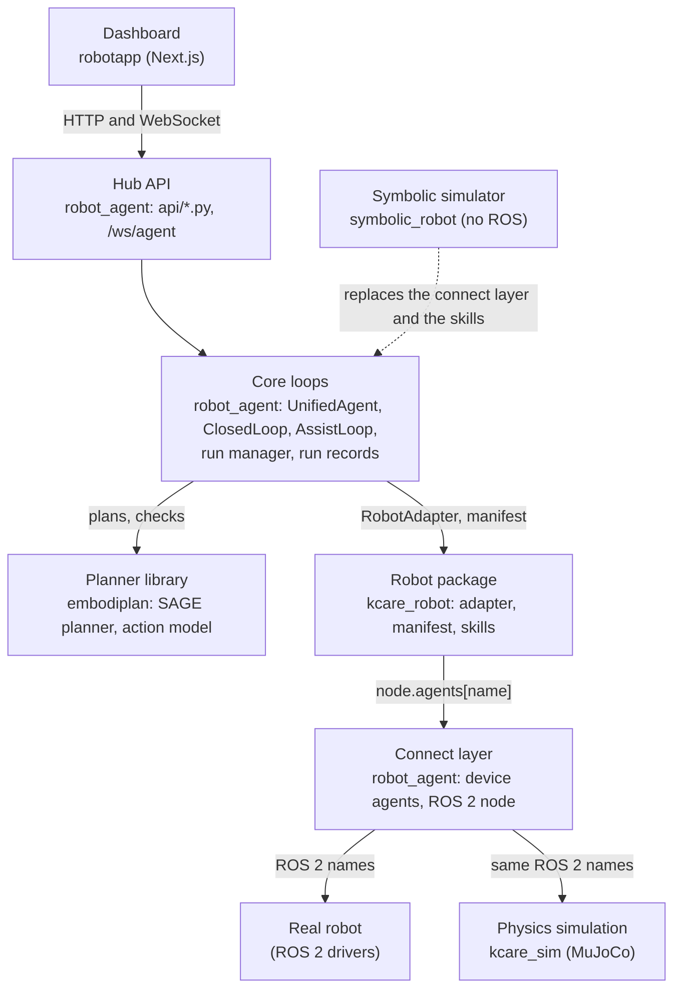
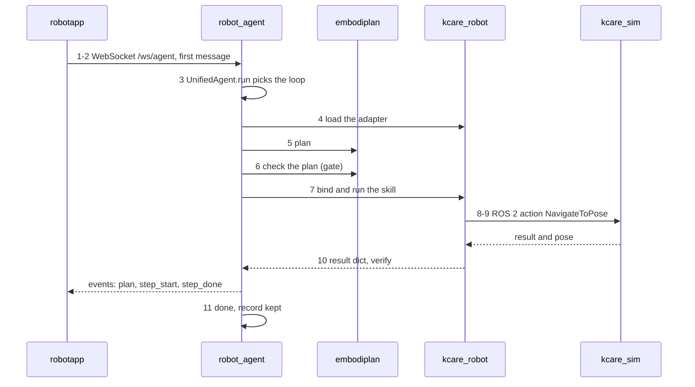

# Architecture

This page shows the whole system on one picture, then follows one typed command from the dashboard to a robot motion and back, one step at a time, with the repo and the line of code for each step. Use it to find which repo to open when something goes wrong.

!!! abstract "In this page"
    - Five layers: the dashboard, the hub API, the hub's core loops, the planner library plus the robot package, and the hardware or a simulator. The hub (`robot_agent`) holds the API and the loops; it knows no robot by name.
    - One command crosses five repos in 11 steps. Each step names the repo, the file and the line, and links to the page that goes deeper.
    - Steps 1 to 7 and 10 to 11 are Python in the hub, the dashboard and the planner library. Steps 8 and 9 reach ROS 2 and need a real robot or a physics simulation. They were read in code, not run.

## The layers

| Layer | Repo | What it does | Deeper |
|---|---|---|---|
| Dashboard | `robotapp` | Sends the command, shows the plan and the steps, stops the run. Calls the hub only through one file, `frontend/lib/api.ts`. | [Dashboard and core](../contracts/dashboard-api.md) |
| Hub API | `robot_agent` | HTTP routes and the WebSocket `/ws/agent`. Starts one [run](glossary.md#run) per robot and streams events. | [Dashboard and core](../contracts/dashboard-api.md), [Runs and records](../concepts/runs-and-records.md) |
| Core loops | `robot_agent` | Understand the command, ask the planner for a plan, check it, run it step by step, verify each step, replan after a failure. | [Closed loop](../concepts/closed-loop.md), [Checks before motion](../concepts/checks-before-motion.md) |
| Planner library | `embodiplan` | The planners and the one set of [action rules](glossary.md#action-model) that the hub's checks also use. | [Planners](../concepts/planners.md), [Planner library contract](../contracts/planner-library.md) |
| Robot package | `kcare_robot` (the example) | The robot as data: the [manifest](glossary.md#manifest), the [adapter](glossary.md#adapter), the [skills](glossary.md#skill) and the per-[site](glossary.md#site) [connections](glossary.md#connections-json). | [Robot as data](../concepts/robot-as-data.md), [Robot package contract](../contracts/robot-package.md) |
| Connect layer | `robot_agent` | One named [device agent](glossary.md#device-agent) per connection. A skill calls `node.agents['<name>']`. | [Robot, hardware and simulators](../contracts/robot-and-simulators.md) |
| Hardware or simulator | the robot, `kcare_sim`, `symbolic_robot` | Answers on the same ROS 2 names (real robot, `kcare_sim`) or replaces the skills with a symbolic world (`symbolic_robot`). | [Robot, hardware and simulators](../contracts/robot-and-simulators.md) |

Two rules from the hub's own notes keep the layers apart. Dependencies in the hub run one way, `contract` <- `model` <- `plan` / `execute` <- `interact` <- `api` ([`CLAUDE.md` rule 2](https://github.com/mtbui2010/robot_agent/blob/3269923/CLAUDE.md#L9), reasons in `docs/rules.md` of the hub repo). And `embodiplan` is imported in only two places in the hub, `core/planning/backends/` and `core/planning/action_model.py` ([rule 3](https://github.com/mtbui2010/robot_agent/blob/3269923/CLAUDE.md#L10)), so the planner library stays replaceable.

!!! code "Where in the code"
    - Hub app factory (mounts the routers): [`app_factory.py`](https://github.com/mtbui2010/robot_agent/blob/3269923/robot_agent/app_factory.py#L73-L89)
    - Robot package entry point: [`kcare_robot/main.py:29`](https://github.com/mtbui2010/kcare_robot/blob/d4f5577b342e/kcare_robot/main.py#L29) calls `create_app(robot_pkg='kcare_robot', ...)`. The hub has no entry point of its own.

## One command from the dashboard to the robot and back

The example: the person types "Bring the apple from the desk to the dining table" in the dashboard. The planner choice is `sage` (an [AssistLoop](glossary.md#assistloop) around the SAGE planner). The robot package is `kcare_robot`, and the robot is the simulated one in `kcare_sim`.

!!! warning "Not run end to end"
    The whole chain was **not run**: it needs ROS 2, a simulator and a language model. Every line number below was checked in the files at the pinned commits. The loop part (steps 5 to 7 and 10) was exercised offline on the hub's fake robot with a scripted language model and a scripted planner; see [Run the whole system](run-the-system.md#a-fully-offline-with-the-hubs-fake-robot). That run replaces the adapter, the skill registry and the planner, so it does not exercise steps 1 to 4, 8 or 9.

1. **Dashboard opens the socket and sends the command.** Repo: `robotapp`.
    - [`frontend/app/page.tsx:328`](https://github.com/mtbui2010/robotapp/blob/f30f0b52d969/frontend/app/page.tsx#L328) calls `api.agentWs()`, which is [`new WebSocket(`${getWsBase()}/ws/agent`)`](https://github.com/mtbui2010/robotapp/blob/f30f0b52d969/frontend/lib/api.ts#L840-L842) in `frontend/lib/api.ts`.
    - On open, [`page.tsx:331-335`](https://github.com/mtbui2010/robotapp/blob/f30f0b52d969/frontend/app/page.tsx#L331-L335) sends one JSON message with `prompt`, `lang`, `direct`, `planner`, `plan_only`, `log_data`, `log_mode` and `log_all`. Here `planner` is `sage`.
    - The address of the hub is the active robot's URL that the user added in the dashboard, `<hub_host>:<port>` in this documentation.
    - Deeper: [Dashboard and core](../contracts/dashboard-api.md).

2. **The hub accepts and starts a run.** Repo: `robot_agent`.
    - [`api/agent.py:431-455`](https://github.com/mtbui2010/robot_agent/blob/3269923/robot_agent/api/agent.py#L431-L455): the WebSocket handler reads the fields of the message (and `options`, `generator`, `user_id`, `role`, which this dashboard does not send).
    - [`agent.py:461`](https://github.com/mtbui2010/robot_agent/blob/3269923/robot_agent/api/agent.py#L461): `_runs().start(...)` starts a [run](glossary.md#run). There is one active run per robot. If one is already running, this client only watches it and its prompt becomes an event into that run ([`:462-464`](https://github.com/mtbui2010/robot_agent/blob/3269923/robot_agent/api/agent.py#L462-L464)).
    - Deeper: [Runs and records](../concepts/runs-and-records.md).

3. **The hub picks the loop.** Repo: `robot_agent`.
    - [`agent.py:483-488`](https://github.com/mtbui2010/robot_agent/blob/3269923/robot_agent/api/agent.py#L483-L488) calls `ua.run(...)`, which is [`UnifiedAgent.run` in `core/unified_agent.py:331`](https://github.com/mtbui2010/robot_agent/blob/3269923/robot_agent/core/unified_agent.py#L331-L335).
    - If `lang` is not `en`, the prompt is translated to English first, unless the AssistLoop's own language layer reads the request (the option `input_pivot` is `translate` or `both`; `_loop_translates`), ([`:356-362`](https://github.com/mtbui2010/robot_agent/blob/3269923/robot_agent/core/unified_agent.py#L356-L362)).
    - The planner key is mapped at [`:368`](https://github.com/mtbui2010/robot_agent/blob/3269923/robot_agent/core/unified_agent.py#L368). The key `sage` selects the [AssistLoop](glossary.md#assistloop) ([`:380-381`](https://github.com/mtbui2010/robot_agent/blob/3269923/robot_agent/core/unified_agent.py#L380-L381)). `grace` or another planner name selects the plain [ClosedLoop](glossary.md#closedloop) ([`:373-379`](https://github.com/mtbui2010/robot_agent/blob/3269923/robot_agent/core/unified_agent.py#L373-L379)). With no planner, no `plan_only` and no `ROBOT_AGENT_CLOSED_LOOP=1`, the older open-loop path runs ([`:393`](https://github.com/mtbui2010/robot_agent/blob/3269923/robot_agent/core/unified_agent.py#L393)).
    - Deeper: [Closed loop](../concepts/closed-loop.md), [Planners](../concepts/planners.md).

4. **The loop loads the robot.** Repos: `robot_agent`, then `kcare_robot`.
    - The loop builds a [RobotView](glossary.md#robotview), the robot as the loops see it: [`loop.py:282`](https://github.com/mtbui2010/robot_agent/blob/3269923/robot_agent/core/planning/loop.py#L282) calls [`RobotView.load` (`robot.py:60`)](https://github.com/mtbui2010/robot_agent/blob/3269923/robot_agent/core/planning/robot.py#L59-L61), which calls [`load_adapter` (`contract/legacy_adapter.py:215`)](https://github.com/mtbui2010/robot_agent/blob/3269923/robot_agent/contract/legacy_adapter.py#L215-L220). The package name comes from `create_app(robot_pkg=...)` above.
    - `load_adapter` imports `<robot_pkg>.configs.adapter` and calls its factory. For `kcare_robot` this is [`make_adapter()` at `configs/adapter.py:224`](https://github.com/mtbui2010/kcare_robot/blob/d4f5577b342e/kcare_robot/configs/adapter.py#L224-L225), whose class reads `configs/manifest.yaml`.
    - Deeper: [Robot as data](../concepts/robot-as-data.md), [Robot package contract](../contracts/robot-package.md).

5. **Reconcile, understand, plan.** Repos: `robot_agent`, then `embodiplan`.
    - [`AssistLoop._run_blocking` (`assist_loop.py:1662`)](https://github.com/mtbui2010/robot_agent/blob/3269923/robot_agent/core/planning/assist_loop.py#L1662-L1696) runs four phases in this order (the public `run_blocking` at `:779` wraps it with the event watchers of the options): [reconcile](glossary.md#reconcile) the [belief](glossary.md#belief) with the sensors ([`:1666`](https://github.com/mtbui2010/robot_agent/blob/3269923/robot_agent/core/planning/assist_loop.py#L1666), `_reconcile` at [`:3480`](https://github.com/mtbui2010/robot_agent/blob/3269923/robot_agent/core/planning/assist_loop.py#L3480)), understand the command and ask a question if it is unclear ([`:1690`](https://github.com/mtbui2010/robot_agent/blob/3269923/robot_agent/core/planning/assist_loop.py#L1690)), plan ([`:1692`](https://github.com/mtbui2010/robot_agent/blob/3269923/robot_agent/core/planning/assist_loop.py#L1692)), then execute ([`:1694`](https://github.com/mtbui2010/robot_agent/blob/3269923/robot_agent/core/planning/assist_loop.py#L1694)).
    - The plan comes from the planner behind the loop. For `sage` the default is the planner key `grace` ([`assist_loop.py:372`](https://github.com/mtbui2010/robot_agent/blob/3269923/robot_agent/core/planning/assist_loop.py#L372)). Its backend, [`GraceBackend` in `backends/pyplanner_grace.py:169`](https://github.com/mtbui2010/robot_agent/blob/3269923/robot_agent/core/planning/backends/pyplanner_grace.py#L169), calls [`embodiplan.get("GRACE")`](https://github.com/mtbui2010/robot_agent/blob/3269923/robot_agent/core/planning/backends/pyplanner_grace.py#L222-L223). In `embodiplan`, `GRACE` is an [alias](https://github.com/mtbui2010/embodiplan/blob/76da520/embodiplan/__init__.py#L79-L80) of `SAGE`, so the class that runs is [`SAGEPlanner`](https://github.com/mtbui2010/embodiplan/blob/76da520/embodiplan/sage.py#L354) and its [`generate_plan`](https://github.com/mtbui2010/embodiplan/blob/76da520/embodiplan/sage.py#L597). The call is made, with one sub-goal per understood goal (`subgoals=`) and the run's LLM-call budget, at [`assist_loop.py:2697`](https://github.com/mtbui2010/robot_agent/blob/3269923/robot_agent/core/planning/assist_loop.py#L2697).
    - Not every goal goes to the planner here. With the option `bt_goal` (on by default; no effect for a robot that declares no behaviour trees) a goal with a tree runs as a tree, and neighbouring goals without one are planned by SAGE later, when the run reaches them ([`plan_goals`](https://github.com/mtbui2010/robot_agent/blob/3269923/robot_agent/core/planning/option_services.py#L94-L108)). Those parts skip the gate of step 6; the effect on the benchmark was not measured. See [Planners](../concepts/planners.md).
    - Deeper: [Dialog and intent](../concepts/dialog-and-intent.md), [Belief and reconcile](../concepts/belief-and-reconcile.md), [Planners](../concepts/planners.md), [Planner library contract](../contracts/planner-library.md).

6. **The gate checks the whole plan before any motion.** Repos: `robot_agent`, then `embodiplan`.
    - [`_generate_and_certify` (`assist_loop.py:2682`)](https://github.com/mtbui2010/robot_agent/blob/3269923/robot_agent/core/planning/assist_loop.py#L2682-L2742) calls [`self._check(...)` at `:2703`](https://github.com/mtbui2010/robot_agent/blob/3269923/robot_agent/core/planning/assist_loop.py#L2703) and sends the event `gate`. [`_check` (`:1300`)](https://github.com/mtbui2010/robot_agent/blob/3269923/robot_agent/core/planning/assist_loop.py#L1300-L1329) walks the plan on a copy of the belief, one step at a time.
    - For each step it asks the shared action rules: [`action_model.check`](https://github.com/mtbui2010/robot_agent/blob/3269923/robot_agent/core/planning/assist_loop.py#L1336) and then [`action_model.apply`](https://github.com/mtbui2010/robot_agent/blob/3269923/robot_agent/core/planning/assist_loop.py#L1319). The hub's [`core/planning/action_model.py`](https://github.com/mtbui2010/robot_agent/blob/3269923/robot_agent/core/planning/action_model.py#L30-L37) only forwards these to [`embodiplan/action_model.py` `check` (`:266`)](https://github.com/mtbui2010/embodiplan/blob/76da520/embodiplan/action_model.py#L266) and [`apply` (`:384`)](https://github.com/mtbui2010/embodiplan/blob/76da520/embodiplan/action_model.py#L384). This is the [certified gate](glossary.md#certified-gate). If a finding blocks the plan, the core first repairs it symbolically with no LLM call (`plan_repair.py`), then asks the planner to repair the block, then for one fresh plan.
    - Deeper: [Checks before motion](../concepts/checks-before-motion.md).

7. **Per step: guard, bind, run.** Repos: `robot_agent`, then `kcare_robot`.
    - [`_run_step` (`assist_loop.py:3551`)](https://github.com/mtbui2010/robot_agent/blob/3269923/robot_agent/core/planning/assist_loop.py#L3551-L3582) calls the [guard](glossary.md#guard) ([`_guard`, `:3515`](https://github.com/mtbui2010/robot_agent/blob/3269923/robot_agent/core/planning/assist_loop.py#L3515)), sends `step_start`, and [binds](glossary.md#bind) the step: [`self._bind` (`:1546`)](https://github.com/mtbui2010/robot_agent/blob/3269923/robot_agent/core/planning/assist_loop.py#L1546-L1549) calls [`RobotView.bind` (`robot.py:99`)](https://github.com/mtbui2010/robot_agent/blob/3269923/robot_agent/core/planning/robot.py#L99-L105) and then the adapter's `bind` ([`legacy_adapter.py:87`](https://github.com/mtbui2010/robot_agent/blob/3269923/robot_agent/contract/legacy_adapter.py#L87)). The result is a skill name and its parameters, for example the step `MoveTo kitchen` becomes `('move', {'inputs': 'kitchen'})` (a `bind` call run offline on `kcare_robot`'s adapter, shown on the [Robot package contract](../contracts/robot-package.md) page).
    - [`run_skill` (`robot.py:318`)](https://github.com/mtbui2010/robot_agent/blob/3269923/robot_agent/core/planning/robot.py#L318-L334) calls [`skill_registry.execute` (`:180`)](https://github.com/mtbui2010/robot_agent/blob/3269923/robot_agent/core/skill_registry.py#L180-L184), which records the call on the run's record and then [imports the skill's module and calls the function](https://github.com/mtbui2010/robot_agent/blob/3269923/robot_agent/core/skill_registry.py#L218-L227): `func(node=node, **params)`.
    - The skill's own precondition check is not in the hub. It lives in each robot's skills; the hub sees only a result with a failure code.
    - Deeper: [Checks before motion](../concepts/checks-before-motion.md), [Skills and failures](../concepts/skills-and-failures.md).

8. **The skill calls a device agent.** Repos: `kcare_robot`, then `robot_agent`.
    - The skill table maps the name `move` to its function: [`configs/skills_config.py:34`](https://github.com/mtbui2010/kcare_robot/blob/d4f5577b342e/kcare_robot/configs/skills_config.py#L34) (`'move': (f'{_PKG}.mobile', 'move')`). At boot the registry reads `skills.json` first and `skills_config.py` only when that file is not there ([`runtime.py:195-202`](https://github.com/mtbui2010/robot_agent/blob/3269923/robot_agent/runtime.py#L195-L202)). At the pinned commit both name the same function, `kcare_robot.skills.mobile:move`.
    - [`skills/mobile.py:86`](https://github.com/mtbui2010/kcare_robot/blob/d4f5577b342e/kcare_robot/skills/mobile.py#L86) `move` looks up the place and drives the base through `moveb` ([`:182`](https://github.com/mtbui2010/kcare_robot/blob/d4f5577b342e/kcare_robot/skills/mobile.py#L182)). [`moveb` (`:41`)](https://github.com/mtbui2010/kcare_robot/blob/d4f5577b342e/kcare_robot/skills/mobile.py#L41) calls `node.agents['mobile_move'].send({'x': ..., 'y': ..., 'qx': ..., 'qw': ..., 'wait': ...})`.
    - That call lands in the hub's connect layer: [`ActionClientAgent.send` (`connect/ros/node.py:316`)](https://github.com/mtbui2010/robot_agent/blob/3269923/robot_agent/connect/ros/node.py#L301-L320). Real robot only: it needs ROS 2.
    - Deeper: [Skills and failures](../concepts/skills-and-failures.md), [Robot, hardware and simulators](../contracts/robot-and-simulators.md).

9. **The wire: a ROS 2 action, and the pose back.** Repos: `kcare_robot` (data), `kcare_sim` or the real robot.
    - Each site's `connections.json` (under `kcare_robot/configs/locations/<site>/`) has an entry `mobile_move` of type `ros_action` with the action name `/navigate_to_pose` and the interface `nav2_msgs/action/NavigateToPose`. Only these three values were read; no hosts.
    - The physics simulation answers on the same name: [`house_bridge.py:722`](https://github.com/mtbui2010/kcare_sim/blob/a288298acede/sim/scripts/house_bridge.py#L722) creates the action server `'/navigate_to_pose'`. It publishes the base pose on [`/robot_pose/mobile_pose`](https://github.com/mtbui2010/kcare_sim/blob/a288298acede/sim/scripts/house_bridge.py#L704-L705) as a `PoseStamped`.
    - The pose is read by the `mobile_pose` skill ([`skills/mobile.py:24-31`](https://github.com/mtbui2010/kcare_robot/blob/d4f5577b342e/kcare_robot/skills/mobile.py#L24-L31)) and by the adapter's `pose()` ([`configs/adapter.py:111`](https://github.com/mtbui2010/kcare_robot/blob/d4f5577b342e/kcare_robot/configs/adapter.py#L111-L115)), which the hub's reconcile uses. Real robot or physics simulation only.
    - Deeper: [Robot, hardware and simulators](../contracts/robot-and-simulators.md).

10. **The result goes back up and is verified.** Repos: `kcare_robot`, `robot_agent`, `robotapp`.
    - The skill returns a dict such as `{'isdone': True, ...}`. [`SkillResult.from_legacy(strict=True)`](https://github.com/mtbui2010/robot_agent/blob/3269923/robot_agent/contract/types.py#L91-L93) turns it into a typed result. `run_skill` makes this call.
    - [`StepVerifier.verify` (`verify.py:144`)](https://github.com/mtbui2010/robot_agent/blob/3269923/robot_agent/core/planning/verify.py#L144-L146) runs the [verify layers](glossary.md#verify-layers); the loop sends `step_verify` and then `step_done` ([`assist_loop.py:3590-3597`](https://github.com/mtbui2010/robot_agent/blob/3269923/robot_agent/core/planning/assist_loop.py#L3590-L3597), [`:3646`](https://github.com/mtbui2010/robot_agent/blob/3269923/robot_agent/core/planning/assist_loop.py#L3646)). A failed step goes to a [replan](glossary.md#replan) or ends the run.
    - Each event is sent through `run.publish` ([`agent.py:489-498`](https://github.com/mtbui2010/robot_agent/blob/3269923/robot_agent/api/agent.py#L489-L498)). The dashboard folds `plan`, `step_start`, `step_done` and `goal_check` into the plan view in [`planView.ts`](https://github.com/mtbui2010/robotapp/blob/f30f0b52d969/frontend/lib/planView.ts#L118) ([`:136`](https://github.com/mtbui2010/robotapp/blob/f30f0b52d969/frontend/lib/planView.ts#L136), [`:163`](https://github.com/mtbui2010/robotapp/blob/f30f0b52d969/frontend/lib/planView.ts#L163), [`:178`](https://github.com/mtbui2010/robotapp/blob/f30f0b52d969/frontend/lib/planView.ts#L178)).
    - Deeper: [Skills and failures](../concepts/skills-and-failures.md), [Checks before motion](../concepts/checks-before-motion.md), [Dashboard and core](../contracts/dashboard-api.md).

11. **The run ends and the record is kept.** Repo: `robot_agent`.
    - After the last step the loop looks at the goals ([`_final_check`, `:1696`](https://github.com/mtbui2010/robot_agent/blob/3269923/robot_agent/core/planning/assist_loop.py#L1696)) and sends `done` with a status ([`_finish`, `:1705-1728`](https://github.com/mtbui2010/robot_agent/blob/3269923/robot_agent/core/planning/assist_loop.py#L1705-L1728)).
    - [`agent.py:517-518`](https://github.com/mtbui2010/robot_agent/blob/3269923/robot_agent/api/agent.py#L517-L518) ends the run with `_runs().finish(...)`. A hook that the run manager calls then closes the [run record](glossary.md#runrecord) ([`observe/record.py:399-401`](https://github.com/mtbui2010/robot_agent/blob/3269923/robot_agent/observe/record.py#L399-L401)), the JSONL file that replay reads.
    - Deeper: [Runs and records](../concepts/runs-and-records.md).

## What needs a robot, ROS 2 or a model

| Part | Needs | Status here |
|---|---|---|
| Dashboard, steps 1 and 10 (browser side) | Node; a hub to talk to | Read in code, not run. |
| Hub server (steps 2, 3, 11) | ROS 2 by default: [`runtime.py:141-152`](https://github.com/mtbui2010/robot_agent/blob/3269923/robot_agent/runtime.py#L141-L152) imports `rclpy` and stops if it is missing, unless `ROBOT_AGENT_ROS=off` (`0`, `false` or `no` also work) is set for a simulated robot package | Read in code, not run. |
| Understand and plan (step 5) | A language model server, set as an `llm` entry in `connections.json` | Scripted model only (fake run). |
| Gate, guard, bind, verify (steps 6, 7, 10) | Python only; the hub's tests run them on a fake robot with no ROS | Exercised on the fake robot. |
| Skill and wire (steps 8, 9) | ROS 2 and the real robot, or `kcare_sim` (MuJoCo, a GPU, ROS 2 in a container) | Not run. Not on a real robot either. |

The symbolic simulators skip steps 8 and 9: `symbolic_robot` replaces the skills and the connect layer with a symbolic world. They need a hub that starts without ROS: set `ROBOT_AGENT_ROS=off` (see the `runtime.py` link above); the default stays on. See [Run the whole system](run-the-system.md#b-the-symbolic-simulator-with-the-hub).

See also [Key ideas](key-ideas.md), [Repo map](repo-map.md) and the [Glossary](glossary.md).
