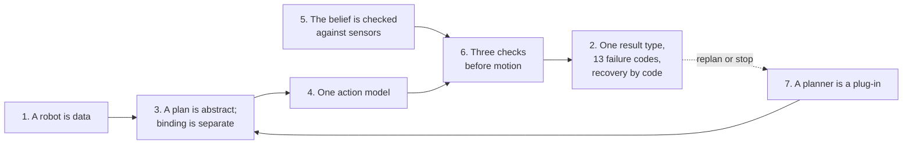

# Key ideas

Seven ideas explain most of the design. Each one below has a one-line statement, why it matters, a place in the code you can open, and the two pages that go deeper: a concept page (the idea) and a contract page (the exact promises between repos).

!!! abstract "In this page"
    - The seven ideas, in the order to read them. Later ideas build on earlier ones.
    - Every idea points at a line range in the hub (`robot_agent`) at the pinned commit. The link resolves once the owner has pushed that commit (see [Repo map and versions](repo-map.md)).
    - Where an idea has an exception in the code, it is stated next to the idea.

## How the ideas fit together

Ideas 1, 3 and 7 say who knows what: the core knows no robot, a planner writes abstract steps, and a robot binds them. Ideas 4, 5 and 6 say how a plan is made safe. Idea 2 says how a failure is reported and handled.

## 1. A robot is data, not code in the core

**The core never names a robot: a robot is a [manifest](glossary.md#manifest) (a data file) plus one [adapter](glossary.md#adapter) object.**

Why it matters: a new robot is a new package, not a change to the core. The same loops can drive a real robot, a physics simulation and a symbolic one.

Evidence: the adapter protocol is [`RobotAdapter` in `contract/adapter.py:23-51`](https://github.com/mtbui2010/robot_agent/blob/ad501cf15ece/robot_agent/contract/adapter.py#L23-L51). The core finds a robot's adapter by a package name through [`load_adapter` (`legacy_adapter.py:215`)](https://github.com/mtbui2010/robot_agent/blob/ad501cf15ece/robot_agent/contract/legacy_adapter.py#L215-L227).

!!! warning "The hub is not completely free of robot data"
    `make lint-core` finds no robot names in `core/`, `interact/` and `contract/`, but one robot's values are stored in the hub file [`skill_configs.py:104-110`](https://github.com/mtbui2010/robot_agent/blob/ad501cf15ece/robot_agent/skill_configs.py#L104-L110) (for example `MOBILE_HEIGHT` and a list of object names). Keep your own robot's values in your manifest. See [Known pitfalls](../reference/known-pitfalls.md).

Go deeper: [A robot as data](../concepts/robot-as-data.md) and [Contract: robot package and core](../contracts/robot-package.md).

## 2. Every skill result has one shape, with a failure code from a fixed list

**Whatever a skill returns becomes one [SkillResult](glossary.md#skillresult). A failure carries one of 13 [failure codes](glossary.md#failurecode), and recovery is a table keyed by that code.**

Why it matters: the decision to retry, ask a person or replan does not depend on how each robot words its errors.

Evidence: the 13 codes are [`FailureCode` in `types.py:15-31`](https://github.com/mtbui2010/robot_agent/blob/ad501cf15ece/robot_agent/contract/types.py#L15-L31). `run_skill` is the one place where a skill's return value is turned into a result ([`robot.py:306-322`](https://github.com/mtbui2010/robot_agent/blob/ad501cf15ece/robot_agent/core/planning/robot.py#L306-L322)). The shared table is `DEFAULT_RECOVERY`, starting at [`recovery.py:66`](https://github.com/mtbui2010/robot_agent/blob/ad501cf15ece/robot_agent/contract/recovery.py#L66-L92).

The hub's `docs/contract.md` lists 12 codes; the code has 13 (`budget_exceeded` is the extra one). This site follows the code.

Go deeper: [Skills, results, failure codes](../concepts/skills-and-failures.md) and [Contract: robot package and core](../contracts/robot-package.md).

## 3. A plan is a list of abstract actions; binding is a separate step

**A planner writes steps such as `Find` and `Pick`. The robot's adapter later [binds](glossary.md#bind) each step to one of its own skills.**

Why it matters: planners stay robot-agnostic. The adapter decides which skill and which parameters a step means on this robot, or says it cannot (`Unbindable`), and the loop turns that into a replan reason.

Evidence: `bind` and `Unbindable` are in [`adapter.py:18-51`](https://github.com/mtbui2010/robot_agent/blob/ad501cf15ece/robot_agent/contract/adapter.py#L18-L51). The docstring of `bind` shows the shape: an abstract step `{'action': 'Pick', 'object': 'Cup'}` becomes `(skill_name, params)`.

Go deeper: [A robot as data](../concepts/robot-as-data.md) (the adapter) and [Planners and loops](../concepts/planners.md); contract: [Robot package and core](../contracts/robot-package.md).

## 4. One action model decides what a step needs and does

**The plan [gate](glossary.md#certified-gate), the per-step [guard](glossary.md#guard) and the symbolic check after a step all ask the same [action model](glossary.md#action-model).**

Why it matters: the checker and the executor cannot disagree about the rules, for example that a `Pick` needs a `Find` of the same object before it.

Evidence: the module header of [`core/planning/action_model.py:1-8`](https://github.com/mtbui2010/robot_agent/blob/ad501cf15ece/robot_agent/core/planning/action_model.py#L1-L8) names these users and says it is the one planning module that imports the rules from `embodiplan`. A run on the hub's `simulate` rejected `[MoveTo kitchen, Pick cup]` with `no_find_before_pick` (output on the concept page).

Go deeper: [Checks before motion](../concepts/checks-before-motion.md) and [Contract: planner library and core](../contracts/planner-library.md).

## 5. The robot's world is a belief, re-checked against sensors

**The robot keeps a written picture of the world, the [belief](glossary.md#belief). [Reconcile](glossary.md#reconcile) corrects it from sensors, and each field has a [provenance](glossary.md#provenance) label.**

Why it matters: a plan made on a stale belief (a person moved the robot, an object slipped) would fail in motion. Reconcile and the guard fix what a sensor can prove before the robot moves.

Evidence: the belief is [`WorldState` (`base.py:49`)](https://github.com/mtbui2010/robot_agent/blob/ad501cf15ece/robot_agent/core/planning/base.py#L49-L243), "updated only from skills that actually succeeded" by its docstring. Sensor reading is in [`reconcile.py:120-177`](https://github.com/mtbui2010/robot_agent/blob/ad501cf15ece/robot_agent/core/planning/reconcile.py#L120-L177), where `arrived` is set from a fresh pose and marked as `SENSOR`. Fields no sensor can read stay beliefs.

Go deeper: [The belief and reconcile](../concepts/belief-and-reconcile.md) and [Contract: robot package and core](../contracts/robot-package.md) (the adapter's `reconcile`).

## 6. Three checks stand between a plan and motion

**The whole-plan gate, the per-step guard and the skill's own check. Success is declared only after the goals are seen to hold.**

Why it matters: an uncertified plan does not move the robot, and a reported success is not trusted without a second look. The gate and the guard are in the hub. The skill's own check is not: it lives in each robot's skills, and the hub sees only a failed result with a failure code.

Evidence: the gate is [`AssistLoop._check` (`assist_loop.py:654`)](https://github.com/mtbui2010/robot_agent/blob/ad501cf15ece/robot_agent/core/planning/assist_loop.py#L654-L677) and `_generate_and_certify` ([`:1269-1314`](https://github.com/mtbui2010/robot_agent/blob/ad501cf15ece/robot_agent/core/planning/assist_loop.py#L1269-L1314)). The guard is [`_guard` (`:1801-1833`)](https://github.com/mtbui2010/robot_agent/blob/ad501cf15ece/robot_agent/core/planning/assist_loop.py#L1801-L1833). Step results are checked in layers by [`StepVerifier.verify` (`verify.py:137-192`)](https://github.com/mtbui2010/robot_agent/blob/ad501cf15ece/robot_agent/core/planning/verify.py#L137-L192).

These checks belong to the AssistLoop (planner key `sage`). The plain ClosedLoop (`grace`) has a much smaller version.

Go deeper: [Checks before motion](../concepts/checks-before-motion.md) and [The closed loop](../concepts/closed-loop.md); contract: [Robot package and core](../contracts/robot-package.md) (what a skill promises).

## 7. A planner is a plug-in with two methods

**A planner has `generate_plan` and `replan`. The core adds understanding, gating, recovery, recording and [replay](glossary.md#replay) around any planner.**

Why it matters: a researcher can swap or add a planner by name without editing `robot_agent`, and measure it under the same checks as the others.

Evidence: the protocol is [`Planner` in `base.py:247`](https://github.com/mtbui2010/robot_agent/blob/ad501cf15ece/robot_agent/core/planning/base.py#L247-L270). A name becomes a planner in [`resolve_planner` (`registry.py:72`)](https://github.com/mtbui2010/robot_agent/blob/ad501cf15ece/robot_agent/core/planning/registry.py#L72-L80); a name of the form `package.module:Class` is accepted. `sage` is not a planner name: it picks the AssistLoop, and `resolve_planner('sage')` raises `ValueError`.

Go deeper: [Planners and loops](../concepts/planners.md) and [Contract: planner library and core](../contracts/planner-library.md). To write one, see [Add a planner](../guides/add-a-planner.md).

!!! note "Not an idea of its own, but worth knowing"
    The system allows one active run per robot, and what a person says during a run is routed into that run. See [Runs and records](../concepts/runs-and-records.md) and [Dialog and intent](../concepts/dialog-and-intent.md).

Next: [Architecture](architecture.md). Terms are in the [Glossary](glossary.md).
