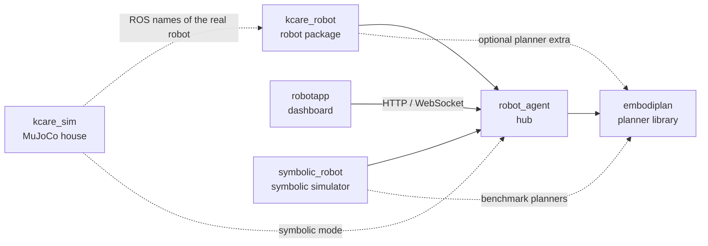

# Repo map and versions

!!! abstract "In this page"
    - The six repos, what each is for, what it depends on, and the commit this site was checked against.
    - The version pins between repos, with the file and line that declares each.
    - `robot_agent` is the hub. Robot packages, the dashboard and the simulators connect to it.

!!! note "Some commits are not on GitHub yet"
    Four repos (`robot_agent`, `kcare_robot`, `robotapp`, `kcare_sim`) have commits that exist only on the owner's machine so far. Code links to these four resolve after the owner pushes. For `kcare_sim`, 41 commits are not on its remote branch, and the checked commit `a288298acede` is the newest of them. The commit ids below are the ones the links use; they do not change.

| Repo | Role | Depends on | Language | Docs | Checked against |
|---|---|---|---|---|---|
| robot_agent | The hub: the robot contract, the planning loops, the run manager, records and the connect layer. Serves the HTTP and WebSocket API. | embodiplan | Python | This site; contributor notes in its `docs/` | `ad501cf15ece` |
| embodiplan | Planner library: the SAGE planner, baselines and the action model. | none of the other repos | Python | [site](https://mtbui2010.github.io/embodiplan/) | `a69064255c69` |
| kcare_robot | The robot package for one mobile manipulator: skills, manifest and site configs. Runs on the real robot. | robot_agent, visionserve (a local sibling), embodiplan (optional extra `planner`) | Python | [repo page](../repos/kcare-robot.md); `docs/` in the repo | `d4f5577b342e` |
| robotapp | Web dashboard for any `robot_agent` backend. | the HTTP and WebSocket API of robot_agent only | TypeScript (Next.js) | [site](https://mtbui2010.github.io/robotapp/) | `f30f0b52d969` |
| kcare_sim | Physics (MuJoCo) house that uses the robot's ROS names; VLA drawer-opening training and tests. Its `symbolic/` folder is the older symbolic simulator. It also has an Isaac Lab mode that its README calls unverified. | kcare_robot (ROS names), robot_agent (symbolic mode only) | Python | [site](https://mtbui2010.github.io/kcare_sim/) | `a288298acede` |
| symbolic_robot | The official symbolic simulator and planner benchmark: home and factory domains. | robot_agent (server and domain packs, in-process benchmark), embodiplan (benchmark planners) | Python | [repo page](../repos/symbolic-robot.md); `docs/` in the repo | `f55ace24c3b4` |

The `embodiplan` docs commit `8293351291c7` is newer than the code commit above; the code is the same at both.

An arrow points from the repo that depends on another to the one it depends on. Dotted arrows are optional or partial.

## Version compatibility

| Consumer | Needs | Declared in |
|---|---|---|
| robot_agent | `embodiplan>=0.2.1,<0.3`, as a core dependency | [`pyproject.toml:24`](https://github.com/mtbui2010/robot_agent/blob/ad501cf15ece/pyproject.toml#L24) |
| robot_agent | the same pin again in the optional extra `grace` | [`pyproject.toml:59`](https://github.com/mtbui2010/robot_agent/blob/ad501cf15ece/pyproject.toml#L59) |
| robot_agent | `numpy==1.26.4`, because ROS 2 extensions are built for numpy 1.x | [`pyproject.toml:19`](https://github.com/mtbui2010/robot_agent/blob/ad501cf15ece/pyproject.toml#L19) |
| kcare_robot | `robot_agent` and `visionserve` with no version; `numpy==1.26.4`; `opencv-python<5` | [`pyproject.toml:22-28`](https://github.com/mtbui2010/kcare_robot/blob/d4f5577b342e/pyproject.toml#L22-L28) |
| kcare_robot | extra `planner`: `embodiplan>=0.2.1,<0.3` | [`pyproject.toml:35`](https://github.com/mtbui2010/kcare_robot/blob/d4f5577b342e/pyproject.toml#L35) |
| kcare_robot | `make install` checks the same range (`EMBODIPLAN_MIN 0.2.1`, `EMBODIPLAN_MAX 0.3`) | [`Makefile:22-23`](https://github.com/mtbui2010/kcare_robot/blob/d4f5577b342e/Makefile#L22-L23) |
| embodiplan | provides version `0.2.5` | [`pyproject.toml:7`](https://github.com/mtbui2010/embodiplan/blob/a69064255c69/pyproject.toml#L7) |
| embodiplan | `ACTION_MODEL_VERSION = "1.0"` | [`embodiplan/action_model.py:29`](https://github.com/mtbui2010/embodiplan/blob/a69064255c69/embodiplan/action_model.py#L29) |
| robotapp | an OpenAPI snapshot of the `robot_agent` API, regenerated by a script | [`scripts/gen_types.sh`](https://github.com/mtbui2010/robotapp/blob/f30f0b52d969/scripts/gen_types.sh) |
| robotapp | the `/ws/agent` events: no version pin; `EVENT_SCHEMA_VERSION = '1.0.0'` exists in `robot_agent` | [`api/events.py:26`](https://github.com/mtbui2010/robot_agent/blob/ad501cf15ece/robot_agent/api/events.py#L26) |
| kcare_sim (`symbolic/`), symbolic_robot | a `robot_agent` that reads the switch `ROBOT_AGENT_ROS=off`; no version | [`symbolic/serve.py:56`](https://github.com/mtbui2010/kcare_sim/blob/a288298acede/symbolic/serve.py#L56), [`server.py:74`](https://github.com/mtbui2010/symbolic_robot/blob/f55ace24c3b4/symbolic_robot/server.py#L74) |

What was verified in the files at these commits:

- `embodiplan` is declared twice in `robot_agent`: as a core dependency (line 24) and again in the `grace` extra (line 59). Both use the same range. The core entry means a plain `pip install -e .` already needs `embodiplan`, which is not on PyPI; install it first with `pip install -e ../embodiplan`.
- A test, `test_embodiplan_pin` in [`tests/test_action_model_agreement.py`](https://github.com/mtbui2010/robot_agent/blob/ad501cf15ece/tests/test_action_model_agreement.py#L285-L287), checks that `pyproject.toml` holds the pin and that both repos report the same `ACTION_MODEL_VERSION`. It was read, not run.
- `robot_agent` has `version = "0.1.0"`, and its [`CHANGELOG.md`](https://github.com/mtbui2010/robot_agent/blob/ad501cf15ece/CHANGELOG.md#L1-L4) promises SemVer for the contract, the manifest format and the event schema, but lists only "Unreleased". No contract version has been released yet.
- No switch named `ROBOT_AGENT_ROS` exists in `robot_agent` at `main`. It is on no branch of the `robot_agent` repository that is known locally either. The two simulator repos above set it, so they need a hub that has it; the one place it was found is the gitignored synced copy of the hub inside kcare_sim (`sim/kcare_code/robot_agent/`, see [kcare_sim](../repos/kcare-sim.md)). That is not `main` and it was not run. See [known pitfalls](../reference/known-pitfalls.md).
- No test or check was found for the `numpy` pin.

See also [Architecture](architecture.md) and [Glossary](glossary.md).
